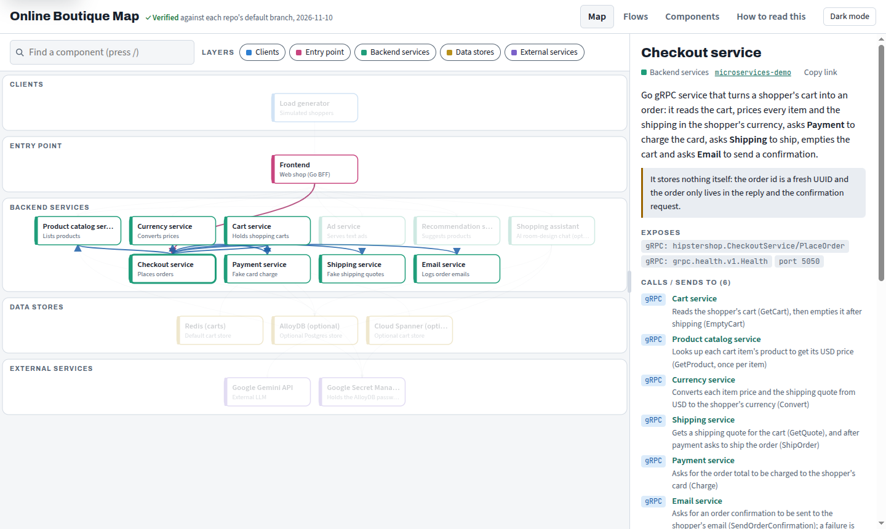
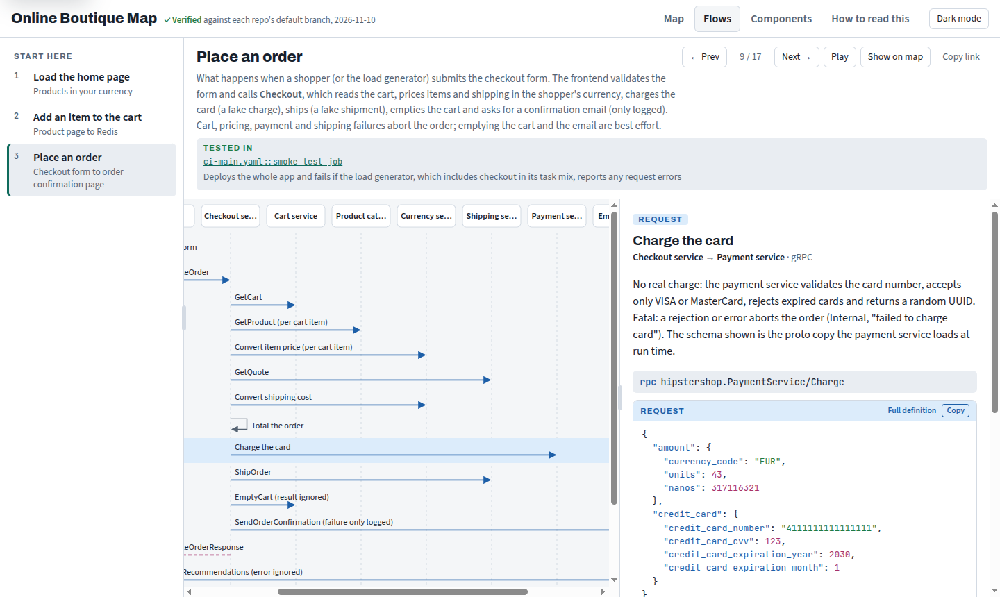

# evidence-architecture-map
[](https://github.com/majdukovic/evidence-architecture-map/actions/workflows/ci.yml)

Architecture maps that newcomers can trust. **Every component, connection, flow step and fact on the map links to
the line of code that proves it**, and a script re-checks every link against your repos.

You point a coding agent (Claude Code, or any agent that can run shell commands) at your repositories. It
discovers the components and how they talk, drafts claims with evidence, checks them with **Chain of
Verification** (independent agents that never saw the draft answer neutral questions from the code), has another
agent try to disprove what is left, and builds:

- **`architecture.html`**: one self-contained interactive page with a layered map, step-by-step flows with real
  request and response shapes, a searchable component list, and shareable links to every component and step.
- **`ARCHITECTURE.md`**: the same content with Mermaid diagrams, readable on GitHub, GitLab, Bitbucket and Azure DevOps.

Anything the code cannot confirm is left out and recorded in `review/dropped.md`. It works for any language and any
git host, including monorepos.

Examples, each with its verification results:

| Example | Stack | Map | Spot-check of 30 claims after the build |
|---|---|---|---|
| [`online-boutique`](examples/online-boutique) | Go, C#, Node, Python, Java; gRPC | 17 components, 25 connections, 3 flows, 411 references | (built step by step, reviewed twice) |
| [`eshop`](examples/eshop) | .NET; RabbitMQ events, gRPC, PostgreSQL, Redis | 16 components, 31 connections, 3 flows, 263 references | 26 correct, 4 minor, 0 wrong |
| [`petclinic`](examples/petclinic) | Java Spring Cloud; gateway, Eureka, config server; **two repos** | 17 components, 35 connections, 7 flows, 470 references | 28 correct, 2 minor, 0 wrong |
| [`bootzooka`](examples/bootzooka) | **Scala** 3 modular monolith; React UI, PostgreSQL, e-mail | 17 components, 31 connections, 4 flows, 252 references | 28 correct, 2 minor, 0 wrong |

The eShop, PetClinic and Bootzooka maps were built by unattended runs of the plugin with no human steering, and the
eShop, PetClinic and Bootzooka maps were then extended by unattended runs of the update skill, adding what the
spot-checks said a newcomer would still want. Minor items found by the
spot-checks were fixed afterwards.




## Why

Architecture docs drift, and AI-written docs repeat whatever the wiki, the README or an old chat said. This kit
treats those as **hints for where to look**, never as evidence. Accuracy beats coverage: a smaller map that is
right is worth more than a complete one that is half wrong.

## Install

**Claude Code plugin**

```
/plugin marketplace add majdukovic/evidence-architecture-map
/plugin install evidence-architecture-map@evidence-architecture-map
```

Then ask, for example: *"Build an architecture map of the repos in ~/code/acme for new backend engineers"*, or run
`/evidence-architecture-map:build-architecture-map`. To change an existing map, ask to update it, or run
`/evidence-architecture-map:update-architecture-map`.

**Claude Code without the plugin system:** copy `plugin/skills/build-architecture-map` and `plugin/skills/update-architecture-map`
into your project's `.claude/skills/` (or `~/.claude/skills/`).

**Any other agent:** clone this repo and use a prompt from [`prompts/`](prompts):
[`build-map.md`](prompts/build-map.md), [`update-map.md`](prompts/update-map.md), or
[`standalone.md`](prompts/standalone.md) when you cannot run the kit's scripts at all (Markdown output only).

**Requirements:** git and Node.js 18 or newer. No npm packages. Optional: Playwright, for the UI audit.

**Layout:** the plugin itself is the [`plugin/`](plugin) folder (manifest, skills, scripts). Everything else in this
repo (examples, prompts, CI recipes, tests) is documentation and is not installed with the plugin.

**Unattended runs** (`claude -p`, CI): give the scope answers in the prompt (see [`prompts/build-map.md`](prompts/build-map.md)),
load the plugin with `--plugin-dir`, and allow the tools the skill needs, for example
`--allowedTools "Skill" "Agent" "Read" "Write" "Edit" "Glob" "Grep" "Bash(git:*)" "Bash(node:*)"`. Set
`CLAUDE_CODE_PRINT_BG_WAIT_CEILING_MS=0` so a slow verification agent is never stopped before the session ends.

## How it works

| Phase | What happens | Where it is defined |
|---|---|---|
| 0. Scope | The agent asks which repos, for whom, which flows matter, and which other sources it may read | `SKILL.md` |
| 1. Discover | Reads each repo's default branch through git (never your working tree); collects hints | [`where-to-look.md`](plugin/skills/build-architecture-map/references/where-to-look.md), [`context-sources.md`](plugin/skills/build-architecture-map/references/context-sources.md) |
| 2. Draft | Research agents write components, connections, flows and facts, each with evidence | [`research-brief.md`](plugin/skills/build-architecture-map/references/research-brief.md), [`evidence-rules.md`](plugin/skills/build-architecture-map/references/evidence-rules.md) |
| 3. Verify | Neutral questions answered by agents that have not seen the draft; then an adversarial review | [`cove-brief.md`](plugin/skills/build-architecture-map/references/cove-brief.md), [`review-brief.md`](plugin/skills/build-architecture-map/references/review-brief.md) |
| 4. Build and check | `build.js` validates the data and builds the page; `verify.js` checks every quote is still on its line | [`scripts/`](plugin/skills/build-architecture-map/scripts) |
| 5. Keep it true | Re-run the check in CI; the update skill handles changes | [`examples/ci/`](examples/ci) |

Evidence is `repo:path:line` plus an exact quote from that line:

```json
{ "ref": "orders-service:src/main/scala/acme/orders/PaymentsClient.scala:31", "quote": "uri\"$paymentsUrl/charges\"" }
```

Links open the code at the commit that was checked (recorded in `pins.json`), so they keep working after the code
moves on. The verifier reads the **current** default branch, so it fails when the code changes under the map.

## Use with your tools

The skill asks before reading anything outside the repos, and uses whatever access you already have (MCP
servers, CLIs such as `gh`, `glab`, `az` or a Jira CLI, or exported pages):

- **Jira, Confluence, Linear, Notion, issues:** candidate components and flows; pages can be added as related links.
- **Grafana, Datadog, Prometheus:** service maps are good leads for connections; dashboards become related links.
  Dashboards and alert rules kept in git count as evidence.
- **Slack, Teams:** only channels you point to, as hints. Never quoted on the map.
- **`CLAUDE.md`, `AGENTS.md`, agent memory and earlier sessions:** good hints for where to look, checked against
  today's code before use.

Related links on the page are labelled as not evidence and are never checked.

## The scripts

```bash
K=plugin/skills/build-architecture-map/scripts
node $K/init.js docs/architecture-map --title "Acme Platform Map" --repos ~/code/acme   # new map folder
node $K/show.js ~/code/acme/orders src/Main.scala 30 60 # a file from the default branch, numbered, for exact quotes
node $K/merge.js docs/architecture-map draft-*.json     # combine research agents' drafts, report conflicts
node $K/build.js docs/architecture-map --pin --verify   # pin commits, build, check every quote is on its exact line
node $K/build.js docs/architecture-map --verify         # rebuild after edits
node $K/verify.js docs/architecture-map [--at pinned] [--exact] [--json]
bash $K/verify-ci.sh docs/architecture-map              # clone the cited repos shallowly and check (CI)
node $K/run-ui-audit.mjs docs/architecture-map          # click through every component and step (needs Playwright)
node test/run-tests.js                                  # the kit's own tests
```

The build refuses: components, connections, steps or facts without evidence; unknown ids; malformed references;
quotes that look like credentials; references to files that hold keys or credentials (`*.pem`, `*.key`, keystores,
`credentials`, `secrets.yaml`, `.netrc`); and HTML that could run script. The verifier also fails a reference when the
cited line or the quoted line sits within two lines of a literal credential, so the page never links to one; type
declarations, `${ENV}` placeholders and field names such as `password: String` do not count. Right after `--pin`, every
quote must be on its exact line; later, a quote that moved up to two lines is reported as a note.

The data format is described in [`data-format.md`](plugin/skills/build-architecture-map/references/data-format.md).
Components and connections that exist only in some setups (a profile, a flag, an optional add-on) carry a
`condition` and are drawn dashed.

## What the plugin runs and sends

- **Runs locally:** `git` (read-only commands on the repos you point it at, such as `git show`, `git grep`, `git ls-tree`;
  never `checkout`, `pull` or `push`) and `node` for the bundled scripts. No hooks, no MCP servers, no package installs.
- **Writes:** only the map folder you choose (JSON, `architecture.html`, `ARCHITECTURE.md`, `review/`).
- **Network:** the scripts make no network calls, except `verify-ci.sh`, which clones the repos listed in `pins.json`
  from your own git host. The generated `architecture.html` is self-contained and loads nothing from the internet.
  `run-ui-audit.mjs` uses Playwright, which you install yourself.
- **Other sources:** the skill reads docs, tickets, dashboards, chat or agent history only when you allow it, through
  tools you already have, and never copies their content onto the map.
- **Personal data:** none is collected or sent anywhere. Evidence quotes are short excerpts of your code, and the build
  and verifier refuse anything that looks like a credential.

## Limitations

- The verifier proves a quote is still on the cited line. Whether the line **means** what the claim says is
  checked by the independent agents and the reviewer, not by a script. Expect them to reduce errors, not to
  remove every one. Read the map critically and report what is wrong.
- Wiring that only exists at runtime (service mesh rules applied by hand, feature flags in a SaaS console) cannot
  be proven from code and is left out unless it is in git.
- Behaviour that lives inside a library (a gateway's default timeout, how an admin server discovers services) is
  left out unless you add the library's source as a repo, because the project's own code cannot prove it.
- A full run uses many agent calls: the example runs cost about USD 4 to 11 each. Start with the flows that matter most.
- An unattended run can only do the UI audit if Playwright is available to it; otherwise run
  `run-ui-audit.mjs` afterwards.

## Licence

MIT, see [LICENSE](LICENSE). The examples quote short excerpts from, and link at fixed commits to,
[GoogleCloudPlatform/microservices-demo](https://github.com/GoogleCloudPlatform/microservices-demo) (Apache 2.0),
[dotnet/eShop](https://github.com/dotnet/eShop) (MIT),
[spring-petclinic-microservices](https://github.com/spring-petclinic/spring-petclinic-microservices) and its
[config repo](https://github.com/spring-petclinic/spring-petclinic-microservices-config) (Apache 2.0), and
[softwaremill/bootzooka](https://github.com/softwaremill/bootzooka) (Apache 2.0).
