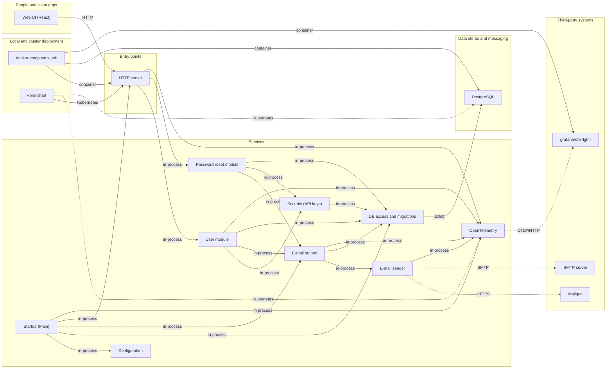
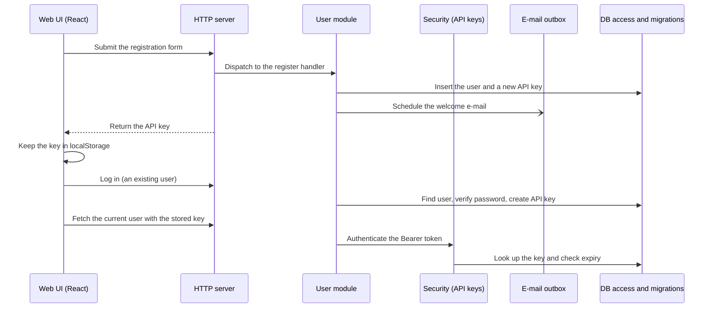
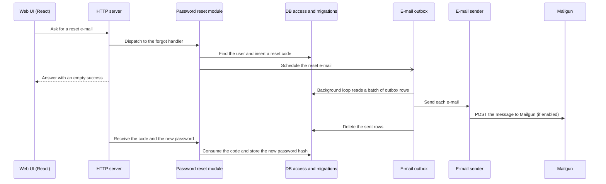
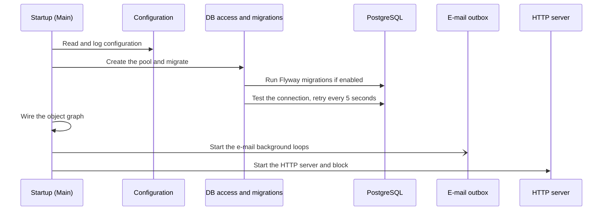
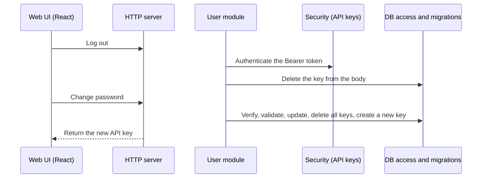

# Bootzooka Map

> Generated by [evidence-architecture-map](https://github.com/majdukovic/evidence-architecture-map) from the JSON files next to this one. Do not edit by hand.
> Every statement links to the line of code that supports it, at the commit checked on 2026-11-10.
> The interactive version is `architecture.html`.

## Overview



## Components

### People and client apps

#### Web UI (React)

Single-page React app in `ui/`. It calls the backend JSON API through a client generated from the OpenAPI description and keeps the API key in the browser's local storage.

- **Repo:** [bootzooka](https://github.com/softwaremill/bootzooka/tree/8d93dde94418ac4771be095ef74376561f7de444)
- **Exposes:** `/`, `/login`, `/register`, `/recover-lost-password`, `/main`, `/profile`, `/* (not found page)`
- **Stores data in:** localStorage: apiKey
- **Calls / sends to:** HTTP server (HTTP)
- **Evidence:**
  - [bootzooka › App.tsx:26](https://github.com/softwaremill/bootzooka/blob/8d93dde94418ac4771be095ef74376561f7de444/ui/src/App.tsx#L26) `<Route path="/login" element={<Login />} />`
  - [bootzooka › apiFetcher.ts:79](https://github.com/softwaremill/bootzooka/blob/8d93dde94418ac4771be095ef74376561f7de444/ui/src/api/apiFetcher.ts#L79) `window.fetch(`
  - [bootzooka › App.tsx:23](https://github.com/softwaremill/bootzooka/blob/8d93dde94418ac4771be095ef74376561f7de444/ui/src/App.tsx#L23) `<Route path="/" element={<Welcome />} />`
  - [bootzooka › App.tsx:35](https://github.com/softwaremill/bootzooka/blob/8d93dde94418ac4771be095ef74376561f7de444/ui/src/App.tsx#L35) `<Route path="/main" element={<SecretMain />} />`

### Entry points

#### HTTP server

Netty server that exposes the Tapir endpoints under `/api/v1`, Swagger UI under `/api/v1/docs`, and everything else as static frontend files from the classpath `webapp` folder (falling back to `index.html`).

- **Repo:** [bootzooka](https://github.com/softwaremill/bootzooka/tree/8d93dde94418ac4771be095ef74376561f7de444)
- **Exposes:** `/api/v1/*`, `/api/v1/docs`, `/ (static webapp)`, `GET /api/v1/admin/version`
- **Calls / sends to:** User module (in-process), Password reset module (in-process), OpenTelemetry (in-process)
- **Called by / receives from:** Web UI (React) (HTTP), Startup (Main) (in-process), docker-compose stack (container), Helm chart (Kubernetes)
- **Evidence:**
  - [bootzooka › HttpApi.scala:77](https://github.com/softwaremill/bootzooka/blob/8d93dde94418ac4771be095ef74376561f7de444/backend/src/main/scala/com/softwaremill/bootzooka/http/HttpApi.scala#L77) `NettySyncServer(serverOptions`
  - [bootzooka › HttpApi.scala:40](https://github.com/softwaremill/bootzooka/blob/8d93dde94418ac4771be095ef74376561f7de444/backend/src/main/scala/com/softwaremill/bootzooka/http/HttpApi.scala#L40) `List("api", "v1")`
  - [bootzooka › HttpApi.scala:70](https://github.com/softwaremill/bootzooka/blob/8d93dde94418ac4771be095ef74376561f7de444/backend/src/main/scala/com/softwaremill/bootzooka/http/HttpApi.scala#L70) `FilesOptions.default[Identity].defaultFile(List("index.html"))`
  - [bootzooka › VersionApi.scala:28](https://github.com/softwaremill/bootzooka/blob/8d93dde94418ac4771be095ef74376561f7de444/backend/src/main/scala/com/softwaremill/bootzooka/admin/VersionApi.scala#L28) `.in(AdminPath / "version")`

### Services

#### User module

Endpoints and logic for registering, logging in, logging out, reading and changing the user profile and password. Login and registration both end by creating an API key.

- **Repo:** [bootzooka](https://github.com/softwaremill/bootzooka/tree/8d93dde94418ac4771be095ef74376561f7de444)
- **Exposes:** `POST /user/register`, `POST /user/login`, `POST /user/logout`, `GET /user`, `POST /user`, `POST /user/changepassword`
- **Stores data in:** PostgreSQL: users
- **Calls / sends to:** Security (API keys) (in-process), E-mail outbox (in-process), DB access and migrations (in-process), OpenTelemetry (in-process)
- **Called by / receives from:** HTTP server (in-process)
- **Evidence:**
  - [bootzooka › UserApi.scala:63](https://github.com/softwaremill/bootzooka/blob/8d93dde94418ac4771be095ef74376561f7de444/backend/src/main/scala/com/softwaremill/bootzooka/user/UserApi.scala#L63) `val registerUserEndpoint = baseEndpoint.post`
  - [bootzooka › UserApi.scala:69](https://github.com/softwaremill/bootzooka/blob/8d93dde94418ac4771be095ef74376561f7de444/backend/src/main/scala/com/softwaremill/bootzooka/user/UserApi.scala#L69) `val loginEndpoint = baseEndpoint.post`
  - [bootzooka › UserModel.scala:45](https://github.com/softwaremill/bootzooka/blob/8d93dde94418ac4771be095ef74376561f7de444/backend/src/main/scala/com/softwaremill/bootzooka/user/UserModel.scala#L45) `@Table(PostgresDbType, SqlNameMapper.CamelToSnakeCase)`

#### Security (API keys)

Authenticates a request by looking its token up in the database and checking its expiry. The same `Auth` class serves API keys (multi-use, kept) and password reset codes (one-time, deleted when used).

> **Logout** deletes the API key sent in the request *body* (`Logout_IN.apiKey`), not necessarily the key that authenticated the call. **Change password** validates the new password and deletes all of the user's API keys, then issues a new one; **password reset** does neither (see the API key flow).

- **Repo:** [bootzooka](https://github.com/softwaremill/bootzooka/tree/8d93dde94418ac4771be095ef74376561f7de444)
- **Stores data in:** PostgreSQL: api_keys
- **Calls / sends to:** DB access and migrations (in-process)
- **Called by / receives from:** User module (in-process), Password reset module (in-process)
- **Evidence:**
  - [bootzooka › Auth.scala:24](https://github.com/softwaremill/bootzooka/blob/8d93dde94418ac4771be095ef74376561f7de444/backend/src/main/scala/com/softwaremill/bootzooka/security/Auth.scala#L24) `def apply(id: Id[T]): Either[Fail.Unauthorized, Id[User]]`
  - [bootzooka › ApiKeyModel.scala:31](https://github.com/softwaremill/bootzooka/blob/8d93dde94418ac4771be095ef74376561f7de444/backend/src/main/scala/com/softwaremill/bootzooka/security/ApiKeyModel.scala#L31) `override def deleteWhenValid: Boolean = false`
  - [bootzooka › UserApi.scala:38](https://github.com/softwaremill/bootzooka/blob/8d93dde94418ac4771be095ef74376561f7de444/backend/src/main/scala/com/softwaremill/bootzooka/user/UserApi.scala#L38) `userService.logout(data.apiKey.asId[ApiKey])`
  - [bootzooka › UserService.scala:130](https://github.com/softwaremill/bootzooka/blob/8d93dde94418ac4771be095ef74376561f7de444/backend/src/main/scala/com/softwaremill/bootzooka/user/UserService.scala#L130) `apiKeyService.invalidateAllForUser(user.id)`
  - [bootzooka › UserService.scala:135](https://github.com/softwaremill/bootzooka/blob/8d93dde94418ac4771be095ef74376561f7de444/backend/src/main/scala/com/softwaremill/bootzooka/user/UserService.scala#L135) `validateNewPassword().ok()`

#### Password reset module

Creates a one-time reset code for a user and schedules an e-mail carrying a link with it; a second endpoint exchanges a valid code and a new password for a password change.

> Resetting a password only writes the new hash: the new password is not validated (unlike registration and change-password) and the user's existing API keys stay valid (change-password deletes them all).

- **Repo:** [bootzooka](https://github.com/softwaremill/bootzooka/tree/8d93dde94418ac4771be095ef74376561f7de444)
- **Exposes:** `POST /passwordreset/forgot`, `POST /passwordreset/reset`
- **Stores data in:** PostgreSQL: password_reset_codes
- **Calls / sends to:** E-mail outbox (in-process), Security (API keys) (in-process), DB access and migrations (in-process)
- **Called by / receives from:** HTTP server (in-process)
- **Evidence:**
  - [bootzooka › PasswordResetApi.scala:34](https://github.com/softwaremill/bootzooka/blob/8d93dde94418ac4771be095ef74376561f7de444/backend/src/main/scala/com/softwaremill/bootzooka/passwordreset/PasswordResetApi.scala#L34) `val forgotPasswordEndpoint = baseEndpoint.post`
  - [bootzooka › PasswordResetApi.scala:29](https://github.com/softwaremill/bootzooka/blob/8d93dde94418ac4771be095ef74376561f7de444/backend/src/main/scala/com/softwaremill/bootzooka/passwordreset/PasswordResetApi.scala#L29) `val passwordResetEndpoint = baseEndpoint.post`
  - [bootzooka › PasswordResetService.scala:52](https://github.com/softwaremill/bootzooka/blob/8d93dde94418ac4771be095ef74376561f7de444/backend/src/main/scala/com/softwaremill/bootzooka/passwordreset/PasswordResetService.scala#L52) `db.transact(userModel.updatePassword(userId, User.hashPassword(newPassword)))`

#### E-mail outbox

Other modules only insert an e-mail row; a background loop started at startup sends rows in batches and then deletes them. A second loop reports the queue size as a metric.

> A batch is sent in full and only then deleted. If the sender throws part-way, nothing in the batch is deleted, the loop logs the error, and the rows stay in the outbox and are read again in a later round, so e-mails already sent earlier in that batch are sent again.

- **Repo:** [bootzooka](https://github.com/softwaremill/bootzooka/tree/8d93dde94418ac4771be095ef74376561f7de444)
- **Stores data in:** PostgreSQL: scheduled_emails
- **Calls / sends to:** E-mail sender (in-process), DB access and migrations (in-process), OpenTelemetry (in-process)
- **Called by / receives from:** User module (in-process), Password reset module (in-process), Startup (Main) (in-process)
- **Evidence:**
  - [bootzooka › EmailService.scala:27](https://github.com/softwaremill/bootzooka/blob/8d93dde94418ac4771be095ef74376561f7de444/backend/src/main/scala/com/softwaremill/bootzooka/email/EmailService.scala#L27) `emailModel.insert(Email(id, data))`
  - [bootzooka › EmailService.scala:39](https://github.com/softwaremill/bootzooka/blob/8d93dde94418ac4771be095ef74376561f7de444/backend/src/main/scala/com/softwaremill/bootzooka/email/EmailService.scala#L39) `foreverPeriodically("Exception when sending emails")`
  - [bootzooka › EmailService.scala:33](https://github.com/softwaremill/bootzooka/blob/8d93dde94418ac4771be095ef74376561f7de444/backend/src/main/scala/com/softwaremill/bootzooka/email/EmailService.scala#L33) `db.transact(emailModel.delete(emails.map(_.id)))`
  - [bootzooka › EmailService.scala:54](https://github.com/softwaremill/bootzooka/blob/8d93dde94418ac4771be095ef74376561f7de444/backend/src/main/scala/com/softwaremill/bootzooka/email/EmailService.scala#L54) `catch case NonFatal(e) => logger.error(errorMsg, e)`

#### E-mail sender

Strategy chosen at startup from configuration: Mailgun if enabled, otherwise SMTP if enabled, otherwise a dummy sender that only logs and keeps the message in memory.

> E-mail templates are plain-text `.txt` files, but the Mailgun sender posts the message text in Mailgun's `html` field; the SMTP sender sets it as a `plain` text part.

- **Repo:** [bootzooka](https://github.com/softwaremill/bootzooka/tree/8d93dde94418ac4771be095ef74376561f7de444)
- **Calls / sends to:** Mailgun (HTTPS), SMTP server (SMTP), OpenTelemetry (in-process)
- **Called by / receives from:** E-mail outbox (in-process)
- **Evidence:**
  - [bootzooka › EmailSender.scala:10](https://github.com/softwaremill/bootzooka/blob/8d93dde94418ac4771be095ef74376561f7de444/backend/src/main/scala/com/softwaremill/bootzooka/email/sender/EmailSender.scala#L10) `def create(sttpBackend: SyncBackend, config: EmailConfig)`
  - [bootzooka › DummyEmailSender.scala:16](https://github.com/softwaremill/bootzooka/blob/8d93dde94418ac4771be095ef74376561f7de444/backend/src/main/scala/com/softwaremill/bootzooka/email/sender/DummyEmailSender.scala#L16) `Would send email, if this wasn't a dummy email service implementation`
  - [bootzooka › MailgunEmailSender.scala:22](https://github.com/softwaremill/bootzooka/blob/8d93dde94418ac4771be095ef74376561f7de444/backend/src/main/scala/com/softwaremill/bootzooka/email/sender/MailgunEmailSender.scala#L22) `"html" -> email.content`
  - [bootzooka › EmailTemplateRenderer.scala:12](https://github.com/softwaremill/bootzooka/blob/8d93dde94418ac4771be095ef74376561f7de444/backend/src/main/scala/com/softwaremill/bootzooka/email/EmailTemplateRenderer.scala#L12) `/templates/email/$templateNameWithoutExtension.txt`
  - [bootzooka › SmtpEmailSender.scala:64](https://github.com/softwaremill/bootzooka/blob/8d93dde94418ac4771be095ef74376561f7de444/backend/src/main/scala/com/softwaremill/bootzooka/email/sender/SmtpEmailSender.scala#L64) `m.setText(emailDescription.message, encoding, "plain")`

#### DB access and migrations

Wraps the connection pool, runs every model call in a transaction, and runs Flyway migrations at startup when enabled.

- **Repo:** [bootzooka](https://github.com/softwaremill/bootzooka/tree/8d93dde94418ac4771be095ef74376561f7de444)
- **Calls / sends to:** PostgreSQL (JDBC)
- **Called by / receives from:** User module (in-process), Security (API keys) (in-process), Password reset module (in-process), E-mail outbox (in-process), Startup (Main) (in-process)
- **Evidence:**
  - [bootzooka › DB.scala:41](https://github.com/softwaremill/bootzooka/blob/8d93dde94418ac4771be095ef74376561f7de444/backend/src/main/scala/com/softwaremill/bootzooka/infrastructure/DB.scala#L41) `def createTestMigrate(config: DBConfig): DB =`
  - [bootzooka › DB.scala:24](https://github.com/softwaremill/bootzooka/blob/8d93dde94418ac4771be095ef74376561f7de444/backend/src/main/scala/com/softwaremill/bootzooka/infrastructure/DB.scala#L24) `def transactEither[E, T]`

#### Configuration

A typed `Config` read with pureconfig from `application.conf`; most keys can be overridden with environment variables.

- **Repo:** [bootzooka](https://github.com/softwaremill/bootzooka/tree/8d93dde94418ac4771be095ef74376561f7de444)
- **Called by / receives from:** Startup (Main) (in-process)
- **Evidence:**
  - [bootzooka › Config.scala:40](https://github.com/softwaremill/bootzooka/blob/8d93dde94418ac4771be095ef74376561f7de444/backend/src/main/scala/com/softwaremill/bootzooka/config/Config.scala#L40) `ConfigSource.default.loadOrThrow[Config]`
  - [bootzooka › application.conf:6](https://github.com/softwaremill/bootzooka/blob/8d93dde94418ac4771be095ef74376561f7de444/backend/src/main/resources/application.conf#L6) `port = ${?API_PORT}`

#### Startup (Main)

Entry point of the backend. Builds the object graph with MacWire, starts the e-mail loops and the HTTP server, then blocks forever.

- **Repo:** [bootzooka](https://github.com/softwaremill/bootzooka/tree/8d93dde94418ac4771be095ef74376561f7de444)
- **Calls / sends to:** Configuration (in-process), DB access and migrations (in-process), E-mail outbox (in-process), HTTP server (in-process), OpenTelemetry (in-process)
- **Evidence:**
  - [bootzooka › Main.scala:24](https://github.com/softwaremill/bootzooka/blob/8d93dde94418ac4771be095ef74376561f7de444/backend/src/main/scala/com/softwaremill/bootzooka/Main.scala#L24) `val deps = Dependencies.create`
  - [bootzooka › Dependencies.scala:51](https://github.com/softwaremill/bootzooka/blob/8d93dde94418ac4771be095ef74376561f7de444/backend/src/main/scala/com/softwaremill/bootzooka/Dependencies.scala#L51) `autowire[Dependencies](`

#### OpenTelemetry

At startup the backend creates an OpenTelemetry SDK configured from `OTEL_*` environment variables, adds JVM runtime metrics and installs the Logback appender that sends logs through it. The HTTP server gets Tapir tracing and metrics interceptors, the outgoing HTTP client is wrapped with tracing and metrics, and a `Metrics` class defines two custom instruments: a counter bumped on each registration request and an e-mail queue gauge.

> The SDK is created in `Dependencies.create`; where the data goes is decided by `OTEL_*` environment variables or `otel.*` system properties (docker-compose sets an OTLP endpoint, `backend-start.sh` sets `OTEL_SDK_DISABLED=true`).

- **Repo:** [bootzooka](https://github.com/softwaremill/bootzooka/tree/8d93dde94418ac4771be095ef74376561f7de444)
- **Exposes:** `Metric: bootzooka_registered_users_counter`, `Metric: bootzooka_email_queue_gauge`
- **Calls / sends to:** grafana/otel-lgtm (OTLP/HTTP)
- **Called by / receives from:** Startup (Main) (in-process), HTTP server (in-process), User module (in-process), E-mail outbox (in-process), E-mail sender (in-process), Helm chart (Kubernetes)
- **Evidence:**
  - [bootzooka › Dependencies.scala:68](https://github.com/softwaremill/bootzooka/blob/8d93dde94418ac4771be095ef74376561f7de444/backend/src/main/scala/com/softwaremill/bootzooka/Dependencies.scala#L68) `AutoConfiguredOpenTelemetrySdk`
  - [bootzooka › Dependencies.scala:71](https://github.com/softwaremill/bootzooka/blob/8d93dde94418ac4771be095ef74376561f7de444/backend/src/main/scala/com/softwaremill/bootzooka/Dependencies.scala#L71) `RuntimeMetrics.create(otel).discard`
  - [bootzooka › Dependencies.scala:72](https://github.com/softwaremill/bootzooka/blob/8d93dde94418ac4771be095ef74376561f7de444/backend/src/main/scala/com/softwaremill/bootzooka/Dependencies.scala#L72) `OpenTelemetryAppender.install`
  - [bootzooka › HttpApi.scala:43](https://github.com/softwaremill/bootzooka/blob/8d93dde94418ac4771be095ef74376561f7de444/backend/src/main/scala/com/softwaremill/bootzooka/http/HttpApi.scala#L43) `.prependInterceptor(OpenTelemetryTracing(otel))`
  - [bootzooka › HttpApi.scala:48](https://github.com/softwaremill/bootzooka/blob/8d93dde94418ac4771be095ef74376561f7de444/backend/src/main/scala/com/softwaremill/bootzooka/http/HttpApi.scala#L48) `OpenTelemetryMetrics.default[Identity](otel)`
  - [bootzooka › Dependencies.scala:42](https://github.com/softwaremill/bootzooka/blob/8d93dde94418ac4771be095ef74376561f7de444/backend/src/main/scala/com/softwaremill/bootzooka/Dependencies.scala#L42) `OpenTelemetryTracingBackend(HttpClientSyncBackend(), otel)`
  - [bootzooka › Metrics.scala:11](https://github.com/softwaremill/bootzooka/blob/8d93dde94418ac4771be095ef74376561f7de444/backend/src/main/scala/com/softwaremill/bootzooka/metrics/Metrics.scala#L11) `.counterBuilder("bootzooka_registered_users_counter")`
  - [bootzooka › Metrics.scala:17](https://github.com/softwaremill/bootzooka/blob/8d93dde94418ac4771be095ef74376561f7de444/backend/src/main/scala/com/softwaremill/bootzooka/metrics/Metrics.scala#L17) `.gaugeBuilder("bootzooka_email_queue_gauge")`
  - [bootzooka › SetTraceIdInMDCInterceptor.scala:20](https://github.com/softwaremill/bootzooka/blob/8d93dde94418ac4771be095ef74376561f7de444/backend/src/main/scala/com/softwaremill/bootzooka/infrastructure/SetTraceIdInMDCInterceptor.scala#L20) `Span.current().getSpanContext().getTraceId()`
  - [bootzooka › backend-start.sh:4](https://github.com/softwaremill/bootzooka/blob/8d93dde94418ac4771be095ef74376561f7de444/backend-start.sh#L4) `export OTEL_SDK_DISABLED=true`
  - [bootzooka › Dependencies.scala:80](https://github.com/softwaremill/bootzooka/blob/8d93dde94418ac4771be095ef74376561f7de444/backend/src/main/scala/com/softwaremill/bootzooka/Dependencies.scala#L80) `sys.props.toSeq.filter((k, _) => k.startsWith("otel."))`

### Data stores and messaging

#### PostgreSQL

Holds users, API keys, password reset codes and the scheduled e-mail outbox. The schema is created by one Flyway migration.

- **Repo:** [bootzooka](https://github.com/softwaremill/bootzooka/tree/8d93dde94418ac4771be095ef74376561f7de444)
- **Stores data in:** users, api_keys, password_reset_codes, scheduled_emails
- **Called by / receives from:** DB access and migrations (JDBC), docker-compose stack (container), Helm chart (Kubernetes)
- **Evidence:**
  - [bootzooka › application.conf:24](https://github.com/softwaremill/bootzooka/blob/8d93dde94418ac4771be095ef74376561f7de444/backend/src/main/resources/application.conf#L24) `jdbc:postgresql://`
  - [bootzooka › V1__create_schema.sql:43](https://github.com/softwaremill/bootzooka/blob/8d93dde94418ac4771be095ef74376561f7de444/backend/src/main/resources/db/migration/V1__create_schema.sql#L43) `CREATE TABLE "scheduled_emails"`

### Third-party systems

#### Mailgun

Third-party e-mail API, used only when the Mailgun sender is enabled in configuration.

*Optional: Only when email.mailgun.enabled is true*

- **Repo:** [bootzooka](https://github.com/softwaremill/bootzooka/tree/8d93dde94418ac4771be095ef74376561f7de444)
- **Called by / receives from:** E-mail sender (HTTPS)
- **Evidence:**
  - [bootzooka › MailgunEmailSender.scala:15](https://github.com/softwaremill/bootzooka/blob/8d93dde94418ac4771be095ef74376561f7de444/backend/src/main/scala/com/softwaremill/bootzooka/email/sender/MailgunEmailSender.scala#L15) `.post(uri"${config.url}")`

#### SMTP server

A mail server reached with the JavaMail transport, used only when the SMTP sender is enabled in configuration.

*Optional: Only when email.smtp.enabled is true and Mailgun is not enabled*

- **Repo:** [bootzooka](https://github.com/softwaremill/bootzooka/tree/8d93dde94418ac4771be095ef74376561f7de444)
- **Called by / receives from:** E-mail sender (SMTP)
- **Evidence:**
  - [bootzooka › SmtpEmailSender.scala:99](https://github.com/softwaremill/bootzooka/blob/8d93dde94418ac4771be095ef74376561f7de444/backend/src/main/scala/com/softwaremill/bootzooka/email/sender/SmtpEmailSender.scala#L99) `transport.sendMessage(m, m.getAllRecipients)`

#### grafana/otel-lgtm

A `grafana/otel-lgtm` container in docker-compose; its comment names an OpenTelemetry Collector, Prometheus, Loki, Tempo and Grafana. Grafana's UI is published on host port 3000.

*Optional: Only in the docker-compose stack (or wherever an OTLP endpoint is configured)*

- **Repo:** [bootzooka](https://github.com/softwaremill/bootzooka/tree/8d93dde94418ac4771be095ef74376561f7de444)
- **Exposes:** `Grafana UI :3000 (published to the host)`
- **Called by / receives from:** OpenTelemetry (OTLP/HTTP), docker-compose stack (container)
- **Evidence:**
  - [bootzooka › docker-compose.yml:32](https://github.com/softwaremill/bootzooka/blob/8d93dde94418ac4771be095ef74376561f7de444/docker-compose.yml#L32) `image: 'grafana/otel-lgtm'`
  - [bootzooka › docker-compose.yml:34](https://github.com/softwaremill/bootzooka/blob/8d93dde94418ac4771be095ef74376561f7de444/docker-compose.yml#L34) `- '3000:3000'`
  - [bootzooka › docker-compose.yml:30](https://github.com/softwaremill/bootzooka/blob/8d93dde94418ac4771be095ef74376561f7de444/docker-compose.yml#L30) `OpenTelemetry Collector, Prometheus, Loki, Tempo, Grafana`
  - [bootzooka › docker-compose.yml:15](https://github.com/softwaremill/bootzooka/blob/8d93dde94418ac4771be095ef74376561f7de444/docker-compose.yml#L15) `OTEL_EXPORTER_OTLP_ENDPOINT: 'http://observability:4318'`

### Local and cluster deployment

#### docker-compose stack

`docker-compose.yml` starts the published backend image on port 8080, a PostgreSQL 17.5 container whose port 5432 is published on host port **25432**, and the `grafana/otel-lgtm` observability container.

- **Repo:** [bootzooka](https://github.com/softwaremill/bootzooka/tree/8d93dde94418ac4771be095ef74376561f7de444)
- **Exposes:** `host :8080 (backend)`, `host :25432 (PostgreSQL)`, `host :3000 (Grafana)`
- **Calls / sends to:** HTTP server (container), PostgreSQL (container), grafana/otel-lgtm (container)
- **Evidence:**
  - [bootzooka › docker-compose.yml:3](https://github.com/softwaremill/bootzooka/blob/8d93dde94418ac4771be095ef74376561f7de444/docker-compose.yml#L3) `image: 'softwaremill/bootzooka:latest'`
  - [bootzooka › docker-compose.yml:22](https://github.com/softwaremill/bootzooka/blob/8d93dde94418ac4771be095ef74376561f7de444/docker-compose.yml#L22) `image: 'postgres:17.5'`
  - [bootzooka › docker-compose.yml:24](https://github.com/softwaremill/bootzooka/blob/8d93dde94418ac4771be095ef74376561f7de444/docker-compose.yml#L24) `- '25432:5432'`

#### Helm chart

Chart `bootzooka` for Kubernetes: a Deployment of the backend image (container port 8080) configured through a ConfigMap and a Secret, a Service, an Ingress, and an optional Bitnami PostgreSQL sub-chart. Its own GitHub Actions workflow lints it, test-installs it on kind clusters and checks the generated chart docs.

- **Repo:** [bootzooka](https://github.com/softwaremill/bootzooka/tree/8d93dde94418ac4771be095ef74376561f7de444)
- **Exposes:** `Deployment (port 8080)`, `Service`, `Ingress`
- **Calls / sends to:** HTTP server (Kubernetes), PostgreSQL (Kubernetes), OpenTelemetry (Kubernetes)
- **Evidence:**
  - [bootzooka › Chart.yaml:4](https://github.com/softwaremill/bootzooka/blob/8d93dde94418ac4771be095ef74376561f7de444/helm/bootzooka/Chart.yaml#L4) `name: bootzooka`
  - [bootzooka › deployment.yaml:26](https://github.com/softwaremill/bootzooka/blob/8d93dde94418ac4771be095ef74376561f7de444/helm/bootzooka/templates/deployment.yaml#L26) `envFrom:`
  - [bootzooka › deployment.yaml:33](https://github.com/softwaremill/bootzooka/blob/8d93dde94418ac4771be095ef74376561f7de444/helm/bootzooka/templates/deployment.yaml#L33) `containerPort: 8080`
  - [bootzooka › Chart.yaml:26](https://github.com/softwaremill/bootzooka/blob/8d93dde94418ac4771be095ef74376561f7de444/helm/bootzooka/Chart.yaml#L26) `condition: postgresql.enabled`
- **Tests and test helpers:**
  - `Helm chart CI` [bootzooka › bootzooka-helm-ci.yaml:103](https://github.com/softwaremill/bootzooka/blob/8d93dde94418ac4771be095ef74376561f7de444/.github/workflows/bootzooka-helm-ci.yaml#L103) `ct install --config .github/helm-ct.yml`

## Connections

| From | To | Protocol | What | Evidence |
|---|---|---|---|---|
| Web UI (React) | HTTP server | HTTP | JSON calls to /api/v1; the base URL is a build-time variable (VITE_APP_BASE_URL), and the packaged build that the backend serves is built with the docker mode. In local development the UI dev server runs on port 8081 and the example env file points the base URL at the backend on port 8080, so the browser makes cross-origin calls; the backend installs Tapir's CORS interceptor | [bootzooka › apiFetcher.ts:80](https://github.com/softwaremill/bootzooka/blob/8d93dde94418ac4771be095ef74376561f7de444/ui/src/api/apiFetcher.ts#L80) `'${baseUrl}${resolveUrl(url, queryParams, pathParams)}'`<br>[bootzooka › vite.config.ts:11](https://github.com/softwaremill/bootzooka/blob/8d93dde94418ac4771be095ef74376561f7de444/ui/vite.config.ts#L11) `JSON.stringify(env.VITE_APP_BASE_URL)`<br>[bootzooka › build.sbt:129](https://github.com/softwaremill/bootzooka/blob/8d93dde94418ac4771be095ef74376561f7de444/build.sbt#L129) `yarn " + taskName + " --mode docker`<br>[bootzooka › .env.example:1](https://github.com/softwaremill/bootzooka/blob/8d93dde94418ac4771be095ef74376561f7de444/ui/.env.example#L1) `http://localhost:8080/api/v1`<br>[bootzooka › vite.config.ts:16](https://github.com/softwaremill/bootzooka/blob/8d93dde94418ac4771be095ef74376561f7de444/ui/vite.config.ts#L16) `port: 8081`<br>[bootzooka › HttpApi.scala:47](https://github.com/softwaremill/bootzooka/blob/8d93dde94418ac4771be095ef74376561f7de444/backend/src/main/scala/com/softwaremill/bootzooka/http/HttpApi.scala#L47) `.corsInterceptor(CORSInterceptor.default[Identity])` |
| HTTP server | User module | in-process | Serves the user endpoints | [bootzooka › Dependencies.scala:36](https://github.com/softwaremill/bootzooka/blob/8d93dde94418ac4771be095ef74376561f7de444/backend/src/main/scala/com/softwaremill/bootzooka/Dependencies.scala#L36) `def endpoints = List(userApi, passwordResetApi, versionApi)`<br>[bootzooka › Dependencies.scala:60](https://github.com/softwaremill/bootzooka/blob/8d93dde94418ac4771be095ef74376561f7de444/backend/src/main/scala/com/softwaremill/bootzooka/Dependencies.scala#L60) `new HttpApi(apis.endpoints` |
| HTTP server | Password reset module | in-process | Serves the password reset endpoints | [bootzooka › Dependencies.scala:36](https://github.com/softwaremill/bootzooka/blob/8d93dde94418ac4771be095ef74376561f7de444/backend/src/main/scala/com/softwaremill/bootzooka/Dependencies.scala#L36) `def endpoints = List(userApi, passwordResetApi, versionApi)` |
| User module | Security (API keys) | in-process | Authenticates the bearer token of protected endpoints and issues API keys on login and registration | [bootzooka › UserApi.scala:35](https://github.com/softwaremill/bootzooka/blob/8d93dde94418ac4771be095ef74376561f7de444/backend/src/main/scala/com/softwaremill/bootzooka/user/UserApi.scala#L35) `e.handleSecurity(authData => auth(authData))`<br>[bootzooka › UserService.scala:65](https://github.com/softwaremill/bootzooka/blob/8d93dde94418ac4771be095ef74376561f7de444/backend/src/main/scala/com/softwaremill/bootzooka/user/UserService.scala#L65) `apiKeyService.create(user.id,` |
| User module | E-mail outbox | in-process | Schedules the registration, profile change and password change notification e-mails | [bootzooka › UserService.scala:48](https://github.com/softwaremill/bootzooka/blob/8d93dde94418ac4771be095ef74376561f7de444/backend/src/main/scala/com/softwaremill/bootzooka/user/UserService.scala#L48) `emailScheduler.schedule(EmailData(emailClean, confirmationEmail))`<br>[bootzooka › EmailService.scala:21](https://github.com/softwaremill/bootzooka/blob/8d93dde94418ac4771be095ef74376561f7de444/backend/src/main/scala/com/softwaremill/bootzooka/email/EmailService.scala#L21) `) extends EmailScheduler` |
| Password reset module | E-mail outbox | in-process | Schedules the e-mail that carries the reset link | [bootzooka › PasswordResetService.scala:43](https://github.com/softwaremill/bootzooka/blob/8d93dde94418ac4771be095ef74376561f7de444/backend/src/main/scala/com/softwaremill/bootzooka/passwordreset/PasswordResetService.scala#L43) `emailScheduler.schedule(EmailData(user.emailLowerCase` |
| Password reset module | Security (API keys) | in-process | Validates the reset code and consumes it | [bootzooka › PasswordResetService.scala:50](https://github.com/softwaremill/bootzooka/blob/8d93dde94418ac4771be095ef74376561f7de444/backend/src/main/scala/com/softwaremill/bootzooka/passwordreset/PasswordResetService.scala#L50) `auth(code.asId[PasswordResetCode]).ok()`<br>[bootzooka › PasswordResetCodeModel.scala:29](https://github.com/softwaremill/bootzooka/blob/8d93dde94418ac4771be095ef74376561f7de444/backend/src/main/scala/com/softwaremill/bootzooka/passwordreset/PasswordResetCodeModel.scala#L29) `override def deleteWhenValid: Boolean = true` |
| E-mail outbox | E-mail sender | in-process | Hands each batched e-mail to the configured sender | [bootzooka › EmailService.scala:32](https://github.com/softwaremill/bootzooka/blob/8d93dde94418ac4771be095ef74376561f7de444/backend/src/main/scala/com/softwaremill/bootzooka/email/EmailService.scala#L32) `emails.map(_.data).foreach(emailSender.apply)` |
| E-mail sender | Mailgun | HTTPS | POSTs the e-mail to the configured Mailgun URL (optional: Only when email.mailgun.enabled is true) | [bootzooka › MailgunEmailSender.scala:15](https://github.com/softwaremill/bootzooka/blob/8d93dde94418ac4771be095ef74376561f7de444/backend/src/main/scala/com/softwaremill/bootzooka/email/sender/MailgunEmailSender.scala#L15) `.post(uri"${config.url}")`<br>[bootzooka › EmailSender.scala:10](https://github.com/softwaremill/bootzooka/blob/8d93dde94418ac4771be095ef74376561f7de444/backend/src/main/scala/com/softwaremill/bootzooka/email/sender/EmailSender.scala#L10) `if config.mailgun.enabled then` |
| E-mail sender | SMTP server | SMTP | Sends the e-mail through a JavaMail SMTP(S) transport (optional: Only when email.smtp.enabled is true and Mailgun is not enabled) | [bootzooka › SmtpEmailSender.scala:99](https://github.com/softwaremill/bootzooka/blob/8d93dde94418ac4771be095ef74376561f7de444/backend/src/main/scala/com/softwaremill/bootzooka/email/sender/SmtpEmailSender.scala#L99) `transport.sendMessage(m, m.getAllRecipients)`<br>[bootzooka › EmailSender.scala:12](https://github.com/softwaremill/bootzooka/blob/8d93dde94418ac4771be095ef74376561f7de444/backend/src/main/scala/com/softwaremill/bootzooka/email/sender/EmailSender.scala#L12) `else if config.smtp.enabled then` |
| User module | DB access and migrations | in-process | Runs each request handler's data access in a DB transaction | [bootzooka › UserApi.scala:24](https://github.com/softwaremill/bootzooka/blob/8d93dde94418ac4771be095ef74376561f7de444/backend/src/main/scala/com/softwaremill/bootzooka/user/UserApi.scala#L24) `db.transactEither(userService.registerNewUser` |
| Security (API keys) | DB access and migrations | in-process | Looks up and deletes tokens (API keys, reset codes) | [bootzooka › Auth.scala:25](https://github.com/softwaremill/bootzooka/blob/8d93dde94418ac4771be095ef74376561f7de444/backend/src/main/scala/com/softwaremill/bootzooka/security/Auth.scala#L25) `db.transact(authTokenOps.findById(id))` |
| Password reset module | DB access and migrations | in-process | Stores reset codes and updates the password in transactions | [bootzooka › PasswordResetApi.scala:19](https://github.com/softwaremill/bootzooka/blob/8d93dde94418ac4771be095ef74376561f7de444/backend/src/main/scala/com/softwaremill/bootzooka/passwordreset/PasswordResetApi.scala#L19) `db.transact(passwordResetService.forgotPassword(` |
| E-mail outbox | DB access and migrations | in-process | Reads, counts and deletes outbox rows | [bootzooka › EmailService.scala:30](https://github.com/softwaremill/bootzooka/blob/8d93dde94418ac4771be095ef74376561f7de444/backend/src/main/scala/com/softwaremill/bootzooka/email/EmailService.scala#L30) `db.transact(emailModel.find(config.batchSize))` |
| DB access and migrations | PostgreSQL | JDBC | Pooled PostgreSQL connections; Flyway migrations over the same URL | [bootzooka › DB.scala:43](https://github.com/softwaremill/bootzooka/blob/8d93dde94418ac4771be095ef74376561f7de444/backend/src/main/scala/com/softwaremill/bootzooka/infrastructure/DB.scala#L43) `hikariConfig.setJdbcUrl(config.url)`<br>[bootzooka › application.conf:24](https://github.com/softwaremill/bootzooka/blob/8d93dde94418ac4771be095ef74376561f7de444/backend/src/main/resources/application.conf#L24) `jdbc:postgresql://` |
| Startup (Main) | Configuration | in-process | Reads and logs the configuration first | [bootzooka › Dependencies.scala:39](https://github.com/softwaremill/bootzooka/blob/8d93dde94418ac4771be095ef74376561f7de444/backend/src/main/scala/com/softwaremill/bootzooka/Dependencies.scala#L39) `Config.read.tap(Config.log)` |
| Startup (Main) | DB access and migrations | in-process | Creates the pool and runs migrations before anything else is served | [bootzooka › Dependencies.scala:44](https://github.com/softwaremill/bootzooka/blob/8d93dde94418ac4771be095ef74376561f7de444/backend/src/main/scala/com/softwaremill/bootzooka/Dependencies.scala#L44) `DB.createTestMigrate(config.db)` |
| Startup (Main) | E-mail outbox | in-process | Starts the background send and queue-size loops | [bootzooka › Main.scala:26](https://github.com/softwaremill/bootzooka/blob/8d93dde94418ac4771be095ef74376561f7de444/backend/src/main/scala/com/softwaremill/bootzooka/Main.scala#L26) `deps.emailService.startProcesses()` |
| Startup (Main) | HTTP server | in-process | Starts the HTTP server | [bootzooka › Main.scala:27](https://github.com/softwaremill/bootzooka/blob/8d93dde94418ac4771be095ef74376561f7de444/backend/src/main/scala/com/softwaremill/bootzooka/Main.scala#L27) `deps.httpApi.start().discard` |
| Startup (Main) | OpenTelemetry | in-process | Creates the OpenTelemetry SDK (from OTEL_* settings) before the database and the services | [bootzooka › Dependencies.scala:40](https://github.com/softwaremill/bootzooka/blob/8d93dde94418ac4771be095ef74376561f7de444/backend/src/main/scala/com/softwaremill/bootzooka/Dependencies.scala#L40) `val otel = initializeOtel()` |
| HTTP server | OpenTelemetry | in-process | Tapir tracing and metrics interceptors on every request, plus an interceptor that puts the trace id into the log context | [bootzooka › HttpApi.scala:43](https://github.com/softwaremill/bootzooka/blob/8d93dde94418ac4771be095ef74376561f7de444/backend/src/main/scala/com/softwaremill/bootzooka/http/HttpApi.scala#L43) `.prependInterceptor(OpenTelemetryTracing(otel))`<br>[bootzooka › HttpApi.scala:48](https://github.com/softwaremill/bootzooka/blob/8d93dde94418ac4771be095ef74376561f7de444/backend/src/main/scala/com/softwaremill/bootzooka/http/HttpApi.scala#L48) `OpenTelemetryMetrics.default[Identity](otel)`<br>[bootzooka › HttpApi.scala:44](https://github.com/softwaremill/bootzooka/blob/8d93dde94418ac4771be095ef74376561f7de444/backend/src/main/scala/com/softwaremill/bootzooka/http/HttpApi.scala#L44) `.prependInterceptor(SetTraceIdInMDCInterceptor)` |
| User module | OpenTelemetry | in-process | Increments the registered-users counter on every registration request, including ones whose registration then fails (the add happens before the result is checked) | [bootzooka › UserApi.scala:25](https://github.com/softwaremill/bootzooka/blob/8d93dde94418ac4771be095ef74376561f7de444/backend/src/main/scala/com/softwaremill/bootzooka/user/UserApi.scala#L25) `metrics.registeredUsersCounter.add(1)` |
| E-mail outbox | OpenTelemetry | in-process | Sets the e-mail queue-size gauge from the periodic count loop | [bootzooka › EmailService.scala:45](https://github.com/softwaremill/bootzooka/blob/8d93dde94418ac4771be095ef74376561f7de444/backend/src/main/scala/com/softwaremill/bootzooka/email/EmailService.scala#L45) `metrics.emailQueueGauge.set(count.toDouble)` |
| E-mail sender | OpenTelemetry | in-process | The HTTP client given to the sender is wrapped with OpenTelemetry tracing and metrics, so the Mailgun call is traced | [bootzooka › Dependencies.scala:42](https://github.com/softwaremill/bootzooka/blob/8d93dde94418ac4771be095ef74376561f7de444/backend/src/main/scala/com/softwaremill/bootzooka/Dependencies.scala#L42) `OpenTelemetryMetricsBackend(OpenTelemetryTracingBackend(HttpClientSyncBackend(), otel), otel)`<br>[bootzooka › EmailSender.scala:11](https://github.com/softwaremill/bootzooka/blob/8d93dde94418ac4771be095ef74376561f7de444/backend/src/main/scala/com/softwaremill/bootzooka/email/sender/EmailSender.scala#L11) `new MailgunEmailSender(config.mailgun, sttpBackend)` |
| OpenTelemetry | grafana/otel-lgtm | OTLP/HTTP | Telemetry from the auto-configured SDK goes to the OTLP endpoint of the observability container; docker-compose sets that endpoint and the http/protobuf protocol through environment variables (optional: Only when an OTLP endpoint is configured, as docker-compose does) | [bootzooka › docker-compose.yml:15](https://github.com/softwaremill/bootzooka/blob/8d93dde94418ac4771be095ef74376561f7de444/docker-compose.yml#L15) `OTEL_EXPORTER_OTLP_ENDPOINT: 'http://observability:4318'`<br>[bootzooka › docker-compose.yml:16](https://github.com/softwaremill/bootzooka/blob/8d93dde94418ac4771be095ef74376561f7de444/docker-compose.yml#L16) `OTEL_EXPORTER_OTLP_PROTOCOL: 'http/protobuf'`<br>[bootzooka › docker-compose.yml:32](https://github.com/softwaremill/bootzooka/blob/8d93dde94418ac4771be095ef74376561f7de444/docker-compose.yml#L32) `image: 'grafana/otel-lgtm'`<br>[bootzooka › Dependencies.scala:68](https://github.com/softwaremill/bootzooka/blob/8d93dde94418ac4771be095ef74376561f7de444/backend/src/main/scala/com/softwaremill/bootzooka/Dependencies.scala#L68) `AutoConfiguredOpenTelemetrySdk` |
| docker-compose stack | HTTP server | container | Runs the backend image and publishes its port 8080 | [bootzooka › docker-compose.yml:3](https://github.com/softwaremill/bootzooka/blob/8d93dde94418ac4771be095ef74376561f7de444/docker-compose.yml#L3) `image: 'softwaremill/bootzooka:latest'`<br>[bootzooka › docker-compose.yml:5](https://github.com/softwaremill/bootzooka/blob/8d93dde94418ac4771be095ef74376561f7de444/docker-compose.yml#L5) `- '8080:8080'` |
| docker-compose stack | PostgreSQL | container | Runs PostgreSQL 17.5 and publishes its port 5432 on host port 25432 | [bootzooka › docker-compose.yml:22](https://github.com/softwaremill/bootzooka/blob/8d93dde94418ac4771be095ef74376561f7de444/docker-compose.yml#L22) `image: 'postgres:17.5'`<br>[bootzooka › docker-compose.yml:24](https://github.com/softwaremill/bootzooka/blob/8d93dde94418ac4771be095ef74376561f7de444/docker-compose.yml#L24) `- '25432:5432'` |
| docker-compose stack | grafana/otel-lgtm | container | Runs the observability container and publishes Grafana on host port 3000 | [bootzooka › docker-compose.yml:32](https://github.com/softwaremill/bootzooka/blob/8d93dde94418ac4771be095ef74376561f7de444/docker-compose.yml#L32) `image: 'grafana/otel-lgtm'`<br>[bootzooka › docker-compose.yml:34](https://github.com/softwaremill/bootzooka/blob/8d93dde94418ac4771be095ef74376561f7de444/docker-compose.yml#L34) `- '3000:3000'` |
| Helm chart | HTTP server | Kubernetes | Deploys the backend image with its settings passed as environment variables from a ConfigMap and a Secret | [bootzooka › deployment.yaml:24](https://github.com/softwaremill/bootzooka/blob/8d93dde94418ac4771be095ef74376561f7de444/helm/bootzooka/templates/deployment.yaml#L24) `image: "{{ .Values.bootzooka.image.repository }}`<br>[bootzooka › deployment.yaml:27](https://github.com/softwaremill/bootzooka/blob/8d93dde94418ac4771be095ef74376561f7de444/helm/bootzooka/templates/deployment.yaml#L27) `- configMapRef:`<br>[bootzooka › deployment.yaml:33](https://github.com/softwaremill/bootzooka/blob/8d93dde94418ac4771be095ef74376561f7de444/helm/bootzooka/templates/deployment.yaml#L33) `containerPort: 8080` |
| Helm chart | PostgreSQL | Kubernetes | Optionally installs a Bitnami PostgreSQL sub-chart and points the backend's SQL_HOST at it (optional: Only when postgresql.enabled is true (the default)) | [bootzooka › Chart.yaml:23](https://github.com/softwaremill/bootzooka/blob/8d93dde94418ac4771be095ef74376561f7de444/helm/bootzooka/Chart.yaml#L23) `- name: postgresql`<br>[bootzooka › Chart.yaml:26](https://github.com/softwaremill/bootzooka/blob/8d93dde94418ac4771be095ef74376561f7de444/helm/bootzooka/Chart.yaml#L26) `condition: postgresql.enabled`<br>[bootzooka › configmap.yaml:17](https://github.com/softwaremill/bootzooka/blob/8d93dde94418ac4771be095ef74376561f7de444/helm/bootzooka/templates/configmap.yaml#L17) `SQL_HOST: "{{ tpl .Values.bootzooka.sql.host . }}"` |
| Helm chart | OpenTelemetry | Kubernetes | Passes the OTEL_* settings to the backend; OpenTelemetry is disabled unless `bootzooka.otel.enabled` is set (optional: Export only when bootzooka.otel.enabled is true) | [bootzooka › configmap.yaml:19](https://github.com/softwaremill/bootzooka/blob/8d93dde94418ac4771be095ef74376561f7de444/helm/bootzooka/templates/configmap.yaml#L19) `OTEL_SDK_DISABLED: "{{ not .Values.bootzooka.otel.enabled }}"`<br>[bootzooka › values.yaml:49](https://github.com/softwaremill/bootzooka/blob/8d93dde94418ac4771be095ef74376561f7de444/helm/bootzooka/values.yaml#L49) `enabled: false` |

## Flows

### Register and log in

Registration and login both return an **API key**: the id of a row in `api_keys`. The UI stores it in `localStorage` and sends it as an `Authorization: Bearer` header on later calls.



1. **Submit the registration form** (Web UI (React) → HTTP server, HTTP). The page's generated hook `usePostUserRegister` posts the whole form object. The form also holds `repeatedPassword`, which the backend's `Register_IN` does not declare; the example shows the backend's three fields. The `/api/v1` prefix is the server's context path.
   - Call: `POST /api/v1/user/register`
   - [bootzooka › index.tsx:59](https://github.com/softwaremill/bootzooka/blob/8d93dde94418ac4771be095ef74376561f7de444/ui/src/pages/Register/index.tsx#L59) `usePostUserRegister({`
   - [bootzooka › apiComponents.ts:41](https://github.com/softwaremill/bootzooka/blob/8d93dde94418ac4771be095ef74376561f7de444/ui/src/api/apiComponents.ts#L41) `url: "/user/register"`
   - [bootzooka › HttpApi.scala:61](https://github.com/softwaremill/bootzooka/blob/8d93dde94418ac4771be095ef74376561f7de444/backend/src/main/scala/com/softwaremill/bootzooka/http/HttpApi.scala#L61) `se.prependSecurityIn(apiContextPath.foldLeft`
   - [bootzooka › index.tsx:92](https://github.com/softwaremill/bootzooka/blob/8d93dde94418ac4771be095ef74376561f7de444/ui/src/pages/Register/index.tsx#L92) `mutate({ body: data })`
2. **Dispatch to the register handler** (HTTP server → User module, in-process). The handler runs the service inside a database transaction.
   - [bootzooka › UserApi.scala:23](https://github.com/softwaremill/bootzooka/blob/8d93dde94418ac4771be095ef74376561f7de444/backend/src/main/scala/com/softwaremill/bootzooka/user/UserApi.scala#L23) `registerUserEndpoint.handle { data =>`
3. **Insert the user and a new API key** (User module → DB access and migrations, in-process). After validating input and checking that login and e-mail are free, the password is hashed (Argon2) and the user row is inserted, then an API key row valid for the configured default duration.
   - [bootzooka › UserService.scala:47](https://github.com/softwaremill/bootzooka/blob/8d93dde94418ac4771be095ef74376561f7de444/backend/src/main/scala/com/softwaremill/bootzooka/user/UserService.scala#L47) `userModel.insert(user)`
   - [bootzooka › UserService.scala:49](https://github.com/softwaremill/bootzooka/blob/8d93dde94418ac4771be095ef74376561f7de444/backend/src/main/scala/com/softwaremill/bootzooka/user/UserService.scala#L49) `apiKeyService.create(user.id, config.defaultApiKeyValid)`
   - [bootzooka › UserModel.scala:63](https://github.com/softwaremill/bootzooka/blob/8d93dde94418ac4771be095ef74376561f7de444/backend/src/main/scala/com/softwaremill/bootzooka/user/UserModel.scala#L63) `Argon2Function.getInstance(`
4. **Schedule the welcome e-mail** (User module → E-mail outbox, in-process). Only a row in the outbox table; sending happens later in the background loop.
   - [bootzooka › UserService.scala:48](https://github.com/softwaremill/bootzooka/blob/8d93dde94418ac4771be095ef74376561f7de444/backend/src/main/scala/com/softwaremill/bootzooka/user/UserService.scala#L48) `emailScheduler.schedule(EmailData(emailClean, confirmationEmail))`
5. **Return the API key** (HTTP server → Web UI (React), HTTP). The key returned is the id of the new row.
   - [bootzooka › UserApi.scala:26](https://github.com/softwaremill/bootzooka/blob/8d93dde94418ac4771be095ef74376561f7de444/backend/src/main/scala/com/softwaremill/bootzooka/user/UserApi.scala#L26) `Register_OUT(apiKey.id.toString)`
6. **Keep the key in localStorage** (inside Web UI (React), browser). On success the page saves the key under the `apiKey` storage key with a local-storage hook.
   - [bootzooka › index.tsx:61](https://github.com/softwaremill/bootzooka/blob/8d93dde94418ac4771be095ef74376561f7de444/ui/src/pages/Register/index.tsx#L61) `setApiKeyState({ apiKey });`
   - [bootzooka › auth.ts:12](https://github.com/softwaremill/bootzooka/blob/8d93dde94418ac4771be095ef74376561f7de444/ui/src/hooks/auth.ts#L12) `useLocalStorage<ApiKeyState | null>(STORAGE_API_KEY)`
   - [bootzooka › consts.ts:1](https://github.com/softwaremill/bootzooka/blob/8d93dde94418ac4771be095ef74376561f7de444/ui/src/consts.ts#L1) `STORAGE_API_KEY = 'apiKey'`
7. **Log in (an existing user)** (Web UI (React) → HTTP server, HTTP). `apiKeyValidHours` is optional; when it is absent the configured default validity is used. The login form does not send it.
   - Call: `POST /api/v1/user/login`
   - [bootzooka › apiComponents.ts:85](https://github.com/softwaremill/bootzooka/blob/8d93dde94418ac4771be095ef74376561f7de444/ui/src/api/apiComponents.ts#L85) `url: "/user/login"`
   - [bootzooka › index.tsx:102](https://github.com/softwaremill/bootzooka/blob/8d93dde94418ac4771be095ef74376561f7de444/ui/src/pages/Login/index.tsx#L102) `mutateAsync({ body: data })`
8. **Find user, verify password, create API key** (User module → DB access and migrations, in-process). A wrong login or password is reported with the same message either way.
   - [bootzooka › UserModel.scala:26](https://github.com/softwaremill/bootzooka/blob/8d93dde94418ac4771be095ef74376561f7de444/backend/src/main/scala/com/softwaremill/bootzooka/user/UserModel.scala#L26) `def findByLoginOrEmail(loginOrEmail: LowerCased)`
   - [bootzooka › UserService.scala:64](https://github.com/softwaremill/bootzooka/blob/8d93dde94418ac4771be095ef74376561f7de444/backend/src/main/scala/com/softwaremill/bootzooka/user/UserService.scala#L64) `verifyPassword(user, password, validationErrorMsg = IncorrectLoginOrPassword)`
   - [bootzooka › UserService.scala:65](https://github.com/softwaremill/bootzooka/blob/8d93dde94418ac4771be095ef74376561f7de444/backend/src/main/scala/com/softwaremill/bootzooka/user/UserService.scala#L65) `apiKeyService.create(user.id,`
9. **Fetch the current user with the stored key** (Web UI (React) → HTTP server, HTTP). The caller sets the Authorization header from the stored key; the shared fetcher would also add it from local storage if a caller did not. The backend reads the key from the Bearer header.
   - Call: `GET /api/v1/user`
   - [bootzooka › apiFetcher.ts:55](https://github.com/softwaremill/bootzooka/blob/8d93dde94418ac4771be095ef74376561f7de444/ui/src/api/apiFetcher.ts#L55) `Bearer ${state.apiKey}`
   - [bootzooka › apiComponents.ts:225](https://github.com/softwaremill/bootzooka/blob/8d93dde94418ac4771be095ef74376561f7de444/ui/src/api/apiComponents.ts#L225) `url: "/user"`
   - [bootzooka › Http.scala:58](https://github.com/softwaremill/bootzooka/blob/8d93dde94418ac4771be095ef74376561f7de444/backend/src/main/scala/com/softwaremill/bootzooka/http/Http.scala#L58) `baseEndpoint.securityIn(auth.bearer[String]()`
   - [bootzooka › auth.ts:19](https://github.com/softwaremill/bootzooka/blob/8d93dde94418ac4771be095ef74376561f7de444/ui/src/hooks/auth.ts#L19) `headers: { Authorization: 'Bearer ${apiKeyState?.apiKey}' }`
10. **Authenticate the Bearer token** (User module → Security (API keys), in-process). Secured endpoints run the auth check before the handler.
   - [bootzooka › UserApi.scala:35](https://github.com/softwaremill/bootzooka/blob/8d93dde94418ac4771be095ef74376561f7de444/backend/src/main/scala/com/softwaremill/bootzooka/user/UserApi.scala#L35) `e.handleSecurity(authData => auth(authData))`
11. **Look up the key and check expiry** (Security (API keys) → DB access and migrations, in-process). An unknown key gets a random delay and 401; an expired key is deleted and rejected; a valid API key is kept (multi-use).
   - [bootzooka › Auth.scala:25](https://github.com/softwaremill/bootzooka/blob/8d93dde94418ac4771be095ef74376561f7de444/backend/src/main/scala/com/softwaremill/bootzooka/security/Auth.scala#L25) `db.transact(authTokenOps.findById(id))`
   - [bootzooka › Auth.scala:31](https://github.com/softwaremill/bootzooka/blob/8d93dde94418ac4771be095ef74376561f7de444/backend/src/main/scala/com/softwaremill/bootzooka/security/Auth.scala#L31) `case Some(token) if expired(token) =>`

**Tested in:**
- `UserApiTest` [bootzooka › UserApiTest.scala:15](https://github.com/softwaremill/bootzooka/blob/8d93dde94418ac4771be095ef74376561f7de444/backend/src/test/scala/com/softwaremill/bootzooka/user/UserApiTest.scala#L15) `"/user/register" should "register" in {`: Registers and logs in a user through the HTTP API

### Reset a forgotten password

The forgot endpoint always answers success. When the user exists it stores a one-time code and puts an e-mail in an outbox table; a background loop sends it. A second backend endpoint exchanges the code for a new password.



1. **Ask for a reset e-mail** (Web UI (React) → HTTP server, HTTP). Sent by the Recover Password page.
   - Call: `POST /api/v1/passwordreset/forgot`
   - [bootzooka › index.tsx:42](https://github.com/softwaremill/bootzooka/blob/8d93dde94418ac4771be095ef74376561f7de444/ui/src/pages/RecoverLostPassword/index.tsx#L42) `usePostPasswordresetForgot({`
   - [bootzooka › apiComponents.ts:412](https://github.com/softwaremill/bootzooka/blob/8d93dde94418ac4771be095ef74376561f7de444/ui/src/api/apiComponents.ts#L412) `url: "/passwordreset/forgot"`
2. **Dispatch to the forgot handler** (HTTP server → Password reset module, in-process). 
   - [bootzooka › PasswordResetApi.scala:19](https://github.com/softwaremill/bootzooka/blob/8d93dde94418ac4771be095ef74376561f7de444/backend/src/main/scala/com/softwaremill/bootzooka/passwordreset/PasswordResetApi.scala#L19) `db.transact(passwordResetService.forgotPassword(`
3. **Find the user and insert a reset code** (Password reset module → DB access and migrations, in-process). If no user matches, nothing is stored and nothing is sent; the HTTP answer is the same.
   - [bootzooka › PasswordResetService.scala:27](https://github.com/softwaremill/bootzooka/blob/8d93dde94418ac4771be095ef74376561f7de444/backend/src/main/scala/com/softwaremill/bootzooka/passwordreset/PasswordResetService.scala#L27) `userModel.findByLoginOrEmail(loginOrEmail.toLowerCased)`
   - [bootzooka › PasswordResetService.scala:38](https://github.com/softwaremill/bootzooka/blob/8d93dde94418ac4771be095ef74376561f7de444/backend/src/main/scala/com/softwaremill/bootzooka/passwordreset/PasswordResetService.scala#L38) `passwordResetCodeModel.insert(passwordResetCode)`
4. **Schedule the reset e-mail** (Password reset module → E-mail outbox, in-process). The link is built from the configured `reset-link-pattern` and the code id; the e-mail body comes from the `resetPassword` template.
   - [bootzooka › PasswordResetService.scala:46](https://github.com/softwaremill/bootzooka/blob/8d93dde94418ac4771be095ef74376561f7de444/backend/src/main/scala/com/softwaremill/bootzooka/passwordreset/PasswordResetService.scala#L46) `String.format(config.resetLinkPattern, code.id)`
   - [bootzooka › PasswordResetService.scala:43](https://github.com/softwaremill/bootzooka/blob/8d93dde94418ac4771be095ef74376561f7de444/backend/src/main/scala/com/softwaremill/bootzooka/passwordreset/PasswordResetService.scala#L43) `emailScheduler.schedule(EmailData(user.emailLowerCase`
   - [bootzooka › EmailTemplates.scala:8](https://github.com/softwaremill/bootzooka/blob/8d93dde94418ac4771be095ef74376561f7de444/backend/src/main/scala/com/softwaremill/bootzooka/email/EmailTemplates.scala#L8) `EmailTemplateRenderer("resetPassword"`
5. **Answer with an empty success** (HTTP server → Web UI (React), HTTP). The response is the same whether or not the user exists.
   - [bootzooka › PasswordResetApi.scala:20](https://github.com/softwaremill/bootzooka/blob/8d93dde94418ac4771be095ef74376561f7de444/backend/src/main/scala/com/softwaremill/bootzooka/passwordreset/PasswordResetApi.scala#L20) `ForgotPassword_OUT()`
6. **Background loop reads a batch of outbox rows** (E-mail outbox → DB access and migrations, in-process). Runs every `email-send-interval` (default 1 second) with `batch-size` rows (default 10).
   - [bootzooka › EmailService.scala:52](https://github.com/softwaremill/bootzooka/blob/8d93dde94418ac4771be095ef74376561f7de444/backend/src/main/scala/com/softwaremill/bootzooka/email/EmailService.scala#L52) `sleep(config.emailSendInterval)`
   - [bootzooka › EmailService.scala:30](https://github.com/softwaremill/bootzooka/blob/8d93dde94418ac4771be095ef74376561f7de444/backend/src/main/scala/com/softwaremill/bootzooka/email/EmailService.scala#L30) `db.transact(emailModel.find(config.batchSize))`
7. **Send each e-mail** (E-mail outbox → E-mail sender, in-process). Recipient, subject and content. The sender is Mailgun, SMTP or the dummy logger depending on configuration.
   - [bootzooka › EmailService.scala:32](https://github.com/softwaremill/bootzooka/blob/8d93dde94418ac4771be095ef74376561f7de444/backend/src/main/scala/com/softwaremill/bootzooka/email/EmailService.scala#L32) `emails.map(_.data).foreach(emailSender.apply)`
   - [bootzooka › EmailSender.scala:10](https://github.com/softwaremill/bootzooka/blob/8d93dde94418ac4771be095ef74376561f7de444/backend/src/main/scala/com/softwaremill/bootzooka/email/sender/EmailSender.scala#L10) `def create(sttpBackend: SyncBackend, config: EmailConfig)`
8. **POST the message to Mailgun (if enabled)** (E-mail sender → Mailgun, HTTPS). Sent as a form body. The message text is put in Mailgun's `html` field although the templates are plain-text `.txt` files (the SMTP sender sends it as a plain-text part). With SMTP enabled the message goes to the SMTP server; with neither, it is only logged.
   - Call: `POST <email.mailgun.url>`
   - [bootzooka › MailgunEmailSender.scala:15](https://github.com/softwaremill/bootzooka/blob/8d93dde94418ac4771be095ef74376561f7de444/backend/src/main/scala/com/softwaremill/bootzooka/email/sender/MailgunEmailSender.scala#L15) `.post(uri"${config.url}")`
   - [bootzooka › MailgunEmailSender.scala:20](https://github.com/softwaremill/bootzooka/blob/8d93dde94418ac4771be095ef74376561f7de444/backend/src/main/scala/com/softwaremill/bootzooka/email/sender/MailgunEmailSender.scala#L20) `"to" -> email.recipient`
   - [bootzooka › MailgunEmailSender.scala:22](https://github.com/softwaremill/bootzooka/blob/8d93dde94418ac4771be095ef74376561f7de444/backend/src/main/scala/com/softwaremill/bootzooka/email/sender/MailgunEmailSender.scala#L22) `"html" -> email.content`
   - [bootzooka › MailgunEmailSender.scala:19](https://github.com/softwaremill/bootzooka/blob/8d93dde94418ac4771be095ef74376561f7de444/backend/src/main/scala/com/softwaremill/bootzooka/email/sender/MailgunEmailSender.scala#L19) `config.senderDisplayName} <${config.senderName}@${config.domain}>`
   - [bootzooka › EmailTemplateRenderer.scala:12](https://github.com/softwaremill/bootzooka/blob/8d93dde94418ac4771be095ef74376561f7de444/backend/src/main/scala/com/softwaremill/bootzooka/email/EmailTemplateRenderer.scala#L12) `/templates/email/$templateNameWithoutExtension.txt`
   - [bootzooka › SmtpEmailSender.scala:64](https://github.com/softwaremill/bootzooka/blob/8d93dde94418ac4771be095ef74376561f7de444/backend/src/main/scala/com/softwaremill/bootzooka/email/sender/SmtpEmailSender.scala#L64) `m.setText(emailDescription.message, encoding, "plain")`
9. **Delete the sent rows** (E-mail outbox → DB access and migrations, in-process). The delete runs once, after the whole batch has been handed to the sender. If the sender throws part-way, this step is not reached, the loop logs the error, and the rows stay in the outbox and are read again in a later round, so e-mails sent earlier in that batch are sent again.
   - [bootzooka › EmailService.scala:33](https://github.com/softwaremill/bootzooka/blob/8d93dde94418ac4771be095ef74376561f7de444/backend/src/main/scala/com/softwaremill/bootzooka/email/EmailService.scala#L33) `db.transact(emailModel.delete(emails.map(_.id)))`
   - [bootzooka › EmailService.scala:32](https://github.com/softwaremill/bootzooka/blob/8d93dde94418ac4771be095ef74376561f7de444/backend/src/main/scala/com/softwaremill/bootzooka/email/EmailService.scala#L32) `emails.map(_.data).foreach(emailSender.apply)`
   - [bootzooka › EmailService.scala:54](https://github.com/softwaremill/bootzooka/blob/8d93dde94418ac4771be095ef74376561f7de444/backend/src/main/scala/com/softwaremill/bootzooka/email/EmailService.scala#L54) `catch case NonFatal(e) => logger.error(errorMsg, e)`
10. **Receive the code and the new password** (HTTP server → Password reset module, in-process). The backend endpoint that completes a reset. This map cites no UI page that calls it; only the generated client has a hook for it.
   - Call: `POST /api/v1/passwordreset/reset`
   - [bootzooka › PasswordResetApi.scala:30](https://github.com/softwaremill/bootzooka/blob/8d93dde94418ac4771be095ef74376561f7de444/backend/src/main/scala/com/softwaremill/bootzooka/passwordreset/PasswordResetApi.scala#L30) `.in(PasswordResetPath / "reset")`
   - [bootzooka › PasswordResetApi.scala:14](https://github.com/softwaremill/bootzooka/blob/8d93dde94418ac4771be095ef74376561f7de444/backend/src/main/scala/com/softwaremill/bootzooka/passwordreset/PasswordResetApi.scala#L14) `passwordResetEndpoint.handle { data =>`
   - [bootzooka › apiComponents.ts:368](https://github.com/softwaremill/bootzooka/blob/8d93dde94418ac4771be095ef74376561f7de444/ui/src/api/apiComponents.ts#L368) `url: "/passwordreset/reset"`
11. **Consume the code and store the new password hash** (Password reset module → DB access and migrations, in-process). The code is looked up, checked for expiry and deleted when valid (one-time); an unknown or expired code gives an unauthorized error. Then the new Argon2 hash is written. Nothing validates the new password and no API key is deleted, so keys issued before the reset keep working (change-password does both; see the API key flow).
   - [bootzooka › PasswordResetService.scala:50](https://github.com/softwaremill/bootzooka/blob/8d93dde94418ac4771be095ef74376561f7de444/backend/src/main/scala/com/softwaremill/bootzooka/passwordreset/PasswordResetService.scala#L50) `auth(code.asId[PasswordResetCode]).ok()`
   - [bootzooka › PasswordResetService.scala:52](https://github.com/softwaremill/bootzooka/blob/8d93dde94418ac4771be095ef74376561f7de444/backend/src/main/scala/com/softwaremill/bootzooka/passwordreset/PasswordResetService.scala#L52) `userModel.updatePassword(userId, User.hashPassword(newPassword))`
   - [bootzooka › PasswordResetCodeModel.scala:29](https://github.com/softwaremill/bootzooka/blob/8d93dde94418ac4771be095ef74376561f7de444/backend/src/main/scala/com/softwaremill/bootzooka/passwordreset/PasswordResetCodeModel.scala#L29) `override def deleteWhenValid: Boolean = true`

**Tested in:**
- `PasswordResetApiTest` [bootzooka › PasswordResetApiTest.scala:10](https://github.com/softwaremill/bootzooka/blob/8d93dde94418ac4771be095ef74376561f7de444/backend/src/test/scala/com/softwaremill/bootzooka/passwordreset/PasswordResetApiTest.scala#L10) `"/passwordreset" should "reset the password" in {`: Requests a reset, reads the code from the sent e-mail, resets, and logs in

### Backend start-up

`Main` builds everything through `Dependencies.create`: it reads configuration, creates the connection pool and migrates the database (retrying until the database is reachable). `Main` then starts the e-mail loops and the HTTP server.



1. **Read and log configuration** (Startup (Main) → Configuration, in-process). Typed config from `application.conf`; environment variables override most keys.
   - [bootzooka › Dependencies.scala:39](https://github.com/softwaremill/bootzooka/blob/8d93dde94418ac4771be095ef74376561f7de444/backend/src/main/scala/com/softwaremill/bootzooka/Dependencies.scala#L39) `Config.read.tap(Config.log)`
   - [bootzooka › Config.scala:40](https://github.com/softwaremill/bootzooka/blob/8d93dde94418ac4771be095ef74376561f7de444/backend/src/main/scala/com/softwaremill/bootzooka/config/Config.scala#L40) `ConfigSource.default.loadOrThrow[Config]`
2. **Create the pool and migrate** (Startup (Main) → DB access and migrations, in-process). 
   - [bootzooka › Dependencies.scala:44](https://github.com/softwaremill/bootzooka/blob/8d93dde94418ac4771be095ef74376561f7de444/backend/src/main/scala/com/softwaremill/bootzooka/Dependencies.scala#L44) `DB.createTestMigrate(config.db)`
3. **Run Flyway migrations if enabled** (DB access and migrations → PostgreSQL, JDBC). `migrate-on-start` defaults to true and can be set with `MIGRATE_ON_START`. The only migration in the repo is V1, which creates all four tables.
   - [bootzooka › DB.scala:58](https://github.com/softwaremill/bootzooka/blob/8d93dde94418ac4771be095ef74376561f7de444/backend/src/main/scala/com/softwaremill/bootzooka/infrastructure/DB.scala#L58) `if config.migrateOnStart then flyway.migrate().discard`
   - [bootzooka › application.conf:27](https://github.com/softwaremill/bootzooka/blob/8d93dde94418ac4771be095ef74376561f7de444/backend/src/main/resources/application.conf#L27) `migrate-on-start = true`
4. **Test the connection, retry every 5 seconds** (DB access and migrations → PostgreSQL, JDBC). If migration or the test query fails, the code waits and tries again, so the backend can start before the database is up.
   - [bootzooka › DB.scala:70](https://github.com/softwaremill/bootzooka/blob/8d93dde94418ac4771be095ef74376561f7de444/backend/src/main/scala/com/softwaremill/bootzooka/infrastructure/DB.scala#L70) `sleep(5.seconds)`
   - [bootzooka › DB.scala:59](https://github.com/softwaremill/bootzooka/blob/8d93dde94418ac4771be095ef74376561f7de444/backend/src/main/scala/com/softwaremill/bootzooka/infrastructure/DB.scala#L59) `sql"SELECT 1".query[Int].run()`
5. **Wire the object graph** (inside Startup (Main), in-process). MacWire's `autowire` builds services, APIs and the HTTP server from the config, the DB and the chosen e-mail sender.
   - [bootzooka › Dependencies.scala:51](https://github.com/softwaremill/bootzooka/blob/8d93dde94418ac4771be095ef74376561f7de444/backend/src/main/scala/com/softwaremill/bootzooka/Dependencies.scala#L51) `autowire[Dependencies](`
   - [bootzooka › Dependencies.scala:58](https://github.com/softwaremill/bootzooka/blob/8d93dde94418ac4771be095ef74376561f7de444/backend/src/main/scala/com/softwaremill/bootzooka/Dependencies.scala#L58) `EmailSender.create,`
6. **Start the e-mail background loops** (Startup (Main) → E-mail outbox, in-process). One loop sends batches, another updates the queue-size gauge; each catches and logs exceptions and keeps going.
   - [bootzooka › Main.scala:26](https://github.com/softwaremill/bootzooka/blob/8d93dde94418ac4771be095ef74376561f7de444/backend/src/main/scala/com/softwaremill/bootzooka/Main.scala#L26) `deps.emailService.startProcesses()`
   - [bootzooka › EmailService.scala:43](https://github.com/softwaremill/bootzooka/blob/8d93dde94418ac4771be095ef74376561f7de444/backend/src/main/scala/com/softwaremill/bootzooka/email/EmailService.scala#L43) `foreverPeriodically("Exception when counting emails")`
7. **Start the HTTP server and block** (Startup (Main) → HTTP server, in-process). Binds to the configured host and port (default 0.0.0.0:8080; `PORT`, `API_PORT`, `API_HOST` override), then the main thread waits forever.
   - [bootzooka › Main.scala:27](https://github.com/softwaremill/bootzooka/blob/8d93dde94418ac4771be095ef74376561f7de444/backend/src/main/scala/com/softwaremill/bootzooka/Main.scala#L27) `deps.httpApi.start().discard`
   - [bootzooka › HttpApi.scala:77](https://github.com/softwaremill/bootzooka/blob/8d93dde94418ac4771be095ef74376561f7de444/backend/src/main/scala/com/softwaremill/bootzooka/http/HttpApi.scala#L77) `NettyConfig.default.host(config.host).port(config.port)`
   - [bootzooka › Main.scala:30](https://github.com/softwaremill/bootzooka/blob/8d93dde94418ac4771be095ef74376561f7de444/backend/src/main/scala/com/softwaremill/bootzooka/Main.scala#L30) `blocking until the application is shut down`

### Log out and change password

**Logout** deletes the API key named in the request body. **Change password** checks the current password, validates the new one, deletes *all* of the user's API keys and returns a fresh one. The reset-password flow does neither of the last two.



1. **Log out** (Web UI (React) → HTTP server, HTTP). The navbar sends its stored key in the body; the Bearer header carries a key too. The endpoint's description says it invalidates the used API key, but the handler uses the body value.
   - Call: `POST /api/v1/user/logout`
   - [bootzooka › index.tsx:68](https://github.com/softwaremill/bootzooka/blob/8d93dde94418ac4771be095ef74376561f7de444/ui/src/components/AppNavbar/index.tsx#L68) `logout({ body: { apiKey } })`
   - [bootzooka › apiComponents.ts:139](https://github.com/softwaremill/bootzooka/blob/8d93dde94418ac4771be095ef74376561f7de444/ui/src/api/apiComponents.ts#L139) `url: "/user/logout"`
   - [bootzooka › UserApi.scala:79](https://github.com/softwaremill/bootzooka/blob/8d93dde94418ac4771be095ef74376561f7de444/backend/src/main/scala/com/softwaremill/bootzooka/user/UserApi.scala#L79) `Logs out a user, invalidating the used API key.`
2. **Authenticate the Bearer token** (User module → Security (API keys), in-process). Logout is a secured endpoint, so the header key is checked first; the handler then ignores the authenticated key id (`_ =>`).
   - [bootzooka › UserApi.scala:37](https://github.com/softwaremill/bootzooka/blob/8d93dde94418ac4771be095ef74376561f7de444/backend/src/main/scala/com/softwaremill/bootzooka/user/UserApi.scala#L37) `authedEndpoint(logoutEndpoint).handle { _ => data =>`
3. **Delete the key from the body** (User module → DB access and migrations, in-process). The key id from the body is deleted. Nothing in these lines compares it with the key that authenticated the call.
   - [bootzooka › UserApi.scala:38](https://github.com/softwaremill/bootzooka/blob/8d93dde94418ac4771be095ef74376561f7de444/backend/src/main/scala/com/softwaremill/bootzooka/user/UserApi.scala#L38) `userService.logout(data.apiKey.asId[ApiKey])`
   - [bootzooka › UserService.scala:67](https://github.com/softwaremill/bootzooka/blob/8d93dde94418ac4771be095ef74376561f7de444/backend/src/main/scala/com/softwaremill/bootzooka/user/UserService.scala#L67) `apiKeyService.invalidate(id)`
   - [bootzooka › ApiKeyService.scala:25](https://github.com/softwaremill/bootzooka/blob/8d93dde94418ac4771be095ef74376561f7de444/backend/src/main/scala/com/softwaremill/bootzooka/security/ApiKeyService.scala#L25) `apiKeyModel.delete(id)`
4. **Change password** (Web UI (React) → HTTP server, HTTP). Sent by the Profile page's password form.
   - Call: `POST /api/v1/user/changepassword`
   - [bootzooka › PasswordDetails.tsx:59](https://github.com/softwaremill/bootzooka/blob/8d93dde94418ac4771be095ef74376561f7de444/ui/src/pages/Profile/components/PasswordDetails.tsx#L59) `usePostUserChangepassword({`
   - [bootzooka › apiComponents.ts:186](https://github.com/softwaremill/bootzooka/blob/8d93dde94418ac4771be095ef74376561f7de444/ui/src/api/apiComponents.ts#L186) `url: "/user/changepassword"`
   - [bootzooka › UserApi.scala:41](https://github.com/softwaremill/bootzooka/blob/8d93dde94418ac4771be095ef74376561f7de444/backend/src/main/scala/com/softwaremill/bootzooka/user/UserApi.scala#L41) `authedEndpoint(changePasswordEndpoint).handle { id => data =>`
5. **Verify, validate, update, delete all keys, create a new key** (User module → DB access and migrations, in-process). The current password must verify and the new one must pass validation (non-empty). The new hash is stored, a notification e-mail is scheduled, all of the user's API keys are deleted and a new one is created and returned.
   - [bootzooka › UserService.scala:118](https://github.com/softwaremill/bootzooka/blob/8d93dde94418ac4771be095ef74376561f7de444/backend/src/main/scala/com/softwaremill/bootzooka/user/UserService.scala#L118) `verifyPassword(user, currentPassword, validationErrorMsg = "Incorrect current password")`
   - [bootzooka › UserService.scala:135](https://github.com/softwaremill/bootzooka/blob/8d93dde94418ac4771be095ef74376561f7de444/backend/src/main/scala/com/softwaremill/bootzooka/user/UserService.scala#L135) `validateNewPassword().ok()`
   - [bootzooka › UserService.scala:130](https://github.com/softwaremill/bootzooka/blob/8d93dde94418ac4771be095ef74376561f7de444/backend/src/main/scala/com/softwaremill/bootzooka/user/UserService.scala#L130) `apiKeyService.invalidateAllForUser(user.id)`
   - [bootzooka › UserService.scala:131](https://github.com/softwaremill/bootzooka/blob/8d93dde94418ac4771be095ef74376561f7de444/backend/src/main/scala/com/softwaremill/bootzooka/user/UserService.scala#L131) `apiKeyService.create(user.id, config.defaultApiKeyValid)`
6. **Return the new API key** (HTTP server → Web UI (React), HTTP). 
   - [bootzooka › UserApi.scala:43](https://github.com/softwaremill/bootzooka/blob/8d93dde94418ac4771be095ef74376561f7de444/backend/src/main/scala/com/softwaremill/bootzooka/user/UserApi.scala#L43) `ChangePassword_OUT(apiKey.id.toString)`

**Tested in:**
- `UserApiTest` [bootzooka › UserApiTest.scala:197](https://github.com/softwaremill/bootzooka/blob/8d93dde94418ac4771be095ef74376561f7de444/backend/src/test/scala/com/softwaremill/bootzooka/user/UserApiTest.scala#L197) `should "create new session and invalidate all existing user's sessions" in {`: Logs out, and checks that changing the password invalidates the user's existing keys

## Facts

### How it is built and shipped

- One sbt build aggregates the `backend`, `ui` and `docker` projects.
  - [bootzooka › build.sbt:141](https://github.com/softwaremill/bootzooka/blob/8d93dde94418ac4771be095ef74376561f7de444/build.sbt#L141) `.aggregate(backend, ui, docker)`
- The Docker image bundles the built UI as `webapp` resources of the backend (the UI is built with yarn and copied in as resources).
  - [bootzooka › build.sbt:220](https://github.com/softwaremill/bootzooka/blob/8d93dde94418ac4771be095ef74376561f7de444/build.sbt#L220) `yarnTask.toTask(" build"), copyWebapp`
- The image is based on Eclipse Temurin 21.
  - [bootzooka › build.sbt:224](https://github.com/softwaremill/bootzooka/blob/8d93dde94418ac4771be095ef74376561f7de444/build.sbt#L224) `dockerBaseImage := "eclipse-temurin:21"`
- CI generates the OpenAPI description, runs the tests, and builds the UI; the Docker image is published only from `master`.
  - [bootzooka › bootzooka-ci.yml:44](https://github.com/softwaremill/bootzooka/blob/8d93dde94418ac4771be095ef74376561f7de444/.github/workflows/bootzooka-ci.yml#L44) `sbt "backend/generateOpenAPIDescription"`
  - [bootzooka › bootzooka-ci.yml:48](https://github.com/softwaremill/bootzooka/blob/8d93dde94418ac4771be095ef74376561f7de444/.github/workflows/bootzooka-ci.yml#L48) `sbt testFull`
  - [bootzooka › bootzooka-ci.yml:58](https://github.com/softwaremill/bootzooka/blob/8d93dde94418ac4771be095ef74376561f7de444/.github/workflows/bootzooka-ci.yml#L58) `if: github.ref == 'refs/heads/master'`

### Local development

- The UI dev server listens on port **8081**; the backend listens on port **8080** by default (`API_PORT` / `PORT` override it).
  - [bootzooka › vite.config.ts:16](https://github.com/softwaremill/bootzooka/blob/8d93dde94418ac4771be095ef74376561f7de444/ui/vite.config.ts#L16) `port: 8081`
  - [bootzooka › application.conf:5](https://github.com/softwaremill/bootzooka/blob/8d93dde94418ac4771be095ef74376561f7de444/backend/src/main/resources/application.conf#L5) `port = 8080`
- In development the UI and the backend are different origins. The example UI env file sets the API base URL to `http://localhost:8080/api/v1`, and the backend installs Tapir's CORS interceptor with its default settings.
  - [bootzooka › .env.example:1](https://github.com/softwaremill/bootzooka/blob/8d93dde94418ac4771be095ef74376561f7de444/ui/.env.example#L1) `http://localhost:8080/api/v1`
  - [bootzooka › HttpApi.scala:47](https://github.com/softwaremill/bootzooka/blob/8d93dde94418ac4771be095ef74376561f7de444/backend/src/main/scala/com/softwaremill/bootzooka/http/HttpApi.scala#L47) `.corsInterceptor(CORSInterceptor.default[Identity])`
- Start scripts: `backend-start.sh` runs the backend under sbt with automatic restart and sets `OTEL_SDK_DISABLED=true`; `frontend-start.sh` runs `yarn start` in `ui/`.
  - [bootzooka › backend-start.sh:12](https://github.com/softwaremill/bootzooka/blob/8d93dde94418ac4771be095ef74376561f7de444/backend-start.sh#L12) `sbt --server "~backend/reStart"`
  - [bootzooka › backend-start.sh:4](https://github.com/softwaremill/bootzooka/blob/8d93dde94418ac4771be095ef74376561f7de444/backend-start.sh#L4) `export OTEL_SDK_DISABLED=true`
  - [bootzooka › frontend-start.sh:4](https://github.com/softwaremill/bootzooka/blob/8d93dde94418ac4771be095ef74376561f7de444/frontend-start.sh#L4) `yarn start`
- `docker-compose.yml` runs PostgreSQL with its port published on host port **25432**, while the backend's default database port is 5432 (`SQL_PORT` overrides it).
  - [bootzooka › docker-compose.yml:24](https://github.com/softwaremill/bootzooka/blob/8d93dde94418ac4771be095ef74376561f7de444/docker-compose.yml#L24) `- '25432:5432'`
  - [bootzooka › application.conf:21](https://github.com/softwaremill/bootzooka/blob/8d93dde94418ac4771be095ef74376561f7de444/backend/src/main/resources/application.conf#L21) `port = 5432`
  - [bootzooka › application.conf:22](https://github.com/softwaremill/bootzooka/blob/8d93dde94418ac4771be095ef74376561f7de444/backend/src/main/resources/application.conf#L22) `port = ${?SQL_PORT}`
- The same compose file starts a `grafana/otel-lgtm` container, and the backend container is pointed at its OTLP endpoint with environment variables; Grafana is on host port 3000.
  - [bootzooka › docker-compose.yml:32](https://github.com/softwaremill/bootzooka/blob/8d93dde94418ac4771be095ef74376561f7de444/docker-compose.yml#L32) `image: 'grafana/otel-lgtm'`
  - [bootzooka › docker-compose.yml:15](https://github.com/softwaremill/bootzooka/blob/8d93dde94418ac4771be095ef74376561f7de444/docker-compose.yml#L15) `OTEL_EXPORTER_OTLP_ENDPOINT: 'http://observability:4318'`
  - [bootzooka › docker-compose.yml:34](https://github.com/softwaremill/bootzooka/blob/8d93dde94418ac4771be095ef74376561f7de444/docker-compose.yml#L34) `- '3000:3000'`

### Deployment to Kubernetes

- A Helm chart named `bootzooka` lives in `helm/bootzooka`; it can install a Bitnami PostgreSQL sub-chart (`postgresql.enabled`).
  - [bootzooka › Chart.yaml:4](https://github.com/softwaremill/bootzooka/blob/8d93dde94418ac4771be095ef74376561f7de444/helm/bootzooka/Chart.yaml#L4) `name: bootzooka`
  - [bootzooka › Chart.yaml:26](https://github.com/softwaremill/bootzooka/blob/8d93dde94418ac4771be095ef74376561f7de444/helm/bootzooka/Chart.yaml#L26) `condition: postgresql.enabled`
- The chart passes settings to the container as environment variables from a ConfigMap and a Secret, including SMTP, database and OpenTelemetry settings; OpenTelemetry is off unless `bootzooka.otel.enabled` is true.
  - [bootzooka › deployment.yaml:26](https://github.com/softwaremill/bootzooka/blob/8d93dde94418ac4771be095ef74376561f7de444/helm/bootzooka/templates/deployment.yaml#L26) `envFrom:`
  - [bootzooka › configmap.yaml:19](https://github.com/softwaremill/bootzooka/blob/8d93dde94418ac4771be095ef74376561f7de444/helm/bootzooka/templates/configmap.yaml#L19) `OTEL_SDK_DISABLED: "{{ not .Values.bootzooka.otel.enabled }}"`
  - [bootzooka › configmap.yaml:7](https://github.com/softwaremill/bootzooka/blob/8d93dde94418ac4771be095ef74376561f7de444/helm/bootzooka/templates/configmap.yaml#L7) `SMTP_ENABLED`
- The chart has its own workflow, `bootzooka-helm-ci.yaml`, triggered by changes under `helm/` or `.github/` (pushes to `master`). When chart-testing finds a changed chart, it lints it, installs it on kind clusters for three Kubernetes versions, and checks that the generated chart docs have no diff.
  - [bootzooka › bootzooka-helm-ci.yaml:6](https://github.com/softwaremill/bootzooka/blob/8d93dde94418ac4771be095ef74376561f7de444/.github/workflows/bootzooka-helm-ci.yaml#L6) `- "helm/**"`
  - [bootzooka › bootzooka-helm-ci.yaml:53](https://github.com/softwaremill/bootzooka/blob/8d93dde94418ac4771be095ef74376561f7de444/.github/workflows/bootzooka-helm-ci.yaml#L53) `ct lint --config .github/helm-ct.yml`
  - [bootzooka › bootzooka-helm-ci.yaml:103](https://github.com/softwaremill/bootzooka/blob/8d93dde94418ac4771be095ef74376561f7de444/.github/workflows/bootzooka-helm-ci.yaml#L103) `ct install --config .github/helm-ct.yml`
  - [bootzooka › bootzooka-helm-ci.yaml:124](https://github.com/softwaremill/bootzooka/blob/8d93dde94418ac4771be095ef74376561f7de444/.github/workflows/bootzooka-helm-ci.yaml#L124) `run: git diff --exit-code`
  - [bootzooka › bootzooka-helm-ci.yaml:9](https://github.com/softwaremill/bootzooka/blob/8d93dde94418ac4771be095ef74376561f7de444/.github/workflows/bootzooka-helm-ci.yaml#L9) `- master`
  - [bootzooka › bootzooka-helm-ci.yaml:43](https://github.com/softwaremill/bootzooka/blob/8d93dde94418ac4771be095ef74376561f7de444/.github/workflows/bootzooka-helm-ci.yaml#L43) `name: Run chart-testing (list-changed)`
- In that workflow the job named *Publish Helm Chart* (push events only) consists of a repository checkout step and no later steps.
  - [bootzooka › bootzooka-helm-ci.yaml:133](https://github.com/softwaremill/bootzooka/blob/8d93dde94418ac4771be095ef74376561f7de444/.github/workflows/bootzooka-helm-ci.yaml#L133) `name: Publish Helm Chart`
  - [bootzooka › bootzooka-helm-ci.yaml:138](https://github.com/softwaremill/bootzooka/blob/8d93dde94418ac4771be095ef74376561f7de444/.github/workflows/bootzooka-helm-ci.yaml#L138) `uses: actions/checkout@v2`

### Conventions

- The UI's API client is generated from the backend's OpenAPI description, not written by hand.
  - [bootzooka › apiComponents.ts:2](https://github.com/softwaremill/bootzooka/blob/8d93dde94418ac4771be095ef74376561f7de444/ui/src/api/apiComponents.ts#L2) `Generated by @openapi-codegen`
- API endpoint errors are returned as JSON with an `error` field, and each failure type maps to an HTTP status.
  - [bootzooka › HttpApi.scala:45](https://github.com/softwaremill/bootzooka/blob/8d93dde94418ac4771be095ef74376561f7de444/backend/src/main/scala/com/softwaremill/bootzooka/http/HttpApi.scala#L45) `all errors are formatted as JSON`
  - [bootzooka › Http.scala:61](https://github.com/softwaremill/bootzooka/blob/8d93dde94418ac4771be095ef74376561f7de444/backend/src/main/scala/com/softwaremill/bootzooka/http/Http.scala#L61) `case class Error_OUT(error: String)`
- Passwords are hashed with Argon2id.
  - [bootzooka › UserModel.scala:70](https://github.com/softwaremill/bootzooka/blob/8d93dde94418ac4771be095ef74376561f7de444/backend/src/main/scala/com/softwaremill/bootzooka/user/UserModel.scala#L70) `com.password4j.types.Argon2.ID`
- Sensitive configuration values are wrapped so they print as `***` in logs.
  - [bootzooka › Sensitive.scala:7](https://github.com/softwaremill/bootzooka/blob/8d93dde94418ac4771be095ef74376561f7de444/backend/src/main/scala/com/softwaremill/bootzooka/config/Sensitive.scala#L7) `override def toString: String = "***"`

## Checking this document

Every reference above is `repo:path:line` plus a quote from that line. To check them all against the repos' default branches:

```bash
node <kit>/plugin/skills/build-architecture-map/scripts/verify.js bootzooka --repos <folder with the repos>
```
