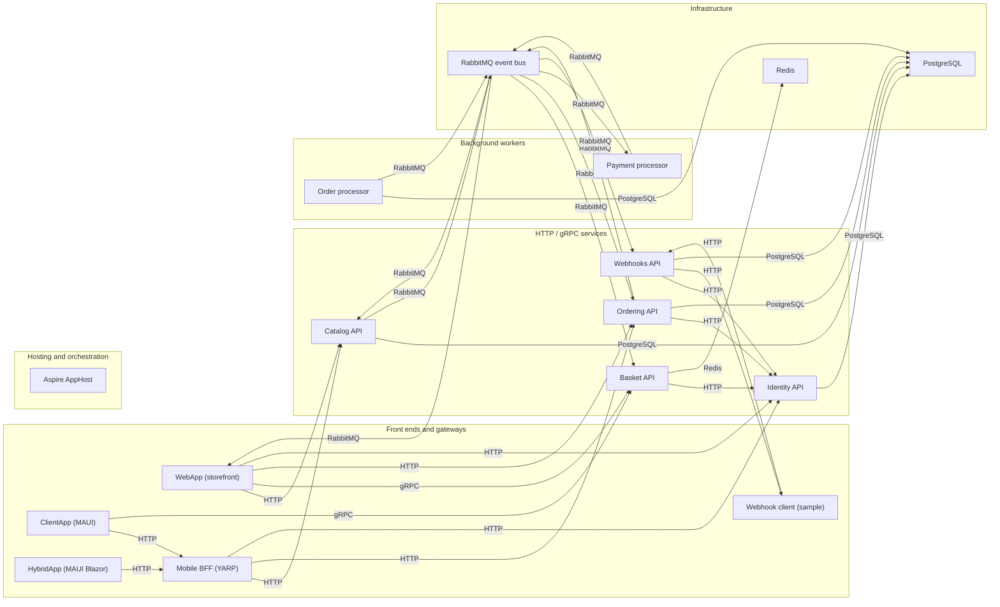
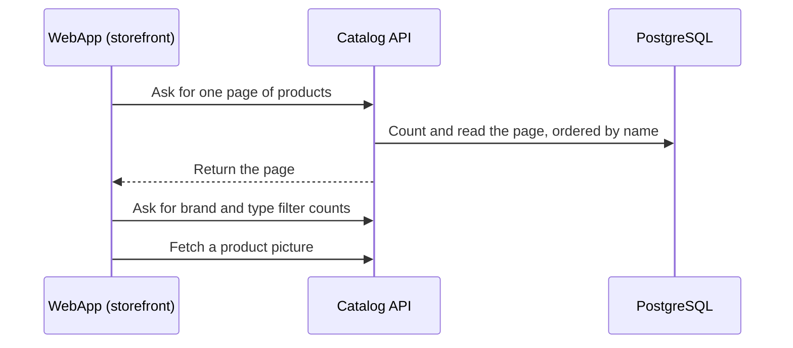
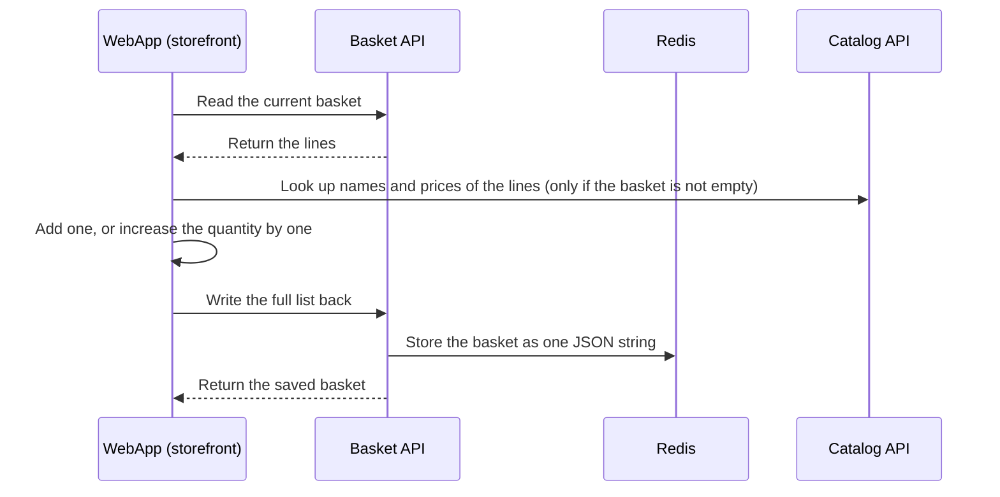
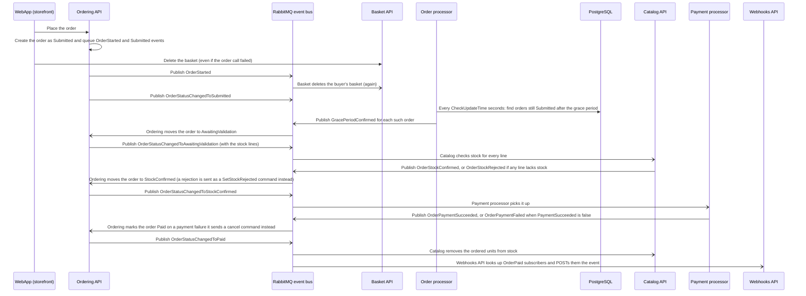

# eShop Map

> Generated by [evidence-architecture-map](https://github.com/majdukovic/evidence-architecture-map) from the JSON files next to this one. Do not edit by hand.
> Every statement links to the line of code that supports it, at the commit checked on 2026-11-10.
> The interactive version is `architecture.html`.

## Overview



## Components

### Front ends and gateways

#### WebApp (storefront)

The customer-facing web shop. It calls **Catalog** over HTTP, **Basket** over gRPC and **Ordering** over HTTP, signs users in against **Identity**, and listens to order-status events on RabbitMQ to refresh the order page.

> Checkout calls Ordering API and then deletes the basket without looking at the order call's result, so an order request that comes back with an error status still empties the basket.

- **Repo:** [eShop](https://github.com/dotnet/eShop/tree/913acea66708a59595351174cee9b29f37179d29)
- **Exposes:** `Web UI`, `GET /product-images/{id} (forwarded to Catalog)`
- **Calls / sends to:** Catalog API (HTTP), Basket API (gRPC), Ordering API (HTTP), Identity API (HTTP)
- **Called by / receives from:** RabbitMQ event bus (RabbitMQ)
- **Evidence:**
  - [eShop › BasketState.cs:108](https://github.com/dotnet/eShop/blob/913acea66708a59595351174cee9b29f37179d29/src/WebApp/Services/BasketState.cs#L108) `await DeleteBasketAsync();`
  - [eShop › OrderingService.cs:17](https://github.com/dotnet/eShop/blob/913acea66708a59595351174cee9b29f37179d29/src/WebApp/Services/OrderingService.cs#L17) `return httpClient.SendAsync(requestMessage);`
  - [eShop › AppHost.cs:71](https://github.com/dotnet/eShop/blob/913acea66708a59595351174cee9b29f37179d29/src/eShop.AppHost/AppHost.cs#L71) `AddDotnetProject("webapp", "../WebApp"`
  - [eShop › Program.cs:32](https://github.com/dotnet/eShop/blob/913acea66708a59595351174cee9b29f37179d29/src/WebApp/Program.cs#L32) `app.MapForwarder("/product-images/{id}"`

#### Mobile BFF (YARP)

A YARP reverse proxy declared in the AppHost. It forwards catalog, ordering and identity routes to the matching services. There is no Basket route on it. In the repo, its callers are the **ClientApp** (MAUI) and **HybridApp** mobile apps.

> Catalog and orders routes only match requests that carry an api-version query parameter (orders: 1.0 or 1).

- **Repo:** [eShop](https://github.com/dotnet/eShop/tree/913acea66708a59595351174cee9b29f37179d29)
- **Exposes:** `/api/catalog/*`, `/api/orders/*`, `/identity/*`
- **Calls / sends to:** Catalog API (HTTP), Ordering API (HTTP), Identity API (HTTP)
- **Called by / receives from:** ClientApp (MAUI) (HTTP), HybridApp (MAUI Blazor) (HTTP)
- **Evidence:**
  - [eShop › AppHost.cs:62](https://github.com/dotnet/eShop/blob/913acea66708a59595351174cee9b29f37179d29/src/eShop.AppHost/AppHost.cs#L62) `builder.AddYarp("mobile-bff")`
  - [eShop › Extensions.cs:146](https://github.com/dotnet/eShop/blob/913acea66708a59595351174cee9b29f37179d29/src/eShop.AppHost/Extensions.cs#L146) `yarp.AddRoute("/api/orders/{*any}"`
  - [eShop › Extensions.cs:147](https://github.com/dotnet/eShop/blob/913acea66708a59595351174cee9b29f37179d29/src/eShop.AppHost/Extensions.cs#L147) `Name = "api-version", Values = ["1.0", "1"]`

#### Webhook client (sample)

A sample web app that registers webhook subscriptions with **Webhooks API** and receives the callbacks on its own endpoint.

- **Repo:** [eShop](https://github.com/dotnet/eShop/tree/913acea66708a59595351174cee9b29f37179d29)
- **Exposes:** `POST /webhook-received`, `OPTIONS /check`
- **Calls / sends to:** Webhooks API (HTTP)
- **Called by / receives from:** Webhooks API (HTTP)
- **Evidence:**
  - [eShop › WebhookEndpoints.cs:16](https://github.com/dotnet/eShop/blob/913acea66708a59595351174cee9b29f37179d29/src/WebhookClient/Endpoints/WebhookEndpoints.cs#L16) `app.MapMethods("/check", [HttpMethods.Options]`
  - [eShop › AppHost.cs:67](https://github.com/dotnet/eShop/blob/913acea66708a59595351174cee9b29f37179d29/src/eShop.AppHost/AppHost.cs#L67) `AddDotnetProject("webhooksclient", "../WebhookClient"`
  - [eShop › WebhookEndpoints.cs:31](https://github.com/dotnet/eShop/blob/913acea66708a59595351174cee9b29f37179d29/src/WebhookClient/Endpoints/WebhookEndpoints.cs#L31) `app.MapPost("/webhook-received"`

#### ClientApp (MAUI)

A .NET MAUI mobile app. It reads the catalogue and places and lists orders through the **Mobile BFF**, and talks to **Basket API** directly over gRPC. The gateway addresses are settings the user can change. It starts on mock services by default; the real calls happen once mocks are switched off in its settings.

> The Mobile BFF has no Basket route, so this app calls Basket API itself (default address port 5221, Basket API's own launch port).

- **Repo:** [eShop](https://github.com/dotnet/eShop/tree/913acea66708a59595351174cee9b29f37179d29)
- **Calls / sends to:** Mobile BFF (YARP) (HTTP), Basket API (gRPC)
- **Evidence:**
  - [eShop › MauiProgram.cs:28](https://github.com/dotnet/eShop/blob/913acea66708a59595351174cee9b29f37179d29/src/ClientApp/MauiProgram.cs#L28) `.UseMauiApp<App>()`
  - [eShop › eShop.slnx:21](https://github.com/dotnet/eShop/blob/913acea66708a59595351174cee9b29f37179d29/eShop.slnx#L21) `<Project Path="src/ClientApp/ClientApp.csproj" />`
  - [eShop › SettingsService.cs:25](https://github.com/dotnet/eShop/blob/913acea66708a59595351174cee9b29f37179d29/src/ClientApp/Services/Settings/SettingsService.cs#L25) `private readonly bool UseMocksDefault = true;`
  - [eShop › MauiProgram.cs:112](https://github.com/dotnet/eShop/blob/913acea66708a59595351174cee9b29f37179d29/src/ClientApp/MauiProgram.cs#L112) `aes.UpdateDependencies(settingsService.UseMocks);`

#### HybridApp (MAUI Blazor)

A .NET MAUI Blazor Hybrid app that browses the catalogue through the **Mobile BFF**. It has no basket or order code.

- **Repo:** [eShop](https://github.com/dotnet/eShop/tree/913acea66708a59595351174cee9b29f37179d29)
- **Calls / sends to:** Mobile BFF (YARP) (HTTP)
- **Evidence:**
  - [eShop › MauiProgram.cs:14](https://github.com/dotnet/eShop/blob/913acea66708a59595351174cee9b29f37179d29/src/HybridApp/MauiProgram.cs#L14) `var builder = MauiApp.CreateBuilder();`
  - [eShop › eShop.slnx:20](https://github.com/dotnet/eShop/blob/913acea66708a59595351174cee9b29f37179d29/eShop.slnx#L20) `<Project Path="src/HybridApp/HybridApp.csproj" />`

### HTTP / gRPC services

#### Identity API

The sign-in server (IdentityServer). WebApp signs users in against it, and Basket, Ordering and Webhooks use it as the authority for bearer tokens.

- **Repo:** [eShop](https://github.com/dotnet/eShop/tree/913acea66708a59595351174cee9b29f37179d29)
- **Exposes:** `OpenID Connect endpoints`
- **Stores data in:** PostgreSQL: identitydb
- **Calls / sends to:** PostgreSQL (PostgreSQL)
- **Called by / receives from:** WebApp (storefront) (HTTP), Mobile BFF (YARP) (HTTP), Basket API (HTTP), Ordering API (HTTP), Webhooks API (HTTP)
- **Evidence:**
  - [eShop › AppHost.cs:25](https://github.com/dotnet/eShop/blob/913acea66708a59595351174cee9b29f37179d29/src/eShop.AppHost/AppHost.cs#L25) `AddDotnetProject("identity-api", "../Identity.API"`
  - [eShop › Program.cs:18](https://github.com/dotnet/eShop/blob/913acea66708a59595351174cee9b29f37179d29/src/Identity.API/Program.cs#L18) `builder.Services.AddIdentityServer(options`

#### Basket API

Holds each user's basket as a list of product ids and quantities in Redis, behind a gRPC service. It also clears the basket when it hears that an order was started.

> When the basket is written, only the product id and quantity of each line are filled in; the name, price and picture fields stay empty. Names and prices are looked up from Catalog by the caller.

- **Repo:** [eShop](https://github.com/dotnet/eShop/tree/913acea66708a59595351174cee9b29f37179d29)
- **Exposes:** `gRPC: Basket.GetBasket / UpdateBasket / DeleteBasket`
- **Stores data in:** Redis: /basket/{userId}
- **Calls / sends to:** Identity API (HTTP), Redis (Redis)
- **Called by / receives from:** WebApp (storefront) (gRPC), ClientApp (MAUI) (gRPC), RabbitMQ event bus (RabbitMQ)
- **Evidence:**
  - [eShop › AppHost.cs:32](https://github.com/dotnet/eShop/blob/913acea66708a59595351174cee9b29f37179d29/src/eShop.AppHost/AppHost.cs#L32) `AddDotnetProject("basket-api", "../Basket.API"`
  - [eShop › Program.cs:12](https://github.com/dotnet/eShop/blob/913acea66708a59595351174cee9b29f37179d29/src/Basket.API/Program.cs#L12) `app.MapGrpcService<BasketService>();`
  - [eShop › basket.proto:7](https://github.com/dotnet/eShop/blob/913acea66708a59595351174cee9b29f37179d29/src/Basket.API/Proto/basket.proto#L7) `service Basket {`

#### Catalog API

Serves the product list, brands, types and pictures over a versioned HTTP API, and owns stock levels. It answers stock checks and reduces stock when an order is paid, using order events.

> The write endpoints (POST and PUT /api/catalog/items, DELETE /api/catalog/items/{id}) are mapped without any authorization requirement, and Catalog API has no authentication set-up at all, unlike Ordering and Webhooks.

- **Repo:** [eShop](https://github.com/dotnet/eShop/tree/913acea66708a59595351174cee9b29f37179d29)
- **Exposes:** `GET /api/catalog/items`, `GET /api/catalog/items/by?ids=`, `GET /api/catalog/items/{id}/pic`, `POST /api/catalog/items`, `PUT /api/catalog/items (v1)`, `PUT /api/catalog/items/{id} (v2)`, `DELETE /api/catalog/items/{id}`, `Event: ProductPriceChangedIntegrationEvent`
- **Stores data in:** PostgreSQL: catalogdb (pgvector image)
- **Calls / sends to:** PostgreSQL (PostgreSQL), RabbitMQ event bus (RabbitMQ)
- **Called by / receives from:** WebApp (storefront) (HTTP), Mobile BFF (YARP) (HTTP), RabbitMQ event bus (RabbitMQ)
- **Evidence:**
  - [eShop › AppHost.cs:38](https://github.com/dotnet/eShop/blob/913acea66708a59595351174cee9b29f37179d29/src/eShop.AppHost/AppHost.cs#L38) `AddDotnetProject("catalog-api", "../Catalog.API"`
  - [eShop › CatalogApi.cs:17](https://github.com/dotnet/eShop/blob/913acea66708a59595351174cee9b29f37179d29/src/Catalog.API/Apis/CatalogApi.cs#L17) `vApi.MapGroup("api/catalog")`
  - [eShop › CatalogApi.cs:110](https://github.com/dotnet/eShop/blob/913acea66708a59595351174cee9b29f37179d29/src/Catalog.API/Apis/CatalogApi.cs#L110) `api.MapPost("/items", CreateItem)`
  - [eShop › CatalogApi.cs:114](https://github.com/dotnet/eShop/blob/913acea66708a59595351174cee9b29f37179d29/src/Catalog.API/Apis/CatalogApi.cs#L114) `api.MapDelete("/items/{id:int}", DeleteItemById)`
  - [eShop › Program.cs:22](https://github.com/dotnet/eShop/blob/913acea66708a59595351174cee9b29f37179d29/src/Ordering.API/Program.cs#L22) `.RequireAuthorization();`
  - [eShop › CatalogApi.cs:100](https://github.com/dotnet/eShop/blob/913acea66708a59595351174cee9b29f37179d29/src/Catalog.API/Apis/CatalogApi.cs#L100) `v1.MapPut("/items", UpdateItemV1)`
  - [eShop › CatalogApi.cs:105](https://github.com/dotnet/eShop/blob/913acea66708a59595351174cee9b29f37179d29/src/Catalog.API/Apis/CatalogApi.cs#L105) `v2.MapPut("/items/{id:int}", UpdateItem)`

#### Ordering API

Creates orders and owns the order status. Status changes are driven by events from other components and most changes are published back on RabbitMQ (cancelling because stock was rejected is not).

> An order is created as Submitted. Stock checks, payment and the grace period arrive as events; shipping and cancelling are HTTP calls to Ordering API.

- **Repo:** [eShop](https://github.com/dotnet/eShop/tree/913acea66708a59595351174cee9b29f37179d29)
- **Exposes:** `POST /api/orders`, `GET /api/orders`, `PUT /api/orders/cancel`, `PUT /api/orders/ship`
- **Stores data in:** PostgreSQL: orderingdb (schema ordering)
- **Calls / sends to:** Identity API (HTTP), PostgreSQL (PostgreSQL), RabbitMQ event bus (RabbitMQ)
- **Called by / receives from:** WebApp (storefront) (HTTP), Mobile BFF (YARP) (HTTP), RabbitMQ event bus (RabbitMQ)
- **Evidence:**
  - [eShop › AppHost.cs:42](https://github.com/dotnet/eShop/blob/913acea66708a59595351174cee9b29f37179d29/src/eShop.AppHost/AppHost.cs#L42) `AddDotnetProject("ordering-api", "../Ordering.API"`
  - [eShop › OrdersApi.cs:9](https://github.com/dotnet/eShop/blob/913acea66708a59595351174cee9b29f37179d29/src/Ordering.API/Apis/OrdersApi.cs#L9) `app.MapGroup("api/orders")`

#### Webhooks API

Stores webhook subscriptions and POSTs a message to each subscriber's destination URL when an order is paid or shipped. It also subscribes to price-change events, but that handler does nothing yet.

> Price-change webhooks are not implemented: the ProductPriceChanged handler just returns. Registering a subscription first makes an OPTIONS request to the subscriber's check URL; the subscription is saved only if the reply has a success status and echoes the same `X-eshop-whtoken` header, and the check URL has the same scheme, host and port as the destination URL.

- **Repo:** [eShop](https://github.com/dotnet/eShop/tree/913acea66708a59595351174cee9b29f37179d29)
- **Exposes:** `POST /api/webhooks`, `GET /api/webhooks`
- **Stores data in:** PostgreSQL: webhooksdb
- **Calls / sends to:** Identity API (HTTP), Webhook client (sample) (HTTP), PostgreSQL (PostgreSQL)
- **Called by / receives from:** Webhook client (sample) (HTTP), RabbitMQ event bus (RabbitMQ)
- **Evidence:**
  - [eShop › AppHost.cs:56](https://github.com/dotnet/eShop/blob/913acea66708a59595351174cee9b29f37179d29/src/eShop.AppHost/AppHost.cs#L56) `AddDotnetProject("webhooks-api", "../Webhooks.API"`
  - [eShop › WebHooksApi.cs:11](https://github.com/dotnet/eShop/blob/913acea66708a59595351174cee9b29f37179d29/src/Webhooks.API/Apis/WebHooksApi.cs#L11) `app.MapGroup("/api/webhooks")`
  - [eShop › ProductPriceChangedIntegrationEventHandler.cs:7](https://github.com/dotnet/eShop/blob/913acea66708a59595351174cee9b29f37179d29/src/Webhooks.API/IntegrationEvents/ProductPriceChangedIntegrationEventHandler.cs#L7) `return Task.CompletedTask;`
  - [eShop › GrantUrlTesterService.cs:14](https://github.com/dotnet/eShop/blob/913acea66708a59595351174cee9b29f37179d29/src/Webhooks.API/Services/GrantUrlTesterService.cs#L14) `new HttpRequestMessage(HttpMethod.Options, url)`
  - [eShop › WebHooksApi.cs:41](https://github.com/dotnet/eShop/blob/913acea66708a59595351174cee9b29f37179d29/src/Webhooks.API/Apis/WebHooksApi.cs#L41) `await grantUrlTester.TestGrantUrl(`
  - [eShop › GrantUrlTesterService.cs:27](https://github.com/dotnet/eShop/blob/913acea66708a59595351174cee9b29f37179d29/src/Webhooks.API/Services/GrantUrlTesterService.cs#L27) `return response.IsSuccessStatusCode && tokenReceived == tokenExpected;`
  - [eShop › GrantUrlTesterService.cs:42](https://github.com/dotnet/eShop/blob/913acea66708a59595351174cee9b29f37179d29/src/Webhooks.API/Services/GrantUrlTesterService.cs#L42) `return firstUrl.Scheme == secondUrl.Scheme &&`

### Background workers

#### Order processor

A background worker that polls the ordering database for orders that have stayed Submitted past the grace period and publishes an event for each.

- **Repo:** [eShop](https://github.com/dotnet/eShop/tree/913acea66708a59595351174cee9b29f37179d29)
- **Stores data in:** Reads PostgreSQL: orderingdb
- **Calls / sends to:** PostgreSQL (PostgreSQL), RabbitMQ event bus (RabbitMQ)
- **Evidence:**
  - [eShop › AppHost.cs:48](https://github.com/dotnet/eShop/blob/913acea66708a59595351174cee9b29f37179d29/src/eShop.AppHost/AppHost.cs#L48) `AddDotnetProject("order-processor", "../OrderProcessor"`
  - [eShop › Extensions.cs:19](https://github.com/dotnet/eShop/blob/913acea66708a59595351174cee9b29f37179d29/src/OrderProcessor/Extensions/Extensions.cs#L19) `AddHostedService<GracePeriodManagerService>()`

#### Payment processor

Listens for orders whose stock is confirmed and publishes a payment succeeded or failed event. The outcome comes from a configuration flag; no payment gateway is called.

> Payment is simulated: success or failure is the PaymentSucceeded setting, not a real charge.

- **Repo:** [eShop](https://github.com/dotnet/eShop/tree/913acea66708a59595351174cee9b29f37179d29)
- **Calls / sends to:** RabbitMQ event bus (RabbitMQ)
- **Called by / receives from:** RabbitMQ event bus (RabbitMQ)
- **Evidence:**
  - [eShop › AppHost.cs:53](https://github.com/dotnet/eShop/blob/913acea66708a59595351174cee9b29f37179d29/src/eShop.AppHost/AppHost.cs#L53) `AddDotnetProject("payment-processor", "../PaymentProcessor"`
  - [eShop › OrderStatusChangedToStockConfirmedIntegrationEventHandler.cs:21](https://github.com/dotnet/eShop/blob/913acea66708a59595351174cee9b29f37179d29/src/PaymentProcessor/IntegrationEvents/EventHandling/OrderStatusChangedToStockConfirmedIntegrationEventHandler.cs#L21) `if (options.CurrentValue.PaymentSucceeded)`

### Infrastructure

#### RabbitMQ event bus

The message broker. All integration events go through one direct exchange, with the event's class name as the routing key.

> Events can be lost. A consumer acknowledges every message even when its handler threw, and there is no dead-letter set-up. On the publishing side, an outbox event whose publish failed is marked failed and is not read again.

- **Repo:** [eShop](https://github.com/dotnet/eShop/tree/913acea66708a59595351174cee9b29f37179d29)
- **Exposes:** `Exchange: eshop_event_bus (direct)`
- **Calls / sends to:** Basket API (RabbitMQ), Catalog API (RabbitMQ), Ordering API (RabbitMQ), Payment processor (RabbitMQ), WebApp (storefront) (RabbitMQ), Webhooks API (RabbitMQ)
- **Called by / receives from:** Ordering API (RabbitMQ), Catalog API (RabbitMQ), Order processor (RabbitMQ), Payment processor (RabbitMQ)
- **Evidence:**
  - [eShop › RabbitMQEventBus.cs:177](https://github.com/dotnet/eShop/blob/913acea66708a59595351174cee9b29f37179d29/src/EventBusRabbitMQ/RabbitMQEventBus.cs#L177) `// Even on exception we take the message off the queue.`
  - [eShop › RabbitMQEventBus.cs:180](https://github.com/dotnet/eShop/blob/913acea66708a59595351174cee9b29f37179d29/src/EventBusRabbitMQ/RabbitMQEventBus.cs#L180) `await _consumerChannel.BasicAckAsync(eventArgs.DeliveryTag`
  - [eShop › AppHost.cs:10](https://github.com/dotnet/eShop/blob/913acea66708a59595351174cee9b29f37179d29/src/eShop.AppHost/AppHost.cs#L10) `builder.AddRabbitMQ("eventbus")`
  - [eShop › RabbitMQEventBus.cs:20](https://github.com/dotnet/eShop/blob/913acea66708a59595351174cee9b29f37179d29/src/EventBusRabbitMQ/RabbitMQEventBus.cs#L20) `ExchangeName = "eshop_event_bus"`
  - [eShop › RabbitMQEventBus.cs:33](https://github.com/dotnet/eShop/blob/913acea66708a59595351174cee9b29f37179d29/src/EventBusRabbitMQ/RabbitMQEventBus.cs#L33) `var routingKey = @event.GetType().Name;`

#### Redis

Key-value store used by Basket API.

- **Repo:** [eShop](https://github.com/dotnet/eShop/tree/913acea66708a59595351174cee9b29f37179d29)
- **Called by / receives from:** Basket API (Redis)
- **Evidence:**
  - [eShop › AppHost.cs:9](https://github.com/dotnet/eShop/blob/913acea66708a59595351174cee9b29f37179d29/src/eShop.AppHost/AppHost.cs#L9) `builder.AddRedis("redis")`

#### PostgreSQL

One Postgres server hosting catalogdb, identitydb, orderingdb and webhooksdb. Ordering API and Order processor both connect to orderingdb.

- **Repo:** [eShop](https://github.com/dotnet/eShop/tree/913acea66708a59595351174cee9b29f37179d29)
- **Stores data in:** catalogdb, identitydb, orderingdb, webhooksdb
- **Called by / receives from:** Catalog API (PostgreSQL), Ordering API (PostgreSQL), Order processor (PostgreSQL), Identity API (PostgreSQL), Webhooks API (PostgreSQL)
- **Evidence:**
  - [eShop › AppHost.cs:12](https://github.com/dotnet/eShop/blob/913acea66708a59595351174cee9b29f37179d29/src/eShop.AppHost/AppHost.cs#L12) `builder.AddPostgres("postgres")`
  - [eShop › AppHost.cs:19](https://github.com/dotnet/eShop/blob/913acea66708a59595351174cee9b29f37179d29/src/eShop.AppHost/AppHost.cs#L19) `postgres.AddDatabase("orderingdb")`

### Hosting and orchestration

#### Aspire AppHost

The Aspire application model. It declares every project and container above and injects the references (connection strings, service URLs) that services use to find each other.

- **Repo:** [eShop](https://github.com/dotnet/eShop/tree/913acea66708a59595351174cee9b29f37179d29)
- **Evidence:**
  - [eShop › AppHost.cs:4](https://github.com/dotnet/eShop/blob/913acea66708a59595351174cee9b29f37179d29/src/eShop.AppHost/AppHost.cs#L4) `DistributedApplication.CreateBuilder(args)`

## Connections

| From | To | Protocol | What | Evidence |
|---|---|---|---|---|
| WebApp (storefront) | Catalog API | HTTP | Lists, filters and fetches products (api/catalog/items, items/by, facets) | [eShop › Extensions.cs:34](https://github.com/dotnet/eShop/blob/913acea66708a59595351174cee9b29f37179d29/src/WebApp/Extensions/Extensions.cs#L34) `new("https+http://catalog-api")`<br>[eShop › CatalogService.cs:82](https://github.com/dotnet/eShop/blob/913acea66708a59595351174cee9b29f37179d29/src/WebAppComponents/Services/CatalogService.cs#L82) `items?{filterQs}pageIndex={pageIndex}`<br>[eShop › CatalogApi.cs:27](https://github.com/dotnet/eShop/blob/913acea66708a59595351174cee9b29f37179d29/src/Catalog.API/Apis/CatalogApi.cs#L27) `v2.MapGet("/items", GetAllItems)` |
| WebApp (storefront) | Basket API | gRPC | Reads, updates and deletes the signed-in user's basket | [eShop › Extensions.cs:31](https://github.com/dotnet/eShop/blob/913acea66708a59595351174cee9b29f37179d29/src/WebApp/Extensions/Extensions.cs#L31) `AddGrpcClient<Basket.BasketClient>`<br>[eShop › BasketService.cs:34](https://github.com/dotnet/eShop/blob/913acea66708a59595351174cee9b29f37179d29/src/WebApp/Services/BasketService.cs#L34) `await basketClient.UpdateBasketAsync(updatePayload);`<br>[eShop › Program.cs:12](https://github.com/dotnet/eShop/blob/913acea66708a59595351174cee9b29f37179d29/src/Basket.API/Program.cs#L12) `app.MapGrpcService<BasketService>();` |
| WebApp (storefront) | Ordering API | HTTP | Creates an order at checkout and lists the user's orders | [eShop › Extensions.cs:38](https://github.com/dotnet/eShop/blob/913acea66708a59595351174cee9b29f37179d29/src/WebApp/Extensions/Extensions.cs#L38) `new("https+http://ordering-api")`<br>[eShop › OrderingService.cs:14](https://github.com/dotnet/eShop/blob/913acea66708a59595351174cee9b29f37179d29/src/WebApp/Services/OrderingService.cs#L14) `new HttpRequestMessage(HttpMethod.Post, remoteServiceBaseUrl)`<br>[eShop › OrdersApi.cs:17](https://github.com/dotnet/eShop/blob/913acea66708a59595351174cee9b29f37179d29/src/Ordering.API/Apis/OrdersApi.cs#L17) `api.MapPost("/", CreateOrderAsync);`<br>[eShop › OrderingService.cs:7](https://github.com/dotnet/eShop/blob/913acea66708a59595351174cee9b29f37179d29/src/WebApp/Services/OrderingService.cs#L7) `public Task<OrderRecord[]> GetOrders()`<br>[eShop › OrdersApi.cs:14](https://github.com/dotnet/eShop/blob/913acea66708a59595351174cee9b29f37179d29/src/Ordering.API/Apis/OrdersApi.cs#L14) `api.MapGet("/", GetOrdersByUserAsync);` |
| WebApp (storefront) | Identity API | HTTP | Signs users in with OpenID Connect | [eShop › Extensions.cs:75](https://github.com/dotnet/eShop/blob/913acea66708a59595351174cee9b29f37179d29/src/WebApp/Extensions/Extensions.cs#L75) `options.Authority = identityUrl;`<br>[eShop › AppHost.cs:79](https://github.com/dotnet/eShop/blob/913acea66708a59595351174cee9b29f37179d29/src/eShop.AppHost/AppHost.cs#L79) `.WithEnvironment("IdentityUrl", identityEndpoint);`<br>[eShop › Program.cs:18](https://github.com/dotnet/eShop/blob/913acea66708a59595351174cee9b29f37179d29/src/Identity.API/Program.cs#L18) `builder.Services.AddIdentityServer(options` |
| Mobile BFF (YARP) | Catalog API | HTTP | Proxies catalog routes | [eShop › AppHost.cs:64](https://github.com/dotnet/eShop/blob/913acea66708a59595351174cee9b29f37179d29/src/eShop.AppHost/AppHost.cs#L64) `.ConfigureMobileBffRoutes(catalogApi, orderingApi, identityApi);`<br>[eShop › Extensions.cs:142](https://github.com/dotnet/eShop/blob/913acea66708a59595351174cee9b29f37179d29/src/eShop.AppHost/Extensions.cs#L142) `yarp.AddRoute("/api/catalog/{*any}", catalogCluster)` |
| Mobile BFF (YARP) | Ordering API | HTTP | Proxies order routes | [eShop › Extensions.cs:146](https://github.com/dotnet/eShop/blob/913acea66708a59595351174cee9b29f37179d29/src/eShop.AppHost/Extensions.cs#L146) `yarp.AddRoute("/api/orders/{*any}", orderingApi.GetEndpoint("http"))` |
| Mobile BFF (YARP) | Identity API | HTTP | Proxies identity routes under /identity | [eShop › Extensions.cs:150](https://github.com/dotnet/eShop/blob/913acea66708a59595351174cee9b29f37179d29/src/eShop.AppHost/Extensions.cs#L150) `yarp.AddRoute("/identity/{*any}", identityApi.GetEndpoint("http"))` |
| Basket API | Identity API | HTTP | Uses Identity as the authority for validating bearer tokens | [eShop › Extensions.cs:12](https://github.com/dotnet/eShop/blob/913acea66708a59595351174cee9b29f37179d29/src/Basket.API/Extensions/Extensions.cs#L12) `builder.AddDefaultAuthentication();`<br>[eShop › AppHost.cs:35](https://github.com/dotnet/eShop/blob/913acea66708a59595351174cee9b29f37179d29/src/eShop.AppHost/AppHost.cs#L35) `.WithEnvironment("Identity__Url", identityEndpoint);`<br>[eShop › AuthenticationExtensions.cs:38](https://github.com/dotnet/eShop/blob/913acea66708a59595351174cee9b29f37179d29/src/eShop.ServiceDefaults/AuthenticationExtensions.cs#L38) `options.Authority = identityUrl;` |
| Ordering API | Identity API | HTTP | Uses Identity as the authority for validating bearer tokens | [eShop › Extensions.cs:10](https://github.com/dotnet/eShop/blob/913acea66708a59595351174cee9b29f37179d29/src/Ordering.API/Extensions/Extensions.cs#L10) `builder.AddDefaultAuthentication();`<br>[eShop › AppHost.cs:46](https://github.com/dotnet/eShop/blob/913acea66708a59595351174cee9b29f37179d29/src/eShop.AppHost/AppHost.cs#L46) `.WithEnvironment("Identity__Url", identityEndpoint);`<br>[eShop › AuthenticationExtensions.cs:38](https://github.com/dotnet/eShop/blob/913acea66708a59595351174cee9b29f37179d29/src/eShop.ServiceDefaults/AuthenticationExtensions.cs#L38) `options.Authority = identityUrl;` |
| Webhooks API | Identity API | HTTP | Uses Identity as the authority for validating bearer tokens | [eShop › Extensions.cs:5](https://github.com/dotnet/eShop/blob/913acea66708a59595351174cee9b29f37179d29/src/Webhooks.API/Extensions/Extensions.cs#L5) `builder.AddDefaultAuthentication();`<br>[eShop › AppHost.cs:59](https://github.com/dotnet/eShop/blob/913acea66708a59595351174cee9b29f37179d29/src/eShop.AppHost/AppHost.cs#L59) `.WithEnvironment("Identity__Url", identityEndpoint);`<br>[eShop › AuthenticationExtensions.cs:38](https://github.com/dotnet/eShop/blob/913acea66708a59595351174cee9b29f37179d29/src/eShop.ServiceDefaults/AuthenticationExtensions.cs#L38) `options.Authority = identityUrl;` |
| Webhook client (sample) | Webhooks API | HTTP | Registers and lists webhook subscriptions | [eShop › Extensions.cs:19](https://github.com/dotnet/eShop/blob/913acea66708a59595351174cee9b29f37179d29/src/WebhookClient/Extensions/Extensions.cs#L19) `new("http://webhooks-api")`<br>[eShop › WebHooksClient.cs:7](https://github.com/dotnet/eShop/blob/913acea66708a59595351174cee9b29f37179d29/src/WebhookClient/Services/WebHooksClient.cs#L7) `client.PostAsJsonAsync("/api/webhooks", payload)`<br>[eShop › WebHooksApi.cs:35](https://github.com/dotnet/eShop/blob/913acea66708a59595351174cee9b29f37179d29/src/Webhooks.API/Apis/WebHooksApi.cs#L35) `api.MapPost("/"` |
| Webhooks API | Webhook client (sample) | HTTP | Registration handshake: sends OPTIONS with an X-eshop-whtoken header to the subscriber's check URL and saves the subscription only on a success reply whose X-eshop-whtoken header matches the token sent (a blank token needs no echo) (the sample client answers on /check). Later POSTs the event to the destination URL a subscriber registered; the sample client receives it on /webhook-received | [eShop › GrantUrlTesterService.cs:14](https://github.com/dotnet/eShop/blob/913acea66708a59595351174cee9b29f37179d29/src/Webhooks.API/Services/GrantUrlTesterService.cs#L14) `new HttpRequestMessage(HttpMethod.Options, url)`<br>[eShop › GrantUrlTesterService.cs:27](https://github.com/dotnet/eShop/blob/913acea66708a59595351174cee9b29f37179d29/src/Webhooks.API/Services/GrantUrlTesterService.cs#L27) `response.IsSuccessStatusCode && tokenReceived == tokenExpected`<br>[eShop › WebHooksApi.cs:43](https://github.com/dotnet/eShop/blob/913acea66708a59595351174cee9b29f37179d29/src/Webhooks.API/Apis/WebHooksApi.cs#L43) `if (grantOk)`<br>[eShop › WebhookEndpoints.cs:16](https://github.com/dotnet/eShop/blob/913acea66708a59595351174cee9b29f37179d29/src/WebhookClient/Endpoints/WebhookEndpoints.cs#L16) `app.MapMethods("/check", [HttpMethods.Options]`<br>[eShop › WebhooksSender.cs:17](https://github.com/dotnet/eShop/blob/913acea66708a59595351174cee9b29f37179d29/src/Webhooks.API/Services/WebhooksSender.cs#L17) `RequestUri = new Uri(subs.DestUrl, UriKind.Absolute)`<br>[eShop › WebhooksSender.cs:18](https://github.com/dotnet/eShop/blob/913acea66708a59595351174cee9b29f37179d29/src/Webhooks.API/Services/WebhooksSender.cs#L18) `Method = HttpMethod.Post`<br>[eShop › WebhookEndpoints.cs:31](https://github.com/dotnet/eShop/blob/913acea66708a59595351174cee9b29f37179d29/src/WebhookClient/Endpoints/WebhookEndpoints.cs#L31) `app.MapPost("/webhook-received"` |
| ClientApp (MAUI) | Mobile BFF (YARP) | HTTP | Reads the catalogue and creates and lists orders (api/catalog and api/orders with an api-version query parameter). The endpoints are settings that default to port 11632, the port HybridApp names as its Mobile BFF host; the AppHost does not fix the BFF's port. | [eShop › SettingsViewModel.cs:58](https://github.com/dotnet/eShop/blob/913acea66708a59595351174cee9b29f37179d29/src/ClientApp/ViewModels/SettingsViewModel.cs#L58) `$"http://{_baseAddress}:11632"`<br>[eShop › CatalogService.cs:38](https://github.com/dotnet/eShop/blob/913acea66708a59595351174cee9b29f37179d29/src/ClientApp/Services/Catalog/CatalogService.cs#L38) `$"{ApiUrlBase}/items?PageSize=100&{ApiVersion}"`<br>[eShop › OrderService.cs:37](https://github.com/dotnet/eShop/blob/913acea66708a59595351174cee9b29f37179d29/src/ClientApp/Services/Order/OrderService.cs#L37) `UriHelper.CombineUri(_settingsService.GatewayOrdersEndpointBase, ApiUrlBase)`<br>[eShop › Extensions.cs:146](https://github.com/dotnet/eShop/blob/913acea66708a59595351174cee9b29f37179d29/src/eShop.AppHost/Extensions.cs#L146) `yarp.AddRoute("/api/orders/{*any}"` |
| HybridApp (MAUI Blazor) | Mobile BFF (YARP) | HTTP | Reads catalogue items, brands, types and pictures (api/catalog with api-version=2.0) | [eShop › MauiProgram.cs:9](https://github.com/dotnet/eShop/blob/913acea66708a59595351174cee9b29f37179d29/src/HybridApp/MauiProgram.cs#L9) `internal static string MobileBffHost`<br>[eShop › MauiProgram.cs:30](https://github.com/dotnet/eShop/blob/913acea66708a59595351174cee9b29f37179d29/src/HybridApp/MauiProgram.cs#L30) `AddHttpClient<CatalogService>(o => o.BaseAddress = new(MobileBffHost))`<br>[eShop › Extensions.cs:142](https://github.com/dotnet/eShop/blob/913acea66708a59595351174cee9b29f37179d29/src/eShop.AppHost/Extensions.cs#L142) `yarp.AddRoute("/api/catalog/{*any}", catalogCluster)` |
| ClientApp (MAUI) | Basket API | gRPC | Reads, updates and deletes the signed-in user's basket, bypassing the Mobile BFF | [eShop › BasketService.cs:125](https://github.com/dotnet/eShop/blob/913acea66708a59595351174cee9b29f37179d29/src/ClientApp/Services/Basket/BasketService.cs#L125) `GrpcChannel.ForAddress(_settingsService.GatewayBasketEndpointBase)`<br>[eShop › SettingsViewModel.cs:63](https://github.com/dotnet/eShop/blob/913acea66708a59595351174cee9b29f37179d29/src/ClientApp/ViewModels/SettingsViewModel.cs#L63) `$"http://{_baseAddress}:5221"`<br>[eShop › launchSettings.json:6](https://github.com/dotnet/eShop/blob/913acea66708a59595351174cee9b29f37179d29/src/Basket.API/Properties/launchSettings.json#L6) `"applicationUrl": "http://localhost:5221"`<br>[eShop › Program.cs:12](https://github.com/dotnet/eShop/blob/913acea66708a59595351174cee9b29f37179d29/src/Basket.API/Program.cs#L12) `app.MapGrpcService<BasketService>();` |
| Basket API | Redis | Redis | Stores each basket as a JSON string under /basket/{userId} | [eShop › Extensions.cs:14](https://github.com/dotnet/eShop/blob/913acea66708a59595351174cee9b29f37179d29/src/Basket.API/Extensions/Extensions.cs#L14) `builder.AddRedisClient("redis");`<br>[eShop › AppHost.cs:33](https://github.com/dotnet/eShop/blob/913acea66708a59595351174cee9b29f37179d29/src/eShop.AppHost/AppHost.cs#L33) `.WithReference(redis)`<br>[eShop › RedisBasketRepository.cs:37](https://github.com/dotnet/eShop/blob/913acea66708a59595351174cee9b29f37179d29/src/Basket.API/Repositories/RedisBasketRepository.cs#L37) `_database.StringSetAsync(GetBasketKey(basket.BuyerId), json)` |
| Catalog API | PostgreSQL | PostgreSQL | Reads and writes catalog data in catalogdb | [eShop › Extensions.cs:15](https://github.com/dotnet/eShop/blob/913acea66708a59595351174cee9b29f37179d29/src/Catalog.API/Extensions/Extensions.cs#L15) `AddNpgsqlDbContext<CatalogContext>("catalogdb"`<br>[eShop › AppHost.cs:40](https://github.com/dotnet/eShop/blob/913acea66708a59595351174cee9b29f37179d29/src/eShop.AppHost/AppHost.cs#L40) `.WithReference(catalogDb);` |
| Ordering API | PostgreSQL | PostgreSQL | Reads and writes orders in orderingdb | [eShop › Extensions.cs:17](https://github.com/dotnet/eShop/blob/913acea66708a59595351174cee9b29f37179d29/src/Ordering.API/Extensions/Extensions.cs#L17) `GetConnectionString("orderingdb")`<br>[eShop › AppHost.cs:44](https://github.com/dotnet/eShop/blob/913acea66708a59595351174cee9b29f37179d29/src/eShop.AppHost/AppHost.cs#L44) `.WithReference(orderDb).WaitFor(orderDb)` |
| Order processor | PostgreSQL | PostgreSQL | Queries orderingdb for orders past the grace period | [eShop › Extensions.cs:13](https://github.com/dotnet/eShop/blob/913acea66708a59595351174cee9b29f37179d29/src/OrderProcessor/Extensions/Extensions.cs#L13) `builder.AddNpgsqlDataSource("orderingdb");`<br>[eShop › GracePeriodOrdersRepository.cs:27](https://github.com/dotnet/eShop/blob/913acea66708a59595351174cee9b29f37179d29/src/OrderProcessor/Services/GracePeriodOrdersRepository.cs#L27) `"OrderStatus" = 'Submitted'`<br>[eShop › AppHost.cs:50](https://github.com/dotnet/eShop/blob/913acea66708a59595351174cee9b29f37179d29/src/eShop.AppHost/AppHost.cs#L50) `.WithReference(orderDb)` |
| Identity API | PostgreSQL | PostgreSQL | Stores users in identitydb | [eShop › Program.cs:7](https://github.com/dotnet/eShop/blob/913acea66708a59595351174cee9b29f37179d29/src/Identity.API/Program.cs#L7) `AddNpgsqlDbContext<ApplicationDbContext>("identitydb")`<br>[eShop › AppHost.cs:27](https://github.com/dotnet/eShop/blob/913acea66708a59595351174cee9b29f37179d29/src/eShop.AppHost/AppHost.cs#L27) `.WithReference(identityDb)` |
| Webhooks API | PostgreSQL | PostgreSQL | Stores webhook subscriptions in webhooksdb | [eShop › Extensions.cs:10](https://github.com/dotnet/eShop/blob/913acea66708a59595351174cee9b29f37179d29/src/Webhooks.API/Extensions/Extensions.cs#L10) `AddNpgsqlDbContext<WebhooksContext>("webhooksdb")`<br>[eShop › AppHost.cs:58](https://github.com/dotnet/eShop/blob/913acea66708a59595351174cee9b29f37179d29/src/eShop.AppHost/AppHost.cs#L58) `.WithReference(webhooksDb)` |
| Ordering API | RabbitMQ event bus | RabbitMQ | Publishes order-status events (Submitted, AwaitingValidation, StockConfirmed, Paid, Shipped, Cancelled) and OrderStarted | [eShop › OrderingIntegrationEventService.cs:24](https://github.com/dotnet/eShop/blob/913acea66708a59595351174cee9b29f37179d29/src/Ordering.API/Application/IntegrationEvents/OrderingIntegrationEventService.cs#L24) `await _eventBus.PublishAsync(logEvt.IntegrationEvent);`<br>[eShop › Extensions.cs:28](https://github.com/dotnet/eShop/blob/913acea66708a59595351174cee9b29f37179d29/src/Ordering.API/Extensions/Extensions.cs#L28) `builder.AddRabbitMqEventBus("eventbus")`<br>[eShop › CreateOrderCommandHandler.cs:32](https://github.com/dotnet/eShop/blob/913acea66708a59595351174cee9b29f37179d29/src/Ordering.API/Application/Commands/CreateOrderCommandHandler.cs#L32) `new OrderStartedIntegrationEvent(message.UserId)`<br>[eShop › ValidateOrAddBuyerAggregateWhenOrderStartedDomainEventHandler.cs:50](https://github.com/dotnet/eShop/blob/913acea66708a59595351174cee9b29f37179d29/src/Ordering.API/Application/DomainEventHandlers/ValidateOrAddBuyerAggregateWhenOrderStartedDomainEventHandler.cs#L50) `new OrderStatusChangedToSubmittedIntegrationEvent(`<br>[eShop › OrderStatusChangedToAwaitingValidationDomainEventHandler.cs:33](https://github.com/dotnet/eShop/blob/913acea66708a59595351174cee9b29f37179d29/src/Ordering.API/Application/DomainEventHandlers/OrderStatusChangedToAwaitingValidationDomainEventHandler.cs#L33) `new OrderStatusChangedToAwaitingValidationIntegrationEvent(`<br>[eShop › OrderStatusChangedToStockConfirmedDomainEventHandler.cs:30](https://github.com/dotnet/eShop/blob/913acea66708a59595351174cee9b29f37179d29/src/Ordering.API/Application/DomainEventHandlers/OrderStatusChangedToStockConfirmedDomainEventHandler.cs#L30) `new OrderStatusChangedToStockConfirmedIntegrationEvent(`<br>[eShop › OrderStatusChangedToPaidDomainEventHandler.cs:32](https://github.com/dotnet/eShop/blob/913acea66708a59595351174cee9b29f37179d29/src/Ordering.API/Application/DomainEventHandlers/OrderStatusChangedToPaidDomainEventHandler.cs#L32) `new OrderStatusChangedToPaidIntegrationEvent(`<br>[eShop › OrderShippedDomainEventHandler.cs:30](https://github.com/dotnet/eShop/blob/913acea66708a59595351174cee9b29f37179d29/src/Ordering.API/Application/DomainEventHandlers/OrderShippedDomainEventHandler.cs#L30) `new OrderStatusChangedToShippedIntegrationEvent(`<br>[eShop › OrderCancelledDomainEventHandler.cs:30](https://github.com/dotnet/eShop/blob/913acea66708a59595351174cee9b29f37179d29/src/Ordering.API/Application/DomainEventHandlers/OrderCancelledDomainEventHandler.cs#L30) `new OrderStatusChangedToCancelledIntegrationEvent(`<br>[eShop › RabbitMQEventBus.cs:97](https://github.com/dotnet/eShop/blob/913acea66708a59595351174cee9b29f37179d29/src/EventBusRabbitMQ/RabbitMQEventBus.cs#L97) `await channel.BasicPublishAsync(` |
| Catalog API | RabbitMQ event bus | RabbitMQ | Publishes OrderStockConfirmed / OrderStockRejected and ProductPriceChanged | [eShop › CatalogIntegrationEventService.cs:18](https://github.com/dotnet/eShop/blob/913acea66708a59595351174cee9b29f37179d29/src/Catalog.API/IntegrationEvents/CatalogIntegrationEventService.cs#L18) `await eventBus.PublishAsync(evt);`<br>[eShop › Extensions.cs:31](https://github.com/dotnet/eShop/blob/913acea66708a59595351174cee9b29f37179d29/src/Catalog.API/Extensions/Extensions.cs#L31) `builder.AddRabbitMqEventBus("eventbus")`<br>[eShop › OrderStatusChangedToAwaitingValidationIntegrationEventHandler.cs:28](https://github.com/dotnet/eShop/blob/913acea66708a59595351174cee9b29f37179d29/src/Catalog.API/IntegrationEvents/EventHandling/OrderStatusChangedToAwaitingValidationIntegrationEventHandler.cs#L28) `new OrderStockRejectedIntegrationEvent(@event.OrderId, confirmedOrderStockItems)`<br>[eShop › OrderStatusChangedToAwaitingValidationIntegrationEventHandler.cs:29](https://github.com/dotnet/eShop/blob/913acea66708a59595351174cee9b29f37179d29/src/Catalog.API/IntegrationEvents/EventHandling/OrderStatusChangedToAwaitingValidationIntegrationEventHandler.cs#L29) `new OrderStockConfirmedIntegrationEvent(@event.OrderId)`<br>[eShop › CatalogApi.cs:405](https://github.com/dotnet/eShop/blob/913acea66708a59595351174cee9b29f37179d29/src/Catalog.API/Apis/CatalogApi.cs#L405) `PublishThroughEventBusAsync(priceChangedEvent)`<br>[eShop › AppHost.cs:39](https://github.com/dotnet/eShop/blob/913acea66708a59595351174cee9b29f37179d29/src/eShop.AppHost/AppHost.cs#L39) `.WithReference(rabbitMq)` |
| Order processor | RabbitMQ event bus | RabbitMQ | Publishes GracePeriodConfirmed for each order past the grace period | [eShop › GracePeriodManagerService.cs:60](https://github.com/dotnet/eShop/blob/913acea66708a59595351174cee9b29f37179d29/src/OrderProcessor/Services/GracePeriodManagerService.cs#L60) `await eventBus.PublishAsync(confirmGracePeriodEvent);`<br>[eShop › Extensions.cs:10](https://github.com/dotnet/eShop/blob/913acea66708a59595351174cee9b29f37179d29/src/OrderProcessor/Extensions/Extensions.cs#L10) `builder.AddRabbitMqEventBus("eventbus")`<br>[eShop › AppHost.cs:49](https://github.com/dotnet/eShop/blob/913acea66708a59595351174cee9b29f37179d29/src/eShop.AppHost/AppHost.cs#L49) `.WithReference(rabbitMq)` |
| Payment processor | RabbitMQ event bus | RabbitMQ | Publishes OrderPaymentSucceeded or OrderPaymentFailed | [eShop › OrderStatusChangedToStockConfirmedIntegrationEventHandler.cs:32](https://github.com/dotnet/eShop/blob/913acea66708a59595351174cee9b29f37179d29/src/PaymentProcessor/IntegrationEvents/EventHandling/OrderStatusChangedToStockConfirmedIntegrationEventHandler.cs#L32) `await eventBus.PublishAsync(orderPaymentIntegrationEvent);`<br>[eShop › Program.cs:5](https://github.com/dotnet/eShop/blob/913acea66708a59595351174cee9b29f37179d29/src/PaymentProcessor/Program.cs#L5) `builder.AddRabbitMqEventBus("EventBus")`<br>[eShop › AppHost.cs:54](https://github.com/dotnet/eShop/blob/913acea66708a59595351174cee9b29f37179d29/src/eShop.AppHost/AppHost.cs#L54) `.WithReference(rabbitMq)` |
| RabbitMQ event bus | Basket API | RabbitMQ | Delivers OrderStarted so the basket is deleted | [eShop › Extensions.cs:19](https://github.com/dotnet/eShop/blob/913acea66708a59595351174cee9b29f37179d29/src/Basket.API/Extensions/Extensions.cs#L19) `.AddSubscription<OrderStartedIntegrationEvent, OrderStartedIntegrationEventHandler>()`<br>[eShop › OrderStartedIntegrationEventHandler.cs:14](https://github.com/dotnet/eShop/blob/913acea66708a59595351174cee9b29f37179d29/src/Basket.API/IntegrationEvents/EventHandling/OrderStartedIntegrationEventHandler.cs#L14) `await repository.DeleteBasketAsync(@event.UserId);`<br>[eShop › AppHost.cs:34](https://github.com/dotnet/eShop/blob/913acea66708a59595351174cee9b29f37179d29/src/eShop.AppHost/AppHost.cs#L34) `.WithReference(rabbitMq)` |
| RabbitMQ event bus | Catalog API | RabbitMQ | Delivers OrderStatusChangedToAwaitingValidation (stock check) and OrderStatusChangedToPaid (stock removal) | [eShop › Extensions.cs:32](https://github.com/dotnet/eShop/blob/913acea66708a59595351174cee9b29f37179d29/src/Catalog.API/Extensions/Extensions.cs#L32) `.AddSubscription<OrderStatusChangedToAwaitingValidationIntegrationEvent`<br>[eShop › Extensions.cs:33](https://github.com/dotnet/eShop/blob/913acea66708a59595351174cee9b29f37179d29/src/Catalog.API/Extensions/Extensions.cs#L33) `.AddSubscription<OrderStatusChangedToPaidIntegrationEvent` |
| RabbitMQ event bus | Ordering API | RabbitMQ | Delivers GracePeriodConfirmed, OrderStockConfirmed, OrderStockRejected, OrderPaymentFailed and OrderPaymentSucceeded | [eShop › Extensions.cs:55](https://github.com/dotnet/eShop/blob/913acea66708a59595351174cee9b29f37179d29/src/Ordering.API/Extensions/Extensions.cs#L55) `AddSubscription<GracePeriodConfirmedIntegrationEvent`<br>[eShop › Extensions.cs:56](https://github.com/dotnet/eShop/blob/913acea66708a59595351174cee9b29f37179d29/src/Ordering.API/Extensions/Extensions.cs#L56) `AddSubscription<OrderStockConfirmedIntegrationEvent`<br>[eShop › Extensions.cs:58](https://github.com/dotnet/eShop/blob/913acea66708a59595351174cee9b29f37179d29/src/Ordering.API/Extensions/Extensions.cs#L58) `AddSubscription<OrderPaymentFailedIntegrationEvent`<br>[eShop › Extensions.cs:59](https://github.com/dotnet/eShop/blob/913acea66708a59595351174cee9b29f37179d29/src/Ordering.API/Extensions/Extensions.cs#L59) `AddSubscription<OrderPaymentSucceededIntegrationEvent` |
| RabbitMQ event bus | Payment processor | RabbitMQ | Delivers OrderStatusChangedToStockConfirmed | [eShop › Program.cs:6](https://github.com/dotnet/eShop/blob/913acea66708a59595351174cee9b29f37179d29/src/PaymentProcessor/Program.cs#L6) `.AddSubscription<OrderStatusChangedToStockConfirmedIntegrationEvent` |
| RabbitMQ event bus | WebApp (storefront) | RabbitMQ | Delivers every order-status event so the open order page can refresh | [eShop › Extensions.cs:45](https://github.com/dotnet/eShop/blob/913acea66708a59595351174cee9b29f37179d29/src/WebApp/Extensions/Extensions.cs#L45) `eventBus.AddSubscription<OrderStatusChangedToAwaitingValidationIntegrationEvent`<br>[eShop › Extensions.cs:50](https://github.com/dotnet/eShop/blob/913acea66708a59595351174cee9b29f37179d29/src/WebApp/Extensions/Extensions.cs#L50) `eventBus.AddSubscription<OrderStatusChangedToSubmittedIntegrationEvent`<br>[eShop › OrderStatusChangedToPaidIntegrationEventHandler.cs:13](https://github.com/dotnet/eShop/blob/913acea66708a59595351174cee9b29f37179d29/src/WebApp/Services/OrderStatus/IntegrationEvents/EventHandling/OrderStatusChangedToPaidIntegrationEventHandler.cs#L13) `NotifyOrderStatusChangedAsync(@event.BuyerIdentityGuid)` |
| RabbitMQ event bus | Webhooks API | RabbitMQ | Delivers OrderStatusChangedToShipped and OrderStatusChangedToPaid (also subscribed to ProductPriceChanged, whose handler does nothing) | [eShop › Extensions.cs:21](https://github.com/dotnet/eShop/blob/913acea66708a59595351174cee9b29f37179d29/src/Webhooks.API/Extensions/Extensions.cs#L21) `AddSubscription<ProductPriceChangedIntegrationEvent`<br>[eShop › Extensions.cs:22](https://github.com/dotnet/eShop/blob/913acea66708a59595351174cee9b29f37179d29/src/Webhooks.API/Extensions/Extensions.cs#L22) `AddSubscription<OrderStatusChangedToShippedIntegrationEvent`<br>[eShop › Extensions.cs:23](https://github.com/dotnet/eShop/blob/913acea66708a59595351174cee9b29f37179d29/src/Webhooks.API/Extensions/Extensions.cs#L23) `AddSubscription<OrderStatusChangedToPaidIntegrationEvent` |

## Flows

### Browse the catalogue

A shopper opens the shop. **WebApp** asks **Catalog API** for one page of products (optionally filtered by type and brand), plus the facet counts and the pictures. No events are involved.



1. **Ask for one page of products** (WebApp (storefront) → Catalog API, HTTP). Query parameters are `type`, `brand` (repeatable), `pageIndex` and `pageSize`. WebApp asks for API version 2.0.
   - Call: `GET /api/catalog/items`
   - [eShop › CatalogService.cs:82](https://github.com/dotnet/eShop/blob/913acea66708a59595351174cee9b29f37179d29/src/WebAppComponents/Services/CatalogService.cs#L82) `items?{filterQs}pageIndex={pageIndex}&pageSize={pageSize}`
   - [eShop › Extensions.cs:35](https://github.com/dotnet/eShop/blob/913acea66708a59595351174cee9b29f37179d29/src/WebApp/Extensions/Extensions.cs#L35) `.AddApiVersion(2.0)`
   - [eShop › CatalogApi.cs:27](https://github.com/dotnet/eShop/blob/913acea66708a59595351174cee9b29f37179d29/src/Catalog.API/Apis/CatalogApi.cs#L27) `v2.MapGet("/items", GetAllItems)`
2. **Count and read the page, ordered by name** (Catalog API → PostgreSQL, PostgreSQL). Filters by name, type and brand when given, counts the matches, then reads the requested page ordered by `Name`.
   - [eShop › CatalogApi.cs:156](https://github.com/dotnet/eShop/blob/913acea66708a59595351174cee9b29f37179d29/src/Catalog.API/Apis/CatalogApi.cs#L156) `var totalItems = await root`
   - [eShop › CatalogApi.cs:161](https://github.com/dotnet/eShop/blob/913acea66708a59595351174cee9b29f37179d29/src/Catalog.API/Apis/CatalogApi.cs#L161) `.OrderBy(c => c.Name)`
   - [eShop › CatalogApi.cs:162](https://github.com/dotnet/eShop/blob/913acea66708a59595351174cee9b29f37179d29/src/Catalog.API/Apis/CatalogApi.cs#L162) `.Skip(pageSize * pageIndex)`
3. **Return the page** (Catalog API → WebApp (storefront), HTTP). Property names are shown as declared in the C# classes. Each item has the fields of `CatalogItem`; the embedding vector is excluded from JSON.
   - [eShop › CatalogApi.cs:166](https://github.com/dotnet/eShop/blob/913acea66708a59595351174cee9b29f37179d29/src/Catalog.API/Apis/CatalogApi.cs#L166) `TypedResults.Ok(new PaginatedItems<CatalogItem>(pageIndex, pageSize, totalItems, itemsOnPage))`
   - [eShop › CatalogItem.cs:39](https://github.com/dotnet/eShop/blob/913acea66708a59595351174cee9b29f37179d29/src/Catalog.API/Model/CatalogItem.cs#L39) `[JsonIgnore]`
4. **Ask for brand and type filter counts** (WebApp (storefront) → Catalog API, HTTP). Returns per-brand and per-type item counts for the current filter selection.
   - Call: `GET /api/catalog/items/facets`
   - [eShop › CatalogService.cs:64](https://github.com/dotnet/eShop/blob/913acea66708a59595351174cee9b29f37179d29/src/WebAppComponents/Services/CatalogService.cs#L64) `items/facets?{filterQs}`
   - [eShop › CatalogApi.cs:53](https://github.com/dotnet/eShop/blob/913acea66708a59595351174cee9b29f37179d29/src/Catalog.API/Apis/CatalogApi.cs#L53) `api.MapGet("/items/facets", GetCatalogFacets)`
5. **Fetch a product picture** (WebApp (storefront) → Catalog API, HTTP). WebApp forwards `/product-images/{id}` to Catalog's picture route.
   - Call: `GET /api/catalog/items/{id}/pic`
   - [eShop › Program.cs:32](https://github.com/dotnet/eShop/blob/913acea66708a59595351174cee9b29f37179d29/src/WebApp/Program.cs#L32) `app.MapForwarder("/product-images/{id}", "https+http://catalog-api"`
   - [eShop › CatalogApi.cs:47](https://github.com/dotnet/eShop/blob/913acea66708a59595351174cee9b29f37179d29/src/Catalog.API/Apis/CatalogApi.cs#L47) `api.MapGet("/items/{id:int}/pic", GetItemPictureById)`

### Add an item to the basket

The basket lives in **Basket API** and fills in only product ids and quantities. **WebApp** reads the basket, bumps the quantity (or adds a line) and writes the whole list back. Names and prices are re-fetched from **Catalog API** whenever the basket is displayed.



1. **Read the current basket** (WebApp (storefront) → Basket API, gRPC). The request is empty; the user is taken from the call's identity.
   - Call: `rpc Basket/GetBasket`
   - [eShop › BasketService.cs:11](https://github.com/dotnet/eShop/blob/913acea66708a59595351174cee9b29f37179d29/src/WebApp/Services/BasketService.cs#L11) `await basketClient.GetBasketAsync(new ())`
   - [eShop › BasketService.cs:15](https://github.com/dotnet/eShop/blob/913acea66708a59595351174cee9b29f37179d29/src/Basket.API/Grpc/BasketService.cs#L15) `var userId = context.GetUserIdentity();`
2. **Return the lines** (Basket API → WebApp (storefront), gRPC). Proto field names are snake_case.
   - [eShop › BasketService.cs:85](https://github.com/dotnet/eShop/blob/913acea66708a59595351174cee9b29f37179d29/src/Basket.API/Grpc/BasketService.cs#L85) `ProductId = item.ProductId,`
3. **Look up names and prices of the lines (only if the basket is not empty)** (WebApp (storefront) → Catalog API, HTTP). 
   - Call: `GET /api/catalog/items/by?ids=1&ids=2`
   - [eShop › BasketState.cs:132](https://github.com/dotnet/eShop/blob/913acea66708a59595351174cee9b29f37179d29/src/WebApp/Services/BasketState.cs#L132) `await catalogService.GetCatalogItems(productIds)`
   - [eShop › CatalogService.cs:26](https://github.com/dotnet/eShop/blob/913acea66708a59595351174cee9b29f37179d29/src/WebAppComponents/Services/CatalogService.cs#L26) `items/by?ids={string.Join("&ids=", ids)}`
   - [eShop › CatalogApi.cs:32](https://github.com/dotnet/eShop/blob/913acea66708a59595351174cee9b29f37179d29/src/Catalog.API/Apis/CatalogApi.cs#L32) `api.MapGet("/items/by", GetItemsByIds)`
4. **Add one, or increase the quantity by one** (inside WebApp (storefront)). 
   - [eShop › BasketState.cs:42](https://github.com/dotnet/eShop/blob/913acea66708a59595351174cee9b29f37179d29/src/WebApp/Services/BasketState.cs#L42) `existing with { Quantity = existing.Quantity + 1 }`
   - [eShop › BasketState.cs:50](https://github.com/dotnet/eShop/blob/913acea66708a59595351174cee9b29f37179d29/src/WebApp/Services/BasketState.cs#L50) `items.Add(new BasketQuantity(item.Id, 1));`
5. **Write the full list back** (WebApp (storefront) → Basket API, gRPC). The call is rejected as unauthenticated when there is no user identity.
   - Call: `rpc Basket/UpdateBasket`
   - [eShop › BasketService.cs:34](https://github.com/dotnet/eShop/blob/913acea66708a59595351174cee9b29f37179d29/src/WebApp/Services/BasketService.cs#L34) `await basketClient.UpdateBasketAsync(updatePayload);`
   - [eShop › BasketService.cs:41](https://github.com/dotnet/eShop/blob/913acea66708a59595351174cee9b29f37179d29/src/Basket.API/Grpc/BasketService.cs#L41) `ThrowNotAuthenticated();`
6. **Store the basket as one JSON string** (Basket API → Redis, Redis). 
   - Call: `SET /basket/{userId}`
   - [eShop › RedisBasketRepository.cs:13](https://github.com/dotnet/eShop/blob/913acea66708a59595351174cee9b29f37179d29/src/Basket.API/Repositories/RedisBasketRepository.cs#L13) `RedisKey BasketKeyPrefix = "/basket/"u8.ToArray();`
   - [eShop › RedisBasketRepository.cs:37](https://github.com/dotnet/eShop/blob/913acea66708a59595351174cee9b29f37179d29/src/Basket.API/Repositories/RedisBasketRepository.cs#L37) `_database.StringSetAsync(GetBasketKey(basket.BuyerId), json)`
7. **Return the saved basket** (Basket API → WebApp (storefront), gRPC). 
   - [eShop › BasketService.cs:56](https://github.com/dotnet/eShop/blob/913acea66708a59595351174cee9b29f37179d29/src/Basket.API/Grpc/BasketService.cs#L56) `return MapToCustomerBasketResponse(response);`

### Check out and follow the order

Checkout is one synchronous call to **Ordering API**. Everything after that is asynchronous: each status change is an event on **RabbitMQ** that another component reacts to, and Ordering publishes the new status back. Status path: `Submitted` (after the grace period) `AwaitingValidation`, `StockConfirmed`, `Paid`. Stock rejection and payment failure lead to `Cancelled`. WebApp itself only creates and lists orders; shipping and cancelling are the Ordering endpoints `PUT /api/orders/ship` and `/cancel`.



1. **Place the order** (WebApp (storefront) → Ordering API, HTTP). The `x-requestid` header carries a GUID that makes the command idempotent. Items are the basket lines enriched with catalog name and price. Field names are shown as sent: ASP.NET Core writes and reads JSON in camelCase, while the record declares them in PascalCase.
   - Call: `POST /api/orders`
   - [eShop › BasketState.cs:107](https://github.com/dotnet/eShop/blob/913acea66708a59595351174cee9b29f37179d29/src/WebApp/Services/BasketState.cs#L107) `await orderingService.CreateOrder(request, checkoutInfo.RequestId);`
   - [eShop › OrderingService.cs:15](https://github.com/dotnet/eShop/blob/913acea66708a59595351174cee9b29f37179d29/src/WebApp/Services/OrderingService.cs#L15) `requestMessage.Headers.Add("x-requestid"`
   - [eShop › OrdersApi.cs:17](https://github.com/dotnet/eShop/blob/913acea66708a59595351174cee9b29f37179d29/src/Ordering.API/Apis/OrdersApi.cs#L17) `api.MapPost("/", CreateOrderAsync);`
2. **Create the order as Submitted and queue OrderStarted and Submitted events** (inside Ordering API). The events are written to an event-log table in the same transaction and published after the transaction commits.
   - [eShop › CreateOrderCommandHandler.cs:33](https://github.com/dotnet/eShop/blob/913acea66708a59595351174cee9b29f37179d29/src/Ordering.API/Application/Commands/CreateOrderCommandHandler.cs#L33) `await _orderingIntegrationEventService.AddAndSaveEventAsync(orderStartedIntegrationEvent);`
   - [eShop › Order.cs:57](https://github.com/dotnet/eShop/blob/913acea66708a59595351174cee9b29f37179d29/src/Ordering.Domain/AggregatesModel/OrderAggregate/Order.cs#L57) `OrderStatus = OrderStatus.Submitted;`
   - [eShop › ValidateOrAddBuyerAggregateWhenOrderStartedDomainEventHandler.cs:51](https://github.com/dotnet/eShop/blob/913acea66708a59595351174cee9b29f37179d29/src/Ordering.API/Application/DomainEventHandlers/ValidateOrAddBuyerAggregateWhenOrderStartedDomainEventHandler.cs#L51) `await _orderingIntegrationEventService.AddAndSaveEventAsync(integrationEvent);`
   - [eShop › TransactionBehavior.cs:52](https://github.com/dotnet/eShop/blob/913acea66708a59595351174cee9b29f37179d29/src/Ordering.API/Application/Behaviors/TransactionBehavior.cs#L52) `await _orderingIntegrationEventService.PublishEventsThroughEventBusAsync(transactionId);`
3. **Delete the basket (even if the order call failed)** (WebApp (storefront) → Basket API, gRPC). WebApp does not look at the order call's response before this call: `SendAsync` does not throw on an error status, so a rejected order still empties the basket. Ordering commits and publishes its events inside the same request, so the OrderStarted message below can be sent before this call is made; the diagram lists the WebApp call first.
   - Call: `rpc Basket/DeleteBasket`
   - [eShop › OrderingService.cs:17](https://github.com/dotnet/eShop/blob/913acea66708a59595351174cee9b29f37179d29/src/WebApp/Services/OrderingService.cs#L17) `return httpClient.SendAsync(requestMessage);`
   - [eShop › BasketState.cs:108](https://github.com/dotnet/eShop/blob/913acea66708a59595351174cee9b29f37179d29/src/WebApp/Services/BasketState.cs#L108) `await DeleteBasketAsync();`
   - [eShop › BasketService.cs:17](https://github.com/dotnet/eShop/blob/913acea66708a59595351174cee9b29f37179d29/src/WebApp/Services/BasketService.cs#L17) `basketClient.DeleteBasketAsync(new DeleteBasketRequest())`
4. **Publish OrderStarted** (Ordering API → RabbitMQ event bus, RabbitMQ). The routing key is the event's class name. The message also carries `Id` and `CreationDate` from the base record.
   - Call: `publish OrderStartedIntegrationEvent`
   - [eShop › RabbitMQEventBus.cs:33](https://github.com/dotnet/eShop/blob/913acea66708a59595351174cee9b29f37179d29/src/EventBusRabbitMQ/RabbitMQEventBus.cs#L33) `var routingKey = @event.GetType().Name;`
   - [eShop › OrderingIntegrationEventService.cs:24](https://github.com/dotnet/eShop/blob/913acea66708a59595351174cee9b29f37179d29/src/Ordering.API/Application/IntegrationEvents/OrderingIntegrationEventService.cs#L24) `await _eventBus.PublishAsync(logEvt.IntegrationEvent);`
5. **Basket deletes the buyer's basket (again)** (RabbitMQ event bus → Basket API, RabbitMQ). 
   - [eShop › Extensions.cs:19](https://github.com/dotnet/eShop/blob/913acea66708a59595351174cee9b29f37179d29/src/Basket.API/Extensions/Extensions.cs#L19) `.AddSubscription<OrderStartedIntegrationEvent, OrderStartedIntegrationEventHandler>()`
   - [eShop › OrderStartedIntegrationEventHandler.cs:14](https://github.com/dotnet/eShop/blob/913acea66708a59595351174cee9b29f37179d29/src/Basket.API/IntegrationEvents/EventHandling/OrderStartedIntegrationEventHandler.cs#L14) `await repository.DeleteBasketAsync(@event.UserId);`
6. **Publish OrderStatusChangedToSubmitted** (Ordering API → RabbitMQ event bus, RabbitMQ). WebApp subscribes to this and every other order-status event and uses the buyer id in it to refresh that user's order page.
   - Call: `publish OrderStatusChangedToSubmittedIntegrationEvent`
   - [eShop › ValidateOrAddBuyerAggregateWhenOrderStartedDomainEventHandler.cs:50](https://github.com/dotnet/eShop/blob/913acea66708a59595351174cee9b29f37179d29/src/Ordering.API/Application/DomainEventHandlers/ValidateOrAddBuyerAggregateWhenOrderStartedDomainEventHandler.cs#L50) `new OrderStatusChangedToSubmittedIntegrationEvent(`
   - [eShop › Extensions.cs:50](https://github.com/dotnet/eShop/blob/913acea66708a59595351174cee9b29f37179d29/src/WebApp/Extensions/Extensions.cs#L50) `eventBus.AddSubscription<OrderStatusChangedToSubmittedIntegrationEvent`
7. **Every CheckUpdateTime seconds: find orders still Submitted after the grace period** (Order processor → PostgreSQL, PostgreSQL). Defaults in appsettings: grace period 1 minute, poll every 30 seconds.
   - [eShop › GracePeriodOrdersRepository.cs:27](https://github.com/dotnet/eShop/blob/913acea66708a59595351174cee9b29f37179d29/src/OrderProcessor/Services/GracePeriodOrdersRepository.cs#L27) `"OrderStatus" = 'Submitted'`
   - [eShop › appsettings.json:15](https://github.com/dotnet/eShop/blob/913acea66708a59595351174cee9b29f37179d29/src/OrderProcessor/appsettings.json#L15) `"GracePeriodTime": "1"`
   - [eShop › appsettings.json:16](https://github.com/dotnet/eShop/blob/913acea66708a59595351174cee9b29f37179d29/src/OrderProcessor/appsettings.json#L16) `"CheckUpdateTime": "30"`
8. **Publish GracePeriodConfirmed for each such order** (Order processor → RabbitMQ event bus, RabbitMQ). 
   - Call: `publish GracePeriodConfirmedIntegrationEvent`
   - [eShop › GracePeriodManagerService.cs:56](https://github.com/dotnet/eShop/blob/913acea66708a59595351174cee9b29f37179d29/src/OrderProcessor/Services/GracePeriodManagerService.cs#L56) `new GracePeriodConfirmedIntegrationEvent(orderId)`
   - [eShop › GracePeriodManagerService.cs:60](https://github.com/dotnet/eShop/blob/913acea66708a59595351174cee9b29f37179d29/src/OrderProcessor/Services/GracePeriodManagerService.cs#L60) `await eventBus.PublishAsync(confirmGracePeriodEvent);`
9. **Ordering moves the order to AwaitingValidation** (RabbitMQ event bus → Ordering API, RabbitMQ). The status only changes if the order is currently Submitted.
   - [eShop › GracePeriodConfirmedIntegrationEventHandler.cs:19](https://github.com/dotnet/eShop/blob/913acea66708a59595351174cee9b29f37179d29/src/Ordering.API/Application/IntegrationEvents/EventHandling/GracePeriodConfirmedIntegrationEventHandler.cs#L19) `new SetAwaitingValidationOrderStatusCommand(@event.OrderId)`
   - [eShop › Order.cs:101](https://github.com/dotnet/eShop/blob/913acea66708a59595351174cee9b29f37179d29/src/Ordering.Domain/AggregatesModel/OrderAggregate/Order.cs#L101) `if (OrderStatus == OrderStatus.Submitted)`
10. **Publish OrderStatusChangedToAwaitingValidation (with the stock lines)** (Ordering API → RabbitMQ event bus, RabbitMQ). 
   - Call: `publish OrderStatusChangedToAwaitingValidationIntegrationEvent`
   - [eShop › OrderStatusChangedToAwaitingValidationDomainEventHandler.cs:33](https://github.com/dotnet/eShop/blob/913acea66708a59595351174cee9b29f37179d29/src/Ordering.API/Application/DomainEventHandlers/OrderStatusChangedToAwaitingValidationDomainEventHandler.cs#L33) `new OrderStatusChangedToAwaitingValidationIntegrationEvent(order.Id`
11. **Catalog checks stock for every line** (RabbitMQ event bus → Catalog API, RabbitMQ). A line has stock when `AvailableStock` is at least the ordered units.
   - [eShop › Extensions.cs:32](https://github.com/dotnet/eShop/blob/913acea66708a59595351174cee9b29f37179d29/src/Catalog.API/Extensions/Extensions.cs#L32) `.AddSubscription<OrderStatusChangedToAwaitingValidationIntegrationEvent`
   - [eShop › OrderStatusChangedToAwaitingValidationIntegrationEventHandler.cs:20](https://github.com/dotnet/eShop/blob/913acea66708a59595351174cee9b29f37179d29/src/Catalog.API/IntegrationEvents/EventHandling/OrderStatusChangedToAwaitingValidationIntegrationEventHandler.cs#L20) `var hasStock = catalogItem.AvailableStock >= orderStockItem.Units;`
12. **Publish OrderStockConfirmed, or OrderStockRejected if any line lacks stock** (Catalog API → RabbitMQ event bus, RabbitMQ). 
   - Call: `publish OrderStockConfirmedIntegrationEvent`
   - [eShop › OrderStatusChangedToAwaitingValidationIntegrationEventHandler.cs:28](https://github.com/dotnet/eShop/blob/913acea66708a59595351174cee9b29f37179d29/src/Catalog.API/IntegrationEvents/EventHandling/OrderStatusChangedToAwaitingValidationIntegrationEventHandler.cs#L28) `new OrderStockRejectedIntegrationEvent(@event.OrderId, confirmedOrderStockItems)`
   - [eShop › OrderStatusChangedToAwaitingValidationIntegrationEventHandler.cs:32](https://github.com/dotnet/eShop/blob/913acea66708a59595351174cee9b29f37179d29/src/Catalog.API/IntegrationEvents/EventHandling/OrderStatusChangedToAwaitingValidationIntegrationEventHandler.cs#L32) `await catalogIntegrationEventService.PublishThroughEventBusAsync(confirmedIntegrationEvent);`
13. **Ordering moves the order to StockConfirmed (a rejection is sent as a SetStockRejected command instead)** (RabbitMQ event bus → Ordering API, RabbitMQ). On rejection the order goes from AwaitingValidation to Cancelled, but that path raises no domain event, so no OrderStatusChangedToCancelled event is published for it.
   - [eShop › OrderStockConfirmedIntegrationEventHandler.cs:12](https://github.com/dotnet/eShop/blob/913acea66708a59595351174cee9b29f37179d29/src/Ordering.API/Application/IntegrationEvents/EventHandling/OrderStockConfirmedIntegrationEventHandler.cs#L12) `new SetStockConfirmedOrderStatusCommand(@event.OrderId)`
   - [eShop › OrderStockRejectedIntegrationEventHandler.cs:15](https://github.com/dotnet/eShop/blob/913acea66708a59595351174cee9b29f37179d29/src/Ordering.API/Application/IntegrationEvents/EventHandling/OrderStockRejectedIntegrationEventHandler.cs#L15) `new SetStockRejectedOrderStatusCommand(@event.OrderId, orderStockRejectedItems)`
   - [eShop › Order.cs:110](https://github.com/dotnet/eShop/blob/913acea66708a59595351174cee9b29f37179d29/src/Ordering.Domain/AggregatesModel/OrderAggregate/Order.cs#L110) `if (OrderStatus == OrderStatus.AwaitingValidation)`
   - [eShop › Order.cs:155](https://github.com/dotnet/eShop/blob/913acea66708a59595351174cee9b29f37179d29/src/Ordering.Domain/AggregatesModel/OrderAggregate/Order.cs#L155) `public void SetCancelledStatusWhenStockIsRejected(`
14. **Publish OrderStatusChangedToStockConfirmed** (Ordering API → RabbitMQ event bus, RabbitMQ). 
   - Call: `publish OrderStatusChangedToStockConfirmedIntegrationEvent`
   - [eShop › OrderStatusChangedToStockConfirmedDomainEventHandler.cs:30](https://github.com/dotnet/eShop/blob/913acea66708a59595351174cee9b29f37179d29/src/Ordering.API/Application/DomainEventHandlers/OrderStatusChangedToStockConfirmedDomainEventHandler.cs#L30) `new OrderStatusChangedToStockConfirmedIntegrationEvent(order.Id`
15. **Payment processor picks it up** (RabbitMQ event bus → Payment processor, RabbitMQ). 
   - [eShop › Program.cs:6](https://github.com/dotnet/eShop/blob/913acea66708a59595351174cee9b29f37179d29/src/PaymentProcessor/Program.cs#L6) `.AddSubscription<OrderStatusChangedToStockConfirmedIntegrationEvent`
16. **Publish OrderPaymentSucceeded, or OrderPaymentFailed when PaymentSucceeded is false** (Payment processor → RabbitMQ event bus, RabbitMQ). No payment gateway is called; the outcome is the `PaymentSucceeded` option, `true` in appsettings.
   - Call: `publish OrderPaymentSucceededIntegrationEvent`
   - [eShop › OrderStatusChangedToStockConfirmedIntegrationEventHandler.cs:21](https://github.com/dotnet/eShop/blob/913acea66708a59595351174cee9b29f37179d29/src/PaymentProcessor/IntegrationEvents/EventHandling/OrderStatusChangedToStockConfirmedIntegrationEventHandler.cs#L21) `if (options.CurrentValue.PaymentSucceeded)`
   - [eShop › OrderStatusChangedToStockConfirmedIntegrationEventHandler.cs:27](https://github.com/dotnet/eShop/blob/913acea66708a59595351174cee9b29f37179d29/src/PaymentProcessor/IntegrationEvents/EventHandling/OrderStatusChangedToStockConfirmedIntegrationEventHandler.cs#L27) `new OrderPaymentFailedIntegrationEvent(@event.OrderId)`
   - [eShop › appsettings.json:15](https://github.com/dotnet/eShop/blob/913acea66708a59595351174cee9b29f37179d29/src/PaymentProcessor/appsettings.json#L15) `"PaymentSucceeded": true`
17. **Ordering marks the order Paid; on a payment failure it sends a cancel command instead** (RabbitMQ event bus → Ordering API, RabbitMQ). 
   - [eShop › OrderPaymentSucceededIntegrationEventHandler.cs:12](https://github.com/dotnet/eShop/blob/913acea66708a59595351174cee9b29f37179d29/src/Ordering.API/Application/IntegrationEvents/EventHandling/OrderPaymentSucceededIntegrationEventHandler.cs#L12) `new SetPaidOrderStatusCommand(@event.OrderId)`
   - [eShop › OrderPaymentFailedIntegrationEventHandler.cs:12](https://github.com/dotnet/eShop/blob/913acea66708a59595351174cee9b29f37179d29/src/Ordering.API/Application/IntegrationEvents/EventHandling/OrderPaymentFailedIntegrationEventHandler.cs#L12) `new CancelOrderCommand(@event.OrderId)`
   - [eShop › Order.cs:121](https://github.com/dotnet/eShop/blob/913acea66708a59595351174cee9b29f37179d29/src/Ordering.Domain/AggregatesModel/OrderAggregate/Order.cs#L121) `if (OrderStatus == OrderStatus.StockConfirmed)`
18. **Publish OrderStatusChangedToPaid** (Ordering API → RabbitMQ event bus, RabbitMQ). 
   - Call: `publish OrderStatusChangedToPaidIntegrationEvent`
   - [eShop › OrderStatusChangedToPaidDomainEventHandler.cs:32](https://github.com/dotnet/eShop/blob/913acea66708a59595351174cee9b29f37179d29/src/Ordering.API/Application/DomainEventHandlers/OrderStatusChangedToPaidDomainEventHandler.cs#L32) `new OrderStatusChangedToPaidIntegrationEvent(`
19. **Catalog removes the ordered units from stock** (RabbitMQ event bus → Catalog API, RabbitMQ). 
   - [eShop › Extensions.cs:33](https://github.com/dotnet/eShop/blob/913acea66708a59595351174cee9b29f37179d29/src/Catalog.API/Extensions/Extensions.cs#L33) `.AddSubscription<OrderStatusChangedToPaidIntegrationEvent`
   - [eShop › OrderStatusChangedToPaidIntegrationEventHandler.cs:17](https://github.com/dotnet/eShop/blob/913acea66708a59595351174cee9b29f37179d29/src/Catalog.API/IntegrationEvents/EventHandling/OrderStatusChangedToPaidIntegrationEventHandler.cs#L17) `catalogItem?.RemoveStock(orderStockItem.Units);`
20. **Webhooks API looks up OrderPaid subscribers and POSTs them the event** (RabbitMQ event bus → Webhooks API, RabbitMQ). 
   - [eShop › Extensions.cs:23](https://github.com/dotnet/eShop/blob/913acea66708a59595351174cee9b29f37179d29/src/Webhooks.API/Extensions/Extensions.cs#L23) `AddSubscription<OrderStatusChangedToPaidIntegrationEvent`
   - [eShop › OrderStatusChangedToPaidIntegrationEventHandler.cs:10](https://github.com/dotnet/eShop/blob/913acea66708a59595351174cee9b29f37179d29/src/Webhooks.API/IntegrationEvents/OrderStatusChangedToPaidIntegrationEventHandler.cs#L10) `GetSubscriptionsOfType(WebhookType.OrderPaid)`

## Facts

### How it runs

- The whole system is started from one Aspire AppHost project that declares every service, database and the broker.
  - [eShop › AppHost.cs:4](https://github.com/dotnet/eShop/blob/913acea66708a59595351174cee9b29f37179d29/src/eShop.AppHost/AppHost.cs#L4) `DistributedApplication.CreateBuilder(args)`
- WebApp finds Catalog by Aspire service name (`catalog-api`), resolved through service discovery that `AddServiceDefaults` turns on (Basket and Order processor use the basic variant without it).
  - [eShop › Extensions.cs:20](https://github.com/dotnet/eShop/blob/913acea66708a59595351174cee9b29f37179d29/src/eShop.ServiceDefaults/Extensions.cs#L20) `builder.Services.AddServiceDiscovery();`
  - [eShop › Extensions.cs:34](https://github.com/dotnet/eShop/blob/913acea66708a59595351174cee9b29f37179d29/src/WebApp/Extensions/Extensions.cs#L34) `new("https+http://catalog-api")`
- Projects that call `AddServiceDefaults` get the standard resilience handler on their HTTP clients by default.
  - [eShop › Extensions.cs:25](https://github.com/dotnet/eShop/blob/913acea66708a59595351174cee9b29f37179d29/src/eShop.ServiceDefaults/Extensions.cs#L25) `http.AddStandardResilienceHandler();`
- ServiceDefaults maps `/health` and `/alive` only when the environment is Development.
  - [eShop › Extensions.cs:115](https://github.com/dotnet/eShop/blob/913acea66708a59595351174cee9b29f37179d29/src/eShop.ServiceDefaults/Extensions.cs#L115) `if (app.Environment.IsDevelopment())`
  - [eShop › Extensions.cs:118](https://github.com/dotnet/eShop/blob/913acea66708a59595351174cee9b29f37179d29/src/eShop.ServiceDefaults/Extensions.cs#L118) `app.MapHealthChecks("/health");`
- Catalog, Identity, Ordering and Webhooks migrate their own database at startup. A code comment in Catalog calls this a development convenience that should not be in production.
  - [eShop › Extensions.cs:23](https://github.com/dotnet/eShop/blob/913acea66708a59595351174cee9b29f37179d29/src/Catalog.API/Extensions/Extensions.cs#L23) `This is done for development ease but shouldn't be here in production`
  - [eShop › Program.cs:12](https://github.com/dotnet/eShop/blob/913acea66708a59595351174cee9b29f37179d29/src/Identity.API/Program.cs#L12) `builder.Services.AddMigration<ApplicationDbContext, UsersSeed>();`
  - [eShop › Extensions.cs:24](https://github.com/dotnet/eShop/blob/913acea66708a59595351174cee9b29f37179d29/src/Catalog.API/Extensions/Extensions.cs#L24) `builder.Services.AddMigration<CatalogContext, CatalogContextSeed>();`
  - [eShop › Extensions.cs:21](https://github.com/dotnet/eShop/blob/913acea66708a59595351174cee9b29f37179d29/src/Ordering.API/Extensions/Extensions.cs#L21) `services.AddMigration<OrderingContext, OrderingContextSeed>();`
  - [eShop › Extensions.cs:12](https://github.com/dotnet/eShop/blob/913acea66708a59595351174cee9b29f37179d29/src/Webhooks.API/Extensions/Extensions.cs#L12) `builder.Services.AddMigration<WebhooksContext>();`
- Order processor waits for Ordering API to be ready because Ordering holds the EF migrations.
  - [eShop › AppHost.cs:51](https://github.com/dotnet/eShop/blob/913acea66708a59595351174cee9b29f37179d29/src/eShop.AppHost/AppHost.cs#L51) `.WaitFor(orderingApi); // wait for the orderingApi to be ready because that contains the EF migrations`

### How events work

- Every event is published to one direct exchange and the routing key is the event class name, so a consumer subscribes by the class name of the event.
  - [eShop › RabbitMQEventBus.cs:33](https://github.com/dotnet/eShop/blob/913acea66708a59595351174cee9b29f37179d29/src/EventBusRabbitMQ/RabbitMQEventBus.cs#L33) `var routingKey = @event.GetType().Name;`
  - [eShop › RabbitMQEventBus.cs:47](https://github.com/dotnet/eShop/blob/913acea66708a59595351174cee9b29f37179d29/src/EventBusRabbitMQ/RabbitMQEventBus.cs#L47) `await channel.ExchangeDeclareAsync(`
- A consumer acknowledges every message, including when its handler threw: the exception is logged and the message is removed from the queue. A code comment says a real app should use a dead-letter exchange. A failed handler therefore loses that event.
  - [eShop › RabbitMQEventBus.cs:172](https://github.com/dotnet/eShop/blob/913acea66708a59595351174cee9b29f37179d29/src/EventBusRabbitMQ/RabbitMQEventBus.cs#L172) `logger.LogWarning(ex, "Error Processing message`
  - [eShop › RabbitMQEventBus.cs:177](https://github.com/dotnet/eShop/blob/913acea66708a59595351174cee9b29f37179d29/src/EventBusRabbitMQ/RabbitMQEventBus.cs#L177) `// Even on exception we take the message off the queue.`
  - [eShop › RabbitMQEventBus.cs:180](https://github.com/dotnet/eShop/blob/913acea66708a59595351174cee9b29f37179d29/src/EventBusRabbitMQ/RabbitMQEventBus.cs#L180) `await _consumerChannel.BasicAckAsync(eventArgs.DeliveryTag`
- If publishing an outbox event fails, Ordering and Catalog mark it as `PublishedFailed` and carry on. The only read of pending events takes entries still `NotPublished` for the current transaction, so a failed event is not published again by this code.
  - [eShop › OrderingIntegrationEventService.cs:31](https://github.com/dotnet/eShop/blob/913acea66708a59595351174cee9b29f37179d29/src/Ordering.API/Application/IntegrationEvents/OrderingIntegrationEventService.cs#L31) `await _eventLogService.MarkEventAsFailedAsync(logEvt.EventId);`
  - [eShop › CatalogIntegrationEventService.cs:24](https://github.com/dotnet/eShop/blob/913acea66708a59595351174cee9b29f37179d29/src/Catalog.API/IntegrationEvents/CatalogIntegrationEventService.cs#L24) `await integrationEventLogService.MarkEventAsFailedAsync(evt.Id);`
  - [eShop › IntegrationEventLogService.cs:22](https://github.com/dotnet/eShop/blob/913acea66708a59595351174cee9b29f37179d29/src/IntegrationEventLogEF/Services/IntegrationEventLogService.cs#L22) `e.TransactionId == transactionId && e.State == EventStateEnum.NotPublished`
- Ordering and Catalog save the event to an integration-event log in the same database transaction as the data change, then publish it (a transactional outbox).
  - [eShop › OrderingIntegrationEventService.cs:40](https://github.com/dotnet/eShop/blob/913acea66708a59595351174cee9b29f37179d29/src/Ordering.API/Application/IntegrationEvents/OrderingIntegrationEventService.cs#L40) `await _eventLogService.SaveEventAsync(evt, _orderingContext.GetCurrentTransaction());`
  - [eShop › CatalogIntegrationEventService.cs:38](https://github.com/dotnet/eShop/blob/913acea66708a59595351174cee9b29f37179d29/src/Catalog.API/IntegrationEvents/CatalogIntegrationEventService.cs#L38) `await integrationEventLogService.SaveEventAsync(evt, catalogContext.Database.CurrentTransaction);`

### Conventions inside Ordering API

- Ordering API uses MediatR for commands, with logging, validation and transaction behaviours wrapped around every command.
  - [eShop › Extensions.cs:35](https://github.com/dotnet/eShop/blob/913acea66708a59595351174cee9b29f37179d29/src/Ordering.API/Extensions/Extensions.cs#L35) `services.AddMediatR(cfg =>`
  - [eShop › Extensions.cs:41](https://github.com/dotnet/eShop/blob/913acea66708a59595351174cee9b29f37179d29/src/Ordering.API/Extensions/Extensions.cs#L41) `cfg.AddOpenBehavior(typeof(TransactionBehavior<,>));`
- Creating an order is idempotent on the `x-requestid` header: a duplicate request is ignored and reported as success.
  - [eShop › CreateOrderCommandHandler.cs:67](https://github.com/dotnet/eShop/blob/913acea66708a59595351174cee9b29f37179d29/src/Ordering.API/Application/Commands/CreateOrderCommandHandler.cs#L67) `protected override bool CreateResultForDuplicateRequest()`
  - [eShop › CreateOrderCommandHandler.cs:69](https://github.com/dotnet/eShop/blob/913acea66708a59595351174cee9b29f37179d29/src/Ordering.API/Application/Commands/CreateOrderCommandHandler.cs#L69) `return true; // Ignore duplicate requests for creating order.`

### Build and CI

- Pull requests build and test the server solution filter `eShop.Web.slnf` on Ubuntu.
  - [eShop › pr-validation.yml:27](https://github.com/dotnet/eShop/blob/913acea66708a59595351174cee9b29f37179d29/.github/workflows/pr-validation.yml#L27) `run: dotnet build eShop.Web.slnf`
  - [eShop › pr-validation.yml:29](https://github.com/dotnet/eShop/blob/913acea66708a59595351174cee9b29f37179d29/.github/workflows/pr-validation.yml#L29) `run: dotnet test --solution eShop.Web.slnf`
- The MAUI client app is built and tested in a separate Windows workflow.
  - [eShop › pr-validation-maui.yml:39](https://github.com/dotnet/eShop/blob/913acea66708a59595351174cee9b29f37179d29/.github/workflows/pr-validation-maui.yml#L39) `run: dotnet build src/ClientApp/ClientApp.csproj`
- Browser end-to-end tests run with Playwright in CI.
  - [eShop › playwright.yml:34](https://github.com/dotnet/eShop/blob/913acea66708a59595351174cee9b29f37179d29/.github/workflows/playwright.yml#L34) `run: npm run test:e2e`

## Checking this document

Every reference above is `repo:path:line` plus a quote from that line. To check them all against the repos' default branches:

```bash
node <kit>/skills/build-architecture-map/scripts/verify.js eshop --repos <folder with the repos>
```
