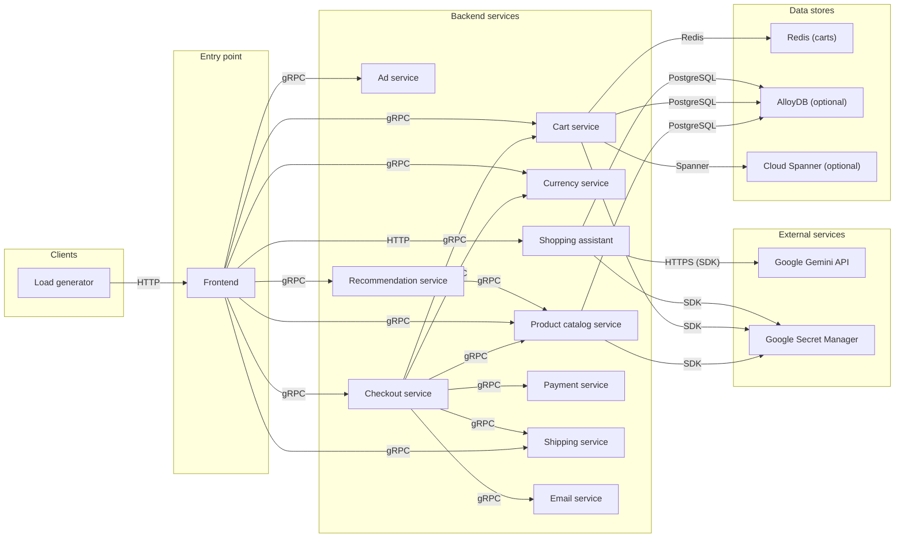
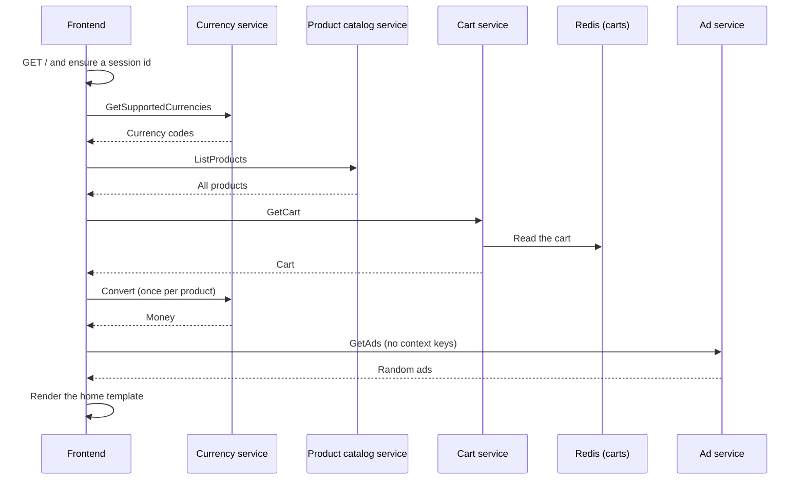
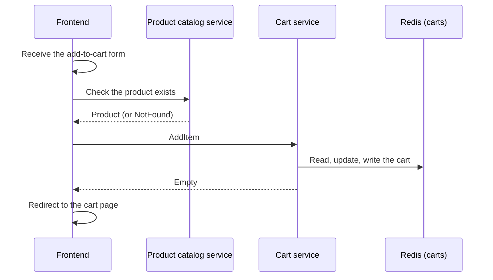
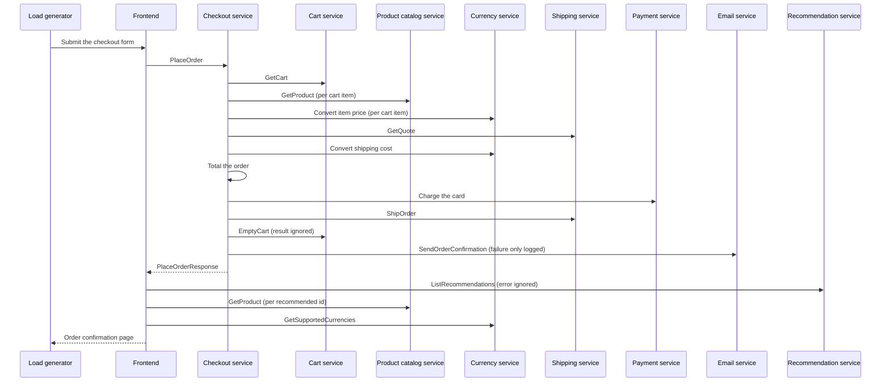

# Online Boutique Map

> Generated by [evidence-architecture-map](https://github.com/majdukovic/evidence-architecture-map) from the JSON files next to this one. Do not edit by hand.
> Every statement links to the line of code that supports it, at the commit checked on 2026-11-10.
> The interactive version is `architecture.html`.

## Overview



## Components

### Clients

#### Load generator

Locust (Python) script that plays fake shoppers against the frontend over HTTP: browsing, changing currency, adding to cart, viewing the cart and checking out with generated VISA card numbers. CI uses its error count as the smoke test.

> It always pays with a Faker-generated VISA number and an expiry year after the current one, so the payment service's card-type and expired-card rejections are never exercised.

- **Repo:** [microservices-demo](https://github.com/GoogleCloudPlatform/microservices-demo/tree/c7cb6d5bfd6ea3aed768634ebbcb98cb7a523712)
- **Calls / sends to:** Frontend (HTTP)
- **Evidence:**
  - [microservices-demo › Dockerfile:52](https://github.com/GoogleCloudPlatform/microservices-demo/blob/c7cb6d5bfd6ea3aed768634ebbcb98cb7a523712/src/loadgenerator/Dockerfile#L52) `locust --host="http://${FRONTEND_ADDR}" --headless`
  - [microservices-demo › locustfile.py:90](https://github.com/GoogleCloudPlatform/microservices-demo/blob/c7cb6d5bfd6ea3aed768634ebbcb98cb7a523712/src/loadgenerator/locustfile.py#L90) `class WebsiteUser(FastHttpUser):`
  - [microservices-demo › locustfile.py:68](https://github.com/GoogleCloudPlatform/microservices-demo/blob/c7cb6d5bfd6ea3aed768634ebbcb98cb7a523712/src/loadgenerator/locustfile.py#L68) `fake.credit_card_number(card_type="visa")`
  - [microservices-demo › loadgenerator.yaml:80](https://github.com/GoogleCloudPlatform/microservices-demo/blob/c7cb6d5bfd6ea3aed768634ebbcb98cb7a523712/kubernetes-manifests/loadgenerator.yaml#L80) `image: loadgenerator`
  - [microservices-demo › locustfile.py:70](https://github.com/GoogleCloudPlatform/microservices-demo/blob/c7cb6d5bfd6ea3aed768634ebbcb98cb7a523712/src/loadgenerator/locustfile.py#L70) `random.randint(current_year, current_year + 70)`
  - [microservices-demo › locustfile.py:60](https://github.com/GoogleCloudPlatform/microservices-demo/blob/c7cb6d5bfd6ea3aed768634ebbcb98cb7a523712/src/loadgenerator/locustfile.py#L60) `current_year = datetime.datetime.now().year+1`

### Entry point

#### Frontend

Go web server that renders the shop's HTML pages. Every page handler calls the backend services over gRPC and stitches the results together; it also proxies the chat box to the **Shopping assistant** over HTTP.

> The shopper's identity is just a random UUID in the `shop_session-id` cookie; it is passed to backends as `user_id`.

- **Repo:** [microservices-demo](https://github.com/GoogleCloudPlatform/microservices-demo/tree/c7cb6d5bfd6ea3aed768634ebbcb98cb7a523712)
- **Exposes:** `GET /`, `GET /product/{id}`, `GET /cart`, `POST /cart`, `POST /cart/empty`, `POST /setCurrency`, `POST /cart/checkout`, `GET /assistant`, `POST /bot`, `GET /product-meta/{ids}`, `GET /logout`, `GET /_healthz`
- **Stores data in:** Cookie: shop_session-id, Cookie: shop_currency
- **Calls / sends to:** Checkout service (gRPC), Shipping service (gRPC), Product catalog service (gRPC), Currency service (gRPC), Cart service (gRPC), Recommendation service (gRPC), Ad service (gRPC), Shopping assistant (HTTP)
- **Called by / receives from:** Load generator (HTTP)
- **Evidence:**
  - [microservices-demo › main.go:150](https://github.com/GoogleCloudPlatform/microservices-demo/blob/c7cb6d5bfd6ea3aed768634ebbcb98cb7a523712/src/frontend/main.go#L150) `r.HandleFunc(baseUrl+"/", svc.homeHandler)`
  - [microservices-demo › main.go:171](https://github.com/GoogleCloudPlatform/microservices-demo/blob/c7cb6d5bfd6ea3aed768634ebbcb98cb7a523712/src/frontend/main.go#L171) `http.ListenAndServe(addr+":"+srvPort, handler)`
  - [microservices-demo › Dockerfile:44](https://github.com/GoogleCloudPlatform/microservices-demo/blob/c7cb6d5bfd6ea3aed768634ebbcb98cb7a523712/src/frontend/Dockerfile#L44) `ENTRYPOINT ["/src/server"]`
  - [microservices-demo › frontend.yaml:130](https://github.com/GoogleCloudPlatform/microservices-demo/blob/c7cb6d5bfd6ea3aed768634ebbcb98cb7a523712/kubernetes-manifests/frontend.yaml#L130) `type: LoadBalancer`
  - [microservices-demo › main.go:44](https://github.com/GoogleCloudPlatform/microservices-demo/blob/c7cb6d5bfd6ea3aed768634ebbcb98cb7a523712/src/frontend/main.go#L44) `cookieSessionID = cookiePrefix + "session-id"`

### Backend services

#### Product catalog service

Go gRPC service that returns the product list and single products. By default it loads the catalogue from the bundled `products.json`; if `ALLOYDB_CLUSTER_NAME` is set it reads it from an AlloyDB table instead.

- **Repo:** [microservices-demo](https://github.com/GoogleCloudPlatform/microservices-demo/tree/c7cb6d5bfd6ea3aed768634ebbcb98cb7a523712)
- **Exposes:** `gRPC ListProducts`, `gRPC GetProduct`, `gRPC SearchProducts`, `port 3550`
- **Stores data in:** products.json (default, read-only), AlloyDB products table (optional)
- **Calls / sends to:** AlloyDB (optional) (PostgreSQL), Google Secret Manager (SDK)
- **Called by / receives from:** Checkout service (gRPC), Frontend (gRPC), Recommendation service (gRPC)
- **Evidence:**
  - [microservices-demo › server.go:143](https://github.com/GoogleCloudPlatform/microservices-demo/blob/c7cb6d5bfd6ea3aed768634ebbcb98cb7a523712/src/productcatalogservice/server.go#L143) `pb.RegisterProductCatalogServiceServer(srv, svc)`
  - [microservices-demo › catalog_loader.go:47](https://github.com/GoogleCloudPlatform/microservices-demo/blob/c7cb6d5bfd6ea3aed768634ebbcb98cb7a523712/src/productcatalogservice/catalog_loader.go#L47) `os.ReadFile("products.json")`
  - [microservices-demo › catalog_loader.go:37](https://github.com/GoogleCloudPlatform/microservices-demo/blob/c7cb6d5bfd6ea3aed768634ebbcb98cb7a523712/src/productcatalogservice/catalog_loader.go#L37) `os.Getenv("ALLOYDB_CLUSTER_NAME") != ""`
  - [microservices-demo › demo.proto:71](https://github.com/GoogleCloudPlatform/microservices-demo/blob/c7cb6d5bfd6ea3aed768634ebbcb98cb7a523712/protos/demo.proto#L71) `service ProductCatalogService {`
  - [microservices-demo › Dockerfile:43](https://github.com/GoogleCloudPlatform/microservices-demo/blob/c7cb6d5bfd6ea3aed768634ebbcb98cb7a523712/src/productcatalogservice/Dockerfile#L43) `EXPOSE 3550`
- **Tests and test helpers:**
  - `TestGetProductExists` [microservices-demo › product_catalog_test.go:58](https://github.com/GoogleCloudPlatform/microservices-demo/blob/c7cb6d5bfd6ea3aed768634ebbcb98cb7a523712/src/productcatalogservice/product_catalog_test.go#L58) `func TestGetProductExists(t *testing.T)`
  - `TestListProducts` [microservices-demo › product_catalog_test.go:79](https://github.com/GoogleCloudPlatform/microservices-demo/blob/c7cb6d5bfd6ea3aed768634ebbcb98cb7a523712/src/productcatalogservice/product_catalog_test.go#L79) `func TestListProducts(t *testing.T)`

#### Currency service

Node.js gRPC service that lists supported currencies and converts a `Money` amount via EUR, using fixed rates from a JSON file shipped in the image.

- **Repo:** [microservices-demo](https://github.com/GoogleCloudPlatform/microservices-demo/tree/c7cb6d5bfd6ea3aed768634ebbcb98cb7a523712)
- **Exposes:** `gRPC GetSupportedCurrencies`, `gRPC Convert`, `port 7000 (from PORT)`
- **Stores data in:** data/currency_conversion.json (static rates)
- **Called by / receives from:** Checkout service (gRPC), Frontend (gRPC)
- **Evidence:**
  - [microservices-demo › server.js:185](https://github.com/GoogleCloudPlatform/microservices-demo/blob/c7cb6d5bfd6ea3aed768634ebbcb98cb7a523712/src/currencyservice/server.js#L185) `shopProto.CurrencyService.service, {getSupportedCurrencies, convert}`
  - [microservices-demo › server.js:110](https://github.com/GoogleCloudPlatform/microservices-demo/blob/c7cb6d5bfd6ea3aed768634ebbcb98cb7a523712/src/currencyservice/server.js#L110) `require('./data/currency_conversion.json')`
  - [microservices-demo › Dockerfile:45](https://github.com/GoogleCloudPlatform/microservices-demo/blob/c7cb6d5bfd6ea3aed768634ebbcb98cb7a523712/src/currencyservice/Dockerfile#L45) `ENTRYPOINT [ "node", "server.js" ]`
  - [microservices-demo › server.js:80](https://github.com/GoogleCloudPlatform/microservices-demo/blob/c7cb6d5bfd6ea3aed768634ebbcb98cb7a523712/src/currencyservice/server.js#L80) `path.join(__dirname, './proto/demo.proto')`
  - [microservices-demo › server.js:83](https://github.com/GoogleCloudPlatform/microservices-demo/blob/c7cb6d5bfd6ea3aed768634ebbcb98cb7a523712/src/currencyservice/server.js#L83) `const PORT = process.env.PORT;`
  - [microservices-demo › currencyservice.yaml:52](https://github.com/GoogleCloudPlatform/microservices-demo/blob/c7cb6d5bfd6ea3aed768634ebbcb98cb7a523712/kubernetes-manifests/currencyservice.yaml#L52) `value: "7000"`

#### Cart service

C# (.NET) gRPC service that adds items to, reads and empties a shopper's cart, keyed by `user_id`. The store is chosen at start-up from env vars: Redis (default), Spanner, AlloyDB, or an in-process memory cache when none is set.

> The class is called `RedisCartStore` even when it runs on the in-memory cache.

- **Repo:** [microservices-demo](https://github.com/GoogleCloudPlatform/microservices-demo/tree/c7cb6d5bfd6ea3aed768634ebbcb98cb7a523712)
- **Exposes:** `gRPC AddItem`, `gRPC GetCart`, `gRPC EmptyCart`, `port 7070`
- **Stores data in:** Redis: key = user_id, value = Cart protobuf (default), Spanner: CartItems (optional), AlloyDB: table named by ALLOYDB_TABLE_NAME (optional)
- **Calls / sends to:** Redis (carts) (Redis), AlloyDB (optional) (PostgreSQL), Google Secret Manager (SDK), Cloud Spanner (optional) (Spanner)
- **Called by / receives from:** Checkout service (gRPC), Frontend (gRPC)
- **Evidence:**
  - [microservices-demo › Startup.cs:74](https://github.com/GoogleCloudPlatform/microservices-demo/blob/c7cb6d5bfd6ea3aed768634ebbcb98cb7a523712/src/cartservice/src/Startup.cs#L74) `endpoints.MapGrpcService<CartService>();`
  - [microservices-demo › CartService.cs:34](https://github.com/GoogleCloudPlatform/microservices-demo/blob/c7cb6d5bfd6ea3aed768634ebbcb98cb7a523712/src/cartservice/src/services/CartService.cs#L34) `public async override Task<Empty> AddItem(`
  - [microservices-demo › Startup.cs:40](https://github.com/GoogleCloudPlatform/microservices-demo/blob/c7cb6d5bfd6ea3aed768634ebbcb98cb7a523712/src/cartservice/src/Startup.cs#L40) `services.AddSingleton<ICartStore, RedisCartStore>();`
  - [microservices-demo › cartservice.csproj:17](https://github.com/GoogleCloudPlatform/microservices-demo/blob/c7cb6d5bfd6ea3aed768634ebbcb98cb7a523712/src/cartservice/src/cartservice.csproj#L17) `Include="protos\Cart.proto"`
  - [microservices-demo › Dockerfile:40](https://github.com/GoogleCloudPlatform/microservices-demo/blob/c7cb6d5bfd6ea3aed768634ebbcb98cb7a523712/src/cartservice/src/Dockerfile#L40) `EXPOSE 7070`
  - [microservices-demo › SpannerCartStore.cs:25](https://github.com/GoogleCloudPlatform/microservices-demo/blob/c7cb6d5bfd6ea3aed768634ebbcb98cb7a523712/src/cartservice/src/cartstore/SpannerCartStore.cs#L25) `TableName = "CartItems";`
  - [microservices-demo › AlloyDBCartStore.cs:58](https://github.com/GoogleCloudPlatform/microservices-demo/blob/c7cb6d5bfd6ea3aed768634ebbcb98cb7a523712/src/cartservice/src/cartstore/AlloyDBCartStore.cs#L58) `tableName = configuration["ALLOYDB_TABLE_NAME"];`
- **Tests and test helpers:**
  - `AddItem_New_Inserted` [microservices-demo › CartServiceTests.cs:117](https://github.com/GoogleCloudPlatform/microservices-demo/blob/c7cb6d5bfd6ea3aed768634ebbcb98cb7a523712/src/cartservice/tests/CartServiceTests.cs#L117) `public async Task AddItem_New_Inserted()`
  - `AddItem_ItemExists_Updated` [microservices-demo › CartServiceTests.cs:71](https://github.com/GoogleCloudPlatform/microservices-demo/blob/c7cb6d5bfd6ea3aed768634ebbcb98cb7a523712/src/cartservice/tests/CartServiceTests.cs#L71) `public async Task AddItem_ItemExists_Updated()`
  - `GetItem_NoAddItemBefore_EmptyCartReturned` [microservices-demo › CartServiceTests.cs:42](https://github.com/GoogleCloudPlatform/microservices-demo/blob/c7cb6d5bfd6ea3aed768634ebbcb98cb7a523712/src/cartservice/tests/CartServiceTests.cs#L42) `GetItem_NoAddItemBefore_EmptyCartReturned()`

#### Ad service

Java gRPC service that returns text ads for given category keys, or random ads when no key matches. Ads are a hard-coded in-memory map.

- **Repo:** [microservices-demo](https://github.com/GoogleCloudPlatform/microservices-demo/tree/c7cb6d5bfd6ea3aed768634ebbcb98cb7a523712)
- **Exposes:** `gRPC GetAds`, `port 9555`
- **Stores data in:** In-memory ads map (hard-coded)
- **Called by / receives from:** Frontend (gRPC)
- **Evidence:**
  - [microservices-demo › AdService.java:59](https://github.com/GoogleCloudPlatform/microservices-demo/blob/c7cb6d5bfd6ea3aed768634ebbcb98cb7a523712/src/adservice/src/main/java/hipstershop/AdService.java#L59) `.addService(new AdServiceImpl())`
  - [microservices-demo › AdService.java:54](https://github.com/GoogleCloudPlatform/microservices-demo/blob/c7cb6d5bfd6ea3aed768634ebbcb98cb7a523712/src/adservice/src/main/java/hipstershop/AdService.java#L54) `getOrDefault("PORT", "9555")`
  - [microservices-demo › AdService.java:185](https://github.com/GoogleCloudPlatform/microservices-demo/blob/c7cb6d5bfd6ea3aed768634ebbcb98cb7a523712/src/adservice/src/main/java/hipstershop/AdService.java#L185) `ImmutableListMultimap.<String, Ad>builder()`
  - [microservices-demo › build.gradle:96](https://github.com/GoogleCloudPlatform/microservices-demo/blob/c7cb6d5bfd6ea3aed768634ebbcb98cb7a523712/src/adservice/build.gradle#L96) `mainClass.set('hipstershop.AdService')`

#### Recommendation service

Python gRPC service that fetches the whole catalogue from the **Product catalog** and returns up to 5 random product ids not in the request. It does not use the user id.

- **Repo:** [microservices-demo](https://github.com/GoogleCloudPlatform/microservices-demo/tree/c7cb6d5bfd6ea3aed768634ebbcb98cb7a523712)
- **Exposes:** `gRPC ListRecommendations`, `port 8080`
- **Calls / sends to:** Product catalog service (gRPC)
- **Called by / receives from:** Frontend (gRPC)
- **Evidence:**
  - [microservices-demo › recommendation_server.py:143](https://github.com/GoogleCloudPlatform/microservices-demo/blob/c7cb6d5bfd6ea3aed768634ebbcb98cb7a523712/src/recommendationservice/recommendation_server.py#L143) `add_RecommendationServiceServicer_to_server(service, server)`
  - [microservices-demo › recommendation_server.py:79](https://github.com/GoogleCloudPlatform/microservices-demo/blob/c7cb6d5bfd6ea3aed768634ebbcb98cb7a523712/src/recommendationservice/recommendation_server.py#L79) `random.sample(range(num_products), num_return)`
  - [microservices-demo › Dockerfile:55](https://github.com/GoogleCloudPlatform/microservices-demo/blob/c7cb6d5bfd6ea3aed768634ebbcb98cb7a523712/src/recommendationservice/Dockerfile#L55) `ENTRYPOINT ["python", "recommendation_server.py"]`

#### Shopping assistant

Optional Python Flask service behind the shop's chat box. It asks Gemini to describe an uploaded room photo, runs a vector similarity search over product descriptions in AlloyDB, then asks Gemini again for recommendations and returns the text. It reads the AlloyDB password from **Secret Manager** and opens the AlloyDB vector store when the module loads, so it cannot start without both.

> Not in the default deployment: only added by the `shopping-assistant` kustomize component, and not available in the Helm chart.

- **Repo:** [microservices-demo](https://github.com/GoogleCloudPlatform/microservices-demo/tree/c7cb6d5bfd6ea3aed768634ebbcb98cb7a523712)
- **Exposes:** `HTTP POST / (container 8080, Service port 80)`
- **Calls / sends to:** Google Gemini API (HTTPS (SDK)), AlloyDB (optional) (PostgreSQL), Google Secret Manager (SDK)
- **Called by / receives from:** Frontend (HTTP)
- **Evidence:**
  - [microservices-demo › shoppingassistantservice.py:65](https://github.com/GoogleCloudPlatform/microservices-demo/blob/c7cb6d5bfd6ea3aed768634ebbcb98cb7a523712/src/shoppingassistantservice/shoppingassistantservice.py#L65) `@app.route("/", methods=['POST'])`
  - [microservices-demo › shoppingassistantservice.py:120](https://github.com/GoogleCloudPlatform/microservices-demo/blob/c7cb6d5bfd6ea3aed768634ebbcb98cb7a523712/src/shoppingassistantservice/shoppingassistantservice.py#L120) `app.run(host='0.0.0.0', port=8080)`
  - [microservices-demo › kustomization.yaml:18](https://github.com/GoogleCloudPlatform/microservices-demo/blob/c7cb6d5bfd6ea3aed768634ebbcb98cb7a523712/kustomize/components/shopping-assistant/kustomization.yaml#L18) `- shoppingassistantservice.yaml`
  - [microservices-demo › values.yaml:216](https://github.com/GoogleCloudPlatform/microservices-demo/blob/c7cb6d5bfd6ea3aed768634ebbcb98cb7a523712/helm-chart/values.yaml#L216) `@TODO: This service is not currently available in Helm.`
  - [microservices-demo › Dockerfile:47](https://github.com/GoogleCloudPlatform/microservices-demo/blob/c7cb6d5bfd6ea3aed768634ebbcb98cb7a523712/src/shoppingassistantservice/Dockerfile#L47) `ENTRYPOINT ["python", "shoppingassistantservice.py"]`
  - [microservices-demo › shoppingassistantservice.yaml:87](https://github.com/GoogleCloudPlatform/microservices-demo/blob/c7cb6d5bfd6ea3aed768634ebbcb98cb7a523712/kustomize/components/shopping-assistant/shoppingassistantservice.yaml#L87) `port: 80`
  - [microservices-demo › shoppingassistantservice.py:52](https://github.com/GoogleCloudPlatform/microservices-demo/blob/c7cb6d5bfd6ea3aed768634ebbcb98cb7a523712/src/shoppingassistantservice/shoppingassistantservice.py#L52) `vectorstore = AlloyDBVectorStore.create_sync(`

#### Checkout service

Go gRPC service that turns a shopper's cart into an order: it reads the cart, prices every item and the shipping in the shopper's currency, asks **Payment** to charge the card, asks **Shipping** to ship, empties the cart and asks **Email** to send a confirmation.

> It stores nothing itself: the order id is a fresh UUID and the order only lives in the reply and the confirmation request.

- **Repo:** [microservices-demo](https://github.com/GoogleCloudPlatform/microservices-demo/tree/c7cb6d5bfd6ea3aed768634ebbcb98cb7a523712)
- **Exposes:** `gRPC: hipstershop.CheckoutService/PlaceOrder`, `gRPC: grpc.health.v1.Health`, `port 5050`
- **Calls / sends to:** Cart service (gRPC), Product catalog service (gRPC), Currency service (gRPC), Shipping service (gRPC), Payment service (gRPC), Email service (gRPC)
- **Called by / receives from:** Frontend (gRPC)
- **Evidence:**
  - [microservices-demo › main.go:142](https://github.com/GoogleCloudPlatform/microservices-demo/blob/c7cb6d5bfd6ea3aed768634ebbcb98cb7a523712/src/checkoutservice/main.go#L142) `pb.RegisterCheckoutServiceServer(srv, svc)`
  - [microservices-demo › main.go:46](https://github.com/GoogleCloudPlatform/microservices-demo/blob/c7cb6d5bfd6ea3aed768634ebbcb98cb7a523712/src/checkoutservice/main.go#L46) `listenPort  = "5050"`
  - [microservices-demo › main.go:230](https://github.com/GoogleCloudPlatform/microservices-demo/blob/c7cb6d5bfd6ea3aed768634ebbcb98cb7a523712/src/checkoutservice/main.go#L230) `func (cs *checkoutService) PlaceOrder(`
  - [microservices-demo › main.go:233](https://github.com/GoogleCloudPlatform/microservices-demo/blob/c7cb6d5bfd6ea3aed768634ebbcb98cb7a523712/src/checkoutservice/main.go#L233) `orderID, err := uuid.NewUUID()`
  - [microservices-demo › demo.proto:225](https://github.com/GoogleCloudPlatform/microservices-demo/blob/c7cb6d5bfd6ea3aed768634ebbcb98cb7a523712/protos/demo.proto#L225) `rpc PlaceOrder(PlaceOrderRequest) returns (PlaceOrderResponse)`
  - [microservices-demo › Dockerfile:44](https://github.com/GoogleCloudPlatform/microservices-demo/blob/c7cb6d5bfd6ea3aed768634ebbcb98cb7a523712/src/checkoutservice/Dockerfile#L44) `ENTRYPOINT ["/src/checkoutservice"]`
- **Tests and test helpers:**
  - `TestSum` [microservices-demo › money_test.go:202](https://github.com/GoogleCloudPlatform/microservices-demo/blob/c7cb6d5bfd6ea3aed768634ebbcb98cb7a523712/src/checkoutservice/money/money_test.go#L202) `func TestSum(t *testing.T) {`

#### Payment service

Node.js gRPC service that pretends to charge a card. It only validates the card number, accepts only VISA or MasterCard, rejects expired cards, logs the transaction and returns a random UUID as the transaction id. No payment provider is called and no money moves.

> The CVV is never checked and no transaction is stored (the id is just `uuidv4()`), but every Charge call logs the full request, including card number and CVV, to stdout.

- **Repo:** [microservices-demo](https://github.com/GoogleCloudPlatform/microservices-demo/tree/c7cb6d5bfd6ea3aed768634ebbcb98cb7a523712)
- **Exposes:** `gRPC: hipstershop.PaymentService/Charge`, `gRPC: grpc.health.v1.Health`, `port 50051 (from PORT)`
- **Called by / receives from:** Checkout service (gRPC)
- **Evidence:**
  - [microservices-demo › server.js:89](https://github.com/GoogleCloudPlatform/microservices-demo/blob/c7cb6d5bfd6ea3aed768634ebbcb98cb7a523712/src/paymentservice/server.js#L89) `hipsterShopPackage.PaymentService.service`
  - [microservices-demo › server.js:91](https://github.com/GoogleCloudPlatform/microservices-demo/blob/c7cb6d5bfd6ea3aed768634ebbcb98cb7a523712/src/paymentservice/server.js#L91) `charge: HipsterShopServer.ChargeServiceHandler.bind(this)`
  - [microservices-demo › server.js:43](https://github.com/GoogleCloudPlatform/microservices-demo/blob/c7cb6d5bfd6ea3aed768634ebbcb98cb7a523712/src/paymentservice/server.js#L43) `PaymentService#Charge invoked with request ${JSON.stringify(`
  - [microservices-demo › charge.js:56](https://github.com/GoogleCloudPlatform/microservices-demo/blob/c7cb6d5bfd6ea3aed768634ebbcb98cb7a523712/src/paymentservice/charge.js#L56) `Verifies the credit card number and (pretend) charges the card.`
  - [microservices-demo › charge.js:64](https://github.com/GoogleCloudPlatform/microservices-demo/blob/c7cb6d5bfd6ea3aed768634ebbcb98cb7a523712/src/paymentservice/charge.js#L64) `const cardInfo = cardValidator(cardNumber);`
  - [microservices-demo › charge.js:74](https://github.com/GoogleCloudPlatform/microservices-demo/blob/c7cb6d5bfd6ea3aed768634ebbcb98cb7a523712/src/paymentservice/charge.js#L74) `if (!(cardType === 'visa' || cardType === 'mastercard'))`
  - [microservices-demo › charge.js:80](https://github.com/GoogleCloudPlatform/microservices-demo/blob/c7cb6d5bfd6ea3aed768634ebbcb98cb7a523712/src/paymentservice/charge.js#L80) `throw new ExpiredCreditCard(`
  - [microservices-demo › charge.js:85](https://github.com/GoogleCloudPlatform/microservices-demo/blob/c7cb6d5bfd6ea3aed768634ebbcb98cb7a523712/src/paymentservice/charge.js#L85) `return { transaction_id: uuidv4() };`
  - [microservices-demo › Dockerfile:45](https://github.com/GoogleCloudPlatform/microservices-demo/blob/c7cb6d5bfd6ea3aed768634ebbcb98cb7a523712/src/paymentservice/Dockerfile#L45) `ENTRYPOINT [ "node", "index.js" ]`
  - [microservices-demo › index.js:70](https://github.com/GoogleCloudPlatform/microservices-demo/blob/c7cb6d5bfd6ea3aed768634ebbcb98cb7a523712/src/paymentservice/index.js#L70) `const PORT = process.env['PORT'];`
  - [microservices-demo › paymentservice.yaml:51](https://github.com/GoogleCloudPlatform/microservices-demo/blob/c7cb6d5bfd6ea3aed768634ebbcb98cb7a523712/kubernetes-manifests/paymentservice.yaml#L51) `value: "50051"`

#### Shipping service

Go gRPC service that quotes and "ships" orders without any carrier. A quote is a flat 8.99 USD for any non-empty cart (0 for an empty one); shipping an order just makes up a random tracking id.

> GetQuote looks only at item quantities, not at the address.

- **Repo:** [microservices-demo](https://github.com/GoogleCloudPlatform/microservices-demo/tree/c7cb6d5bfd6ea3aed768634ebbcb98cb7a523712)
- **Exposes:** `gRPC: hipstershop.ShippingService/GetQuote`, `gRPC: hipstershop.ShippingService/ShipOrder`, `gRPC: grpc.health.v1.Health`, `port 50051`
- **Called by / receives from:** Frontend (gRPC), Checkout service (gRPC)
- **Evidence:**
  - [microservices-demo › main.go:92](https://github.com/GoogleCloudPlatform/microservices-demo/blob/c7cb6d5bfd6ea3aed768634ebbcb98cb7a523712/src/shippingservice/main.go#L92) `pb.RegisterShippingServiceServer(srv, svc)`
  - [microservices-demo › main.go:37](https://github.com/GoogleCloudPlatform/microservices-demo/blob/c7cb6d5bfd6ea3aed768634ebbcb98cb7a523712/src/shippingservice/main.go#L37) `defaultPort = "50051"`
  - [microservices-demo › quote.go:38](https://github.com/GoogleCloudPlatform/microservices-demo/blob/c7cb6d5bfd6ea3aed768634ebbcb98cb7a523712/src/shippingservice/quote.go#L38) `return CreateQuoteFromFloat(8.99)`
  - [microservices-demo › main.go:140](https://github.com/GoogleCloudPlatform/microservices-demo/blob/c7cb6d5bfd6ea3aed768634ebbcb98cb7a523712/src/shippingservice/main.go#L140) `ShipOrder mocks that the requested items will be shipped.`
  - [microservices-demo › main.go:147](https://github.com/GoogleCloudPlatform/microservices-demo/blob/c7cb6d5bfd6ea3aed768634ebbcb98cb7a523712/src/shippingservice/main.go#L147) `id := CreateTrackingId(baseAddress)`
  - [microservices-demo › tracker.go:36](https://github.com/GoogleCloudPlatform/microservices-demo/blob/c7cb6d5bfd6ea3aed768634ebbcb98cb7a523712/src/shippingservice/tracker.go#L36) `return 65 + uint32(rand.Intn(25))`
  - [microservices-demo › Dockerfile:44](https://github.com/GoogleCloudPlatform/microservices-demo/blob/c7cb6d5bfd6ea3aed768634ebbcb98cb7a523712/src/shippingservice/Dockerfile#L44) `ENTRYPOINT ["/src/shippingservice"]`
- **Tests and test helpers:**
  - `TestGetQuote` [microservices-demo › shippingservice_test.go:27](https://github.com/GoogleCloudPlatform/microservices-demo/blob/c7cb6d5bfd6ea3aed768634ebbcb98cb7a523712/src/shippingservice/shippingservice_test.go#L27) `func TestGetQuote(t *testing.T) {`
  - `TestShipOrder` [microservices-demo › shippingservice_test.go:83](https://github.com/GoogleCloudPlatform/microservices-demo/blob/c7cb6d5bfd6ea3aed768634ebbcb98cb7a523712/src/shippingservice/shippingservice_test.go#L83) `func TestShipOrder(t *testing.T) {`

#### Email service

Python gRPC service that receives order confirmation requests. It always starts in dummy mode, which only writes a log line that a confirmation was requested; no email is sent.

> The real sender class raises `cloud mail client not implemented`, and non-dummy mode raises too.

- **Repo:** [microservices-demo](https://github.com/GoogleCloudPlatform/microservices-demo/tree/c7cb6d5bfd6ea3aed768634ebbcb98cb7a523712)
- **Exposes:** `gRPC: hipstershop.EmailService/SendOrderConfirmation`, `gRPC: grpc.health.v1.Health`, `port 8080 (Kubernetes Service port 5000)`
- **Called by / receives from:** Checkout service (gRPC)
- **Evidence:**
  - [microservices-demo › email_server.py:200](https://github.com/GoogleCloudPlatform/microservices-demo/blob/c7cb6d5bfd6ea3aed768634ebbcb98cb7a523712/src/emailservice/email_server.py#L200) `start(dummy_mode = True)`
  - [microservices-demo › email_server.py:110](https://github.com/GoogleCloudPlatform/microservices-demo/blob/c7cb6d5bfd6ea3aed768634ebbcb98cb7a523712/src/emailservice/email_server.py#L110) `A request to send order confirmation email to {} has been received.`
  - [microservices-demo › email_server.py:63](https://github.com/GoogleCloudPlatform/microservices-demo/blob/c7cb6d5bfd6ea3aed768634ebbcb98cb7a523712/src/emailservice/email_server.py#L63) `raise Exception('cloud mail client not implemented')`
  - [microservices-demo › email_server.py:124](https://github.com/GoogleCloudPlatform/microservices-demo/blob/c7cb6d5bfd6ea3aed768634ebbcb98cb7a523712/src/emailservice/email_server.py#L124) `raise Exception('non-dummy mode not implemented yet')`
  - [microservices-demo › email_server.py:126](https://github.com/GoogleCloudPlatform/microservices-demo/blob/c7cb6d5bfd6ea3aed768634ebbcb98cb7a523712/src/emailservice/email_server.py#L126) `demo_pb2_grpc.add_EmailServiceServicer_to_server(service, server)`
  - [microservices-demo › Dockerfile:54](https://github.com/GoogleCloudPlatform/microservices-demo/blob/c7cb6d5bfd6ea3aed768634ebbcb98cb7a523712/src/emailservice/Dockerfile#L54) `ENTRYPOINT [ "python", "email_server.py" ]`
  - [microservices-demo › email_server.py:129](https://github.com/GoogleCloudPlatform/microservices-demo/blob/c7cb6d5bfd6ea3aed768634ebbcb98cb7a523712/src/emailservice/email_server.py#L129) `port = os.environ.get('PORT', "8080")`
  - [microservices-demo › emailservice.yaml:82](https://github.com/GoogleCloudPlatform/microservices-demo/blob/c7cb6d5bfd6ea3aed768634ebbcb98cb7a523712/kubernetes-manifests/emailservice.yaml#L82) `port: 5000`

### Data stores

#### Redis (carts)

In-cluster Redis (`redis:alpine`) deployed next to the cart service in the default manifests. Its data volume is an `emptyDir`, so carts are lost when the pod is replaced.

> The optional `memorystore`, `spanner` and `alloydb` kustomize components delete this Deployment and Service.

- **Repo:** [microservices-demo](https://github.com/GoogleCloudPlatform/microservices-demo/tree/c7cb6d5bfd6ea3aed768634ebbcb98cb7a523712)
- **Exposes:** `Redis port 6379`
- **Stores data in:** Carts (serialised Cart protobuf per user_id)
- **Called by / receives from:** Cart service (Redis)
- **Evidence:**
  - [microservices-demo › cartservice.yaml:92](https://github.com/GoogleCloudPlatform/microservices-demo/blob/c7cb6d5bfd6ea3aed768634ebbcb98cb7a523712/kubernetes-manifests/cartservice.yaml#L92) `name: redis-cart`
  - [microservices-demo › cartservice.yaml:118](https://github.com/GoogleCloudPlatform/microservices-demo/blob/c7cb6d5bfd6ea3aed768634ebbcb98cb7a523712/kubernetes-manifests/cartservice.yaml#L118) `image: redis:alpine`
  - [microservices-demo › cartservice.yaml:141](https://github.com/GoogleCloudPlatform/microservices-demo/blob/c7cb6d5bfd6ea3aed768634ebbcb98cb7a523712/kubernetes-manifests/cartservice.yaml#L141) `emptyDir: {}`
  - [microservices-demo › values.yaml:202](https://github.com/GoogleCloudPlatform/microservices-demo/blob/c7cb6d5bfd6ea3aed768634ebbcb98cb7a523712/helm-chart/values.yaml#L202) `type: redis`

#### AlloyDB (optional)

Google Cloud AlloyDB for PostgreSQL, created outside Kubernetes with `gcloud`. The `alloydb` kustomize component points the cart and product catalogue services at it, and the shopping assistant always needs it for its vector search over product descriptions.

> Not part of the default deployment: the kustomize components only pass placeholder connection settings such as `ALLOYDB_PRIMARY_IP_VAL`.

- **Repo:** [microservices-demo](https://github.com/GoogleCloudPlatform/microservices-demo/tree/c7cb6d5bfd6ea3aed768634ebbcb98cb7a523712)
- **Stores data in:** Carts table (optional, cart service), Products table (optional, product catalogue), Product description embeddings (shopping assistant)
- **Called by / receives from:** Product catalog service (PostgreSQL), Cart service (PostgreSQL), Shopping assistant (PostgreSQL)
- **Evidence:**
  - [microservices-demo › 1_deploy_alloydb_infra.sh:69](https://github.com/GoogleCloudPlatform/microservices-demo/blob/c7cb6d5bfd6ea3aed768634ebbcb98cb7a523712/kustomize/components/shopping-assistant/scripts/1_deploy_alloydb_infra.sh#L69) `gcloud alloydb instances create`
  - [microservices-demo › kustomization.yaml:35](https://github.com/GoogleCloudPlatform/microservices-demo/blob/c7cb6d5bfd6ea3aed768634ebbcb98cb7a523712/kustomize/components/alloydb/kustomization.yaml#L35) `value: ALLOYDB_PRIMARY_IP_VAL`
  - [microservices-demo › kustomization.yaml:64](https://github.com/GoogleCloudPlatform/microservices-demo/blob/c7cb6d5bfd6ea3aed768634ebbcb98cb7a523712/kustomize/components/alloydb/kustomization.yaml#L64) `name: ALLOYDB_CLUSTER_NAME`
  - [microservices-demo › shoppingassistantservice.py:52](https://github.com/GoogleCloudPlatform/microservices-demo/blob/c7cb6d5bfd6ea3aed768634ebbcb98cb7a523712/src/shoppingassistantservice/shoppingassistantservice.py#L52) `AlloyDBVectorStore.create_sync(`

#### Cloud Spanner (optional)

Google Cloud Spanner, used as the cart store only when the `spanner` kustomize component sets `SPANNER_CONNECTION_STRING`. Carts are rows in the `CartItems` table (default instance `onlineboutique`, database `carts`).

- **Repo:** [microservices-demo](https://github.com/GoogleCloudPlatform/microservices-demo/tree/c7cb6d5bfd6ea3aed768634ebbcb98cb7a523712)
- **Stores data in:** CartItems (optional, cart service)
- **Called by / receives from:** Cart service (Spanner)
- **Evidence:**
  - [microservices-demo › kustomization.yaml:32](https://github.com/GoogleCloudPlatform/microservices-demo/blob/c7cb6d5bfd6ea3aed768634ebbcb98cb7a523712/kustomize/components/spanner/kustomization.yaml#L32) `name: SPANNER_CONNECTION_STRING`
  - [microservices-demo › SpannerCartStore.cs:25](https://github.com/GoogleCloudPlatform/microservices-demo/blob/c7cb6d5bfd6ea3aed768634ebbcb98cb7a523712/src/cartservice/src/cartstore/SpannerCartStore.cs#L25) `TableName = "CartItems";`
  - [microservices-demo › SpannerCartStore.cs:26](https://github.com/GoogleCloudPlatform/microservices-demo/blob/c7cb6d5bfd6ea3aed768634ebbcb98cb7a523712/src/cartservice/src/cartstore/SpannerCartStore.cs#L26) `DefaultInstanceName = "onlineboutique";`
  - [microservices-demo › SpannerCartStore.cs:27](https://github.com/GoogleCloudPlatform/microservices-demo/blob/c7cb6d5bfd6ea3aed768634ebbcb98cb7a523712/src/cartservice/src/cartstore/SpannerCartStore.cs#L27) `DefaultDatabaseName = "carts";`

### External services

#### Google Gemini API

Google's generative AI models, called by the Shopping assistant through LangChain (`gemini-1.5-flash` for chat and vision, `embedding-001` for embeddings). Only used when the shopping assistant is deployed.

- **Repo:** [microservices-demo](https://github.com/GoogleCloudPlatform/microservices-demo/tree/c7cb6d5bfd6ea3aed768634ebbcb98cb7a523712)
- **Called by / receives from:** Shopping assistant (HTTPS (SDK))
- **Evidence:**
  - [microservices-demo › shoppingassistantservice.py:72](https://github.com/GoogleCloudPlatform/microservices-demo/blob/c7cb6d5bfd6ea3aed768634ebbcb98cb7a523712/src/shoppingassistantservice/shoppingassistantservice.py#L72) `ChatGoogleGenerativeAI(model="gemini-1.5-flash")`
  - [microservices-demo › shoppingassistantservice.py:55](https://github.com/GoogleCloudPlatform/microservices-demo/blob/c7cb6d5bfd6ea3aed768634ebbcb98cb7a523712/src/shoppingassistantservice/shoppingassistantservice.py#L55) `GoogleGenerativeAIEmbeddings(model="models/embedding-001")`

#### Google Secret Manager

Google Cloud Secret Manager. The shopping assistant, and the cart and product catalogue services when they run on AlloyDB, read the AlloyDB password from the secret named by `ALLOYDB_SECRET_NAME` before connecting.

- **Repo:** [microservices-demo](https://github.com/GoogleCloudPlatform/microservices-demo/tree/c7cb6d5bfd6ea3aed768634ebbcb98cb7a523712)
- **Stores data in:** AlloyDB password (secret named by ALLOYDB_SECRET_NAME)
- **Called by / receives from:** Product catalog service (SDK), Cart service (SDK), Shopping assistant (SDK)
- **Evidence:**
  - [microservices-demo › shoppingassistantservice.py:19](https://github.com/GoogleCloudPlatform/microservices-demo/blob/c7cb6d5bfd6ea3aed768634ebbcb98cb7a523712/src/shoppingassistantservice/shoppingassistantservice.py#L19) `from google.cloud import secretmanager_v1`
  - [microservices-demo › catalog_loader.go:76](https://github.com/GoogleCloudPlatform/microservices-demo/blob/c7cb6d5bfd6ea3aed768634ebbcb98cb7a523712/src/productcatalogservice/catalog_loader.go#L76) `client.AccessSecretVersion(ctx, req)`
  - [microservices-demo › AlloyDBCartStore.cs:33](https://github.com/GoogleCloudPlatform/microservices-demo/blob/c7cb6d5bfd6ea3aed768634ebbcb98cb7a523712/src/cartservice/src/cartstore/AlloyDBCartStore.cs#L33) `SecretManagerServiceClient.Create()`

## Connections

| From | To | Protocol | What | Evidence |
|---|---|---|---|---|
| Load generator | Frontend | HTTP | Simulated shoppers browse, add to cart and check out (POST /cart/checkout) against the frontend | [microservices-demo › locustfile.py:61](https://github.com/GoogleCloudPlatform/microservices-demo/blob/c7cb6d5bfd6ea3aed768634ebbcb98cb7a523712/src/loadgenerator/locustfile.py#L61) `l.client.post("/cart/checkout", {`<br>[microservices-demo › Dockerfile:52](https://github.com/GoogleCloudPlatform/microservices-demo/blob/c7cb6d5bfd6ea3aed768634ebbcb98cb7a523712/src/loadgenerator/Dockerfile#L52) `--host="http://${FRONTEND_ADDR}"`<br>[microservices-demo › loadgenerator.yaml:83](https://github.com/GoogleCloudPlatform/microservices-demo/blob/c7cb6d5bfd6ea3aed768634ebbcb98cb7a523712/kubernetes-manifests/loadgenerator.yaml#L83) `value: "frontend:80"`<br>[microservices-demo › main.go:157](https://github.com/GoogleCloudPlatform/microservices-demo/blob/c7cb6d5bfd6ea3aed768634ebbcb98cb7a523712/src/frontend/main.go#L157) `r.HandleFunc(baseUrl+"/cart/checkout", svc.placeOrderHandler)`<br>[microservices-demo › locustfile.py:51](https://github.com/GoogleCloudPlatform/microservices-demo/blob/c7cb6d5bfd6ea3aed768634ebbcb98cb7a523712/src/loadgenerator/locustfile.py#L51) `l.client.post("/cart", {` |
| Frontend | Checkout service | gRPC | Places the order when the shopper submits the checkout form (PlaceOrder) | [microservices-demo › handlers.go:354](https://github.com/GoogleCloudPlatform/microservices-demo/blob/c7cb6d5bfd6ea3aed768634ebbcb98cb7a523712/src/frontend/handlers.go#L354) `pb.NewCheckoutServiceClient(fe.checkoutSvcConn)`<br>[microservices-demo › handlers.go:355](https://github.com/GoogleCloudPlatform/microservices-demo/blob/c7cb6d5bfd6ea3aed768634ebbcb98cb7a523712/src/frontend/handlers.go#L355) `PlaceOrder(r.Context(), &pb.PlaceOrderRequest{`<br>[microservices-demo › main.go:136](https://github.com/GoogleCloudPlatform/microservices-demo/blob/c7cb6d5bfd6ea3aed768634ebbcb98cb7a523712/src/frontend/main.go#L136) `mustMapEnv(&svc.checkoutSvcAddr, "CHECKOUT_SERVICE_ADDR")`<br>[microservices-demo › frontend.yaml:80](https://github.com/GoogleCloudPlatform/microservices-demo/blob/c7cb6d5bfd6ea3aed768634ebbcb98cb7a523712/kubernetes-manifests/frontend.yaml#L80) `value: "checkoutservice:5050"` |
| Frontend | Shipping service | gRPC | Gets a shipping quote (with no address) to show on the cart page (GetQuote) | [microservices-demo › rpc.go:88](https://github.com/GoogleCloudPlatform/microservices-demo/blob/c7cb6d5bfd6ea3aed768634ebbcb98cb7a523712/src/frontend/rpc.go#L88) `pb.NewShippingServiceClient(fe.shippingSvcConn).GetQuote(ctx,`<br>[microservices-demo › handlers.go:271](https://github.com/GoogleCloudPlatform/microservices-demo/blob/c7cb6d5bfd6ea3aed768634ebbcb98cb7a523712/src/frontend/handlers.go#L271) `fe.getShippingQuote(r.Context(), cart, currentCurrency(r))`<br>[microservices-demo › main.go:137](https://github.com/GoogleCloudPlatform/microservices-demo/blob/c7cb6d5bfd6ea3aed768634ebbcb98cb7a523712/src/frontend/main.go#L137) `mustMapEnv(&svc.shippingSvcAddr, "SHIPPING_SERVICE_ADDR")`<br>[microservices-demo › frontend.yaml:78](https://github.com/GoogleCloudPlatform/microservices-demo/blob/c7cb6d5bfd6ea3aed768634ebbcb98cb7a523712/kubernetes-manifests/frontend.yaml#L78) `value: "shippingservice:50051"` |
| Checkout service | Cart service | gRPC | Reads the shopper's cart (GetCart), then empties it after shipping (EmptyCart) | [microservices-demo › main.go:325](https://github.com/GoogleCloudPlatform/microservices-demo/blob/c7cb6d5bfd6ea3aed768634ebbcb98cb7a523712/src/checkoutservice/main.go#L325) `pb.NewCartServiceClient(cs.cartSvcConn).GetCart(ctx`<br>[microservices-demo › main.go:333](https://github.com/GoogleCloudPlatform/microservices-demo/blob/c7cb6d5bfd6ea3aed768634ebbcb98cb7a523712/src/checkoutservice/main.go#L333) `pb.NewCartServiceClient(cs.cartSvcConn).EmptyCart(ctx`<br>[microservices-demo › main.go:113](https://github.com/GoogleCloudPlatform/microservices-demo/blob/c7cb6d5bfd6ea3aed768634ebbcb98cb7a523712/src/checkoutservice/main.go#L113) `mustMapEnv(&svc.cartSvcAddr, "CART_SERVICE_ADDR")`<br>[microservices-demo › checkoutservice.yaml:68](https://github.com/GoogleCloudPlatform/microservices-demo/blob/c7cb6d5bfd6ea3aed768634ebbcb98cb7a523712/kubernetes-manifests/checkoutservice.yaml#L68) `value: "cartservice:7070"` |
| Checkout service | Product catalog service | gRPC | Looks up each cart item's product to get its USD price (GetProduct, once per item) | [microservices-demo › main.go:344](https://github.com/GoogleCloudPlatform/microservices-demo/blob/c7cb6d5bfd6ea3aed768634ebbcb98cb7a523712/src/checkoutservice/main.go#L344) `cl.GetProduct(ctx, &pb.GetProductRequest{Id: item.GetProductId()})`<br>[microservices-demo › main.go:112](https://github.com/GoogleCloudPlatform/microservices-demo/blob/c7cb6d5bfd6ea3aed768634ebbcb98cb7a523712/src/checkoutservice/main.go#L112) `"PRODUCT_CATALOG_SERVICE_ADDR")`<br>[microservices-demo › checkoutservice.yaml:58](https://github.com/GoogleCloudPlatform/microservices-demo/blob/c7cb6d5bfd6ea3aed768634ebbcb98cb7a523712/kubernetes-manifests/checkoutservice.yaml#L58) `value: "productcatalogservice:3550"` |
| Checkout service | Currency service | gRPC | Converts each item price and the shipping quote from USD to the shopper's currency (Convert) | [microservices-demo › main.go:360](https://github.com/GoogleCloudPlatform/microservices-demo/blob/c7cb6d5bfd6ea3aed768634ebbcb98cb7a523712/src/checkoutservice/main.go#L360) `pb.NewCurrencyServiceClient(cs.currencySvcConn).Convert(`<br>[microservices-demo › main.go:114](https://github.com/GoogleCloudPlatform/microservices-demo/blob/c7cb6d5bfd6ea3aed768634ebbcb98cb7a523712/src/checkoutservice/main.go#L114) `mustMapEnv(&svc.currencySvcAddr, "CURRENCY_SERVICE_ADDR")`<br>[microservices-demo › checkoutservice.yaml:66](https://github.com/GoogleCloudPlatform/microservices-demo/blob/c7cb6d5bfd6ea3aed768634ebbcb98cb7a523712/kubernetes-manifests/checkoutservice.yaml#L66) `value: "currencyservice:7000"` |
| Checkout service | Shipping service | gRPC | Gets a shipping quote for the cart (GetQuote), and after payment asks to ship the order (ShipOrder) | [microservices-demo › main.go:314](https://github.com/GoogleCloudPlatform/microservices-demo/blob/c7cb6d5bfd6ea3aed768634ebbcb98cb7a523712/src/checkoutservice/main.go#L314) `pb.NewShippingServiceClient(cs.shippingSvcConn).`<br>[microservices-demo › main.go:315](https://github.com/GoogleCloudPlatform/microservices-demo/blob/c7cb6d5bfd6ea3aed768634ebbcb98cb7a523712/src/checkoutservice/main.go#L315) `GetQuote(ctx, &pb.GetQuoteRequest{`<br>[microservices-demo › main.go:387](https://github.com/GoogleCloudPlatform/microservices-demo/blob/c7cb6d5bfd6ea3aed768634ebbcb98cb7a523712/src/checkoutservice/main.go#L387) `pb.NewShippingServiceClient(cs.shippingSvcConn).ShipOrder(ctx`<br>[microservices-demo › main.go:111](https://github.com/GoogleCloudPlatform/microservices-demo/blob/c7cb6d5bfd6ea3aed768634ebbcb98cb7a523712/src/checkoutservice/main.go#L111) `mustMapEnv(&svc.shippingSvcAddr, "SHIPPING_SERVICE_ADDR")`<br>[microservices-demo › checkoutservice.yaml:60](https://github.com/GoogleCloudPlatform/microservices-demo/blob/c7cb6d5bfd6ea3aed768634ebbcb98cb7a523712/kubernetes-manifests/checkoutservice.yaml#L60) `value: "shippingservice:50051"` |
| Checkout service | Payment service | gRPC | Asks for the order total to be charged to the shopper's card (Charge) | [microservices-demo › main.go:370](https://github.com/GoogleCloudPlatform/microservices-demo/blob/c7cb6d5bfd6ea3aed768634ebbcb98cb7a523712/src/checkoutservice/main.go#L370) `pb.NewPaymentServiceClient(cs.paymentSvcConn).Charge(ctx`<br>[microservices-demo › main.go:116](https://github.com/GoogleCloudPlatform/microservices-demo/blob/c7cb6d5bfd6ea3aed768634ebbcb98cb7a523712/src/checkoutservice/main.go#L116) `mustMapEnv(&svc.paymentSvcAddr, "PAYMENT_SERVICE_ADDR")`<br>[microservices-demo › checkoutservice.yaml:62](https://github.com/GoogleCloudPlatform/microservices-demo/blob/c7cb6d5bfd6ea3aed768634ebbcb98cb7a523712/kubernetes-manifests/checkoutservice.yaml#L62) `value: "paymentservice:50051"` |
| Checkout service | Email service | gRPC | Asks for an order confirmation to be sent to the shopper's email (SendOrderConfirmation); a failure is only logged | [microservices-demo › main.go:380](https://github.com/GoogleCloudPlatform/microservices-demo/blob/c7cb6d5bfd6ea3aed768634ebbcb98cb7a523712/src/checkoutservice/main.go#L380) `pb.NewEmailServiceClient(cs.emailSvcConn).SendOrderConfirmation(`<br>[microservices-demo › main.go:115](https://github.com/GoogleCloudPlatform/microservices-demo/blob/c7cb6d5bfd6ea3aed768634ebbcb98cb7a523712/src/checkoutservice/main.go#L115) `mustMapEnv(&svc.emailSvcAddr, "EMAIL_SERVICE_ADDR")`<br>[microservices-demo › checkoutservice.yaml:64](https://github.com/GoogleCloudPlatform/microservices-demo/blob/c7cb6d5bfd6ea3aed768634ebbcb98cb7a523712/kubernetes-manifests/checkoutservice.yaml#L64) `value: "emailservice:5000"`<br>[microservices-demo › emailservice.yaml:83](https://github.com/GoogleCloudPlatform/microservices-demo/blob/c7cb6d5bfd6ea3aed768634ebbcb98cb7a523712/kubernetes-manifests/emailservice.yaml#L83) `targetPort: 8080` |
| Frontend | Product catalog service | gRPC | Lists all products (home page) and fetches single products (product page, add to cart, cart lines, recommendations, /product-meta) | [microservices-demo › rpc.go:47](https://github.com/GoogleCloudPlatform/microservices-demo/blob/c7cb6d5bfd6ea3aed768634ebbcb98cb7a523712/src/frontend/rpc.go#L47) `ListProducts(ctx, &pb.Empty{})`<br>[microservices-demo › rpc.go:53](https://github.com/GoogleCloudPlatform/microservices-demo/blob/c7cb6d5bfd6ea3aed768634ebbcb98cb7a523712/src/frontend/rpc.go#L53) `GetProduct(ctx, &pb.GetProductRequest{Id: id})`<br>[microservices-demo › main.go:132](https://github.com/GoogleCloudPlatform/microservices-demo/blob/c7cb6d5bfd6ea3aed768634ebbcb98cb7a523712/src/frontend/main.go#L132) `"PRODUCT_CATALOG_SERVICE_ADDR"`<br>[microservices-demo › frontend.yaml:70](https://github.com/GoogleCloudPlatform/microservices-demo/blob/c7cb6d5bfd6ea3aed768634ebbcb98cb7a523712/kubernetes-manifests/frontend.yaml#L70) `value: "productcatalogservice:3550"` |
| Frontend | Currency service | gRPC | Gets the supported currency codes and converts product prices (home, product and cart pages) and the cart's shipping quote to the shopper's currency | [microservices-demo › rpc.go:32](https://github.com/GoogleCloudPlatform/microservices-demo/blob/c7cb6d5bfd6ea3aed768634ebbcb98cb7a523712/src/frontend/rpc.go#L32) `GetSupportedCurrencies(ctx, &pb.Empty{})`<br>[microservices-demo › rpc.go:82](https://github.com/GoogleCloudPlatform/microservices-demo/blob/c7cb6d5bfd6ea3aed768634ebbcb98cb7a523712/src/frontend/rpc.go#L82) `Convert(ctx, &pb.CurrencyConversionRequest{`<br>[microservices-demo › rpc.go:95](https://github.com/GoogleCloudPlatform/microservices-demo/blob/c7cb6d5bfd6ea3aed768634ebbcb98cb7a523712/src/frontend/rpc.go#L95) `fe.convertCurrency(ctx, quote.GetCostUsd(), currency)`<br>[microservices-demo › main.go:133](https://github.com/GoogleCloudPlatform/microservices-demo/blob/c7cb6d5bfd6ea3aed768634ebbcb98cb7a523712/src/frontend/main.go#L133) `"CURRENCY_SERVICE_ADDR"`<br>[microservices-demo › frontend.yaml:72](https://github.com/GoogleCloudPlatform/microservices-demo/blob/c7cb6d5bfd6ea3aed768634ebbcb98cb7a523712/kubernetes-manifests/frontend.yaml#L72) `value: "currencyservice:7000"` |
| Frontend | Cart service | gRPC | Reads, adds to and empties the shopper's cart, keyed by the session id | [microservices-demo › rpc.go:58](https://github.com/GoogleCloudPlatform/microservices-demo/blob/c7cb6d5bfd6ea3aed768634ebbcb98cb7a523712/src/frontend/rpc.go#L58) `GetCart(ctx, &pb.GetCartRequest{UserId: userID})`<br>[microservices-demo › rpc.go:68](https://github.com/GoogleCloudPlatform/microservices-demo/blob/c7cb6d5bfd6ea3aed768634ebbcb98cb7a523712/src/frontend/rpc.go#L68) `AddItem(ctx, &pb.AddItemRequest{`<br>[microservices-demo › rpc.go:63](https://github.com/GoogleCloudPlatform/microservices-demo/blob/c7cb6d5bfd6ea3aed768634ebbcb98cb7a523712/src/frontend/rpc.go#L63) `EmptyCart(ctx, &pb.EmptyCartRequest{UserId: userID})`<br>[microservices-demo › main.go:134](https://github.com/GoogleCloudPlatform/microservices-demo/blob/c7cb6d5bfd6ea3aed768634ebbcb98cb7a523712/src/frontend/main.go#L134) `"CART_SERVICE_ADDR"`<br>[microservices-demo › frontend.yaml:74](https://github.com/GoogleCloudPlatform/microservices-demo/blob/c7cb6d5bfd6ea3aed768634ebbcb98cb7a523712/kubernetes-manifests/frontend.yaml#L74) `value: "cartservice:7070"` |
| Frontend | Recommendation service | gRPC | Asks for recommended product ids on the product, cart and order-confirmation pages (not the home page) | [microservices-demo › rpc.go:100](https://github.com/GoogleCloudPlatform/microservices-demo/blob/c7cb6d5bfd6ea3aed768634ebbcb98cb7a523712/src/frontend/rpc.go#L100) `ListRecommendations(ctx,`<br>[microservices-demo › handlers.go:178](https://github.com/GoogleCloudPlatform/microservices-demo/blob/c7cb6d5bfd6ea3aed768634ebbcb98cb7a523712/src/frontend/handlers.go#L178) `fe.getRecommendations(r.Context(), sessionID(r), []string{id})`<br>[microservices-demo › handlers.go:266](https://github.com/GoogleCloudPlatform/microservices-demo/blob/c7cb6d5bfd6ea3aed768634ebbcb98cb7a523712/src/frontend/handlers.go#L266) `getRecommendations(r.Context(), sessionID(r), cartIDs(cart))`<br>[microservices-demo › handlers.go:378](https://github.com/GoogleCloudPlatform/microservices-demo/blob/c7cb6d5bfd6ea3aed768634ebbcb98cb7a523712/src/frontend/handlers.go#L378) `fe.getRecommendations(r.Context(), sessionID(r), nil)`<br>[microservices-demo › main.go:135](https://github.com/GoogleCloudPlatform/microservices-demo/blob/c7cb6d5bfd6ea3aed768634ebbcb98cb7a523712/src/frontend/main.go#L135) `"RECOMMENDATION_SERVICE_ADDR"`<br>[microservices-demo › frontend.yaml:76](https://github.com/GoogleCloudPlatform/microservices-demo/blob/c7cb6d5bfd6ea3aed768634ebbcb98cb7a523712/kubernetes-manifests/frontend.yaml#L76) `value: "recommendationservice:8080"` |
| Frontend | Ad service | gRPC | Fetches ads with a 100 ms timeout and shows one at random; errors are logged and ignored | [microservices-demo › rpc.go:123](https://github.com/GoogleCloudPlatform/microservices-demo/blob/c7cb6d5bfd6ea3aed768634ebbcb98cb7a523712/src/frontend/rpc.go#L123) `GetAds(ctx, &pb.AdRequest{`<br>[microservices-demo › rpc.go:120](https://github.com/GoogleCloudPlatform/microservices-demo/blob/c7cb6d5bfd6ea3aed768634ebbcb98cb7a523712/src/frontend/rpc.go#L120) `context.WithTimeout(ctx, time.Millisecond*100)`<br>[microservices-demo › main.go:138](https://github.com/GoogleCloudPlatform/microservices-demo/blob/c7cb6d5bfd6ea3aed768634ebbcb98cb7a523712/src/frontend/main.go#L138) `"AD_SERVICE_ADDR"`<br>[microservices-demo › frontend.yaml:82](https://github.com/GoogleCloudPlatform/microservices-demo/blob/c7cb6d5bfd6ea3aed768634ebbcb98cb7a523712/kubernetes-manifests/frontend.yaml#L82) `value: "adservice:9555"` |
| Frontend | Shopping assistant | HTTP | Forwards the chat box's JSON body (message, image) from POST /bot to the assistant and returns its content as message | [microservices-demo › handlers.go:464](https://github.com/GoogleCloudPlatform/microservices-demo/blob/c7cb6d5bfd6ea3aed768634ebbcb98cb7a523712/src/frontend/handlers.go#L464) `url := "http://" + fe.shoppingAssistantSvcAddr`<br>[microservices-demo › handlers.go:465](https://github.com/GoogleCloudPlatform/microservices-demo/blob/c7cb6d5bfd6ea3aed768634ebbcb98cb7a523712/src/frontend/handlers.go#L465) `http.NewRequest(http.MethodPost, url, r.Body)`<br>[microservices-demo › main.go:139](https://github.com/GoogleCloudPlatform/microservices-demo/blob/c7cb6d5bfd6ea3aed768634ebbcb98cb7a523712/src/frontend/main.go#L139) `"SHOPPING_ASSISTANT_SERVICE_ADDR"`<br>[microservices-demo › frontend.yaml:84](https://github.com/GoogleCloudPlatform/microservices-demo/blob/c7cb6d5bfd6ea3aed768634ebbcb98cb7a523712/kubernetes-manifests/frontend.yaml#L84) `value: "shoppingassistantservice:80"` |
| Recommendation service | Product catalog service | gRPC | Loads the full product list on every ListRecommendations call to pick random ids | [microservices-demo › recommendation_server.py:73](https://github.com/GoogleCloudPlatform/microservices-demo/blob/c7cb6d5bfd6ea3aed768634ebbcb98cb7a523712/src/recommendationservice/recommendation_server.py#L73) `product_catalog_stub.ListProducts(demo_pb2.Empty())`<br>[microservices-demo › recommendation_server.py:136](https://github.com/GoogleCloudPlatform/microservices-demo/blob/c7cb6d5bfd6ea3aed768634ebbcb98cb7a523712/src/recommendationservice/recommendation_server.py#L136) `demo_pb2_grpc.ProductCatalogServiceStub(channel)`<br>[microservices-demo › recommendation_server.py:131](https://github.com/GoogleCloudPlatform/microservices-demo/blob/c7cb6d5bfd6ea3aed768634ebbcb98cb7a523712/src/recommendationservice/recommendation_server.py#L131) `os.environ.get('PRODUCT_CATALOG_SERVICE_ADDR', '')`<br>[microservices-demo › recommendationservice.yaml:61](https://github.com/GoogleCloudPlatform/microservices-demo/blob/c7cb6d5bfd6ea3aed768634ebbcb98cb7a523712/kubernetes-manifests/recommendationservice.yaml#L61) `value: "productcatalogservice:3550"` |
| Product catalog service | AlloyDB (optional) | PostgreSQL | Optional: when ALLOYDB_CLUSTER_NAME is set, loads the product catalogue from an AlloyDB table instead of products.json | [microservices-demo › catalog_loader.go:38](https://github.com/GoogleCloudPlatform/microservices-demo/blob/c7cb6d5bfd6ea3aed768634ebbcb98cb7a523712/src/productcatalogservice/catalog_loader.go#L38) `return loadCatalogFromAlloyDB(catalog)`<br>[microservices-demo › catalog_loader.go:133](https://github.com/GoogleCloudPlatform/microservices-demo/blob/c7cb6d5bfd6ea3aed768634ebbcb98cb7a523712/src/productcatalogservice/catalog_loader.go#L133) `pool.Query(context.Background(), query)`<br>[microservices-demo › kustomization.yaml:64](https://github.com/GoogleCloudPlatform/microservices-demo/blob/c7cb6d5bfd6ea3aed768634ebbcb98cb7a523712/kustomize/components/alloydb/kustomization.yaml#L64) `name: ALLOYDB_CLUSTER_NAME` |
| Product catalog service | Google Secret Manager | SDK | Optional (AlloyDB mode): reads the AlloyDB password before connecting | [microservices-demo › catalog_loader.go:64](https://github.com/GoogleCloudPlatform/microservices-demo/blob/c7cb6d5bfd6ea3aed768634ebbcb98cb7a523712/src/productcatalogservice/catalog_loader.go#L64) `secretmanager.NewClient(ctx)`<br>[microservices-demo › catalog_loader.go:76](https://github.com/GoogleCloudPlatform/microservices-demo/blob/c7cb6d5bfd6ea3aed768634ebbcb98cb7a523712/src/productcatalogservice/catalog_loader.go#L76) `client.AccessSecretVersion(ctx, req)` |
| Cart service | Redis (carts) | Redis | Default: reads and writes each cart as protobuf bytes under the user id | [microservices-demo › Startup.cs:36](https://github.com/GoogleCloudPlatform/microservices-demo/blob/c7cb6d5bfd6ea3aed768634ebbcb98cb7a523712/src/cartservice/src/Startup.cs#L36) `services.AddStackExchangeRedisCache(options =>`<br>[microservices-demo › Startup.cs:29](https://github.com/GoogleCloudPlatform/microservices-demo/blob/c7cb6d5bfd6ea3aed768634ebbcb98cb7a523712/src/cartservice/src/Startup.cs#L29) `Configuration["REDIS_ADDR"]`<br>[microservices-demo › cartservice.yaml:51](https://github.com/GoogleCloudPlatform/microservices-demo/blob/c7cb6d5bfd6ea3aed768634ebbcb98cb7a523712/kubernetes-manifests/cartservice.yaml#L51) `value: "redis-cart:6379"`<br>[microservices-demo › RedisCartStore.cs:60](https://github.com/GoogleCloudPlatform/microservices-demo/blob/c7cb6d5bfd6ea3aed768634ebbcb98cb7a523712/src/cartservice/src/cartstore/RedisCartStore.cs#L60) `await _cache.SetAsync(userId, cart.ToByteArray());` |
| Cart service | AlloyDB (optional) | PostgreSQL | Optional: when ALLOYDB_PRIMARY_IP is set (and no Redis or Spanner settings), stores carts in an AlloyDB table | [microservices-demo › Startup.cs:49](https://github.com/GoogleCloudPlatform/microservices-demo/blob/c7cb6d5bfd6ea3aed768634ebbcb98cb7a523712/src/cartservice/src/Startup.cs#L49) `services.AddSingleton<ICartStore, AlloyDBCartStore>();`<br>[microservices-demo › AlloyDBCartStore.cs:67](https://github.com/GoogleCloudPlatform/microservices-demo/blob/c7cb6d5bfd6ea3aed768634ebbcb98cb7a523712/src/cartservice/src/cartstore/AlloyDBCartStore.cs#L67) `NpgsqlDataSource.Create(connectionString)`<br>[microservices-demo › kustomization.yaml:34](https://github.com/GoogleCloudPlatform/microservices-demo/blob/c7cb6d5bfd6ea3aed768634ebbcb98cb7a523712/kustomize/components/alloydb/kustomization.yaml#L34) `name: ALLOYDB_PRIMARY_IP` |
| Cart service | Google Secret Manager | SDK | Optional (AlloyDB mode): reads the AlloyDB password when the AlloyDB cart store is created | [microservices-demo › AlloyDBCartStore.cs:33](https://github.com/GoogleCloudPlatform/microservices-demo/blob/c7cb6d5bfd6ea3aed768634ebbcb98cb7a523712/src/cartservice/src/cartstore/AlloyDBCartStore.cs#L33) `SecretManagerServiceClient.Create()`<br>[microservices-demo › AlloyDBCartStore.cs:36](https://github.com/GoogleCloudPlatform/microservices-demo/blob/c7cb6d5bfd6ea3aed768634ebbcb98cb7a523712/src/cartservice/src/cartstore/AlloyDBCartStore.cs#L36) `new SecretVersionName(projectId, secretId, "latest")` |
| Cart service | Cloud Spanner (optional) | Spanner | Optional: when SPANNER_PROJECT or SPANNER_CONNECTION_STRING is set (and no REDIS_ADDR), stores carts in the CartItems table | [microservices-demo › Startup.cs:44](https://github.com/GoogleCloudPlatform/microservices-demo/blob/c7cb6d5bfd6ea3aed768634ebbcb98cb7a523712/src/cartservice/src/Startup.cs#L44) `services.AddSingleton<ICartStore, SpannerCartStore>();`<br>[microservices-demo › SpannerCartStore.cs:59](https://github.com/GoogleCloudPlatform/microservices-demo/blob/c7cb6d5bfd6ea3aed768634ebbcb98cb7a523712/src/cartservice/src/cartstore/SpannerCartStore.cs#L59) `spannerConnection = new(databaseString)`<br>[microservices-demo › kustomization.yaml:32](https://github.com/GoogleCloudPlatform/microservices-demo/blob/c7cb6d5bfd6ea3aed768634ebbcb98cb7a523712/kustomize/components/spanner/kustomization.yaml#L32) `name: SPANNER_CONNECTION_STRING` |
| Shopping assistant | Google Gemini API | HTTPS (SDK) | Asks Gemini to describe the room image, embeds the search text, and asks Gemini for the final recommendation text | [microservices-demo › shoppingassistantservice.py:72](https://github.com/GoogleCloudPlatform/microservices-demo/blob/c7cb6d5bfd6ea3aed768634ebbcb98cb7a523712/src/shoppingassistantservice/shoppingassistantservice.py#L72) `llm_vision = ChatGoogleGenerativeAI(model="gemini-1.5-flash")`<br>[microservices-demo › shoppingassistantservice.py:55](https://github.com/GoogleCloudPlatform/microservices-demo/blob/c7cb6d5bfd6ea3aed768634ebbcb98cb7a523712/src/shoppingassistantservice/shoppingassistantservice.py#L55) `GoogleGenerativeAIEmbeddings(model="models/embedding-001")`<br>[microservices-demo › shoppingassistantservice.py:91](https://github.com/GoogleCloudPlatform/microservices-demo/blob/c7cb6d5bfd6ea3aed768634ebbcb98cb7a523712/src/shoppingassistantservice/shoppingassistantservice.py#L91) `vectorstore.similarity_search(vector_search_prompt)`<br>[microservices-demo › shoppingassistantservice.py:108](https://github.com/GoogleCloudPlatform/microservices-demo/blob/c7cb6d5bfd6ea3aed768634ebbcb98cb7a523712/src/shoppingassistantservice/shoppingassistantservice.py#L108) `design_response = llm.invoke(`<br>[microservices-demo › shoppingassistantservice.py:82](https://github.com/GoogleCloudPlatform/microservices-demo/blob/c7cb6d5bfd6ea3aed768634ebbcb98cb7a523712/src/shoppingassistantservice/shoppingassistantservice.py#L82) `response = llm_vision.invoke([message])` |
| Shopping assistant | AlloyDB (optional) | PostgreSQL | Runs a vector similarity search over product descriptions for each chat request; the vector store is opened at start-up | [microservices-demo › shoppingassistantservice.py:52](https://github.com/GoogleCloudPlatform/microservices-demo/blob/c7cb6d5bfd6ea3aed768634ebbcb98cb7a523712/src/shoppingassistantservice/shoppingassistantservice.py#L52) `AlloyDBVectorStore.create_sync(`<br>[microservices-demo › shoppingassistantservice.py:57](https://github.com/GoogleCloudPlatform/microservices-demo/blob/c7cb6d5bfd6ea3aed768634ebbcb98cb7a523712/src/shoppingassistantservice/shoppingassistantservice.py#L57) `content_column="description"`<br>[microservices-demo › shoppingassistantservice.py:91](https://github.com/GoogleCloudPlatform/microservices-demo/blob/c7cb6d5bfd6ea3aed768634ebbcb98cb7a523712/src/shoppingassistantservice/shoppingassistantservice.py#L91) `vectorstore.similarity_search(vector_search_prompt)`<br>[microservices-demo › shoppingassistantservice.py:44](https://github.com/GoogleCloudPlatform/microservices-demo/blob/c7cb6d5bfd6ea3aed768634ebbcb98cb7a523712/src/shoppingassistantservice/shoppingassistantservice.py#L44) `cluster=ALLOYDB_CLUSTER_NAME` |
| Shopping assistant | Google Secret Manager | SDK | Reads the AlloyDB password from the secret named by ALLOYDB_SECRET_NAME once, at start-up | [microservices-demo › shoppingassistantservice.py:19](https://github.com/GoogleCloudPlatform/microservices-demo/blob/c7cb6d5bfd6ea3aed768634ebbcb98cb7a523712/src/shoppingassistantservice/shoppingassistantservice.py#L19) `from google.cloud import secretmanager_v1`<br>[microservices-demo › shoppingassistantservice.py:33](https://github.com/GoogleCloudPlatform/microservices-demo/blob/c7cb6d5bfd6ea3aed768634ebbcb98cb7a523712/src/shoppingassistantservice/shoppingassistantservice.py#L33) `ALLOYDB_SECRET_NAME = os.environ["ALLOYDB_SECRET_NAME"]` |

## Flows

### Load the home page

What the frontend's home handler calls, in order: currencies, product list, the shopper's cart (for the cart badge), one currency conversion **per product**, then an ad. It does **not** call the recommendation service.



1. **GET / and ensure a session id** (inside Frontend, HTTP). Middleware sets a new random UUID in the `shop_session-id` cookie if the browser has none (or a fixed shared id when `ENABLE_SINGLE_SHARED_SESSION=true`, so every new browser shares one cart). The currency comes from the `shop_currency` cookie (default USD).
   - Call: `GET /`
   - [microservices-demo › main.go:150](https://github.com/GoogleCloudPlatform/microservices-demo/blob/c7cb6d5bfd6ea3aed768634ebbcb98cb7a523712/src/frontend/main.go#L150) `r.HandleFunc(baseUrl+"/", svc.homeHandler)`
   - [microservices-demo › middleware.go:94](https://github.com/GoogleCloudPlatform/microservices-demo/blob/c7cb6d5bfd6ea3aed768634ebbcb98cb7a523712/src/frontend/middleware.go#L94) `u, _ := uuid.NewRandom()`
   - [microservices-demo › middleware.go:90](https://github.com/GoogleCloudPlatform/microservices-demo/blob/c7cb6d5bfd6ea3aed768634ebbcb98cb7a523712/src/frontend/middleware.go#L90) `os.Getenv("ENABLE_SINGLE_SHARED_SESSION") == "true"`
   - [microservices-demo › kustomization.yaml:30](https://github.com/GoogleCloudPlatform/microservices-demo/blob/c7cb6d5bfd6ea3aed768634ebbcb98cb7a523712/kustomize/components/single-shared-session/kustomization.yaml#L30) `name: ENABLE_SINGLE_SHARED_SESSION`
   - [microservices-demo › handlers.go:574](https://github.com/GoogleCloudPlatform/microservices-demo/blob/c7cb6d5bfd6ea3aed768634ebbcb98cb7a523712/src/frontend/handlers.go#L574) `c, _ := r.Cookie(cookieCurrency)`
   - [microservices-demo › main.go:40](https://github.com/GoogleCloudPlatform/microservices-demo/blob/c7cb6d5bfd6ea3aed768634ebbcb98cb7a523712/src/frontend/main.go#L40) `defaultCurrency = "USD"`
2. **GetSupportedCurrencies** (Frontend → Currency service, gRPC). 
   - Call: `rpc CurrencyService/GetSupportedCurrencies`
   - [microservices-demo › handlers.go:62](https://github.com/GoogleCloudPlatform/microservices-demo/blob/c7cb6d5bfd6ea3aed768634ebbcb98cb7a523712/src/frontend/handlers.go#L62) `currencies, err := fe.getCurrencies(r.Context())`
   - [microservices-demo › rpc.go:32](https://github.com/GoogleCloudPlatform/microservices-demo/blob/c7cb6d5bfd6ea3aed768634ebbcb98cb7a523712/src/frontend/rpc.go#L32) `GetSupportedCurrencies(ctx, &pb.Empty{})`
3. **Currency codes** (Currency service → Frontend, gRPC). The frontend keeps only its whitelist (USD, EUR, CAD, JPY, GBP, TRY).
   - [microservices-demo › server.js:131](https://github.com/GoogleCloudPlatform/microservices-demo/blob/c7cb6d5bfd6ea3aed768634ebbcb98cb7a523712/src/currencyservice/server.js#L131) `callback(null, {currency_codes: Object.keys(data)});`
   - [microservices-demo › rpc.go:38](https://github.com/GoogleCloudPlatform/microservices-demo/blob/c7cb6d5bfd6ea3aed768634ebbcb98cb7a523712/src/frontend/rpc.go#L38) `whitelistedCurrencies[c]`
4. **ListProducts** (Frontend → Product catalog service, gRPC). 
   - Call: `rpc ProductCatalogService/ListProducts`
   - [microservices-demo › handlers.go:67](https://github.com/GoogleCloudPlatform/microservices-demo/blob/c7cb6d5bfd6ea3aed768634ebbcb98cb7a523712/src/frontend/handlers.go#L67) `products, err := fe.getProducts(r.Context())`
   - [microservices-demo › rpc.go:47](https://github.com/GoogleCloudPlatform/microservices-demo/blob/c7cb6d5bfd6ea3aed768634ebbcb98cb7a523712/src/frontend/rpc.go#L47) `ListProducts(ctx, &pb.Empty{})`
5. **All products** (Product catalog service → Frontend, gRPC). 
   - [microservices-demo › product_catalog.go:44](https://github.com/GoogleCloudPlatform/microservices-demo/blob/c7cb6d5bfd6ea3aed768634ebbcb98cb7a523712/src/productcatalogservice/product_catalog.go#L44) `&pb.ListProductsResponse{Products: p.parseCatalog()}`
6. **GetCart** (Frontend → Cart service, gRPC). Only used to show the number of items in the header.
   - Call: `rpc CartService/GetCart`
   - [microservices-demo › handlers.go:72](https://github.com/GoogleCloudPlatform/microservices-demo/blob/c7cb6d5bfd6ea3aed768634ebbcb98cb7a523712/src/frontend/handlers.go#L72) `cart, err := fe.getCart(r.Context(), sessionID(r))`
   - [microservices-demo › handlers.go:114](https://github.com/GoogleCloudPlatform/microservices-demo/blob/c7cb6d5bfd6ea3aed768634ebbcb98cb7a523712/src/frontend/handlers.go#L114) `"cart_size":     cartSize(cart)`
7. **Read the cart** (Cart service → Redis (carts), Redis). Reads the bytes under the user id; a missing key gives an empty cart.
   - [microservices-demo › RedisCartStore.cs:90](https://github.com/GoogleCloudPlatform/microservices-demo/blob/c7cb6d5bfd6ea3aed768634ebbcb98cb7a523712/src/cartservice/src/cartstore/RedisCartStore.cs#L90) `var value = await _cache.GetAsync(userId);`
   - [microservices-demo › RedisCartStore.cs:98](https://github.com/GoogleCloudPlatform/microservices-demo/blob/c7cb6d5bfd6ea3aed768634ebbcb98cb7a523712/src/cartservice/src/cartstore/RedisCartStore.cs#L98) `return new Hipstershop.Cart();`
8. **Cart** (Cart service → Frontend, gRPC). 
   - [microservices-demo › CartService.cs:42](https://github.com/GoogleCloudPlatform/microservices-demo/blob/c7cb6d5bfd6ea3aed768634ebbcb98cb7a523712/src/cartservice/src/services/CartService.cs#L42) `return _cartStore.GetCartAsync(request.UserId);`
9. **Convert (once per product)** (Frontend → Currency service, gRPC). Called in a loop for every product, even when the target is USD (the no-op shortcut is switched off).
   - Call: `rpc CurrencyService/Convert`
   - [microservices-demo › handlers.go:84](https://github.com/GoogleCloudPlatform/microservices-demo/blob/c7cb6d5bfd6ea3aed768634ebbcb98cb7a523712/src/frontend/handlers.go#L84) `fe.convertCurrency(r.Context(), p.GetPriceUsd(), currentCurrency(r))`
   - [microservices-demo › rpc.go:27](https://github.com/GoogleCloudPlatform/microservices-demo/blob/c7cb6d5bfd6ea3aed768634ebbcb98cb7a523712/src/frontend/rpc.go#L27) `avoidNoopCurrencyConversionRPC = false`
   - [microservices-demo › rpc.go:82](https://github.com/GoogleCloudPlatform/microservices-demo/blob/c7cb6d5bfd6ea3aed768634ebbcb98cb7a523712/src/frontend/rpc.go#L82) `Convert(ctx, &pb.CurrencyConversionRequest{`
10. **Money** (Currency service → Frontend, gRPC). Converts via EUR using the static rates file.
   - [microservices-demo › server.js:160](https://github.com/GoogleCloudPlatform/microservices-demo/blob/c7cb6d5bfd6ea3aed768634ebbcb98cb7a523712/src/currencyservice/server.js#L160) `result.currency_code = request.to_code;`
   - [microservices-demo › server.js:143](https://github.com/GoogleCloudPlatform/microservices-demo/blob/c7cb6d5bfd6ea3aed768634ebbcb98cb7a523712/src/currencyservice/server.js#L143) `// Convert: from_currency --> EUR`
11. **GetAds (no context keys)** (Frontend → Ad service, gRPC). 100 ms timeout; on error the page renders without an ad.
   - Call: `rpc AdService/GetAds`
   - [microservices-demo › handlers.go:116](https://github.com/GoogleCloudPlatform/microservices-demo/blob/c7cb6d5bfd6ea3aed768634ebbcb98cb7a523712/src/frontend/handlers.go#L116) `fe.chooseAd(r.Context(), []string{}, log)`
   - [microservices-demo › rpc.go:123](https://github.com/GoogleCloudPlatform/microservices-demo/blob/c7cb6d5bfd6ea3aed768634ebbcb98cb7a523712/src/frontend/rpc.go#L123) `GetAds(ctx, &pb.AdRequest{`
   - [microservices-demo › handlers.go:530](https://github.com/GoogleCloudPlatform/microservices-demo/blob/c7cb6d5bfd6ea3aed768634ebbcb98cb7a523712/src/frontend/handlers.go#L530) `log.WithField("error", err).Warn("failed to retrieve ads")`
12. **Random ads** (Ad service → Frontend, gRPC). With no context keys the ad service returns random ads; the frontend picks one at random.
   - [microservices-demo › AdService.java:105](https://github.com/GoogleCloudPlatform/microservices-demo/blob/c7cb6d5bfd6ea3aed768634ebbcb98cb7a523712/src/adservice/src/main/java/hipstershop/AdService.java#L105) `allAds = service.getRandomAds();`
   - [microservices-demo › handlers.go:533](https://github.com/GoogleCloudPlatform/microservices-demo/blob/c7cb6d5bfd6ea3aed768634ebbcb98cb7a523712/src/frontend/handlers.go#L533) `return ads[rand.Intn(len(ads))]`
13. **Render the home template** (inside Frontend, HTTP). 
   - [microservices-demo › handlers.go:110](https://github.com/GoogleCloudPlatform/microservices-demo/blob/c7cb6d5bfd6ea3aed768634ebbcb98cb7a523712/src/frontend/handlers.go#L110) `templates.ExecuteTemplate(w, "home"`

**Tested in:**
- `TestListProducts` [microservices-demo › product_catalog_test.go:79](https://github.com/GoogleCloudPlatform/microservices-demo/blob/c7cb6d5bfd6ea3aed768634ebbcb98cb7a523712/src/productcatalogservice/product_catalog_test.go#L79) `func TestListProducts(t *testing.T)`: Unit test of the ListProducts RPC the home page uses (run in CI)
- `GetItem_NoAddItemBefore_EmptyCartReturned` [microservices-demo › CartServiceTests.cs:42](https://github.com/GoogleCloudPlatform/microservices-demo/blob/c7cb6d5bfd6ea3aed768634ebbcb98cb7a523712/src/cartservice/tests/CartServiceTests.cs#L42) `GetItem_NoAddItemBefore_EmptyCartReturned()`: GetCart for a new session returns an empty cart

### Add an item to the cart

The shopper picks a quantity on a product page and presses **Add to cart**. The browser posts a form to the frontend, which checks the product exists, asks the cart service to add it, and redirects to `/cart`. Default store: **redis-cart**.



1. **Receive the add-to-cart form** (inside Frontend, HTTP). The product page form posts `product_id` and `quantity`. The frontend validates quantity 1 to 10 (else 422) and takes the shopper id from the `shop_session-id` cookie.
   - Call: `POST /cart`
   - [microservices-demo › main.go:153](https://github.com/GoogleCloudPlatform/microservices-demo/blob/c7cb6d5bfd6ea3aed768634ebbcb98cb7a523712/src/frontend/main.go#L153) `r.HandleFunc(baseUrl+"/cart", svc.addToCartHandler)`
   - [microservices-demo › handlers.go:214](https://github.com/GoogleCloudPlatform/microservices-demo/blob/c7cb6d5bfd6ea3aed768634ebbcb98cb7a523712/src/frontend/handlers.go#L214) `productID := r.FormValue("product_id")`
   - [microservices-demo › validator.go:38](https://github.com/GoogleCloudPlatform/microservices-demo/blob/c7cb6d5bfd6ea3aed768634ebbcb98cb7a523712/src/frontend/validator/validator.go#L38) `validate:"required,gte=1,lte=10"`
   - [microservices-demo › product.html:57](https://github.com/GoogleCloudPlatform/microservices-demo/blob/c7cb6d5bfd6ea3aed768634ebbcb98cb7a523712/src/frontend/templates/product.html#L57) `name="product_id"`
2. **Check the product exists** (Frontend → Product catalog service, gRPC). 
   - Call: `rpc ProductCatalogService/GetProduct`
   - [microservices-demo › handlers.go:225](https://github.com/GoogleCloudPlatform/microservices-demo/blob/c7cb6d5bfd6ea3aed768634ebbcb98cb7a523712/src/frontend/handlers.go#L225) `fe.getProduct(r.Context(), payload.ProductID)`
   - [microservices-demo › rpc.go:53](https://github.com/GoogleCloudPlatform/microservices-demo/blob/c7cb6d5bfd6ea3aed768634ebbcb98cb7a523712/src/frontend/rpc.go#L53) `GetProduct(ctx, &pb.GetProductRequest{Id: id})`
3. **Product (or NotFound)** (Product catalog service → Frontend, gRPC). An unknown id returns gRPC NotFound, which the frontend turns into a 500 page.
   - [microservices-demo › product_catalog.go:52](https://github.com/GoogleCloudPlatform/microservices-demo/blob/c7cb6d5bfd6ea3aed768634ebbcb98cb7a523712/src/productcatalogservice/product_catalog.go#L52) `if req.Id == product.Id {`
   - [microservices-demo › product_catalog.go:57](https://github.com/GoogleCloudPlatform/microservices-demo/blob/c7cb6d5bfd6ea3aed768634ebbcb98cb7a523712/src/productcatalogservice/product_catalog.go#L57) `codes.NotFound, "no product with ID %s"`
4. **AddItem** (Frontend → Cart service, gRPC). `user_id` is the session cookie value. Cart service compiles its own `Cart.proto` (same messages as `protos/demo.proto`).
   - Call: `rpc CartService/AddItem`
   - [microservices-demo › handlers.go:231](https://github.com/GoogleCloudPlatform/microservices-demo/blob/c7cb6d5bfd6ea3aed768634ebbcb98cb7a523712/src/frontend/handlers.go#L231) `fe.insertCart(r.Context(), sessionID(r), p.GetId(), int32(payload.Quantity))`
   - [microservices-demo › rpc.go:68](https://github.com/GoogleCloudPlatform/microservices-demo/blob/c7cb6d5bfd6ea3aed768634ebbcb98cb7a523712/src/frontend/rpc.go#L68) `AddItem(ctx, &pb.AddItemRequest{`
   - [microservices-demo › CartService.cs:36](https://github.com/GoogleCloudPlatform/microservices-demo/blob/c7cb6d5bfd6ea3aed768634ebbcb98cb7a523712/src/cartservice/src/services/CartService.cs#L36) `_cartStore.AddItemAsync(request.UserId, request.Item.ProductId, request.Item.Quantity)`
5. **Read, update, write the cart** (Cart service → Redis (carts), Redis). Reads the cart bytes stored under the user id, adds the item or increases its quantity, and writes the whole `Cart` protobuf back.
   - [microservices-demo › RedisCartStore.cs:40](https://github.com/GoogleCloudPlatform/microservices-demo/blob/c7cb6d5bfd6ea3aed768634ebbcb98cb7a523712/src/cartservice/src/cartstore/RedisCartStore.cs#L40) `var value = await _cache.GetAsync(userId);`
   - [microservices-demo › RedisCartStore.cs:57](https://github.com/GoogleCloudPlatform/microservices-demo/blob/c7cb6d5bfd6ea3aed768634ebbcb98cb7a523712/src/cartservice/src/cartstore/RedisCartStore.cs#L57) `existingItem.Quantity += quantity;`
   - [microservices-demo › RedisCartStore.cs:60](https://github.com/GoogleCloudPlatform/microservices-demo/blob/c7cb6d5bfd6ea3aed768634ebbcb98cb7a523712/src/cartservice/src/cartstore/RedisCartStore.cs#L60) `await _cache.SetAsync(userId, cart.ToByteArray());`
6. **Empty** (Cart service → Frontend, gRPC). A storage error comes back as gRPC FailedPrecondition.
   - [microservices-demo › CartService.cs:37](https://github.com/GoogleCloudPlatform/microservices-demo/blob/c7cb6d5bfd6ea3aed768634ebbcb98cb7a523712/src/cartservice/src/services/CartService.cs#L37) `return Empty;`
   - [microservices-demo › RedisCartStore.cs:64](https://github.com/GoogleCloudPlatform/microservices-demo/blob/c7cb6d5bfd6ea3aed768634ebbcb98cb7a523712/src/cartservice/src/cartstore/RedisCartStore.cs#L64) `StatusCode.FailedPrecondition`
7. **Redirect to the cart page** (inside Frontend, HTTP). Responds 302 with `location: /cart`; the browser then loads the cart page.
   - [microservices-demo › handlers.go:235](https://github.com/GoogleCloudPlatform/microservices-demo/blob/c7cb6d5bfd6ea3aed768634ebbcb98cb7a523712/src/frontend/handlers.go#L235) `w.Header().Set("location", baseUrl + "/cart")`
   - [microservices-demo › handlers.go:236](https://github.com/GoogleCloudPlatform/microservices-demo/blob/c7cb6d5bfd6ea3aed768634ebbcb98cb7a523712/src/frontend/handlers.go#L236) `w.WriteHeader(http.StatusFound)`

**Tested in:**
- `AddItem_New_Inserted` [microservices-demo › CartServiceTests.cs:117](https://github.com/GoogleCloudPlatform/microservices-demo/blob/c7cb6d5bfd6ea3aed768634ebbcb98cb7a523712/src/cartservice/tests/CartServiceTests.cs#L117) `public async Task AddItem_New_Inserted()`: Calls cartservice AddItem over gRPC on an in-process test server with no REDIS_ADDR set, so Startup uses the in-memory cache, not Redis; covers only the cart part of this flow
- `AddItem_ItemExists_Updated` [microservices-demo › CartServiceTests.cs:71](https://github.com/GoogleCloudPlatform/microservices-demo/blob/c7cb6d5bfd6ea3aed768634ebbcb98cb7a523712/src/cartservice/tests/CartServiceTests.cs#L71) `public async Task AddItem_ItemExists_Updated()`: Adding the same product twice increases quantity

### Place an order

What happens when a shopper (or the load generator) submits the checkout form. The frontend validates the form and calls **Checkout**, which reads the cart, prices items and shipping in the shopper's currency, charges the card (a fake charge), ships (a fake shipment), empties the cart and asks for a confirmation email (only logged). Cart, pricing, payment and shipping failures abort the order; emptying the cart and the email are best effort.



1. **Submit the checkout form** (Load generator → Frontend, HTTP). A form post (not JSON). The load generator sends the same fields a browser does. The frontend parses them and validates them (required fields, email format, card number format, month 1 to 12); a validation error returns HTTP 422 and checkout is never called.
   - Call: `POST /cart/checkout`
   - [microservices-demo › locustfile.py:61](https://github.com/GoogleCloudPlatform/microservices-demo/blob/c7cb6d5bfd6ea3aed768634ebbcb98cb7a523712/src/loadgenerator/locustfile.py#L61) `l.client.post("/cart/checkout", {`
   - [microservices-demo › handlers.go:325](https://github.com/GoogleCloudPlatform/microservices-demo/blob/c7cb6d5bfd6ea3aed768634ebbcb98cb7a523712/src/frontend/handlers.go#L325) `email         = r.FormValue("email")`
   - [microservices-demo › handlers.go:350](https://github.com/GoogleCloudPlatform/microservices-demo/blob/c7cb6d5bfd6ea3aed768634ebbcb98cb7a523712/src/frontend/handlers.go#L350) `http.StatusUnprocessableEntity`
2. **PlaceOrder** (Frontend → Checkout service, gRPC). The user id is the frontend session id and the currency is the one the shopper picked. If PlaceOrder fails, the frontend shows an HTTP 500 page "failed to complete the order".
   - Call: `rpc hipstershop.CheckoutService/PlaceOrder`
   - [microservices-demo › handlers.go:355](https://github.com/GoogleCloudPlatform/microservices-demo/blob/c7cb6d5bfd6ea3aed768634ebbcb98cb7a523712/src/frontend/handlers.go#L355) `PlaceOrder(r.Context(), &pb.PlaceOrderRequest{`
   - [microservices-demo › handlers.go:362](https://github.com/GoogleCloudPlatform/microservices-demo/blob/c7cb6d5bfd6ea3aed768634ebbcb98cb7a523712/src/frontend/handlers.go#L362) `UserId:       sessionID(r),`
   - [microservices-demo › handlers.go:372](https://github.com/GoogleCloudPlatform/microservices-demo/blob/c7cb6d5bfd6ea3aed768634ebbcb98cb7a523712/src/frontend/handlers.go#L372) `"failed to complete the order"), http.StatusInternalServerError`
3. **GetCart** (Checkout service → Cart service, gRPC). Fatal: an error aborts the order with gRPC status Internal ("cart failure").
   - Call: `rpc hipstershop.CartService/GetCart`
   - [microservices-demo › main.go:290](https://github.com/GoogleCloudPlatform/microservices-demo/blob/c7cb6d5bfd6ea3aed768634ebbcb98cb7a523712/src/checkoutservice/main.go#L290) `cartItems, err := cs.getUserCart(ctx, userID)`
   - [microservices-demo › main.go:292](https://github.com/GoogleCloudPlatform/microservices-demo/blob/c7cb6d5bfd6ea3aed768634ebbcb98cb7a523712/src/checkoutservice/main.go#L292) `fmt.Errorf("cart failure: %+v", err)`
   - [microservices-demo › main.go:240](https://github.com/GoogleCloudPlatform/microservices-demo/blob/c7cb6d5bfd6ea3aed768634ebbcb98cb7a523712/src/checkoutservice/main.go#L240) `return nil, status.Errorf(codes.Internal, err.Error())`
4. **GetProduct (per cart item)** (Checkout service → Product catalog service, gRPC). Called once for each cart item, one after another, each followed by the currency conversion in the next step. Fatal: an error aborts the order (Internal).
   - Call: `rpc hipstershop.ProductCatalogService/GetProduct`
   - [microservices-demo › main.go:344](https://github.com/GoogleCloudPlatform/microservices-demo/blob/c7cb6d5bfd6ea3aed768634ebbcb98cb7a523712/src/checkoutservice/main.go#L344) `cl.GetProduct(ctx, &pb.GetProductRequest{Id: item.GetProductId()})`
   - [microservices-demo › main.go:346](https://github.com/GoogleCloudPlatform/microservices-demo/blob/c7cb6d5bfd6ea3aed768634ebbcb98cb7a523712/src/checkoutservice/main.go#L346) `fmt.Errorf("failed to get product #%q", item.GetProductId())`
5. **Convert item price (per cart item)** (Checkout service → Currency service, gRPC). Fatal: an error aborts the order (Internal). The conversion call uses `context.TODO()`, not the request context.
   - Call: `rpc hipstershop.CurrencyService/Convert`
   - [microservices-demo › main.go:348](https://github.com/GoogleCloudPlatform/microservices-demo/blob/c7cb6d5bfd6ea3aed768634ebbcb98cb7a523712/src/checkoutservice/main.go#L348) `price, err := cs.convertCurrency(ctx, product.GetPriceUsd(), userCurrency)`
   - [microservices-demo › main.go:360](https://github.com/GoogleCloudPlatform/microservices-demo/blob/c7cb6d5bfd6ea3aed768634ebbcb98cb7a523712/src/checkoutservice/main.go#L360) `Convert(context.TODO(), &pb.CurrencyConversionRequest{`
6. **GetQuote** (Checkout service → Shipping service, gRPC). The shipping service returns a flat 8.99 USD for any non-empty cart. Fatal: an error aborts the order (Internal, "shipping quote failure").
   - Call: `rpc hipstershop.ShippingService/GetQuote`
   - [microservices-demo › main.go:298](https://github.com/GoogleCloudPlatform/microservices-demo/blob/c7cb6d5bfd6ea3aed768634ebbcb98cb7a523712/src/checkoutservice/main.go#L298) `shippingUSD, err := cs.quoteShipping(ctx, address, cartItems)`
   - [microservices-demo › main.go:300](https://github.com/GoogleCloudPlatform/microservices-demo/blob/c7cb6d5bfd6ea3aed768634ebbcb98cb7a523712/src/checkoutservice/main.go#L300) `fmt.Errorf("shipping quote failure: %+v", err)`
   - [microservices-demo › quote.go:38](https://github.com/GoogleCloudPlatform/microservices-demo/blob/c7cb6d5bfd6ea3aed768634ebbcb98cb7a523712/src/shippingservice/quote.go#L38) `return CreateQuoteFromFloat(8.99)`
7. **Convert shipping cost** (Checkout service → Currency service, gRPC). Fatal: an error aborts the order (Internal).
   - Call: `rpc hipstershop.CurrencyService/Convert`
   - [microservices-demo › main.go:302](https://github.com/GoogleCloudPlatform/microservices-demo/blob/c7cb6d5bfd6ea3aed768634ebbcb98cb7a523712/src/checkoutservice/main.go#L302) `shippingPrice, err := cs.convertCurrency(ctx, shippingUSD, userCurrency)`
   - [microservices-demo › main.go:304](https://github.com/GoogleCloudPlatform/microservices-demo/blob/c7cb6d5bfd6ea3aed768634ebbcb98cb7a523712/src/checkoutservice/main.go#L304) `failed to convert shipping cost to currency`
8. **Total the order** (inside Checkout service). Adds the localised shipping cost and price times quantity for every item, in the shopper's currency, using the local `money` package.
   - [microservices-demo › main.go:246](https://github.com/GoogleCloudPlatform/microservices-demo/blob/c7cb6d5bfd6ea3aed768634ebbcb98cb7a523712/src/checkoutservice/main.go#L246) `total = money.Must(money.Sum(total, *prep.shippingCostLocalized))`
   - [microservices-demo › main.go:248](https://github.com/GoogleCloudPlatform/microservices-demo/blob/c7cb6d5bfd6ea3aed768634ebbcb98cb7a523712/src/checkoutservice/main.go#L248) `money.MultiplySlow(*it.Cost, uint32(it.GetItem().GetQuantity()))`
9. **Charge the card** (Checkout service → Payment service, gRPC). No real charge: the payment service validates the card number, accepts only VISA or MasterCard, rejects expired cards and returns a random UUID. Fatal: a rejection or error aborts the order (Internal, "failed to charge card"). The schema shown is the proto copy the payment service loads at run time.
   - Call: `rpc hipstershop.PaymentService/Charge`
   - [microservices-demo › main.go:252](https://github.com/GoogleCloudPlatform/microservices-demo/blob/c7cb6d5bfd6ea3aed768634ebbcb98cb7a523712/src/checkoutservice/main.go#L252) `txID, err := cs.chargeCard(ctx, &total, req.CreditCard)`
   - [microservices-demo › main.go:254](https://github.com/GoogleCloudPlatform/microservices-demo/blob/c7cb6d5bfd6ea3aed768634ebbcb98cb7a523712/src/checkoutservice/main.go#L254) `"failed to charge card: %+v"`
   - [microservices-demo › charge.js:85](https://github.com/GoogleCloudPlatform/microservices-demo/blob/c7cb6d5bfd6ea3aed768634ebbcb98cb7a523712/src/paymentservice/charge.js#L85) `return { transaction_id: uuidv4() };`
   - [microservices-demo › server.js:28](https://github.com/GoogleCloudPlatform/microservices-demo/blob/c7cb6d5bfd6ea3aed768634ebbcb98cb7a523712/src/paymentservice/server.js#L28) `this.loadProto(path.join(protoRoot, 'demo.proto'))`
10. **ShipOrder** (Checkout service → Shipping service, gRPC). No real shipment: the shipping service makes up a random tracking id. Fatal: an error returns gRPC status Unavailable, after the card has already been "charged"; nothing reverses the charge.
   - Call: `rpc hipstershop.ShippingService/ShipOrder`
   - [microservices-demo › main.go:258](https://github.com/GoogleCloudPlatform/microservices-demo/blob/c7cb6d5bfd6ea3aed768634ebbcb98cb7a523712/src/checkoutservice/main.go#L258) `shippingTrackingID, err := cs.shipOrder(ctx, req.Address, prep.cartItems)`
   - [microservices-demo › main.go:260](https://github.com/GoogleCloudPlatform/microservices-demo/blob/c7cb6d5bfd6ea3aed768634ebbcb98cb7a523712/src/checkoutservice/main.go#L260) `status.Errorf(codes.Unavailable, "shipping error: %+v", err)`
   - [microservices-demo › main.go:147](https://github.com/GoogleCloudPlatform/microservices-demo/blob/c7cb6d5bfd6ea3aed768634ebbcb98cb7a523712/src/shippingservice/main.go#L147) `id := CreateTrackingId(baseAddress)`
11. **EmptyCart (result ignored)** (Checkout service → Cart service, gRPC). Not fatal: the returned error is thrown away, so the order still succeeds if the cart could not be emptied.
   - Call: `rpc hipstershop.CartService/EmptyCart`
   - [microservices-demo › main.go:263](https://github.com/GoogleCloudPlatform/microservices-demo/blob/c7cb6d5bfd6ea3aed768634ebbcb98cb7a523712/src/checkoutservice/main.go#L263) `_ = cs.emptyUserCart(ctx, req.UserId)`
12. **SendOrderConfirmation (failure only logged)** (Checkout service → Email service, gRPC). Not fatal: an error is only logged as a warning. The email service runs in dummy mode and only logs that a confirmation was requested; no email is sent.
   - Call: `rpc hipstershop.EmailService/SendOrderConfirmation`
   - [microservices-demo › main.go:273](https://github.com/GoogleCloudPlatform/microservices-demo/blob/c7cb6d5bfd6ea3aed768634ebbcb98cb7a523712/src/checkoutservice/main.go#L273) `cs.sendOrderConfirmation(ctx, req.Email, orderResult)`
   - [microservices-demo › main.go:274](https://github.com/GoogleCloudPlatform/microservices-demo/blob/c7cb6d5bfd6ea3aed768634ebbcb98cb7a523712/src/checkoutservice/main.go#L274) `log.Warnf("failed to send order confirmation to %q: %+v"`
   - [microservices-demo › email_server.py:110](https://github.com/GoogleCloudPlatform/microservices-demo/blob/c7cb6d5bfd6ea3aed768634ebbcb98cb7a523712/src/emailservice/email_server.py#L110) `A request to send order confirmation email to {} has been received.`
13. **PlaceOrderResponse** (Checkout service → Frontend, gRPC). The order id is a time-based UUID made by checkout. The response carries no total and no payment transaction id; the transaction id is only logged.
   - [microservices-demo › main.go:266](https://github.com/GoogleCloudPlatform/microservices-demo/blob/c7cb6d5bfd6ea3aed768634ebbcb98cb7a523712/src/checkoutservice/main.go#L266) `OrderId:            orderID.String(),`
   - [microservices-demo › main.go:256](https://github.com/GoogleCloudPlatform/microservices-demo/blob/c7cb6d5bfd6ea3aed768634ebbcb98cb7a523712/src/checkoutservice/main.go#L256) `payment went through (transaction_id: %s)`
   - [microservices-demo › main.go:278](https://github.com/GoogleCloudPlatform/microservices-demo/blob/c7cb6d5bfd6ea3aed768634ebbcb98cb7a523712/src/checkoutservice/main.go#L278) `resp := &pb.PlaceOrderResponse{Order: orderResult}`
14. **ListRecommendations (error ignored)** (Frontend → Recommendation service, gRPC). For the "you may also like" strip on the confirmation page. Not fatal: the error is discarded, and a failure in the GetProduct lookups that follow also empties the list.
   - Call: `rpc hipstershop.RecommendationService/ListRecommendations`
   - [microservices-demo › handlers.go:378](https://github.com/GoogleCloudPlatform/microservices-demo/blob/c7cb6d5bfd6ea3aed768634ebbcb98cb7a523712/src/frontend/handlers.go#L378) `recommendations, _ := fe.getRecommendations(r.Context(), sessionID(r), nil)`
   - [microservices-demo › rpc.go:100](https://github.com/GoogleCloudPlatform/microservices-demo/blob/c7cb6d5bfd6ea3aed768634ebbcb98cb7a523712/src/frontend/rpc.go#L100) `ListRecommendations(ctx,`
15. **GetProduct (per recommended id)** (Frontend → Product catalog service, gRPC). Called once for each recommended id, one after another (here also for 9SIQT8TOJO). Any error drops all recommendations: the whole lookup returns an error, which the confirmation page ignores. At most four products are kept for the page.
   - Call: `rpc hipstershop.ProductCatalogService/GetProduct`
   - [microservices-demo › rpc.go:107](https://github.com/GoogleCloudPlatform/microservices-demo/blob/c7cb6d5bfd6ea3aed768634ebbcb98cb7a523712/src/frontend/rpc.go#L107) `p, err := fe.getProduct(ctx, v)`
   - [microservices-demo › rpc.go:109](https://github.com/GoogleCloudPlatform/microservices-demo/blob/c7cb6d5bfd6ea3aed768634ebbcb98cb7a523712/src/frontend/rpc.go#L109) `failed to get recommended product info`
   - [microservices-demo › rpc.go:53](https://github.com/GoogleCloudPlatform/microservices-demo/blob/c7cb6d5bfd6ea3aed768634ebbcb98cb7a523712/src/frontend/rpc.go#L53) `GetProduct(ctx, &pb.GetProductRequest{Id: id})`
   - [microservices-demo › rpc.go:114](https://github.com/GoogleCloudPlatform/microservices-demo/blob/c7cb6d5bfd6ea3aed768634ebbcb98cb7a523712/src/frontend/rpc.go#L114) `out = out[:4]`
16. **GetSupportedCurrencies** (Frontend → Currency service, gRPC). The response carries every code in the rates file; the frontend keeps only its whitelist (USD, EUR, CAD, JPY, GBP, TRY). Fatal for the page only: an error shows an HTTP 500 page even though the order was already placed. Before this call the frontend recomputes the total paid itself from shipping cost and items.
   - Call: `rpc hipstershop.CurrencyService/GetSupportedCurrencies`
   - [microservices-demo › handlers.go:386](https://github.com/GoogleCloudPlatform/microservices-demo/blob/c7cb6d5bfd6ea3aed768634ebbcb98cb7a523712/src/frontend/handlers.go#L386) `currencies, err := fe.getCurrencies(r.Context())`
   - [microservices-demo › handlers.go:388](https://github.com/GoogleCloudPlatform/microservices-demo/blob/c7cb6d5bfd6ea3aed768634ebbcb98cb7a523712/src/frontend/handlers.go#L388) `"could not retrieve currencies"), http.StatusInternalServerError`
   - [microservices-demo › handlers.go:380](https://github.com/GoogleCloudPlatform/microservices-demo/blob/c7cb6d5bfd6ea3aed768634ebbcb98cb7a523712/src/frontend/handlers.go#L380) `totalPaid := *order.GetOrder().GetShippingCost()`
   - [microservices-demo › server.js:131](https://github.com/GoogleCloudPlatform/microservices-demo/blob/c7cb6d5bfd6ea3aed768634ebbcb98cb7a523712/src/currencyservice/server.js#L131) `callback(null, {currency_codes: Object.keys(data)});`
   - [microservices-demo › rpc.go:38](https://github.com/GoogleCloudPlatform/microservices-demo/blob/c7cb6d5bfd6ea3aed768634ebbcb98cb7a523712/src/frontend/rpc.go#L38) `whitelistedCurrencies[c]`
17. **Order confirmation page** (Frontend → Load generator, HTTP). The frontend renders the order confirmation HTML page.
   - [microservices-demo › handlers.go:392](https://github.com/GoogleCloudPlatform/microservices-demo/blob/c7cb6d5bfd6ea3aed768634ebbcb98cb7a523712/src/frontend/handlers.go#L392) `templates.ExecuteTemplate(w, "order"`
   - [microservices-demo › handlers.go:396](https://github.com/GoogleCloudPlatform/microservices-demo/blob/c7cb6d5bfd6ea3aed768634ebbcb98cb7a523712/src/frontend/handlers.go#L396) `"total_paid":      &totalPaid,`

**Tested in:**
- `smoke test job` [microservices-demo › ci-main.yaml:147](https://github.com/GoogleCloudPlatform/microservices-demo/blob/c7cb6d5bfd6ea3aed768634ebbcb98cb7a523712/.github/workflows/ci-main.yaml#L147) `ERROR_COUNT=$(kubectl logs -l app=loadgenerator`: Deploys the whole app and fails if the load generator, which includes checkout in its task mix, reports any request errors

## Facts

### How it is built

- Each service is its own container image built by Skaffold from its folder under `src/` (`src/cartservice/src` for the cart), for both amd64 and arm64.
  - [microservices-demo › skaffold.yaml:20](https://github.com/GoogleCloudPlatform/microservices-demo/blob/c7cb6d5bfd6ea3aed768634ebbcb98cb7a523712/skaffold.yaml#L20) `platforms: ["linux/amd64", "linux/arm64"]`
  - [microservices-demo › skaffold.yaml:47](https://github.com/GoogleCloudPlatform/microservices-demo/blob/c7cb6d5bfd6ea3aed768634ebbcb98cb7a523712/skaffold.yaml#L47) `context: src/frontend`
  - [microservices-demo › skaffold.yaml:43](https://github.com/GoogleCloudPlatform/microservices-demo/blob/c7cb6d5bfd6ea3aed768634ebbcb98cb7a523712/skaffold.yaml#L43) `context: src/cartservice/src`
- The read path is polyglot: frontend and product catalog in Go, cart in C# (.NET), currency in Node.js, ads in Java, recommendations and the shopping assistant in Python.
  - [microservices-demo › Dockerfile:18](https://github.com/GoogleCloudPlatform/microservices-demo/blob/c7cb6d5bfd6ea3aed768634ebbcb98cb7a523712/src/frontend/Dockerfile#L18) `golang:1.27.0-alpine`
  - [microservices-demo › Dockerfile:19](https://github.com/GoogleCloudPlatform/microservices-demo/blob/c7cb6d5bfd6ea3aed768634ebbcb98cb7a523712/src/cartservice/src/Dockerfile#L19) `mcr.microsoft.com/dotnet/sdk`
  - [microservices-demo › Dockerfile:18](https://github.com/GoogleCloudPlatform/microservices-demo/blob/c7cb6d5bfd6ea3aed768634ebbcb98cb7a523712/src/currencyservice/Dockerfile#L18) `node:24.20.0-alpine`
  - [microservices-demo › Dockerfile:18](https://github.com/GoogleCloudPlatform/microservices-demo/blob/c7cb6d5bfd6ea3aed768634ebbcb98cb7a523712/src/adservice/Dockerfile#L18) `eclipse-temurin:25.0.4_7-jdk-noble`
  - [microservices-demo › Dockerfile:18](https://github.com/GoogleCloudPlatform/microservices-demo/blob/c7cb6d5bfd6ea3aed768634ebbcb98cb7a523712/src/recommendationservice/Dockerfile#L18) `python:3.14.7-alpine`
- `protos/demo.proto` (package `hipstershop`) is the shared gRPC contract. The Go services and the Python gRPC services (email, recommendation) generate code from it; adservice copies it in and generates code with Gradle; the currency and payment services copy it and load it at run time. The cart service is the exception and compiles its own `Cart.proto`.
  - [microservices-demo › demo.proto:17](https://github.com/GoogleCloudPlatform/microservices-demo/blob/c7cb6d5bfd6ea3aed768634ebbcb98cb7a523712/protos/demo.proto#L17) `package hipstershop;`
  - [microservices-demo › genproto.sh:20](https://github.com/GoogleCloudPlatform/microservices-demo/blob/c7cb6d5bfd6ea3aed768634ebbcb98cb7a523712/src/checkoutservice/genproto.sh#L20) `protodir=../../protos`
  - [microservices-demo › genproto.sh:19](https://github.com/GoogleCloudPlatform/microservices-demo/blob/c7cb6d5bfd6ea3aed768634ebbcb98cb7a523712/src/emailservice/genproto.sh#L19) `python -m grpc_tools.protoc -I../../protos`
  - [microservices-demo › genproto.sh:24](https://github.com/GoogleCloudPlatform/microservices-demo/blob/c7cb6d5bfd6ea3aed768634ebbcb98cb7a523712/src/recommendationservice/genproto.sh#L24) `../../protos/demo.proto`
  - [microservices-demo › genproto.sh:21](https://github.com/GoogleCloudPlatform/microservices-demo/blob/c7cb6d5bfd6ea3aed768634ebbcb98cb7a523712/src/adservice/genproto.sh#L21) `cp ../../protos/demo.proto src/main/proto`
  - [microservices-demo › build.gradle:2](https://github.com/GoogleCloudPlatform/microservices-demo/blob/c7cb6d5bfd6ea3aed768634ebbcb98cb7a523712/src/adservice/build.gradle#L2) `id 'com.google.protobuf'`
  - [microservices-demo › genproto.sh:21](https://github.com/GoogleCloudPlatform/microservices-demo/blob/c7cb6d5bfd6ea3aed768634ebbcb98cb7a523712/src/currencyservice/genproto.sh#L21) `cp -r ../../protos/* ./proto`
  - [microservices-demo › server.js:80](https://github.com/GoogleCloudPlatform/microservices-demo/blob/c7cb6d5bfd6ea3aed768634ebbcb98cb7a523712/src/currencyservice/server.js#L80) `path.join(__dirname, './proto/demo.proto')`
  - [microservices-demo › server.js:28](https://github.com/GoogleCloudPlatform/microservices-demo/blob/c7cb6d5bfd6ea3aed768634ebbcb98cb7a523712/src/paymentservice/server.js#L28) `this.loadProto(path.join(protoRoot, 'demo.proto'))`
  - [microservices-demo › cartservice.csproj:17](https://github.com/GoogleCloudPlatform/microservices-demo/blob/c7cb6d5bfd6ea3aed768634ebbcb98cb7a523712/src/cartservice/src/cartservice.csproj#L17) `Include="protos\Cart.proto"`
- ci-main runs Go unit tests for shippingservice and productcatalogservice and `dotnet test` for the cart service; ci-pr runs the same plus the frontend's `validator` package. No currency, ad, recommendation, checkout or email tests run in CI.
  - [microservices-demo › ci-main.yaml:48](https://github.com/GoogleCloudPlatform/microservices-demo/blob/c7cb6d5bfd6ea3aed768634ebbcb98cb7a523712/.github/workflows/ci-main.yaml#L48) `for SERVICE in "shippingservice" "productcatalogservice"; do`
  - [microservices-demo › ci-main.yaml:57](https://github.com/GoogleCloudPlatform/microservices-demo/blob/c7cb6d5bfd6ea3aed768634ebbcb98cb7a523712/.github/workflows/ci-main.yaml#L57) `dotnet test src/cartservice/`
  - [microservices-demo › ci-pr.yaml:54](https://github.com/GoogleCloudPlatform/microservices-demo/blob/c7cb6d5bfd6ea3aed768634ebbcb98cb7a523712/.github/workflows/ci-pr.yaml#L54) `"shippingservice" "productcatalogservice" "frontend/validator"`
- The order path mixes languages: checkout and shipping are Go (distroless images), payment is Node.js, email and the load generator are Python (Locust).
  - [microservices-demo › Dockerfile:18](https://github.com/GoogleCloudPlatform/microservices-demo/blob/c7cb6d5bfd6ea3aed768634ebbcb98cb7a523712/src/checkoutservice/Dockerfile#L18) `golang:1.27.0-alpine`
  - [microservices-demo › Dockerfile:32](https://github.com/GoogleCloudPlatform/microservices-demo/blob/c7cb6d5bfd6ea3aed768634ebbcb98cb7a523712/src/shippingservice/Dockerfile#L32) `FROM gcr.io/distroless/static`
  - [microservices-demo › Dockerfile:18](https://github.com/GoogleCloudPlatform/microservices-demo/blob/c7cb6d5bfd6ea3aed768634ebbcb98cb7a523712/src/paymentservice/Dockerfile#L18) `node:24.20.0-alpine`
  - [microservices-demo › Dockerfile:18](https://github.com/GoogleCloudPlatform/microservices-demo/blob/c7cb6d5bfd6ea3aed768634ebbcb98cb7a523712/src/emailservice/Dockerfile#L18) `python:3.14.7-alpine`
  - [microservices-demo › Dockerfile:18](https://github.com/GoogleCloudPlatform/microservices-demo/blob/c7cb6d5bfd6ea3aed768634ebbcb98cb7a523712/src/loadgenerator/Dockerfile#L18) `python:3.14.7-alpine`

### Default deployment vs optional parts

- The default deployment is `kubernetes-manifests`, which Skaffold's `app` config deploys: the 10 core services plus in-cluster Redis. Its kustomization comments out the load generator (Skaffold deploys it through a separate `loadgenerator` config) and lists 10 of the 15 kustomize components (including shopping-assistant), all commented out.
  - [microservices-demo › kustomization.yaml:24](https://github.com/GoogleCloudPlatform/microservices-demo/blob/c7cb6d5bfd6ea3aed768634ebbcb98cb7a523712/kubernetes-manifests/kustomization.yaml#L24) `# - loadgenerator.yaml`
  - [microservices-demo › kustomization.yaml:29](https://github.com/GoogleCloudPlatform/microservices-demo/blob/c7cb6d5bfd6ea3aed768634ebbcb98cb7a523712/kubernetes-manifests/kustomization.yaml#L29) `# components:`
  - [microservices-demo › kustomization.yaml:35](https://github.com/GoogleCloudPlatform/microservices-demo/blob/c7cb6d5bfd6ea3aed768634ebbcb98cb7a523712/kubernetes-manifests/kustomization.yaml#L35) `# - ../kustomize/components/shopping-assistant`
  - [microservices-demo › skaffold.yaml:58](https://github.com/GoogleCloudPlatform/microservices-demo/blob/c7cb6d5bfd6ea3aed768634ebbcb98cb7a523712/skaffold.yaml#L58) `- kubernetes-manifests`
  - [microservices-demo › skaffold.yaml:113](https://github.com/GoogleCloudPlatform/microservices-demo/blob/c7cb6d5bfd6ea3aed768634ebbcb98cb7a523712/skaffold.yaml#L113) `- ./kubernetes-manifests/loadgenerator.yaml`
- The frontend is the only service exposed outside the cluster, through a LoadBalancer Service `frontend-external`.
  - [microservices-demo › frontend.yaml:126](https://github.com/GoogleCloudPlatform/microservices-demo/blob/c7cb6d5bfd6ea3aed768634ebbcb98cb7a523712/kubernetes-manifests/frontend.yaml#L126) `name: frontend-external`
  - [microservices-demo › frontend.yaml:130](https://github.com/GoogleCloudPlatform/microservices-demo/blob/c7cb6d5bfd6ea3aed768634ebbcb98cb7a523712/kubernetes-manifests/frontend.yaml#L130) `type: LoadBalancer`
- Backend addresses are plain Kubernetes Service names in env vars; the frontend panics at start-up if any of them, including `SHOPPING_ASSISTANT_SERVICE_ADDR`, is unset.
  - [microservices-demo › main.go:220](https://github.com/GoogleCloudPlatform/microservices-demo/blob/c7cb6d5bfd6ea3aed768634ebbcb98cb7a523712/src/frontend/main.go#L220) `panic(fmt.Sprintf("environment variable %q not set", envKey))`
  - [microservices-demo › main.go:139](https://github.com/GoogleCloudPlatform/microservices-demo/blob/c7cb6d5bfd6ea3aed768634ebbcb98cb7a523712/src/frontend/main.go#L139) `"SHOPPING_ASSISTANT_SERVICE_ADDR"`
- The cart store is picked from env vars at start-up: `REDIS_ADDR` (default, `redis-cart:6379`), then Spanner, then AlloyDB, else an in-process memory cache.
  - [microservices-demo › Startup.cs:34](https://github.com/GoogleCloudPlatform/microservices-demo/blob/c7cb6d5bfd6ea3aed768634ebbcb98cb7a523712/src/cartservice/src/Startup.cs#L34) `if (!string.IsNullOrEmpty(redisAddress))`
  - [microservices-demo › Startup.cs:54](https://github.com/GoogleCloudPlatform/microservices-demo/blob/c7cb6d5bfd6ea3aed768634ebbcb98cb7a523712/src/cartservice/src/Startup.cs#L54) `services.AddDistributedMemoryCache();`
  - [microservices-demo › cartservice.yaml:51](https://github.com/GoogleCloudPlatform/microservices-demo/blob/c7cb6d5bfd6ea3aed768634ebbcb98cb7a523712/kubernetes-manifests/cartservice.yaml#L51) `value: "redis-cart:6379"`
- The `memorystore`, `spanner` and `alloydb` kustomize components each delete the in-cluster `redis-cart`; memorystore points `REDIS_ADDR` at a managed Redis instead.
  - [microservices-demo › kustomization.yaml:31](https://github.com/GoogleCloudPlatform/microservices-demo/blob/c7cb6d5bfd6ea3aed768634ebbcb98cb7a523712/kustomize/components/memorystore/kustomization.yaml#L31) `value: "REDIS_CONNECTION_STRING"`
  - [microservices-demo › kustomization.yaml:38](https://github.com/GoogleCloudPlatform/microservices-demo/blob/c7cb6d5bfd6ea3aed768634ebbcb98cb7a523712/kustomize/components/memorystore/kustomization.yaml#L38) `$patch: delete`
  - [microservices-demo › kustomization.yaml:48](https://github.com/GoogleCloudPlatform/microservices-demo/blob/c7cb6d5bfd6ea3aed768634ebbcb98cb7a523712/kustomize/components/spanner/kustomization.yaml#L48) `$patch: delete`
  - [microservices-demo › kustomization.yaml:92](https://github.com/GoogleCloudPlatform/microservices-demo/blob/c7cb6d5bfd6ea3aed768634ebbcb98cb7a523712/kustomize/components/alloydb/kustomization.yaml#L92) `$patch: delete`
- The `alloydb` component also switches the product catalogue from `products.json` to AlloyDB, not just the cart.
  - [microservices-demo › kustomization.yaml:57](https://github.com/GoogleCloudPlatform/microservices-demo/blob/c7cb6d5bfd6ea3aed768634ebbcb98cb7a523712/kustomize/components/alloydb/kustomization.yaml#L57) `name: productcatalogservice`
  - [microservices-demo › kustomization.yaml:64](https://github.com/GoogleCloudPlatform/microservices-demo/blob/c7cb6d5bfd6ea3aed768634ebbcb98cb7a523712/kustomize/components/alloydb/kustomization.yaml#L64) `- name: ALLOYDB_CLUSTER_NAME`
- The shopping assistant is opt-in: the `shopping-assistant` component adds its Deployment and sets `ENABLE_ASSISTANT=true` on the frontend, which only shows the assistant link in the header. The Helm chart cannot deploy it.
  - [microservices-demo › kustomization.yaml:31](https://github.com/GoogleCloudPlatform/microservices-demo/blob/c7cb6d5bfd6ea3aed768634ebbcb98cb7a523712/kustomize/components/shopping-assistant/kustomization.yaml#L31) `- name: ENABLE_ASSISTANT`
  - [microservices-demo › handlers.go:559](https://github.com/GoogleCloudPlatform/microservices-demo/blob/c7cb6d5bfd6ea3aed768634ebbcb98cb7a523712/src/frontend/handlers.go#L559) `"assistant_enabled": assistantEnabled,`
  - [microservices-demo › values.yaml:219](https://github.com/GoogleCloudPlatform/microservices-demo/blob/c7cb6d5bfd6ea3aed768634ebbcb98cb7a523712/helm-chart/values.yaml#L219) `create: false`
- Helm defaults the cart store to in-cluster Redis (`cartDatabase.type: redis`, `inClusterRedis.create: true`).
  - [microservices-demo › values.yaml:202](https://github.com/GoogleCloudPlatform/microservices-demo/blob/c7cb6d5bfd6ea3aed768634ebbcb98cb7a523712/helm-chart/values.yaml#L202) `type: redis`
  - [microservices-demo › values.yaml:205](https://github.com/GoogleCloudPlatform/microservices-demo/blob/c7cb6d5bfd6ea3aed768634ebbcb98cb7a523712/helm-chart/values.yaml#L205) `create: true`
- Setting `ENABLE_SINGLE_SHARED_SESSION=true` on the frontend makes every new visitor share one hard-coded session id (and so one cart).
  - [microservices-demo › middleware.go:90](https://github.com/GoogleCloudPlatform/microservices-demo/blob/c7cb6d5bfd6ea3aed768634ebbcb98cb7a523712/src/frontend/middleware.go#L90) `os.Getenv("ENABLE_SINGLE_SHARED_SESSION") == "true"`
  - [microservices-demo › middleware.go:91](https://github.com/GoogleCloudPlatform/microservices-demo/blob/c7cb6d5bfd6ea3aed768634ebbcb98cb7a523712/src/frontend/middleware.go#L91) `Hard coded user id, shared across sessions`

### How it ships

- Plain Kubernetes manifests live in `kubernetes-manifests/`, one file per service, tied together by a kustomization. That kustomization leaves the load generator out (commented), because skaffold deploys it as a separate module.
  - [microservices-demo › kustomization.yaml:20](https://github.com/GoogleCloudPlatform/microservices-demo/blob/c7cb6d5bfd6ea3aed768634ebbcb98cb7a523712/kubernetes-manifests/kustomization.yaml#L20) `- checkoutservice.yaml`
  - [microservices-demo › kustomization.yaml:24](https://github.com/GoogleCloudPlatform/microservices-demo/blob/c7cb6d5bfd6ea3aed768634ebbcb98cb7a523712/kubernetes-manifests/kustomization.yaml#L24) `# - loadgenerator.yaml # During development, the loadgenerator module`
  - [microservices-demo › skaffold.yaml:99](https://github.com/GoogleCloudPlatform/microservices-demo/blob/c7cb6d5bfd6ea3aed768634ebbcb98cb7a523712/skaffold.yaml#L99) `name: loadgenerator`
  - [microservices-demo › skaffold.yaml:113](https://github.com/GoogleCloudPlatform/microservices-demo/blob/c7cb6d5bfd6ea3aed768634ebbcb98cb7a523712/skaffold.yaml#L113) `- ./kubernetes-manifests/loadgenerator.yaml`
- Skaffold builds every service image from its folder under `src/`, tags the `app` images with the git commit and deploys with kubectl: the `app` config renders the `kubernetes-manifests` kustomization, and a second `loadgenerator` config applies `kubernetes-manifests/loadgenerator.yaml` as raw YAML.
  - [microservices-demo › skaffold.yaml:37](https://github.com/GoogleCloudPlatform/microservices-demo/blob/c7cb6d5bfd6ea3aed768634ebbcb98cb7a523712/skaffold.yaml#L37) `context: src/checkoutservice`
  - [microservices-demo › skaffold.yaml:51](https://github.com/GoogleCloudPlatform/microservices-demo/blob/c7cb6d5bfd6ea3aed768634ebbcb98cb7a523712/skaffold.yaml#L51) `gitCommit: {}`
  - [microservices-demo › skaffold.yaml:58](https://github.com/GoogleCloudPlatform/microservices-demo/blob/c7cb6d5bfd6ea3aed768634ebbcb98cb7a523712/skaffold.yaml#L58) `- kubernetes-manifests`
  - [microservices-demo › skaffold.yaml:60](https://github.com/GoogleCloudPlatform/microservices-demo/blob/c7cb6d5bfd6ea3aed768634ebbcb98cb7a523712/skaffold.yaml#L60) `kubectl: {}`
  - [microservices-demo › skaffold.yaml:112](https://github.com/GoogleCloudPlatform/microservices-demo/blob/c7cb6d5bfd6ea3aed768634ebbcb98cb7a523712/skaffold.yaml#L112) `rawYaml:`
  - [microservices-demo › skaffold.yaml:113](https://github.com/GoogleCloudPlatform/microservices-demo/blob/c7cb6d5bfd6ea3aed768634ebbcb98cb7a523712/skaffold.yaml#L113) `- ./kubernetes-manifests/loadgenerator.yaml`
- Two other ways to deploy exist: a kustomize base with optional components (all commented out by default, the base includes the load generator), and a Helm chart `onlineboutique` with a `create` switch per service.
  - [microservices-demo › kustomization.yaml:18](https://github.com/GoogleCloudPlatform/microservices-demo/blob/c7cb6d5bfd6ea3aed768634ebbcb98cb7a523712/kustomize/kustomization.yaml#L18) `- base`
  - [microservices-demo › kustomization.yaml:24](https://github.com/GoogleCloudPlatform/microservices-demo/blob/c7cb6d5bfd6ea3aed768634ebbcb98cb7a523712/kustomize/base/kustomization.yaml#L24) `- loadgenerator.yaml`
  - [microservices-demo › Chart.yaml:16](https://github.com/GoogleCloudPlatform/microservices-demo/blob/c7cb6d5bfd6ea3aed768634ebbcb98cb7a523712/helm-chart/Chart.yaml#L16) `name: onlineboutique`
  - [microservices-demo › values.yaml:84](https://github.com/GoogleCloudPlatform/microservices-demo/blob/c7cb6d5bfd6ea3aed768634ebbcb98cb7a523712/helm-chart/values.yaml#L84) `checkoutService:`

### How services find each other

- Services find each other through `*_SERVICE_ADDR` environment variables set to Kubernetes Service names and ports; checkout panics at start-up if any of its six is missing.
  - [microservices-demo › main.go:205](https://github.com/GoogleCloudPlatform/microservices-demo/blob/c7cb6d5bfd6ea3aed768634ebbcb98cb7a523712/src/checkoutservice/main.go#L205) `panic(fmt.Sprintf("environment variable %q not set", envKey))`
  - [microservices-demo › main.go:116](https://github.com/GoogleCloudPlatform/microservices-demo/blob/c7cb6d5bfd6ea3aed768634ebbcb98cb7a523712/src/checkoutservice/main.go#L116) `mustMapEnv(&svc.paymentSvcAddr, "PAYMENT_SERVICE_ADDR")`
  - [microservices-demo › checkoutservice.yaml:61](https://github.com/GoogleCloudPlatform/microservices-demo/blob/c7cb6d5bfd6ea3aed768634ebbcb98cb7a523712/kubernetes-manifests/checkoutservice.yaml#L61) `- name: PAYMENT_SERVICE_ADDR`
  - [microservices-demo › checkoutservice.yaml:62](https://github.com/GoogleCloudPlatform/microservices-demo/blob/c7cb6d5bfd6ea3aed768634ebbcb98cb7a523712/kubernetes-manifests/checkoutservice.yaml#L62) `value: "paymentservice:50051"`

### How it is tested

- CI on pushes to main and release branches runs Go unit tests for shipping and product catalog plus the C# cart tests, then deploys to a GKE cluster with skaffold and fails if the load generator logs any errors.
  - [microservices-demo › ci-main.yaml:48](https://github.com/GoogleCloudPlatform/microservices-demo/blob/c7cb6d5bfd6ea3aed768634ebbcb98cb7a523712/.github/workflows/ci-main.yaml#L48) `for SERVICE in "shippingservice" "productcatalogservice"; do`
  - [microservices-demo › ci-main.yaml:57](https://github.com/GoogleCloudPlatform/microservices-demo/blob/c7cb6d5bfd6ea3aed768634ebbcb98cb7a523712/.github/workflows/ci-main.yaml#L57) `dotnet test src/cartservice/`
  - [microservices-demo › ci-main.yaml:112](https://github.com/GoogleCloudPlatform/microservices-demo/blob/c7cb6d5bfd6ea3aed768634ebbcb98cb7a523712/.github/workflows/ci-main.yaml#L112) `skaffold run --default-repo=`
  - [microservices-demo › ci-main.yaml:148](https://github.com/GoogleCloudPlatform/microservices-demo/blob/c7cb6d5bfd6ea3aed768634ebbcb98cb7a523712/.github/workflows/ci-main.yaml#L148) `if [[ "$ERROR_COUNT" -gt "0" ]]; then`
- Separate workflows lint and render the Helm chart and build the kustomize variants.
  - [microservices-demo › helm-chart-ci.yaml:35](https://github.com/GoogleCloudPlatform/microservices-demo/blob/c7cb6d5bfd6ea3aed768634ebbcb98cb7a523712/.github/workflows/helm-chart-ci.yaml#L35) `helm lint --strict`
  - [microservices-demo › kustomize-build-ci.yaml:44](https://github.com/GoogleCloudPlatform/microservices-demo/blob/c7cb6d5bfd6ea3aed768634ebbcb98cb7a523712/.github/workflows/kustomize-build-ci.yaml#L44) `kustomize build $test`

## Checking this document

Every reference above is `repo:path:line` plus a quote from that line. To check them all against the repos' default branches:

```bash
node <kit>/skills/build-architecture-map/scripts/verify.js online-boutique --repos <folder with the repos>
```
