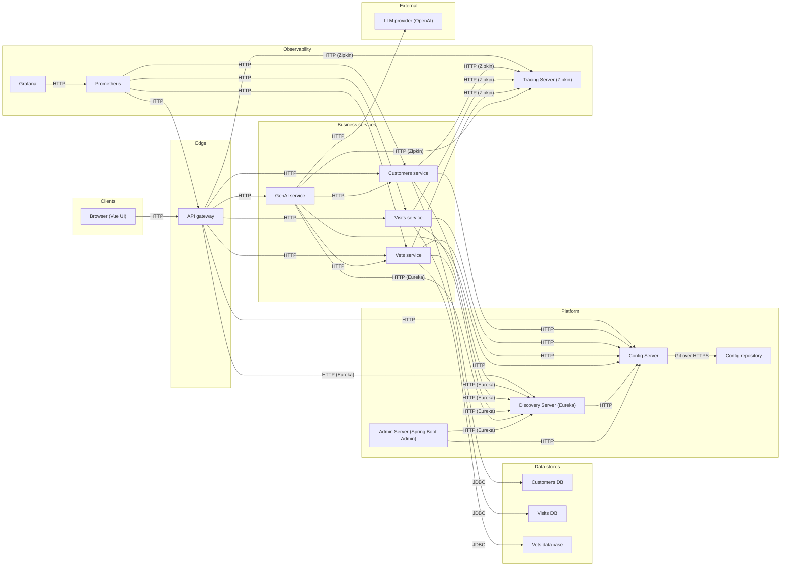
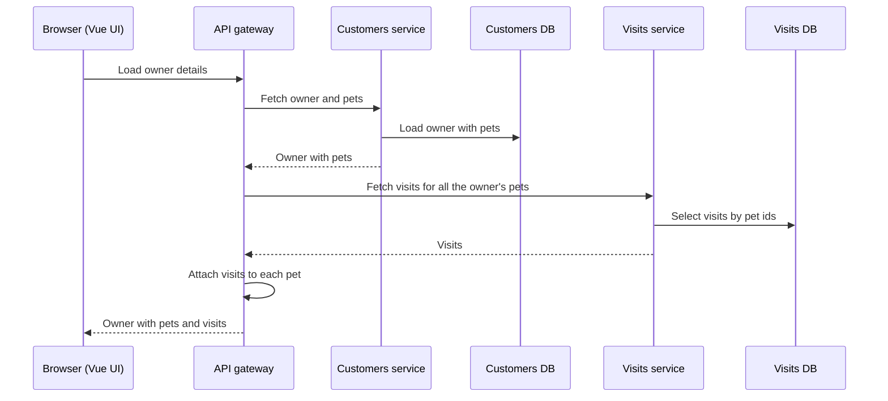
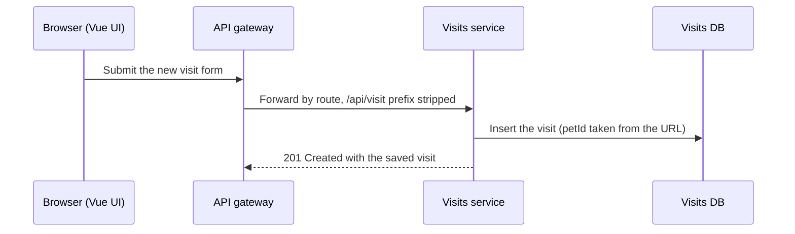
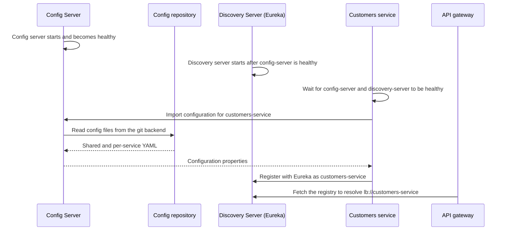
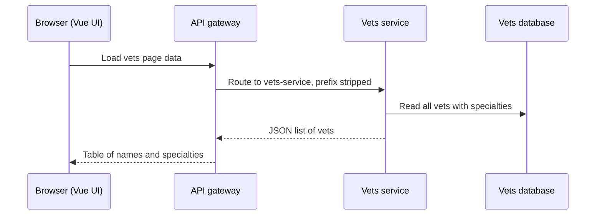
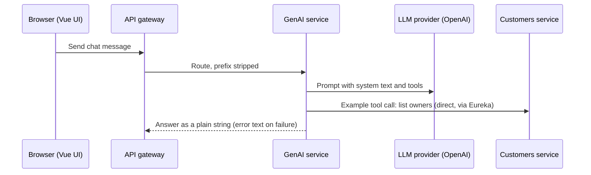
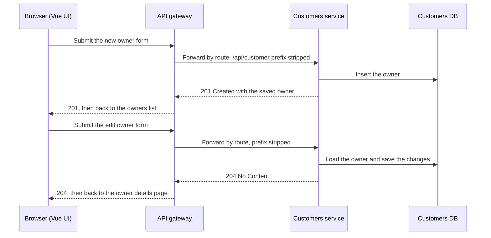
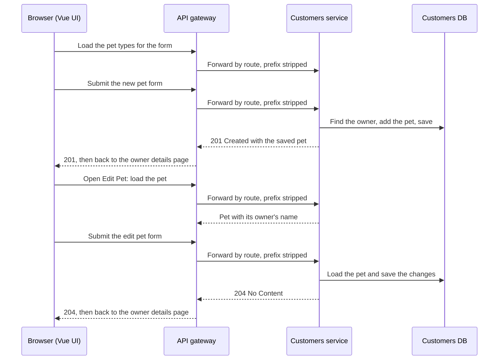

# PetClinic Microservices Map

> Generated by [evidence-architecture-map](https://github.com/majdukovic/evidence-architecture-map) from the JSON files next to this one. Do not edit by hand.
> Every statement links to the line of code that supports it, at the commit checked on 2026-11-10.
> The interactive version is `architecture.html`.

## Overview



## Components

### Clients

#### Browser (Vue UI)

The Vue single-page app is downloaded from the **API gateway** and runs in the browser; its pages call the gateway with `fetch`.

- **Repo:** [spring-petclinic-microservices](https://github.com/spring-petclinic/spring-petclinic-microservices/tree/e8b747ab522721076cacb5cf688eb8a54ba8c5c9)
- **Calls / sends to:** API gateway (HTTP)
- **Evidence:**
  - [spring-petclinic-microservices › client.js:69](https://github.com/spring-petclinic/spring-petclinic-microservices/blob/e8b747ab522721076cacb5cf688eb8a54ba8c5c9/spring-petclinic-api-gateway/src/main/resources/static/scripts/api/client.js#L69) `response = await fetch(url, {`
  - [spring-petclinic-microservices › ApiGatewayApplication.java:66](https://github.com/spring-petclinic/spring-petclinic-microservices/blob/e8b747ab522721076cacb5cf688eb8a54ba8c5c9/spring-petclinic-api-gateway/src/main/java/org/springframework/samples/petclinic/api/ApiGatewayApplication.java#L66) `new ClassPathResource("static/index.html")`

### Edge

#### API gateway

Spring Cloud Gateway app that serves the Vue UI as static files, forwards `/api/vet`, `/api/visit`, `/api/customer` and `/api/genai` to the matching service, and aggregates owner and visit data in its own controller at `/api/gateway/owners/{ownerId}`.

> The gateway's circuit breakers use one default configuration with a **10-second** time limit, and no other time limit is configured. A slow chat answer from the LLM ends in the `/fallback` 503 (the chat box then shows its own "unavailable" message), and a slow visits call on the owner page quietly returns an empty visits list, with no error shown.

- **Repo:** [spring-petclinic-microservices](https://github.com/spring-petclinic/spring-petclinic-microservices/tree/e8b747ab522721076cacb5cf688eb8a54ba8c5c9)
- **Exposes:** `GET /api/gateway/owners/{ownerId}`, `/api/customer/**`, `/api/visit/**`, `/api/vet/**`, `/api/genai/**`, `GET/POST /fallback`
- **Calls / sends to:** Customers service (HTTP), Visits service (HTTP), Config Server (HTTP), Discovery Server (Eureka) (HTTP (Eureka)), Tracing Server (Zipkin) (HTTP (Zipkin)), Vets service (HTTP), GenAI service (HTTP)
- **Called by / receives from:** Browser (Vue UI) (HTTP), Prometheus (HTTP)
- **Evidence:**
  - [spring-petclinic-microservices › ApiGatewayApplication.java:46](https://github.com/spring-petclinic/spring-petclinic-microservices/blob/e8b747ab522721076cacb5cf688eb8a54ba8c5c9/spring-petclinic-api-gateway/src/main/java/org/springframework/samples/petclinic/api/ApiGatewayApplication.java#L46) `public class ApiGatewayApplication`
  - [spring-petclinic-microservices › ApiGatewayApplication.java:44](https://github.com/spring-petclinic/spring-petclinic-microservices/blob/e8b747ab522721076cacb5cf688eb8a54ba8c5c9/spring-petclinic-api-gateway/src/main/java/org/springframework/samples/petclinic/api/ApiGatewayApplication.java#L44) `@EnableDiscoveryClient`
  - [spring-petclinic-microservices › ApiGatewayController.java:37](https://github.com/spring-petclinic/spring-petclinic-microservices/blob/e8b747ab522721076cacb5cf688eb8a54ba8c5c9/spring-petclinic-api-gateway/src/main/java/org/springframework/samples/petclinic/api/boundary/web/ApiGatewayController.java#L37) `@RequestMapping("/api/gateway")`
  - [spring-petclinic-microservices › application.yml:3](https://github.com/spring-petclinic/spring-petclinic-microservices/blob/e8b747ab522721076cacb5cf688eb8a54ba8c5c9/spring-petclinic-api-gateway/src/main/resources/application.yml#L3) `name: api-gateway`
  - [spring-petclinic-microservices › ApiGatewayApplication.java:66](https://github.com/spring-petclinic/spring-petclinic-microservices/blob/e8b747ab522721076cacb5cf688eb8a54ba8c5c9/spring-petclinic-api-gateway/src/main/java/org/springframework/samples/petclinic/api/ApiGatewayApplication.java#L66) `new ClassPathResource("static/index.html")`
  - [spring-petclinic-microservices › ApiGatewayApplication.java:77](https://github.com/spring-petclinic/spring-petclinic-microservices/blob/e8b747ab522721076cacb5cf688eb8a54ba8c5c9/spring-petclinic-api-gateway/src/main/java/org/springframework/samples/petclinic/api/ApiGatewayApplication.java#L77) `RouterFunctions.route(htmlNavigation,`
  - [spring-petclinic-microservices › ApiGatewayApplication.java:88](https://github.com/spring-petclinic/spring-petclinic-microservices/blob/e8b747ab522721076cacb5cf688eb8a54ba8c5c9/spring-petclinic-api-gateway/src/main/java/org/springframework/samples/petclinic/api/ApiGatewayApplication.java#L88) `timeoutDuration(Duration.ofSeconds(10))`
  - [spring-petclinic-microservices › ApiGatewayApplication.java:86](https://github.com/spring-petclinic/spring-petclinic-microservices/blob/e8b747ab522721076cacb5cf688eb8a54ba8c5c9/spring-petclinic-api-gateway/src/main/java/org/springframework/samples/petclinic/api/ApiGatewayApplication.java#L86) `factory.configureDefault(id -> new Resilience4JConfigBuilder(id)`
  - [spring-petclinic-microservices › ApiGatewayController.java:61](https://github.com/spring-petclinic/spring-petclinic-microservices/blob/e8b747ab522721076cacb5cf688eb8a54ba8c5c9/spring-petclinic-api-gateway/src/main/java/org/springframework/samples/petclinic/api/boundary/web/ApiGatewayController.java#L61) `cb.run(it, throwable -> emptyVisitsForPets())`
  - [spring-petclinic-microservices › FallbackController.java:15](https://github.com/spring-petclinic/spring-petclinic-microservices/blob/e8b747ab522721076cacb5cf688eb8a54ba8c5c9/spring-petclinic-api-gateway/src/main/java/org/springframework/samples/petclinic/api/boundary/web/FallbackController.java#L15) `HttpStatus.SC_SERVICE_UNAVAILABLE`
  - [spring-petclinic-microservices › ChatBox.js:56](https://github.com/spring-petclinic/spring-petclinic-microservices/blob/e8b747ab522721076cacb5cf688eb8a54ba8c5c9/spring-petclinic-api-gateway/src/main/resources/static/scripts/components/ChatBox.js#L56) `content: 'Chat is currently unavailable'`
- **Tests and test helpers:**
  - `ApiGatewayControllerTest` [spring-petclinic-microservices › ApiGatewayControllerTest.java:39](https://github.com/spring-petclinic/spring-petclinic-microservices/blob/e8b747ab522721076cacb5cf688eb8a54ba8c5c9/spring-petclinic-api-gateway/src/test/java/org/springframework/samples/petclinic/api/boundary/web/ApiGatewayControllerTest.java#L39) `getOwnerDetails_withAvailableVisitsService`
  - `VisitsServiceClientIntegrationTest` [spring-petclinic-microservices › VisitsServiceClientIntegrationTest.java:39](https://github.com/spring-petclinic/spring-petclinic-microservices/blob/e8b747ab522721076cacb5cf688eb8a54ba8c5c9/spring-petclinic-api-gateway/src/test/java/org/springframework/samples/petclinic/api/application/VisitsServiceClientIntegrationTest.java#L39) `getVisitsForPets_withAvailableVisitsService`
  - `ApiGatewayApplicationRouterTest` [spring-petclinic-microservices › ApiGatewayApplicationRouterTest.java:13](https://github.com/spring-petclinic/spring-petclinic-microservices/blob/e8b747ab522721076cacb5cf688eb8a54ba8c5c9/spring-petclinic-api-gateway/src/test/java/org/springframework/samples/petclinic/api/ApiGatewayApplicationRouterTest.java#L13) `servesTheVueApplicationForHtmlNavigation`
  - `FallbackControllerTest` [spring-petclinic-microservices › FallbackControllerTest.java:12](https://github.com/spring-petclinic/spring-petclinic-microservices/blob/e8b747ab522721076cacb5cf688eb8a54ba8c5c9/spring-petclinic-api-gateway/src/test/java/org/springframework/samples/petclinic/api/boundary/web/FallbackControllerTest.java#L12) `returnsServiceUnavailableForGetRequests`

### Business services

#### Customers service

Stores owners, pets and pet types and exposes them over REST. Registers with Eureka.

- **Repo:** [spring-petclinic-microservices](https://github.com/spring-petclinic/spring-petclinic-microservices/tree/e8b747ab522721076cacb5cf688eb8a54ba8c5c9)
- **Exposes:** `GET/POST /owners`, `GET/PUT /owners/{ownerId}`, `GET /petTypes`, `POST /owners/{ownerId}/pets`, `GET/PUT /owners/*/pets/{petId}`
- **Stores data in:** embedded HSQLDB (default): owners, pets, types, MySQL via the mysql profile
- **Calls / sends to:** Customers DB (JDBC), Config Server (HTTP), Discovery Server (Eureka) (HTTP (Eureka)), Tracing Server (Zipkin) (HTTP (Zipkin))
- **Called by / receives from:** API gateway (HTTP), Prometheus (HTTP), GenAI service (HTTP)
- **Evidence:**
  - [spring-petclinic-microservices › application.yml:3](https://github.com/spring-petclinic/spring-petclinic-microservices/blob/e8b747ab522721076cacb5cf688eb8a54ba8c5c9/spring-petclinic-customers-service/src/main/resources/application.yml#L3) `name: customers-service`
  - [spring-petclinic-microservices › CustomersServiceApplication.java:25](https://github.com/spring-petclinic/spring-petclinic-microservices/blob/e8b747ab522721076cacb5cf688eb8a54ba8c5c9/spring-petclinic-customers-service/src/main/java/org/springframework/samples/petclinic/customers/CustomersServiceApplication.java#L25) `@EnableDiscoveryClient`
  - [spring-petclinic-microservices › OwnerResource.java:39](https://github.com/spring-petclinic/spring-petclinic-microservices/blob/e8b747ab522721076cacb5cf688eb8a54ba8c5c9/spring-petclinic-customers-service/src/main/java/org/springframework/samples/petclinic/customers/web/OwnerResource.java#L39) `@RequestMapping("/owners")`
  - [spring-petclinic-microservices › PetResource.java:55](https://github.com/spring-petclinic/spring-petclinic-microservices/blob/e8b747ab522721076cacb5cf688eb8a54ba8c5c9/spring-petclinic-customers-service/src/main/java/org/springframework/samples/petclinic/customers/web/PetResource.java#L55) `@PostMapping("/owners/{ownerId}/pets")`
- **Tests and test helpers:**
  - `PetResourceTest` [spring-petclinic-microservices › PetResourceTest.java:48](https://github.com/spring-petclinic/spring-petclinic-microservices/blob/e8b747ab522721076cacb5cf688eb8a54ba8c5c9/spring-petclinic-customers-service/src/test/java/org/springframework/samples/petclinic/customers/web/PetResourceTest.java#L48) `shouldGetAPetInJSonFormat`

#### Visits service

Stores veterinary visits per pet and exposes them over REST. Registers with Eureka.

- **Repo:** [spring-petclinic-microservices](https://github.com/spring-petclinic/spring-petclinic-microservices/tree/e8b747ab522721076cacb5cf688eb8a54ba8c5c9)
- **Exposes:** `POST /owners/*/pets/{petId}/visits`, `GET /owners/*/pets/{petId}/visits`, `GET /pets/visits?petId=...`
- **Stores data in:** embedded HSQLDB (default): visits, MySQL via the mysql profile
- **Calls / sends to:** Visits DB (JDBC), Config Server (HTTP), Discovery Server (Eureka) (HTTP (Eureka)), Tracing Server (Zipkin) (HTTP (Zipkin))
- **Called by / receives from:** API gateway (HTTP), Prometheus (HTTP)
- **Evidence:**
  - [spring-petclinic-microservices › application.yml:3](https://github.com/spring-petclinic/spring-petclinic-microservices/blob/e8b747ab522721076cacb5cf688eb8a54ba8c5c9/spring-petclinic-visits-service/src/main/resources/application.yml#L3) `name: visits-service`
  - [spring-petclinic-microservices › VisitsServiceApplication.java:25](https://github.com/spring-petclinic/spring-petclinic-microservices/blob/e8b747ab522721076cacb5cf688eb8a54ba8c5c9/spring-petclinic-visits-service/src/main/java/org/springframework/samples/petclinic/visits/VisitsServiceApplication.java#L25) `@EnableDiscoveryClient`
  - [spring-petclinic-microservices › VisitResource.java:56](https://github.com/spring-petclinic/spring-petclinic-microservices/blob/e8b747ab522721076cacb5cf688eb8a54ba8c5c9/spring-petclinic-visits-service/src/main/java/org/springframework/samples/petclinic/visits/web/VisitResource.java#L56) `@PostMapping("owners/*/pets/{petId}/visits")`
- **Tests and test helpers:**
  - `VisitResourceTest` [spring-petclinic-microservices › VisitResourceTest.java:30](https://github.com/spring-petclinic/spring-petclinic-microservices/blob/e8b747ab522721076cacb5cf688eb8a54ba8c5c9/spring-petclinic-visits-service/src/test/java/org/springframework/samples/petclinic/visits/web/VisitResourceTest.java#L30) `void shouldFetchVisits()`

#### Vets service

Serves the list of veterinarians and their specialties from its own database. Registers with Eureka and reads its settings from the config server.

> Caching of `GET /vets` is on only when the `production` profile is active. The service's own application.yml makes it the default, but the Docker image sets `SPRING_PROFILES_ACTIVE=docker`, so in docker-compose it is off.

- **Repo:** [spring-petclinic-microservices](https://github.com/spring-petclinic/spring-petclinic-microservices/tree/e8b747ab522721076cacb5cf688eb8a54ba8c5c9)
- **Exposes:** `GET /vets`
- **Stores data in:** vets-db (embedded HSQLDB by default; MySQL via profile)
- **Calls / sends to:** Config Server (HTTP), Discovery Server (Eureka) (HTTP (Eureka)), Tracing Server (Zipkin) (HTTP (Zipkin)), Vets database (JDBC)
- **Called by / receives from:** Prometheus (HTTP), API gateway (HTTP), GenAI service (HTTP)
- **Evidence:**
  - [spring-petclinic-microservices › VetResource.java:34](https://github.com/spring-petclinic/spring-petclinic-microservices/blob/e8b747ab522721076cacb5cf688eb8a54ba8c5c9/spring-petclinic-vets-service/src/main/java/org/springframework/samples/petclinic/vets/web/VetResource.java#L34) `@RequestMapping("/vets")`
  - [spring-petclinic-microservices › VetResource.java:45](https://github.com/spring-petclinic/spring-petclinic-microservices/blob/e8b747ab522721076cacb5cf688eb8a54ba8c5c9/spring-petclinic-vets-service/src/main/java/org/springframework/samples/petclinic/vets/web/VetResource.java#L45) `@Cacheable("vets")`
  - [spring-petclinic-microservices › VetsServiceApplication.java:27](https://github.com/spring-petclinic/spring-petclinic-microservices/blob/e8b747ab522721076cacb5cf688eb8a54ba8c5c9/spring-petclinic-vets-service/src/main/java/org/springframework/samples/petclinic/vets/VetsServiceApplication.java#L27) `@EnableDiscoveryClient`
  - [spring-petclinic-microservices › application.yml:3](https://github.com/spring-petclinic/spring-petclinic-microservices/blob/e8b747ab522721076cacb5cf688eb8a54ba8c5c9/spring-petclinic-vets-service/src/main/resources/application.yml#L3) `name: vets-service`
  - [spring-petclinic-microservices › CacheConfig.java:27](https://github.com/spring-petclinic/spring-petclinic-microservices/blob/e8b747ab522721076cacb5cf688eb8a54ba8c5c9/spring-petclinic-vets-service/src/main/java/org/springframework/samples/petclinic/vets/system/CacheConfig.java#L27) `@EnableCaching`
  - [spring-petclinic-microservices › CacheConfig.java:28](https://github.com/spring-petclinic/spring-petclinic-microservices/blob/e8b747ab522721076cacb5cf688eb8a54ba8c5c9/spring-petclinic-vets-service/src/main/java/org/springframework/samples/petclinic/vets/system/CacheConfig.java#L28) `@Profile("production")`
  - [spring-petclinic-microservices › application.yml:9](https://github.com/spring-petclinic/spring-petclinic-microservices/blob/e8b747ab522721076cacb5cf688eb8a54ba8c5c9/spring-petclinic-vets-service/src/main/resources/application.yml#L9) `active: production`
  - [spring-petclinic-microservices › Dockerfile:14](https://github.com/spring-petclinic/spring-petclinic-microservices/blob/e8b747ab522721076cacb5cf688eb8a54ba8c5c9/docker/Dockerfile#L14) `SPRING_PROFILES_ACTIVE=docker`
- **Tests and test helpers:**
  - `VetResourceTest.shouldGetAListOfVets` [spring-petclinic-microservices › VetResourceTest.java:56](https://github.com/spring-petclinic/spring-petclinic-microservices/blob/e8b747ab522721076cacb5cf688eb8a54ba8c5c9/spring-petclinic-vets-service/src/test/java/org/springframework/samples/petclinic/vets/web/VetResourceTest.java#L56) `get("/vets")`

#### GenAI service

Spring AI chat back end. Receives chat text, calls the LLM with tools that can list owners, add owners, add pets (calling customers-service) and list vets (similarity search in an in-memory vector store).

> Its vet answers come from a vector store preloaded from `vectorstore.json`, not from a live call to vets-service. It has no automated tests. The chat endpoint takes only the message text, and the chat memory advisor is registered once on the shared chat client; nothing in this repository gives the memory a user, session or conversation id.

- **Repo:** [spring-petclinic-microservices](https://github.com/spring-petclinic/spring-petclinic-microservices/tree/e8b747ab522721076cacb5cf688eb8a54ba8c5c9)
- **Exposes:** `POST /chatclient`
- **Stores data in:** in-memory SimpleVectorStore, loaded from vectorstore.json
- **Calls / sends to:** Config Server (HTTP), Discovery Server (Eureka) (HTTP (Eureka)), Tracing Server (Zipkin) (HTTP (Zipkin)), LLM provider (OpenAI) (HTTP), Customers service (HTTP), Vets service (HTTP)
- **Called by / receives from:** API gateway (HTTP)
- **Evidence:**
  - [spring-petclinic-microservices › PetclinicChatClient.java:57](https://github.com/spring-petclinic/spring-petclinic-microservices/blob/e8b747ab522721076cacb5cf688eb8a54ba8c5c9/spring-petclinic-genai-service/src/main/java/org/springframework/samples/petclinic/genai/PetclinicChatClient.java#L57) `@PostMapping("/chatclient")`
  - [spring-petclinic-microservices › GenAIServiceApplication.java:25](https://github.com/spring-petclinic/spring-petclinic-microservices/blob/e8b747ab522721076cacb5cf688eb8a54ba8c5c9/spring-petclinic-genai-service/src/main/java/org/springframework/samples/petclinic/genai/GenAIServiceApplication.java#L25) `@EnableDiscoveryClient`
  - [spring-petclinic-microservices › application.yml:5](https://github.com/spring-petclinic/spring-petclinic-microservices/blob/e8b747ab522721076cacb5cf688eb8a54ba8c5c9/spring-petclinic-genai-service/src/main/resources/application.yml#L5) `name: genai-service`
  - [spring-petclinic-microservices › AIBeanConfiguration.java:21](https://github.com/spring-petclinic/spring-petclinic-microservices/blob/e8b747ab522721076cacb5cf688eb8a54ba8c5c9/spring-petclinic-genai-service/src/main/java/org/springframework/samples/petclinic/genai/AIBeanConfiguration.java#L21) `SimpleVectorStore.builder(embeddingModel).build()`
  - [spring-petclinic-microservices › PetclinicChatClient.java:58](https://github.com/spring-petclinic/spring-petclinic-microservices/blob/e8b747ab522721076cacb5cf688eb8a54ba8c5c9/spring-petclinic-genai-service/src/main/java/org/springframework/samples/petclinic/genai/PetclinicChatClient.java#L58) `exchange(@RequestBody String query)`
  - [spring-petclinic-microservices › PetclinicChatClient.java:48](https://github.com/spring-petclinic/spring-petclinic-microservices/blob/e8b747ab522721076cacb5cf688eb8a54ba8c5c9/spring-petclinic-genai-service/src/main/java/org/springframework/samples/petclinic/genai/PetclinicChatClient.java#L48) `MessageChatMemoryAdvisor.builder(chatMemory)`
  - [spring-petclinic-microservices › PetclinicChatClient.java:64](https://github.com/spring-petclinic/spring-petclinic-microservices/blob/e8b747ab522721076cacb5cf688eb8a54ba8c5c9/spring-petclinic-genai-service/src/main/java/org/springframework/samples/petclinic/genai/PetclinicChatClient.java#L64) `.user(query)`

### Data stores

#### Customers DB

Tables `owners`, `pets`, `types`. The customers service runs an embedded HSQLDB by default (schema and data loaded at start) and switches to MySQL when the `mysql` profile is active.

- **Repo:** [spring-petclinic-microservices](https://github.com/spring-petclinic/spring-petclinic-microservices/tree/e8b747ab522721076cacb5cf688eb8a54ba8c5c9)
- **Stores data in:** owners, pets, types
- **Called by / receives from:** Customers service (JDBC)
- **Evidence:**
  - [spring-petclinic-microservices › schema.sql:21](https://github.com/spring-petclinic/spring-petclinic-microservices/blob/e8b747ab522721076cacb5cf688eb8a54ba8c5c9/spring-petclinic-customers-service/src/main/resources/db/hsqldb/schema.sql#L21) `CREATE TABLE pets (`
  - [spring-petclinic-microservices › pom.xml:71](https://github.com/spring-petclinic/spring-petclinic-microservices/blob/e8b747ab522721076cacb5cf688eb8a54ba8c5c9/spring-petclinic-customers-service/pom.xml#L71) `<artifactId>hsqldb</artifactId>`
  - [spring-petclinic-microservices-config › application.yml:13](https://github.com/spring-petclinic/spring-petclinic-microservices-config/blob/323993ce2519c6d02df63e08bf4458d123d3b611/application.yml#L13) `schema-locations: classpath*:db/hsqldb/schema.sql`
  - [spring-petclinic-microservices-config › application.yml:98](https://github.com/spring-petclinic/spring-petclinic-microservices-config/blob/323993ce2519c6d02df63e08bf4458d123d3b611/application.yml#L98) `on-profile: mysql`
  - [spring-petclinic-microservices-config › application.yml:105](https://github.com/spring-petclinic/spring-petclinic-microservices-config/blob/323993ce2519c6d02df63e08bf4458d123d3b611/application.yml#L105) `schema-locations: classpath*:db/mysql/schema.sql`

#### Visits DB

Table `visits`. The visits service runs an embedded HSQLDB by default and switches to MySQL when the `mysql` profile is active.

- **Repo:** [spring-petclinic-microservices](https://github.com/spring-petclinic/spring-petclinic-microservices/tree/e8b747ab522721076cacb5cf688eb8a54ba8c5c9)
- **Stores data in:** visits
- **Called by / receives from:** Visits service (JDBC)
- **Evidence:**
  - [spring-petclinic-microservices › schema.sql:3](https://github.com/spring-petclinic/spring-petclinic-microservices/blob/e8b747ab522721076cacb5cf688eb8a54ba8c5c9/spring-petclinic-visits-service/src/main/resources/db/hsqldb/schema.sql#L3) `CREATE TABLE visits (`
  - [spring-petclinic-microservices › pom.xml:64](https://github.com/spring-petclinic/spring-petclinic-microservices/blob/e8b747ab522721076cacb5cf688eb8a54ba8c5c9/spring-petclinic-visits-service/pom.xml#L64) `<artifactId>hsqldb</artifactId>`
  - [spring-petclinic-microservices-config › application.yml:13](https://github.com/spring-petclinic/spring-petclinic-microservices-config/blob/323993ce2519c6d02df63e08bf4458d123d3b611/application.yml#L13) `schema-locations: classpath*:db/hsqldb/schema.sql`
  - [spring-petclinic-microservices-config › application.yml:98](https://github.com/spring-petclinic/spring-petclinic-microservices-config/blob/323993ce2519c6d02df63e08bf4458d123d3b611/application.yml#L98) `on-profile: mysql`

#### Vets database

Relational store for vets, specialties and the link table between them. By default an embedded HSQLDB initialised from schema.sql and data.sql.

- **Repo:** [spring-petclinic-microservices](https://github.com/spring-petclinic/spring-petclinic-microservices/tree/e8b747ab522721076cacb5cf688eb8a54ba8c5c9)
- **Stores data in:** tables: vets, specialties, vet_specialties
- **Called by / receives from:** Vets service (JDBC)
- **Evidence:**
  - [spring-petclinic-microservices › schema.sql:5](https://github.com/spring-petclinic/spring-petclinic-microservices/blob/e8b747ab522721076cacb5cf688eb8a54ba8c5c9/spring-petclinic-vets-service/src/main/resources/db/hsqldb/schema.sql#L5) `CREATE TABLE vets (`
  - [spring-petclinic-microservices › schema.sql:18](https://github.com/spring-petclinic/spring-petclinic-microservices/blob/e8b747ab522721076cacb5cf688eb8a54ba8c5c9/spring-petclinic-vets-service/src/main/resources/db/hsqldb/schema.sql#L18) `CREATE TABLE vet_specialties (`
  - [spring-petclinic-microservices › pom.xml:89](https://github.com/spring-petclinic/spring-petclinic-microservices/blob/e8b747ab522721076cacb5cf688eb8a54ba8c5c9/spring-petclinic-vets-service/pom.xml#L89) `<artifactId>hsqldb</artifactId>`

### Platform

#### Config repository

Git repo of per-service YAML files plus a shared `application.yml` (default HSQLDB init, a `mysql` profile, actuator and Prometheus exposure). The Config server serves it to the services.

> The `mysql` profile is defined once, here in the shared `application.yml`, so every service that takes this file gets the same datasource settings. docker-compose.yml defines no database service.

- **Repo:** [spring-petclinic-microservices-config](https://github.com/spring-petclinic/spring-petclinic-microservices-config/tree/323993ce2519c6d02df63e08bf4458d123d3b611)
- **Called by / receives from:** Config Server (Git over HTTPS)
- **Evidence:**
  - [spring-petclinic-microservices-config › application.yml:1](https://github.com/spring-petclinic/spring-petclinic-microservices-config/blob/323993ce2519c6d02df63e08bf4458d123d3b611/application.yml#L1) `# COMMON APPLICATION PROPERTIES`
  - [spring-petclinic-microservices › application.yml:7](https://github.com/spring-petclinic/spring-petclinic-microservices/blob/e8b747ab522721076cacb5cf688eb8a54ba8c5c9/spring-petclinic-config-server/src/main/resources/application.yml#L7) `spring-petclinic-microservices-config`
  - [spring-petclinic-microservices-config › customers-service.yml:16](https://github.com/spring-petclinic/spring-petclinic-microservices-config/blob/323993ce2519c6d02df63e08bf4458d123d3b611/customers-service.yml#L16) `port: 8081`
  - [spring-petclinic-microservices-config › application.yml:98](https://github.com/spring-petclinic/spring-petclinic-microservices-config/blob/323993ce2519c6d02df63e08bf4458d123d3b611/application.yml#L98) `on-profile: mysql`

#### Config Server

Spring Cloud Config Server on port 8888. The other Spring services import their configuration from it at startup (`spring.config.import`; mandatory under the `docker` profile, optional with a localhost default otherwise).

- **Repo:** [spring-petclinic-microservices](https://github.com/spring-petclinic/spring-petclinic-microservices/tree/e8b747ab522721076cacb5cf688eb8a54ba8c5c9)
- **Exposes:** `HTTP :8888`
- **Calls / sends to:** Config repository (Git over HTTPS)
- **Called by / receives from:** API gateway (HTTP), Customers service (HTTP), Visits service (HTTP), Vets service (HTTP), GenAI service (HTTP), Discovery Server (Eureka) (HTTP), Admin Server (Spring Boot Admin) (HTTP)
- **Evidence:**
  - [spring-petclinic-microservices › ConfigServerApplication.java:25](https://github.com/spring-petclinic/spring-petclinic-microservices/blob/e8b747ab522721076cacb5cf688eb8a54ba8c5c9/spring-petclinic-config-server/src/main/java/org/springframework/samples/petclinic/config/ConfigServerApplication.java#L25) `@EnableConfigServer`
  - [spring-petclinic-microservices › application.yml:1](https://github.com/spring-petclinic/spring-petclinic-microservices/blob/e8b747ab522721076cacb5cf688eb8a54ba8c5c9/spring-petclinic-config-server/src/main/resources/application.yml#L1) `server.port: 8888`
  - [spring-petclinic-microservices › docker-compose.yml:3](https://github.com/spring-petclinic/spring-petclinic-microservices/blob/e8b747ab522721076cacb5cf688eb8a54ba8c5c9/docker-compose.yml#L3) `springcommunity/spring-petclinic-config-server`

#### Discovery Server (Eureka)

Eureka server on port 8761 where services register and where the gateway looks up instances by name. Runs standalone (does not register with itself or fetch a registry).

- **Repo:** [spring-petclinic-microservices](https://github.com/spring-petclinic/spring-petclinic-microservices/tree/e8b747ab522721076cacb5cf688eb8a54ba8c5c9)
- **Exposes:** `HTTP :8761`, `Eureka /eureka/`
- **Calls / sends to:** Config Server (HTTP)
- **Called by / receives from:** API gateway (HTTP (Eureka)), Customers service (HTTP (Eureka)), Visits service (HTTP (Eureka)), Vets service (HTTP (Eureka)), GenAI service (HTTP (Eureka)), Admin Server (Spring Boot Admin) (HTTP (Eureka))
- **Evidence:**
  - [spring-petclinic-microservices › DiscoveryServerApplication.java:26](https://github.com/spring-petclinic/spring-petclinic-microservices/blob/e8b747ab522721076cacb5cf688eb8a54ba8c5c9/spring-petclinic-discovery-server/src/main/java/org/springframework/samples/petclinic/discovery/DiscoveryServerApplication.java#L26) `@EnableEurekaServer`
  - [spring-petclinic-microservices-config › discovery-server.yml:2](https://github.com/spring-petclinic/spring-petclinic-microservices-config/blob/323993ce2519c6d02df63e08bf4458d123d3b611/discovery-server.yml#L2) `port: 8761`
  - [spring-petclinic-microservices-config › discovery-server.yml:9](https://github.com/spring-petclinic/spring-petclinic-microservices-config/blob/323993ce2519c6d02df63e08bf4458d123d3b611/discovery-server.yml#L9) `registerWithEureka: false`

#### Admin Server (Spring Boot Admin)

Spring Boot Admin server on port 9090. It is also an Eureka discovery client.

- **Repo:** [spring-petclinic-microservices](https://github.com/spring-petclinic/spring-petclinic-microservices/tree/e8b747ab522721076cacb5cf688eb8a54ba8c5c9)
- **Exposes:** `HTTP :9090`
- **Calls / sends to:** Config Server (HTTP), Discovery Server (Eureka) (HTTP (Eureka))
- **Evidence:**
  - [spring-petclinic-microservices › SpringBootAdminApplication.java:24](https://github.com/spring-petclinic/spring-petclinic-microservices/blob/e8b747ab522721076cacb5cf688eb8a54ba8c5c9/spring-petclinic-admin-server/src/main/java/org/springframework/samples/petclinic/admin/SpringBootAdminApplication.java#L24) `@EnableAdminServer`
  - [spring-petclinic-microservices-config › admin-server.yml:2](https://github.com/spring-petclinic/spring-petclinic-microservices-config/blob/323993ce2519c6d02df63e08bf4458d123d3b611/admin-server.yml#L2) `port: 9090`

### Observability

#### Tracing Server (Zipkin)

Zipkin, run from the stock openzipkin/zipkin image in docker-compose, port 9411. Services export spans to it.

- **Repo:** [spring-petclinic-microservices](https://github.com/spring-petclinic/spring-petclinic-microservices/tree/e8b747ab522721076cacb5cf688eb8a54ba8c5c9)
- **Exposes:** `HTTP :9411`
- **Called by / receives from:** API gateway (HTTP (Zipkin)), Customers service (HTTP (Zipkin)), Visits service (HTTP (Zipkin)), Vets service (HTTP (Zipkin)), GenAI service (HTTP (Zipkin))
- **Evidence:**
  - [spring-petclinic-microservices › docker-compose.yml:117](https://github.com/spring-petclinic/spring-petclinic-microservices/blob/e8b747ab522721076cacb5cf688eb8a54ba8c5c9/docker-compose.yml#L117) `image: openzipkin/zipkin`
  - [spring-petclinic-microservices › docker-compose.yml:124](https://github.com/spring-petclinic/spring-petclinic-microservices/blob/e8b747ab522721076cacb5cf688eb8a54ba8c5c9/docker-compose.yml#L124) `9411:9411`

#### Prometheus

Prometheus image built from docker/prometheus with the repo's prometheus.yml; container port 9090 published as 9091.

- **Repo:** [spring-petclinic-microservices](https://github.com/spring-petclinic/spring-petclinic-microservices/tree/e8b747ab522721076cacb5cf688eb8a54ba8c5c9)
- **Exposes:** `HTTP :9091 (host)`
- **Calls / sends to:** API gateway (HTTP), Customers service (HTTP), Visits service (HTTP), Vets service (HTTP)
- **Called by / receives from:** Grafana (HTTP)
- **Evidence:**
  - [spring-petclinic-microservices › Dockerfile:1](https://github.com/spring-petclinic/spring-petclinic-microservices/blob/e8b747ab522721076cacb5cf688eb8a54ba8c5c9/docker/prometheus/Dockerfile#L1) `FROM prom/prometheus:v3.1.0`
  - [spring-petclinic-microservices › docker-compose.yml:154](https://github.com/spring-petclinic/spring-petclinic-microservices/blob/e8b747ab522721076cacb5cf688eb8a54ba8c5c9/docker-compose.yml#L154) `build: ./docker/prometheus`
  - [spring-petclinic-microservices › docker-compose.yml:161](https://github.com/spring-petclinic/spring-petclinic-microservices/blob/e8b747ab522721076cacb5cf688eb8a54ba8c5c9/docker-compose.yml#L161) `9091:9090`

#### Grafana

Grafana image built from docker/grafana with provisioned datasource and a petclinic dashboard; container port 3000 published as 3030.

- **Repo:** [spring-petclinic-microservices](https://github.com/spring-petclinic/spring-petclinic-microservices/tree/e8b747ab522721076cacb5cf688eb8a54ba8c5c9)
- **Exposes:** `HTTP :3030 (host)`
- **Calls / sends to:** Prometheus (HTTP)
- **Evidence:**
  - [spring-petclinic-microservices › Dockerfile:1](https://github.com/spring-petclinic/spring-petclinic-microservices/blob/e8b747ab522721076cacb5cf688eb8a54ba8c5c9/docker/grafana/Dockerfile#L1) `FROM grafana/grafana:11.4.0`
  - [spring-petclinic-microservices › docker-compose.yml:144](https://github.com/spring-petclinic/spring-petclinic-microservices/blob/e8b747ab522721076cacb5cf688eb8a54ba8c5c9/docker-compose.yml#L144) `build: ./docker/grafana`
  - [spring-petclinic-microservices › docker-compose.yml:151](https://github.com/spring-petclinic/spring-petclinic-microservices/blob/e8b747ab522721076cacb5cf688eb8a54ba8c5c9/docker-compose.yml#L151) `3030:3000`

### External

#### LLM provider (OpenAI)

Hosted large language model. The pom enables the OpenAI starter (chat model gpt-4o-mini, key from OPENAI_API_KEY). The Azure OpenAI starter is commented out in the pom, although Azure settings remain in application.yml.

> Both OPENAI_API_KEY and AZURE_OPENAI_* are passed to the container by docker-compose.yml, but only the OpenAI starter is on the classpath.

- **Repo:** [spring-petclinic-microservices](https://github.com/spring-petclinic/spring-petclinic-microservices/tree/e8b747ab522721076cacb5cf688eb8a54ba8c5c9)
- **Called by / receives from:** GenAI service (HTTP)
- **Evidence:**
  - [spring-petclinic-microservices › pom.xml:27](https://github.com/spring-petclinic/spring-petclinic-microservices/blob/e8b747ab522721076cacb5cf688eb8a54ba8c5c9/spring-petclinic-genai-service/pom.xml#L27) `spring-ai-starter-model-openai`
  - [spring-petclinic-microservices › pom.xml:28](https://github.com/spring-petclinic/spring-petclinic-microservices/blob/e8b747ab522721076cacb5cf688eb8a54ba8c5c9/spring-petclinic-genai-service/pom.xml#L28) `<!-- artifactId>spring-ai-starter-model-azure-openai`
  - [spring-petclinic-microservices › application.yml:29](https://github.com/spring-petclinic/spring-petclinic-microservices/blob/e8b747ab522721076cacb5cf688eb8a54ba8c5c9/spring-petclinic-genai-service/src/main/resources/application.yml#L29) `model: gpt-4o-mini`
  - [spring-petclinic-microservices › docker-compose.yml:85](https://github.com/spring-petclinic/spring-petclinic-microservices/blob/e8b747ab522721076cacb5cf688eb8a54ba8c5c9/docker-compose.yml#L85) `OPENAI_API_KEY=${OPENAI_API_KEY}`
  - [spring-petclinic-microservices › docker-compose.yml:86](https://github.com/spring-petclinic/spring-petclinic-microservices/blob/e8b747ab522721076cacb5cf688eb8a54ba8c5c9/docker-compose.yml#L86) `AZURE_OPENAI_KEY=${AZURE_OPENAI_KEY}`
  - [spring-petclinic-microservices › docker-compose.yml:87](https://github.com/spring-petclinic/spring-petclinic-microservices/blob/e8b747ab522721076cacb5cf688eb8a54ba8c5c9/docker-compose.yml#L87) `AZURE_OPENAI_ENDPOINT=${AZURE_OPENAI_ENDPOINT}`

## Connections

| From | To | Protocol | What | Evidence |
|---|---|---|---|---|
| Browser (Vue UI) | API gateway | HTTP | The Vue pages call the gateway's /api/... paths with fetch | [spring-petclinic-microservices › client.js:69](https://github.com/spring-petclinic/spring-petclinic-microservices/blob/e8b747ab522721076cacb5cf688eb8a54ba8c5c9/spring-petclinic-api-gateway/src/main/resources/static/scripts/api/client.js#L69) `response = await fetch(url, {`<br>[spring-petclinic-microservices › OwnerDetailsPage.js:13](https://github.com/spring-petclinic/spring-petclinic-microservices/blob/e8b747ab522721076cacb5cf688eb8a54ba8c5c9/spring-petclinic-api-gateway/src/main/resources/static/scripts/pages/OwnerDetailsPage.js#L13) `/api/gateway/owners/${route.params.ownerId}`<br>[spring-petclinic-microservices › VetsPage.js:10](https://github.com/spring-petclinic/spring-petclinic-microservices/blob/e8b747ab522721076cacb5cf688eb8a54ba8c5c9/spring-petclinic-api-gateway/src/main/resources/static/scripts/pages/VetsPage.js#L10) `request('/api/vet/vets'`<br>[spring-petclinic-microservices › ChatBox.js:47](https://github.com/spring-petclinic/spring-petclinic-microservices/blob/e8b747ab522721076cacb5cf688eb8a54ba8c5c9/spring-petclinic-api-gateway/src/main/resources/static/scripts/components/ChatBox.js#L47) `request('/api/genai/chatclient', jsonRequest('POST', query)` |
| API gateway | Customers service | HTTP | Routes /api/customer/** to it (owner and pet create, read and edit), and the gateway controller fetches an owner with its pets (WebClient, resolved by service name through Eureka load balancing) | [spring-petclinic-microservices › CustomersServiceClient.java:37](https://github.com/spring-petclinic/spring-petclinic-microservices/blob/e8b747ab522721076cacb5cf688eb8a54ba8c5c9/spring-petclinic-api-gateway/src/main/java/org/springframework/samples/petclinic/api/application/CustomersServiceClient.java#L37) `http://customers-service/owners/{ownerId}`<br>[spring-petclinic-microservices › ApiGatewayApplication.java:60](https://github.com/spring-petclinic/spring-petclinic-microservices/blob/e8b747ab522721076cacb5cf688eb8a54ba8c5c9/spring-petclinic-api-gateway/src/main/java/org/springframework/samples/petclinic/api/ApiGatewayApplication.java#L60) `public WebClient.Builder loadBalancedWebClientBuilder()`<br>[spring-petclinic-microservices › application.yml:3](https://github.com/spring-petclinic/spring-petclinic-microservices/blob/e8b747ab522721076cacb5cf688eb8a54ba8c5c9/spring-petclinic-customers-service/src/main/resources/application.yml#L3) `name: customers-service`<br>[spring-petclinic-microservices › application.yml:34](https://github.com/spring-petclinic/spring-petclinic-microservices/blob/e8b747ab522721076cacb5cf688eb8a54ba8c5c9/spring-petclinic-api-gateway/src/main/resources/application.yml#L34) `uri: lb://customers-service`<br>[spring-petclinic-microservices › application.yml:36](https://github.com/spring-petclinic/spring-petclinic-microservices/blob/e8b747ab522721076cacb5cf688eb8a54ba8c5c9/spring-petclinic-api-gateway/src/main/resources/application.yml#L36) `Path=/api/customer/**`<br>[spring-petclinic-microservices › application.yml:38](https://github.com/spring-petclinic/spring-petclinic-microservices/blob/e8b747ab522721076cacb5cf688eb8a54ba8c5c9/spring-petclinic-api-gateway/src/main/resources/application.yml#L38) `StripPrefix=2` |
| API gateway | Visits service | HTTP | Gateway controller fetches visits for all of an owner's pets in one call (WebClient, resolved by service name) | [spring-petclinic-microservices › VisitsServiceClient.java:34](https://github.com/spring-petclinic/spring-petclinic-microservices/blob/e8b747ab522721076cacb5cf688eb8a54ba8c5c9/spring-petclinic-api-gateway/src/main/java/org/springframework/samples/petclinic/api/application/VisitsServiceClient.java#L34) `"http://visits-service/"`<br>[spring-petclinic-microservices › VisitsServiceClient.java:45](https://github.com/spring-petclinic/spring-petclinic-microservices/blob/e8b747ab522721076cacb5cf688eb8a54ba8c5c9/spring-petclinic-api-gateway/src/main/java/org/springframework/samples/petclinic/api/application/VisitsServiceClient.java#L45) `pets/visits?petId={petId}`<br>[spring-petclinic-microservices › VisitResource.java:72](https://github.com/spring-petclinic/spring-petclinic-microservices/blob/e8b747ab522721076cacb5cf688eb8a54ba8c5c9/spring-petclinic-visits-service/src/main/java/org/springframework/samples/petclinic/visits/web/VisitResource.java#L72) `@GetMapping("pets/visits")`<br>[spring-petclinic-microservices › application.yml:28](https://github.com/spring-petclinic/spring-petclinic-microservices/blob/e8b747ab522721076cacb5cf688eb8a54ba8c5c9/spring-petclinic-api-gateway/src/main/resources/application.yml#L28) `uri: lb://visits-service`<br>[spring-petclinic-microservices › application.yml:30](https://github.com/spring-petclinic/spring-petclinic-microservices/blob/e8b747ab522721076cacb5cf688eb8a54ba8c5c9/spring-petclinic-api-gateway/src/main/resources/application.yml#L30) `Path=/api/visit/**`<br>[spring-petclinic-microservices › application.yml:32](https://github.com/spring-petclinic/spring-petclinic-microservices/blob/e8b747ab522721076cacb5cf688eb8a54ba8c5c9/spring-petclinic-api-gateway/src/main/resources/application.yml#L32) `StripPrefix=2` |
| Customers service | Customers DB | JDBC | JPA entities map to owners, pets and types tables in an embedded, in-process HSQLDB (MySQL with the mysql profile) | [spring-petclinic-microservices › Owner.java:38](https://github.com/spring-petclinic/spring-petclinic-microservices/blob/e8b747ab522721076cacb5cf688eb8a54ba8c5c9/spring-petclinic-customers-service/src/main/java/org/springframework/samples/petclinic/customers/model/Owner.java#L38) `@Table(name = "owners")`<br>[spring-petclinic-microservices-config › application.yml:13](https://github.com/spring-petclinic/spring-petclinic-microservices-config/blob/323993ce2519c6d02df63e08bf4458d123d3b611/application.yml#L13) `schema-locations: classpath*:db/hsqldb/schema.sql`<br>[spring-petclinic-microservices › pom.xml:71](https://github.com/spring-petclinic/spring-petclinic-microservices/blob/e8b747ab522721076cacb5cf688eb8a54ba8c5c9/spring-petclinic-customers-service/pom.xml#L71) `<artifactId>hsqldb</artifactId>` |
| Visits service | Visits DB | JDBC | JPA entity maps to the visits table in an embedded, in-process HSQLDB (MySQL with the mysql profile) | [spring-petclinic-microservices › Visit.java:32](https://github.com/spring-petclinic/spring-petclinic-microservices/blob/e8b747ab522721076cacb5cf688eb8a54ba8c5c9/spring-petclinic-visits-service/src/main/java/org/springframework/samples/petclinic/visits/model/Visit.java#L32) `@Table(name = "visits")`<br>[spring-petclinic-microservices-config › application.yml:13](https://github.com/spring-petclinic/spring-petclinic-microservices-config/blob/323993ce2519c6d02df63e08bf4458d123d3b611/application.yml#L13) `schema-locations: classpath*:db/hsqldb/schema.sql`<br>[spring-petclinic-microservices › pom.xml:64](https://github.com/spring-petclinic/spring-petclinic-microservices/blob/e8b747ab522721076cacb5cf688eb8a54ba8c5c9/spring-petclinic-visits-service/pom.xml#L64) `<artifactId>hsqldb</artifactId>` |
| API gateway | Config Server | HTTP | Imports configuration at startup via spring.config.import (docker profile: configserver:http://config-server:8888) | [spring-petclinic-microservices › application.yml:53](https://github.com/spring-petclinic/spring-petclinic-microservices/blob/e8b747ab522721076cacb5cf688eb8a54ba8c5c9/spring-petclinic-api-gateway/src/main/resources/application.yml#L53) `import: configserver:http://config-server:8888` |
| Customers service | Config Server | HTTP | Imports configuration at startup via spring.config.import | [spring-petclinic-microservices › application.yml:13](https://github.com/spring-petclinic/spring-petclinic-microservices/blob/e8b747ab522721076cacb5cf688eb8a54ba8c5c9/spring-petclinic-customers-service/src/main/resources/application.yml#L13) `import: configserver:http://config-server:8888`<br>[spring-petclinic-microservices › application.yml:5](https://github.com/spring-petclinic/spring-petclinic-microservices/blob/e8b747ab522721076cacb5cf688eb8a54ba8c5c9/spring-petclinic-customers-service/src/main/resources/application.yml#L5) `${CONFIG_SERVER_URL:http://localhost:8888/}` |
| Visits service | Config Server | HTTP | Imports configuration at startup via spring.config.import | [spring-petclinic-microservices › application.yml:13](https://github.com/spring-petclinic/spring-petclinic-microservices/blob/e8b747ab522721076cacb5cf688eb8a54ba8c5c9/spring-petclinic-visits-service/src/main/resources/application.yml#L13) `import: configserver:http://config-server:8888` |
| Vets service | Config Server | HTTP | Imports configuration at startup via spring.config.import | [spring-petclinic-microservices › application.yml:16](https://github.com/spring-petclinic/spring-petclinic-microservices/blob/e8b747ab522721076cacb5cf688eb8a54ba8c5c9/spring-petclinic-vets-service/src/main/resources/application.yml#L16) `import: configserver:http://config-server:8888` |
| GenAI service | Config Server | HTTP | Imports configuration at startup via spring.config.import | [spring-petclinic-microservices › application.yml:45](https://github.com/spring-petclinic/spring-petclinic-microservices/blob/e8b747ab522721076cacb5cf688eb8a54ba8c5c9/spring-petclinic-genai-service/src/main/resources/application.yml#L45) `import: configserver:http://config-server:8888` |
| Discovery Server (Eureka) | Config Server | HTTP | Imports its own configuration (port, standalone Eureka settings) at startup | [spring-petclinic-microservices › application.yml:20](https://github.com/spring-petclinic/spring-petclinic-microservices/blob/e8b747ab522721076cacb5cf688eb8a54ba8c5c9/spring-petclinic-discovery-server/src/main/resources/application.yml#L20) `import: configserver:http://config-server:8888` |
| Admin Server (Spring Boot Admin) | Config Server | HTTP | Imports configuration at startup via spring.config.import | [spring-petclinic-microservices › application.yml:13](https://github.com/spring-petclinic/spring-petclinic-microservices/blob/e8b747ab522721076cacb5cf688eb8a54ba8c5c9/spring-petclinic-admin-server/src/main/resources/application.yml#L13) `import: configserver:http://config-server:8888` |
| Config Server | Config repository | Git over HTTPS | Reads configuration files from the config repo (default label main); a native file-system backend is available with the native profile and GIT_REPO | [spring-petclinic-microservices › application.yml:7](https://github.com/spring-petclinic/spring-petclinic-microservices/blob/e8b747ab522721076cacb5cf688eb8a54ba8c5c9/spring-petclinic-config-server/src/main/resources/application.yml#L7) `spring-petclinic/spring-petclinic-microservices-config`<br>[spring-petclinic-microservices › application.yml:8](https://github.com/spring-petclinic/spring-petclinic-microservices/blob/e8b747ab522721076cacb5cf688eb8a54ba8c5c9/spring-petclinic-config-server/src/main/resources/application.yml#L8) `default-label: main` |
| API gateway | Discovery Server (Eureka) | HTTP (Eureka) | Registers with Eureka (docker profile defaultZone from the config repo); also resolves lb:// route targets through discovery | [spring-petclinic-microservices-config › api-gateway.yml:22](https://github.com/spring-petclinic/spring-petclinic-microservices-config/blob/323993ce2519c6d02df63e08bf4458d123d3b611/api-gateway.yml#L22) `defaultZone: http://discovery-server:8761/eureka/`<br>[spring-petclinic-microservices › ApiGatewayApplication.java:44](https://github.com/spring-petclinic/spring-petclinic-microservices/blob/e8b747ab522721076cacb5cf688eb8a54ba8c5c9/spring-petclinic-api-gateway/src/main/java/org/springframework/samples/petclinic/api/ApiGatewayApplication.java#L44) `@EnableDiscoveryClient` |
| Customers service | Discovery Server (Eureka) | HTTP (Eureka) | Registers with Eureka using eureka.client.serviceUrl.defaultZone | [spring-petclinic-microservices-config › customers-service.yml:20](https://github.com/spring-petclinic/spring-petclinic-microservices-config/blob/323993ce2519c6d02df63e08bf4458d123d3b611/customers-service.yml#L20) `defaultZone: http://discovery-server:8761/eureka/`<br>[spring-petclinic-microservices › CustomersServiceApplication.java:25](https://github.com/spring-petclinic/spring-petclinic-microservices/blob/e8b747ab522721076cacb5cf688eb8a54ba8c5c9/spring-petclinic-customers-service/src/main/java/org/springframework/samples/petclinic/customers/CustomersServiceApplication.java#L25) `@EnableDiscoveryClient` |
| Visits service | Discovery Server (Eureka) | HTTP (Eureka) | Registers with Eureka using eureka.client.serviceUrl.defaultZone | [spring-petclinic-microservices-config › visits-service.yml:20](https://github.com/spring-petclinic/spring-petclinic-microservices-config/blob/323993ce2519c6d02df63e08bf4458d123d3b611/visits-service.yml#L20) `defaultZone: http://discovery-server:8761/eureka/` |
| Vets service | Discovery Server (Eureka) | HTTP (Eureka) | Registers with Eureka using eureka.client.serviceUrl.defaultZone | [spring-petclinic-microservices-config › vets-service.yml:26](https://github.com/spring-petclinic/spring-petclinic-microservices-config/blob/323993ce2519c6d02df63e08bf4458d123d3b611/vets-service.yml#L26) `defaultZone: http://discovery-server:8761/eureka/` |
| GenAI service | Discovery Server (Eureka) | HTTP (Eureka) | Registers with Eureka using eureka.client.serviceUrl.defaultZone | [spring-petclinic-microservices-config › genai-service.yml:20](https://github.com/spring-petclinic/spring-petclinic-microservices-config/blob/323993ce2519c6d02df63e08bf4458d123d3b611/genai-service.yml#L20) `defaultZone: http://discovery-server:8761/eureka/` |
| Admin Server (Spring Boot Admin) | Discovery Server (Eureka) | HTTP (Eureka) | Is an Eureka discovery client pointed at discovery-server | [spring-petclinic-microservices-config › admin-server.yml:12](https://github.com/spring-petclinic/spring-petclinic-microservices-config/blob/323993ce2519c6d02df63e08bf4458d123d3b611/admin-server.yml#L12) `defaultZone: http://discovery-server:8761/eureka/`<br>[spring-petclinic-microservices › SpringBootAdminApplication.java:25](https://github.com/spring-petclinic/spring-petclinic-microservices/blob/e8b747ab522721076cacb5cf688eb8a54ba8c5c9/spring-petclinic-admin-server/src/main/java/org/springframework/samples/petclinic/admin/SpringBootAdminApplication.java#L25) `@EnableDiscoveryClient` |
| Prometheus | API gateway | HTTP | Scrapes /actuator/prometheus | [spring-petclinic-microservices › prometheus.yml:17](https://github.com/spring-petclinic/spring-petclinic-microservices/blob/e8b747ab522721076cacb5cf688eb8a54ba8c5c9/docker/prometheus/prometheus.yml#L17) `['api-gateway:8080']`<br>[spring-petclinic-microservices › prometheus.yml:15](https://github.com/spring-petclinic/spring-petclinic-microservices/blob/e8b747ab522721076cacb5cf688eb8a54ba8c5c9/docker/prometheus/prometheus.yml#L15) `metrics_path: /actuator/prometheus` |
| Prometheus | Customers service | HTTP | Scrapes /actuator/prometheus | [spring-petclinic-microservices › prometheus.yml:22](https://github.com/spring-petclinic/spring-petclinic-microservices/blob/e8b747ab522721076cacb5cf688eb8a54ba8c5c9/docker/prometheus/prometheus.yml#L22) `['customers-service:8081']` |
| Prometheus | Visits service | HTTP | Scrapes /actuator/prometheus | [spring-petclinic-microservices › prometheus.yml:27](https://github.com/spring-petclinic/spring-petclinic-microservices/blob/e8b747ab522721076cacb5cf688eb8a54ba8c5c9/docker/prometheus/prometheus.yml#L27) `['visits-service:8082']` |
| Prometheus | Vets service | HTTP | Scrapes /actuator/prometheus | [spring-petclinic-microservices › prometheus.yml:32](https://github.com/spring-petclinic/spring-petclinic-microservices/blob/e8b747ab522721076cacb5cf688eb8a54ba8c5c9/docker/prometheus/prometheus.yml#L32) `['vets-service:8083']` |
| Grafana | Prometheus | HTTP | Provisioned default datasource of type prometheus at http://prometheus-server:9090 | [spring-petclinic-microservices › all.yml:10](https://github.com/spring-petclinic/spring-petclinic-microservices/blob/e8b747ab522721076cacb5cf688eb8a54ba8c5c9/docker/grafana/provisioning/datasources/all.yml#L10) `url: http://prometheus-server:9090`<br>[spring-petclinic-microservices › docker-compose.yml:153](https://github.com/spring-petclinic/spring-petclinic-microservices/blob/e8b747ab522721076cacb5cf688eb8a54ba8c5c9/docker-compose.yml#L153) `prometheus-server:` |
| API gateway | Tracing Server (Zipkin) | HTTP (Zipkin) | Exports spans to the zipkin endpoint set in the shared config for the docker profile | [spring-petclinic-microservices-config › application.yml:92](https://github.com/spring-petclinic/spring-petclinic-microservices-config/blob/323993ce2519c6d02df63e08bf4458d123d3b611/application.yml#L92) `http://tracing-server:9411/api/v2/spans`<br>[spring-petclinic-microservices › docker-compose.yml:118](https://github.com/spring-petclinic/spring-petclinic-microservices/blob/e8b747ab522721076cacb5cf688eb8a54ba8c5c9/docker-compose.yml#L118) `container_name: tracing-server`<br>[spring-petclinic-microservices › pom.xml:62](https://github.com/spring-petclinic/spring-petclinic-microservices/blob/e8b747ab522721076cacb5cf688eb8a54ba8c5c9/spring-petclinic-api-gateway/pom.xml#L62) `<artifactId>spring-boot-starter-zipkin</artifactId>`<br>[spring-petclinic-microservices › Dockerfile:14](https://github.com/spring-petclinic/spring-petclinic-microservices/blob/e8b747ab522721076cacb5cf688eb8a54ba8c5c9/docker/Dockerfile#L14) `SPRING_PROFILES_ACTIVE=docker` |
| Customers service | Tracing Server (Zipkin) | HTTP (Zipkin) | Exports spans to the zipkin endpoint set in the shared config for the docker profile | [spring-petclinic-microservices-config › application.yml:92](https://github.com/spring-petclinic/spring-petclinic-microservices-config/blob/323993ce2519c6d02df63e08bf4458d123d3b611/application.yml#L92) `http://tracing-server:9411/api/v2/spans`<br>[spring-petclinic-microservices › pom.xml:49](https://github.com/spring-petclinic/spring-petclinic-microservices/blob/e8b747ab522721076cacb5cf688eb8a54ba8c5c9/spring-petclinic-customers-service/pom.xml#L49) `<artifactId>spring-boot-starter-zipkin</artifactId>`<br>[spring-petclinic-microservices › Dockerfile:14](https://github.com/spring-petclinic/spring-petclinic-microservices/blob/e8b747ab522721076cacb5cf688eb8a54ba8c5c9/docker/Dockerfile#L14) `SPRING_PROFILES_ACTIVE=docker` |
| Visits service | Tracing Server (Zipkin) | HTTP (Zipkin) | Exports spans to the zipkin endpoint set in the shared config for the docker profile | [spring-petclinic-microservices-config › application.yml:92](https://github.com/spring-petclinic/spring-petclinic-microservices-config/blob/323993ce2519c6d02df63e08bf4458d123d3b611/application.yml#L92) `http://tracing-server:9411/api/v2/spans`<br>[spring-petclinic-microservices › pom.xml:48](https://github.com/spring-petclinic/spring-petclinic-microservices/blob/e8b747ab522721076cacb5cf688eb8a54ba8c5c9/spring-petclinic-visits-service/pom.xml#L48) `<artifactId>spring-boot-starter-zipkin</artifactId>`<br>[spring-petclinic-microservices › Dockerfile:14](https://github.com/spring-petclinic/spring-petclinic-microservices/blob/e8b747ab522721076cacb5cf688eb8a54ba8c5c9/docker/Dockerfile#L14) `SPRING_PROFILES_ACTIVE=docker` |
| Vets service | Tracing Server (Zipkin) | HTTP (Zipkin) | Exports spans to the zipkin endpoint set in the shared config for the docker profile | [spring-petclinic-microservices-config › application.yml:92](https://github.com/spring-petclinic/spring-petclinic-microservices-config/blob/323993ce2519c6d02df63e08bf4458d123d3b611/application.yml#L92) `http://tracing-server:9411/api/v2/spans`<br>[spring-petclinic-microservices › pom.xml:57](https://github.com/spring-petclinic/spring-petclinic-microservices/blob/e8b747ab522721076cacb5cf688eb8a54ba8c5c9/spring-petclinic-vets-service/pom.xml#L57) `<artifactId>spring-boot-starter-zipkin</artifactId>`<br>[spring-petclinic-microservices › Dockerfile:14](https://github.com/spring-petclinic/spring-petclinic-microservices/blob/e8b747ab522721076cacb5cf688eb8a54ba8c5c9/docker/Dockerfile#L14) `SPRING_PROFILES_ACTIVE=docker` |
| GenAI service | Tracing Server (Zipkin) | HTTP (Zipkin) | Exports spans to the zipkin endpoint set in the shared config for the docker profile | [spring-petclinic-microservices-config › application.yml:92](https://github.com/spring-petclinic/spring-petclinic-microservices-config/blob/323993ce2519c6d02df63e08bf4458d123d3b611/application.yml#L92) `http://tracing-server:9411/api/v2/spans`<br>[spring-petclinic-microservices › pom.xml:62](https://github.com/spring-petclinic/spring-petclinic-microservices/blob/e8b747ab522721076cacb5cf688eb8a54ba8c5c9/spring-petclinic-genai-service/pom.xml#L62) `<artifactId>spring-boot-starter-zipkin</artifactId>`<br>[spring-petclinic-microservices › Dockerfile:14](https://github.com/spring-petclinic/spring-petclinic-microservices/blob/e8b747ab522721076cacb5cf688eb8a54ba8c5c9/docker/Dockerfile#L14) `SPRING_PROFILES_ACTIVE=docker` |
| API gateway | Vets service | HTTP | Gateway route: requests to /api/vet/** are sent to vets-service via the load-balanced name, with the first two path segments stripped (so /api/vet/vets becomes /vets) | [spring-petclinic-microservices › application.yml:22](https://github.com/spring-petclinic/spring-petclinic-microservices/blob/e8b747ab522721076cacb5cf688eb8a54ba8c5c9/spring-petclinic-api-gateway/src/main/resources/application.yml#L22) `uri: lb://vets-service`<br>[spring-petclinic-microservices › application.yml:24](https://github.com/spring-petclinic/spring-petclinic-microservices/blob/e8b747ab522721076cacb5cf688eb8a54ba8c5c9/spring-petclinic-api-gateway/src/main/resources/application.yml#L24) `Path=/api/vet/**`<br>[spring-petclinic-microservices › application.yml:26](https://github.com/spring-petclinic/spring-petclinic-microservices/blob/e8b747ab522721076cacb5cf688eb8a54ba8c5c9/spring-petclinic-api-gateway/src/main/resources/application.yml#L26) `StripPrefix=2` |
| Vets service | Vets database | JDBC | Reads all vets (with specialties) through a Spring Data JPA repository | [spring-petclinic-microservices › VetRepository.java:30](https://github.com/spring-petclinic/spring-petclinic-microservices/blob/e8b747ab522721076cacb5cf688eb8a54ba8c5c9/spring-petclinic-vets-service/src/main/java/org/springframework/samples/petclinic/vets/model/VetRepository.java#L30) `interface VetRepository extends JpaRepository<Vet, Integer>`<br>[spring-petclinic-microservices › Vet.java:37](https://github.com/spring-petclinic/spring-petclinic-microservices/blob/e8b747ab522721076cacb5cf688eb8a54ba8c5c9/spring-petclinic-vets-service/src/main/java/org/springframework/samples/petclinic/vets/model/Vet.java#L37) `@Table(name = "vets")`<br>[spring-petclinic-microservices › VetResource.java:47](https://github.com/spring-petclinic/spring-petclinic-microservices/blob/e8b747ab522721076cacb5cf688eb8a54ba8c5c9/spring-petclinic-vets-service/src/main/java/org/springframework/samples/petclinic/vets/web/VetResource.java#L47) `vetRepository.findAll()` |
| API gateway | GenAI service | HTTP | Gateway route: /api/genai/** goes to genai-service via the load-balanced name, prefix stripped (so /chatclient), with a circuit breaker falling back to /fallback | [spring-petclinic-microservices › application.yml:40](https://github.com/spring-petclinic/spring-petclinic-microservices/blob/e8b747ab522721076cacb5cf688eb8a54ba8c5c9/spring-petclinic-api-gateway/src/main/resources/application.yml#L40) `uri: lb://genai-service`<br>[spring-petclinic-microservices › application.yml:42](https://github.com/spring-petclinic/spring-petclinic-microservices/blob/e8b747ab522721076cacb5cf688eb8a54ba8c5c9/spring-petclinic-api-gateway/src/main/resources/application.yml#L42) `Path=/api/genai/**`<br>[spring-petclinic-microservices › application.yml:45](https://github.com/spring-petclinic/spring-petclinic-microservices/blob/e8b747ab522721076cacb5cf688eb8a54ba8c5c9/spring-petclinic-api-gateway/src/main/resources/application.yml#L45) `CircuitBreaker=name=genaiCircuitBreaker` |
| GenAI service | LLM provider (OpenAI) | HTTP | Sends the user's message to the chat model through the Spring AI ChatClient (OpenAI starter), with the tools registered | [spring-petclinic-microservices › PetclinicChatClient.java:53](https://github.com/spring-petclinic/spring-petclinic-microservices/blob/e8b747ab522721076cacb5cf688eb8a54ba8c5c9/spring-petclinic-genai-service/src/main/java/org/springframework/samples/petclinic/genai/PetclinicChatClient.java#L53) `.defaultTools(petclinicTools)`<br>[spring-petclinic-microservices › PetclinicChatClient.java:65](https://github.com/spring-petclinic/spring-petclinic-microservices/blob/e8b747ab522721076cacb5cf688eb8a54ba8c5c9/spring-petclinic-genai-service/src/main/java/org/springframework/samples/petclinic/genai/PetclinicChatClient.java#L65) `.call()`<br>[spring-petclinic-microservices › pom.xml:27](https://github.com/spring-petclinic/spring-petclinic-microservices/blob/e8b747ab522721076cacb5cf688eb8a54ba8c5c9/spring-petclinic-genai-service/pom.xml#L27) `spring-ai-starter-model-openai` |
| GenAI service | Customers service | HTTP | Tool calls go direct to customers-service, not through the gateway: the base URI is the first Eureka instance of customers-service; calls are GET /owners, POST /owners and POST /owners/{ownerId}/pets | [spring-petclinic-microservices › AIDataProvider.java:90](https://github.com/spring-petclinic/spring-petclinic-microservices/blob/e8b747ab522721076cacb5cf688eb8a54ba8c5c9/spring-petclinic-genai-service/src/main/java/org/springframework/samples/petclinic/genai/AIDataProvider.java#L90) `discoveryClient.getInstances("customers-service").get(0).getUri()`<br>[spring-petclinic-microservices › AIDataProvider.java:45](https://github.com/spring-petclinic/spring-petclinic-microservices/blob/e8b747ab522721076cacb5cf688eb8a54ba8c5c9/spring-petclinic-genai-service/src/main/java/org/springframework/samples/petclinic/genai/AIDataProvider.java#L45) `.uri(getCustomerServiceUri() + "/owners")`<br>[spring-petclinic-microservices › AIDataProvider.java:73](https://github.com/spring-petclinic/spring-petclinic-microservices/blob/e8b747ab522721076cacb5cf688eb8a54ba8c5c9/spring-petclinic-genai-service/src/main/java/org/springframework/samples/petclinic/genai/AIDataProvider.java#L73) `"/owners/" + ownerId + "/pets"`<br>[spring-petclinic-microservices › AIDataProvider.java:82](https://github.com/spring-petclinic/spring-petclinic-microservices/blob/e8b747ab522721076cacb5cf688eb8a54ba8c5c9/spring-petclinic-genai-service/src/main/java/org/springframework/samples/petclinic/genai/AIDataProvider.java#L82) `.uri(getCustomerServiceUri() + "/owners")` |
| GenAI service | Vets service | HTTP | Dormant fallback: the startup listener fetches GET /vets via the load-balanced name vets-service to fill the vector store only when vectorstore.json is absent from the classpath; the file is committed, so by default no call is made. | [spring-petclinic-microservices › VectorStoreController.java:66](https://github.com/spring-petclinic/spring-petclinic-microservices/blob/e8b747ab522721076cacb5cf688eb8a54ba8c5c9/spring-petclinic-genai-service/src/main/java/org/springframework/samples/petclinic/genai/VectorStoreController.java#L66) `"http://vets-service/"`<br>[spring-petclinic-microservices › VectorStoreController.java:69](https://github.com/spring-petclinic/spring-petclinic-microservices/blob/e8b747ab522721076cacb5cf688eb8a54ba8c5c9/spring-petclinic-genai-service/src/main/java/org/springframework/samples/petclinic/genai/VectorStoreController.java#L69) `.uri(vetsHostname + "vets")`<br>[spring-petclinic-microservices › VectorStoreController.java:54](https://github.com/spring-petclinic/spring-petclinic-microservices/blob/e8b747ab522721076cacb5cf688eb8a54ba8c5c9/spring-petclinic-genai-service/src/main/java/org/springframework/samples/petclinic/genai/VectorStoreController.java#L54) `if (resource.exists()) {`<br>[spring-petclinic-microservices › AIBeanConfiguration.java:25](https://github.com/spring-petclinic/spring-petclinic-microservices/blob/e8b747ab522721076cacb5cf688eb8a54ba8c5c9/spring-petclinic-genai-service/src/main/java/org/springframework/samples/petclinic/genai/AIBeanConfiguration.java#L25) `@LoadBalanced`<br>[spring-petclinic-microservices › VectorStoreController.java:50](https://github.com/spring-petclinic/spring-petclinic-microservices/blob/e8b747ab522721076cacb5cf688eb8a54ba8c5c9/spring-petclinic-genai-service/src/main/java/org/springframework/samples/petclinic/genai/VectorStoreController.java#L50) `loadVetDataToVectorStoreOnStartup(ApplicationStartedEvent` |

## Flows

### Show an owner with pets and visits

The owner details page (`/owners/details/:ownerId`) makes one call to the gateway controller, which reads the owner and pets from customers-service and then all the pets' visits from visits-service, and merges them.



1. **Load owner details** (Browser (Vue UI) → API gateway, HTTP). OwnerDetailsPage requests the aggregated owner. This path is a controller in the gateway, not a proxy route.
   - Call: `GET /api/gateway/owners/{ownerId}`
   - [spring-petclinic-microservices › OwnerDetailsPage.js:13](https://github.com/spring-petclinic/spring-petclinic-microservices/blob/e8b747ab522721076cacb5cf688eb8a54ba8c5c9/spring-petclinic-api-gateway/src/main/resources/static/scripts/pages/OwnerDetailsPage.js#L13) `/api/gateway/owners/${route.params.ownerId}`
   - [spring-petclinic-microservices › ApiGatewayController.java:54](https://github.com/spring-petclinic/spring-petclinic-microservices/blob/e8b747ab522721076cacb5cf688eb8a54ba8c5c9/spring-petclinic-api-gateway/src/main/java/org/springframework/samples/petclinic/api/boundary/web/ApiGatewayController.java#L54) `@GetMapping(value = "owners/{ownerId}")`
   - [spring-petclinic-microservices › router.js:30](https://github.com/spring-petclinic/spring-petclinic-microservices/blob/e8b747ab522721076cacb5cf688eb8a54ba8c5c9/spring-petclinic-api-gateway/src/main/resources/static/scripts/router.js#L30) `path: '/owners/details/:ownerId'`
2. **Fetch owner and pets** (API gateway → Customers service, HTTP). The gateway calls customers-service by service name.
   - Call: `GET /owners/{ownerId}`
   - [spring-petclinic-microservices › ApiGatewayController.java:56](https://github.com/spring-petclinic/spring-petclinic-microservices/blob/e8b747ab522721076cacb5cf688eb8a54ba8c5c9/spring-petclinic-api-gateway/src/main/java/org/springframework/samples/petclinic/api/boundary/web/ApiGatewayController.java#L56) `customersServiceClient.getOwner(ownerId)`
   - [spring-petclinic-microservices › CustomersServiceClient.java:37](https://github.com/spring-petclinic/spring-petclinic-microservices/blob/e8b747ab522721076cacb5cf688eb8a54ba8c5c9/spring-petclinic-api-gateway/src/main/java/org/springframework/samples/petclinic/api/application/CustomersServiceClient.java#L37) `http://customers-service/owners/{ownerId}`
   - [spring-petclinic-microservices › OwnerResource.java:67](https://github.com/spring-petclinic/spring-petclinic-microservices/blob/e8b747ab522721076cacb5cf688eb8a54ba8c5c9/spring-petclinic-customers-service/src/main/java/org/springframework/samples/petclinic/customers/web/OwnerResource.java#L67) `@GetMapping(value = "/{ownerId}")`
3. **Load owner with pets** (Customers service → Customers DB, JDBC). The Owner entity loads its pets eagerly.
   - [spring-petclinic-microservices › OwnerResource.java:69](https://github.com/spring-petclinic/spring-petclinic-microservices/blob/e8b747ab522721076cacb5cf688eb8a54ba8c5c9/spring-petclinic-customers-service/src/main/java/org/springframework/samples/petclinic/customers/web/OwnerResource.java#L69) `ownerRepository.findById(ownerId)`
   - [spring-petclinic-microservices › Owner.java:66](https://github.com/spring-petclinic/spring-petclinic-microservices/blob/e8b747ab522721076cacb5cf688eb8a54ba8c5c9/spring-petclinic-customers-service/src/main/java/org/springframework/samples/petclinic/customers/model/Owner.java#L66) `fetch = FetchType.EAGER, mappedBy = "owner"`
4. **Owner with pets** (Customers service → API gateway, HTTP). The gateway reads it into its own OwnerDetails record (whose pet type keeps only the name); the pets' visits list starts empty.
   - [spring-petclinic-microservices › CustomersServiceClient.java:39](https://github.com/spring-petclinic/spring-petclinic-microservices/blob/e8b747ab522721076cacb5cf688eb8a54ba8c5c9/spring-petclinic-api-gateway/src/main/java/org/springframework/samples/petclinic/api/application/CustomersServiceClient.java#L39) `.bodyToMono(OwnerDetails.class)`
   - [spring-petclinic-microservices › PetType.java:31](https://github.com/spring-petclinic/spring-petclinic-microservices/blob/e8b747ab522721076cacb5cf688eb8a54ba8c5c9/spring-petclinic-customers-service/src/main/java/org/springframework/samples/petclinic/customers/model/PetType.java#L31) `private Integer id;`
5. **Fetch visits for all the owner's pets** (API gateway → Visits service, HTTP). After the owner arrives the gateway joins the pet ids with commas and makes one call, wrapped in a circuit breaker; if it fails, an empty visits list is used. The gateway's only time limit is a 10-second default for its circuit breakers; this breaker uses it, so a slow visits service gives the same empty list, with no error on the page.
   - Call: `GET /pets/visits?petId=1,2`
   - [spring-petclinic-microservices › ApiGatewayController.java:58](https://github.com/spring-petclinic/spring-petclinic-microservices/blob/e8b747ab522721076cacb5cf688eb8a54ba8c5c9/spring-petclinic-api-gateway/src/main/java/org/springframework/samples/petclinic/api/boundary/web/ApiGatewayController.java#L58) `visitsServiceClient.getVisitsForPets(owner.getPetIds())`
   - [spring-petclinic-microservices › VisitsServiceClient.java:45](https://github.com/spring-petclinic/spring-petclinic-microservices/blob/e8b747ab522721076cacb5cf688eb8a54ba8c5c9/spring-petclinic-api-gateway/src/main/java/org/springframework/samples/petclinic/api/application/VisitsServiceClient.java#L45) `pets/visits?petId={petId}`
   - [spring-petclinic-microservices › VisitsServiceClient.java:34](https://github.com/spring-petclinic/spring-petclinic-microservices/blob/e8b747ab522721076cacb5cf688eb8a54ba8c5c9/spring-petclinic-api-gateway/src/main/java/org/springframework/samples/petclinic/api/application/VisitsServiceClient.java#L34) `"http://visits-service/"`
   - [spring-petclinic-microservices › ApiGatewayController.java:61](https://github.com/spring-petclinic/spring-petclinic-microservices/blob/e8b747ab522721076cacb5cf688eb8a54ba8c5c9/spring-petclinic-api-gateway/src/main/java/org/springframework/samples/petclinic/api/boundary/web/ApiGatewayController.java#L61) `emptyVisitsForPets()`
   - [spring-petclinic-microservices › VisitResource.java:72](https://github.com/spring-petclinic/spring-petclinic-microservices/blob/e8b747ab522721076cacb5cf688eb8a54ba8c5c9/spring-petclinic-visits-service/src/main/java/org/springframework/samples/petclinic/visits/web/VisitResource.java#L72) `@GetMapping("pets/visits")`
   - [spring-petclinic-microservices › ApiGatewayApplication.java:88](https://github.com/spring-petclinic/spring-petclinic-microservices/blob/e8b747ab522721076cacb5cf688eb8a54ba8c5c9/spring-petclinic-api-gateway/src/main/java/org/springframework/samples/petclinic/api/ApiGatewayApplication.java#L88) `timeoutDuration(Duration.ofSeconds(10))`
6. **Select visits by pet ids** (Visits service → Visits DB, JDBC). 
   - [spring-petclinic-microservices › VisitResource.java:74](https://github.com/spring-petclinic/spring-petclinic-microservices/blob/e8b747ab522721076cacb5cf688eb8a54ba8c5c9/spring-petclinic-visits-service/src/main/java/org/springframework/samples/petclinic/visits/web/VisitResource.java#L74) `visitRepository.findByPetIdIn(petIds)`
7. **Visits** (Visits service → API gateway, HTTP). Visits wrapped in an items array.
   - [spring-petclinic-microservices › VisitResource.java:79](https://github.com/spring-petclinic/spring-petclinic-microservices/blob/e8b747ab522721076cacb5cf688eb8a54ba8c5c9/spring-petclinic-visits-service/src/main/java/org/springframework/samples/petclinic/visits/web/VisitResource.java#L79) `List<Visit> items`
   - [spring-petclinic-microservices › VisitDetails.java:21](https://github.com/spring-petclinic/spring-petclinic-microservices/blob/e8b747ab522721076cacb5cf688eb8a54ba8c5c9/spring-petclinic-api-gateway/src/main/java/org/springframework/samples/petclinic/api/dto/VisitDetails.java#L21) `public record VisitDetails (`
8. **Attach visits to each pet** (inside API gateway, internal). Each pet gets the visits whose petId equals the pet's id.
   - [spring-petclinic-microservices › ApiGatewayController.java:73](https://github.com/spring-petclinic/spring-petclinic-microservices/blob/e8b747ab522721076cacb5cf688eb8a54ba8c5c9/spring-petclinic-api-gateway/src/main/java/org/springframework/samples/petclinic/api/boundary/web/ApiGatewayController.java#L73) `.filter(v -> v.petId() == pet.id())`
9. **Owner with pets and visits** (API gateway → Browser (Vue UI), HTTP). The page renders owner fields, a row per pet and the pet's visits.
   - [spring-petclinic-microservices › OwnerDetailsPage.js:56](https://github.com/spring-petclinic/spring-petclinic-microservices/blob/e8b747ab522721076cacb5cf688eb8a54ba8c5c9/spring-petclinic-api-gateway/src/main/resources/static/scripts/pages/OwnerDetailsPage.js#L56) `v-for="pet in owner.pets"`
   - [spring-petclinic-microservices › OwnerDetailsPage.js:77](https://github.com/spring-petclinic/spring-petclinic-microservices/blob/e8b747ab522721076cacb5cf688eb8a54ba8c5c9/spring-petclinic-api-gateway/src/main/resources/static/scripts/pages/OwnerDetailsPage.js#L77) `v-for="visit in pet.visits"`

**Tested in:**
- `ApiGatewayControllerTest.getOwnerDetails_withAvailableVisitsService` [spring-petclinic-microservices › ApiGatewayControllerTest.java:59](https://github.com/spring-petclinic/spring-petclinic-microservices/blob/e8b747ab522721076cacb5cf688eb8a54ba8c5c9/spring-petclinic-api-gateway/src/test/java/org/springframework/samples/petclinic/api/boundary/web/ApiGatewayControllerTest.java#L59) `.uri("/api/gateway/owners/1")`: Calls GET /api/gateway/owners/1 with customers and visits clients mocked
- `ApiGatewayControllerTest.getOwnerDetails_withServiceError` [spring-petclinic-microservices › ApiGatewayControllerTest.java:71](https://github.com/spring-petclinic/spring-petclinic-microservices/blob/e8b747ab522721076cacb5cf688eb8a54ba8c5c9/spring-petclinic-api-gateway/src/test/java/org/springframework/samples/petclinic/api/boundary/web/ApiGatewayControllerTest.java#L71) `getOwnerDetails_withServiceError`: Visits call fails and the owner is still returned
- `VisitResourceTest.shouldFetchVisits` [spring-petclinic-microservices › VisitResourceTest.java:49](https://github.com/spring-petclinic/spring-petclinic-microservices/blob/e8b747ab522721076cacb5cf688eb8a54ba8c5c9/spring-petclinic-visits-service/src/test/java/org/springframework/samples/petclinic/visits/web/VisitResourceTest.java#L49) `get("/pets/visits?petId=111,222")`: Calls GET /pets/visits?petId=111,222 on visits-service

### Add a visit for a pet

The visits page form posts to `/api/visit/...`. The gateway forwards it by route (no gateway controller code) to visits-service, which saves it.



1. **Submit the new visit form** (Browser (Vue UI) → API gateway, HTTP). VisitsPage (route /owners/:ownerId/pets/:petId/visits) posts the form, then navigates back to the owner details page.
   - Call: `POST /api/visit/owners/{ownerId}/pets/{petId}/visits`
   - [spring-petclinic-microservices › VisitsPage.js:21](https://github.com/spring-petclinic/spring-petclinic-microservices/blob/e8b747ab522721076cacb5cf688eb8a54ba8c5c9/spring-petclinic-api-gateway/src/main/resources/static/scripts/pages/VisitsPage.js#L21) `/api/visit/owners/${ownerId}/pets/${petId}/visits`
   - [spring-petclinic-microservices › VisitsPage.js:36](https://github.com/spring-petclinic/spring-petclinic-microservices/blob/e8b747ab522721076cacb5cf688eb8a54ba8c5c9/spring-petclinic-api-gateway/src/main/resources/static/scripts/pages/VisitsPage.js#L36) `jsonRequest('POST', {`
   - [spring-petclinic-microservices › VisitsPage.js:37](https://github.com/spring-petclinic/spring-petclinic-microservices/blob/e8b747ab522721076cacb5cf688eb8a54ba8c5c9/spring-petclinic-api-gateway/src/main/resources/static/scripts/pages/VisitsPage.js#L37) `date: form.date`
   - [spring-petclinic-microservices › VisitsPage.js:38](https://github.com/spring-petclinic/spring-petclinic-microservices/blob/e8b747ab522721076cacb5cf688eb8a54ba8c5c9/spring-petclinic-api-gateway/src/main/resources/static/scripts/pages/VisitsPage.js#L38) `description: form.description.trim()`
   - [spring-petclinic-microservices › router.js:42](https://github.com/spring-petclinic/spring-petclinic-microservices/blob/e8b747ab522721076cacb5cf688eb8a54ba8c5c9/spring-petclinic-api-gateway/src/main/resources/static/scripts/router.js#L42) `path: '/owners/:ownerId/pets/:petId/visits'`
2. **Forward by route, /api/visit prefix stripped** (API gateway → Visits service, HTTP). A Spring Cloud Gateway route matches /api/visit/** and sends it to the visits-service instance found through the load balancer. A default Retry filter retries a POST once on 503.
   - Call: `POST /owners/{ownerId}/pets/{petId}/visits`
   - [spring-petclinic-microservices › application.yml:28](https://github.com/spring-petclinic/spring-petclinic-microservices/blob/e8b747ab522721076cacb5cf688eb8a54ba8c5c9/spring-petclinic-api-gateway/src/main/resources/application.yml#L28) `uri: lb://visits-service`
   - [spring-petclinic-microservices › application.yml:30](https://github.com/spring-petclinic/spring-petclinic-microservices/blob/e8b747ab522721076cacb5cf688eb8a54ba8c5c9/spring-petclinic-api-gateway/src/main/resources/application.yml#L30) `Path=/api/visit/**`
   - [spring-petclinic-microservices › application.yml:32](https://github.com/spring-petclinic/spring-petclinic-microservices/blob/e8b747ab522721076cacb5cf688eb8a54ba8c5c9/spring-petclinic-api-gateway/src/main/resources/application.yml#L32) `StripPrefix=2`
   - [spring-petclinic-microservices › application.yml:19](https://github.com/spring-petclinic/spring-petclinic-microservices/blob/e8b747ab522721076cacb5cf688eb8a54ba8c5c9/spring-petclinic-api-gateway/src/main/resources/application.yml#L19) `methods: POST`
3. **Insert the visit (petId taken from the URL)** (Visits service → Visits DB, JDBC). The handler overwrites petId with the path value and saves the Visit entity.
   - [spring-petclinic-microservices › VisitResource.java:62](https://github.com/spring-petclinic/spring-petclinic-microservices/blob/e8b747ab522721076cacb5cf688eb8a54ba8c5c9/spring-petclinic-visits-service/src/main/java/org/springframework/samples/petclinic/visits/web/VisitResource.java#L62) `visit.setPetId(petId);`
   - [spring-petclinic-microservices › VisitResource.java:64](https://github.com/spring-petclinic/spring-petclinic-microservices/blob/e8b747ab522721076cacb5cf688eb8a54ba8c5c9/spring-petclinic-visits-service/src/main/java/org/springframework/samples/petclinic/visits/web/VisitResource.java#L64) `return visitRepository.save(visit);`
4. **201 Created with the saved visit** (Visits service → API gateway, HTTP). Date is serialised as yyyy-MM-dd.
   - [spring-petclinic-microservices › VisitResource.java:57](https://github.com/spring-petclinic/spring-petclinic-microservices/blob/e8b747ab522721076cacb5cf688eb8a54ba8c5c9/spring-petclinic-visits-service/src/main/java/org/springframework/samples/petclinic/visits/web/VisitResource.java#L57) `@ResponseStatus(HttpStatus.CREATED)`
   - [spring-petclinic-microservices › Visit.java:41](https://github.com/spring-petclinic/spring-petclinic-microservices/blob/e8b747ab522721076cacb5cf688eb8a54ba8c5c9/spring-petclinic-visits-service/src/main/java/org/springframework/samples/petclinic/visits/model/Visit.java#L41) `@JsonFormat(pattern = "yyyy-MM-dd")`

### Service startup

How **customers-service** starts in docker-compose: the config server comes up first, then the service imports its configuration (served from the config repo), registers with Eureka, and the gateway later resolves `lb://customers-service`.



1. **Config server starts and becomes healthy** (inside Config Server, internal). Port 8888; its compose healthcheck curls http://config-server:8888 (10 retries every 5s). Because the image runs with the docker profile and the native profile is not enabled, the git uri backend is the one configured.
   - [spring-petclinic-microservices › docker-compose.yml:10](https://github.com/spring-petclinic/spring-petclinic-microservices/blob/e8b747ab522721076cacb5cf688eb8a54ba8c5c9/docker-compose.yml#L10) `"http://config-server:8888"`
   - [spring-petclinic-microservices › Dockerfile:14](https://github.com/spring-petclinic/spring-petclinic-microservices/blob/e8b747ab522721076cacb5cf688eb8a54ba8c5c9/docker/Dockerfile#L14) `ENV SPRING_PROFILES_ACTIVE=docker`
2. **Discovery server starts after config-server is healthy** (inside Discovery Server (Eureka), internal). depends_on config-server with condition service_healthy; its own healthcheck curls port 8761.
   - [spring-petclinic-microservices › docker-compose.yml:31](https://github.com/spring-petclinic/spring-petclinic-microservices/blob/e8b747ab522721076cacb5cf688eb8a54ba8c5c9/docker-compose.yml#L31) `condition: service_healthy`
   - [spring-petclinic-microservices › docker-compose.yml:25](https://github.com/spring-petclinic/spring-petclinic-microservices/blob/e8b747ab522721076cacb5cf688eb8a54ba8c5c9/docker-compose.yml#L25) `"http://discovery-server:8761"`
3. **Wait for config-server and discovery-server to be healthy** (inside Customers service, internal). depends_on lists both with service_healthy; the container then starts with the docker profile (port 8081).
   - [spring-petclinic-microservices › docker-compose.yml:46](https://github.com/spring-petclinic/spring-petclinic-microservices/blob/e8b747ab522721076cacb5cf688eb8a54ba8c5c9/docker-compose.yml#L46) `condition: service_healthy`
   - [spring-petclinic-microservices › docker-compose.yml:48](https://github.com/spring-petclinic/spring-petclinic-microservices/blob/e8b747ab522721076cacb5cf688eb8a54ba8c5c9/docker-compose.yml#L48) `8081:8081`
4. **Import configuration for customers-service** (Customers service → Config Server, HTTP). spring.config.import in the docker profile is configserver:http://config-server:8888; outside docker it is optional:configserver:${CONFIG_SERVER_URL:http://localhost:8888/}. spring.application.name is customers-service.
   - [spring-petclinic-microservices › application.yml:13](https://github.com/spring-petclinic/spring-petclinic-microservices/blob/e8b747ab522721076cacb5cf688eb8a54ba8c5c9/spring-petclinic-customers-service/src/main/resources/application.yml#L13) `import: configserver:http://config-server:8888`
   - [spring-petclinic-microservices › application.yml:3](https://github.com/spring-petclinic/spring-petclinic-microservices/blob/e8b747ab522721076cacb5cf688eb8a54ba8c5c9/spring-petclinic-customers-service/src/main/resources/application.yml#L3) `name: customers-service`
5. **Read config files from the git backend** (Config Server → Config repository, Git over HTTPS). The git uri points at the spring-petclinic-microservices-config repository, default label main. The repo holds application.yml (shared) and customers-service.yml.
   - [spring-petclinic-microservices › application.yml:7](https://github.com/spring-petclinic/spring-petclinic-microservices/blob/e8b747ab522721076cacb5cf688eb8a54ba8c5c9/spring-petclinic-config-server/src/main/resources/application.yml#L7) `spring-petclinic/spring-petclinic-microservices-config`
   - [spring-petclinic-microservices › application.yml:8](https://github.com/spring-petclinic/spring-petclinic-microservices/blob/e8b747ab522721076cacb5cf688eb8a54ba8c5c9/spring-petclinic-config-server/src/main/resources/application.yml#L8) `default-label: main`
6. **Shared and per-service YAML** (Config repository → Config Server, Git over HTTPS). Shared application.yml sets random port 0 and the docker-profile zipkin endpoint; customers-service.yml has a docker-profile block with port 8081 and the Eureka defaultZone.
   - [spring-petclinic-microservices-config › application.yml:5](https://github.com/spring-petclinic/spring-petclinic-microservices-config/blob/323993ce2519c6d02df63e08bf4458d123d3b611/application.yml#L5) `port: 0`
   - [spring-petclinic-microservices-config › customers-service.yml:14](https://github.com/spring-petclinic/spring-petclinic-microservices-config/blob/323993ce2519c6d02df63e08bf4458d123d3b611/customers-service.yml#L14) `on-profile: docker`
7. **Configuration properties** (Config Server → Customers service, HTTP). customers-service now has server.port 8081, eureka.client.serviceUrl.defaultZone and the zipkin endpoint from the config repo.
   - [spring-petclinic-microservices-config › customers-service.yml:16](https://github.com/spring-petclinic/spring-petclinic-microservices-config/blob/323993ce2519c6d02df63e08bf4458d123d3b611/customers-service.yml#L16) `port: 8081`
   - [spring-petclinic-microservices-config › customers-service.yml:20](https://github.com/spring-petclinic/spring-petclinic-microservices-config/blob/323993ce2519c6d02df63e08bf4458d123d3b611/customers-service.yml#L20) `defaultZone: http://discovery-server:8761/eureka/`
8. **Register with Eureka as customers-service** (Customers service → Discovery Server (Eureka), HTTP (Eureka)). Eureka client enabled by @EnableDiscoveryClient; the registry URL is the defaultZone from the config repo.
   - [spring-petclinic-microservices-config › customers-service.yml:20](https://github.com/spring-petclinic/spring-petclinic-microservices-config/blob/323993ce2519c6d02df63e08bf4458d123d3b611/customers-service.yml#L20) `defaultZone: http://discovery-server:8761/eureka/`
   - [spring-petclinic-microservices › CustomersServiceApplication.java:25](https://github.com/spring-petclinic/spring-petclinic-microservices/blob/e8b747ab522721076cacb5cf688eb8a54ba8c5c9/spring-petclinic-customers-service/src/main/java/org/springframework/samples/petclinic/customers/CustomersServiceApplication.java#L25) `@EnableDiscoveryClient`
9. **Fetch the registry to resolve lb://customers-service** (API gateway → Discovery Server (Eureka), HTTP (Eureka)). A gateway route for Path=/api/customer/** has target uri lb://customers-service; the gateway is a discovery client with a load-balanced client, which resolves the name to a registered instance.
   - [spring-petclinic-microservices › application.yml:34](https://github.com/spring-petclinic/spring-petclinic-microservices/blob/e8b747ab522721076cacb5cf688eb8a54ba8c5c9/spring-petclinic-api-gateway/src/main/resources/application.yml#L34) `uri: lb://customers-service`
   - [spring-petclinic-microservices › ApiGatewayApplication.java:44](https://github.com/spring-petclinic/spring-petclinic-microservices/blob/e8b747ab522721076cacb5cf688eb8a54ba8c5c9/spring-petclinic-api-gateway/src/main/java/org/springframework/samples/petclinic/api/ApiGatewayApplication.java#L44) `@EnableDiscoveryClient`

### List veterinarians

The Veterinarians page asks the gateway for `/api/vet/vets`; the gateway forwards `/vets` to vets-service, which reads all vets from its database.



1. **Load vets page data** (Browser (Vue UI) → API gateway, HTTP). 
   - Call: `GET /api/vet/vets`
   - [spring-petclinic-microservices › VetsPage.js:10](https://github.com/spring-petclinic/spring-petclinic-microservices/blob/e8b747ab522721076cacb5cf688eb8a54ba8c5c9/spring-petclinic-api-gateway/src/main/resources/static/scripts/pages/VetsPage.js#L10) `request('/api/vet/vets'`
2. **Route to vets-service, prefix stripped** (API gateway → Vets service, HTTP). 
   - Call: `GET /vets`
   - [spring-petclinic-microservices › application.yml:22](https://github.com/spring-petclinic/spring-petclinic-microservices/blob/e8b747ab522721076cacb5cf688eb8a54ba8c5c9/spring-petclinic-api-gateway/src/main/resources/application.yml#L22) `uri: lb://vets-service`
   - [spring-petclinic-microservices › application.yml:26](https://github.com/spring-petclinic/spring-petclinic-microservices/blob/e8b747ab522721076cacb5cf688eb8a54ba8c5c9/spring-petclinic-api-gateway/src/main/resources/application.yml#L26) `StripPrefix=2`
3. **Read all vets with specialties** (Vets service → Vets database, JDBC). 
   - [spring-petclinic-microservices › VetResource.java:47](https://github.com/spring-petclinic/spring-petclinic-microservices/blob/e8b747ab522721076cacb5cf688eb8a54ba8c5c9/spring-petclinic-vets-service/src/main/java/org/springframework/samples/petclinic/vets/web/VetResource.java#L47) `vetRepository.findAll()`
4. **JSON list of vets** (Vets service → API gateway, HTTP). 
   - [spring-petclinic-microservices › VetResource.java:46](https://github.com/spring-petclinic/spring-petclinic-microservices/blob/e8b747ab522721076cacb5cf688eb8a54ba8c5c9/spring-petclinic-vets-service/src/main/java/org/springframework/samples/petclinic/vets/web/VetResource.java#L46) `public List<Vet> showResourcesVetList()`
5. **Table of names and specialties** (API gateway → Browser (Vue UI), HTTP). 
   - [spring-petclinic-microservices › VetsPage.js:32](https://github.com/spring-petclinic/spring-petclinic-microservices/blob/e8b747ab522721076cacb5cf688eb8a54ba8c5c9/spring-petclinic-api-gateway/src/main/resources/static/scripts/pages/VetsPage.js#L32) `{{ vet.firstName }} {{ vet.lastName }}`

**Tested in:**
- `VetResourceTest` [spring-petclinic-microservices › VetResourceTest.java:56](https://github.com/spring-petclinic/spring-petclinic-microservices/blob/e8b747ab522721076cacb5cf688eb8a54ba8c5c9/spring-petclinic-vets-service/src/test/java/org/springframework/samples/petclinic/vets/web/VetResourceTest.java#L56) `get("/vets")`: Checks GET /vets returns 200 with the vet id

### Chat with the assistant

The chat box posts the message as a JSON string to the gateway; genai-service passes it to the LLM, which may call tools (for example one that lists owners from customers-service).



1. **Send chat message** (Browser (Vue UI) → API gateway, HTTP). 
   - Call: `POST /api/genai/chatclient`
   - [spring-petclinic-microservices › ChatBox.js:47](https://github.com/spring-petclinic/spring-petclinic-microservices/blob/e8b747ab522721076cacb5cf688eb8a54ba8c5c9/spring-petclinic-api-gateway/src/main/resources/static/scripts/components/ChatBox.js#L47) `request('/api/genai/chatclient', jsonRequest('POST', query)`
   - [spring-petclinic-microservices › client.js:97](https://github.com/spring-petclinic/spring-petclinic-microservices/blob/e8b747ab522721076cacb5cf688eb8a54ba8c5c9/spring-petclinic-api-gateway/src/main/resources/static/scripts/api/client.js#L97) `body: JSON.stringify(body)`
2. **Route, prefix stripped** (API gateway → GenAI service, HTTP). The default `CircuitBreaker` filter (fallback `forward:/fallback`) applies to every route, and this route adds its own `genaiCircuitBreaker` (fallback `/fallback`); how the two combine is gateway behaviour not read here. The only time limit configured is the 10-second default, so a slower LLM answer ends in the 503 from `/fallback`, which the chat box shows as its own "Chat is currently unavailable" message.
   - Call: `POST /chatclient`
   - [spring-petclinic-microservices › application.yml:40](https://github.com/spring-petclinic/spring-petclinic-microservices/blob/e8b747ab522721076cacb5cf688eb8a54ba8c5c9/spring-petclinic-api-gateway/src/main/resources/application.yml#L40) `uri: lb://genai-service`
   - [spring-petclinic-microservices › PetclinicChatClient.java:57](https://github.com/spring-petclinic/spring-petclinic-microservices/blob/e8b747ab522721076cacb5cf688eb8a54ba8c5c9/spring-petclinic-genai-service/src/main/java/org/springframework/samples/petclinic/genai/PetclinicChatClient.java#L57) `@PostMapping("/chatclient")`
   - [spring-petclinic-microservices › application.yml:45](https://github.com/spring-petclinic/spring-petclinic-microservices/blob/e8b747ab522721076cacb5cf688eb8a54ba8c5c9/spring-petclinic-api-gateway/src/main/resources/application.yml#L45) `CircuitBreaker=name=genaiCircuitBreaker,fallbackUri=/fallback`
   - [spring-petclinic-microservices › ApiGatewayApplication.java:88](https://github.com/spring-petclinic/spring-petclinic-microservices/blob/e8b747ab522721076cacb5cf688eb8a54ba8c5c9/spring-petclinic-api-gateway/src/main/java/org/springframework/samples/petclinic/api/ApiGatewayApplication.java#L88) `timeoutDuration(Duration.ofSeconds(10))`
   - [spring-petclinic-microservices › FallbackController.java:15](https://github.com/spring-petclinic/spring-petclinic-microservices/blob/e8b747ab522721076cacb5cf688eb8a54ba8c5c9/spring-petclinic-api-gateway/src/main/java/org/springframework/samples/petclinic/api/boundary/web/FallbackController.java#L15) `HttpStatus.SC_SERVICE_UNAVAILABLE`
   - [spring-petclinic-microservices › application.yml:42](https://github.com/spring-petclinic/spring-petclinic-microservices/blob/e8b747ab522721076cacb5cf688eb8a54ba8c5c9/spring-petclinic-api-gateway/src/main/resources/application.yml#L42) `Path=/api/genai/**`
   - [spring-petclinic-microservices › application.yml:44](https://github.com/spring-petclinic/spring-petclinic-microservices/blob/e8b747ab522721076cacb5cf688eb8a54ba8c5c9/spring-petclinic-api-gateway/src/main/resources/application.yml#L44) `StripPrefix=2`
   - [spring-petclinic-microservices › application.yml:14](https://github.com/spring-petclinic/spring-petclinic-microservices/blob/e8b747ab522721076cacb5cf688eb8a54ba8c5c9/spring-petclinic-api-gateway/src/main/resources/application.yml#L14) `fallbackUri: forward:/fallback`
   - [spring-petclinic-microservices › ChatBox.js:56](https://github.com/spring-petclinic/spring-petclinic-microservices/blob/e8b747ab522721076cacb5cf688eb8a54ba8c5c9/spring-petclinic-api-gateway/src/main/resources/static/scripts/components/ChatBox.js#L56) `content: 'Chat is currently unavailable'`
3. **Prompt with system text and tools** (GenAI service → LLM provider (OpenAI), HTTPS). 
   - [spring-petclinic-microservices › PetclinicChatClient.java:35](https://github.com/spring-petclinic/spring-petclinic-microservices/blob/e8b747ab522721076cacb5cf688eb8a54ba8c5c9/spring-petclinic-genai-service/src/main/java/org/springframework/samples/petclinic/genai/PetclinicChatClient.java#L35) `.defaultSystem("""`
   - [spring-petclinic-microservices › PetclinicChatClient.java:53](https://github.com/spring-petclinic/spring-petclinic-microservices/blob/e8b747ab522721076cacb5cf688eb8a54ba8c5c9/spring-petclinic-genai-service/src/main/java/org/springframework/samples/petclinic/genai/PetclinicChatClient.java#L53) `.defaultTools(petclinicTools)`
4. **Example tool call: list owners (direct, via Eureka)** (GenAI service → Customers service, HTTP). 
   - Call: `GET /owners`
   - [spring-petclinic-microservices › AIDataProvider.java:45](https://github.com/spring-petclinic/spring-petclinic-microservices/blob/e8b747ab522721076cacb5cf688eb8a54ba8c5c9/spring-petclinic-genai-service/src/main/java/org/springframework/samples/petclinic/genai/AIDataProvider.java#L45) `.uri(getCustomerServiceUri() + "/owners")`
   - [spring-petclinic-microservices › PetclinicTools.java:41](https://github.com/spring-petclinic/spring-petclinic-microservices/blob/e8b747ab522721076cacb5cf688eb8a54ba8c5c9/spring-petclinic-genai-service/src/main/java/org/springframework/samples/petclinic/genai/PetclinicTools.java#L41) `petclinicAiProvider.getAllOwners()`
   - [spring-petclinic-microservices › AIDataProvider.java:90](https://github.com/spring-petclinic/spring-petclinic-microservices/blob/e8b747ab522721076cacb5cf688eb8a54ba8c5c9/spring-petclinic-genai-service/src/main/java/org/springframework/samples/petclinic/genai/AIDataProvider.java#L90) `discoveryClient.getInstances("customers-service")`
5. **Answer as a plain string (error text on failure)** (GenAI service → API gateway, HTTP). 
   - [spring-petclinic-microservices › PetclinicChatClient.java:69](https://github.com/spring-petclinic/spring-petclinic-microservices/blob/e8b747ab522721076cacb5cf688eb8a54ba8c5c9/spring-petclinic-genai-service/src/main/java/org/springframework/samples/petclinic/genai/PetclinicChatClient.java#L69) `Chat is currently unavailable. Please try again later.`

### Register or edit an owner

The **Register owner** and **Edit Owner** pages use one form component. A new owner is `POST`ed, an existing one `PUT`, both through the gateway route `/api/customer/**` to customers-service.



1. **Submit the new owner form** (Browser (Vue UI) → API gateway, HTTP). Opened from the "Register owner" menu entry (route /owners/new). The telephone field only accepts up to 12 digits.
   - Call: `POST /api/customer/owners`
   - [spring-petclinic-microservices › OwnerFormPage.js:49](https://github.com/spring-petclinic/spring-petclinic-microservices/blob/e8b747ab522721076cacb5cf688eb8a54ba8c5c9/spring-petclinic-api-gateway/src/main/resources/static/scripts/pages/OwnerFormPage.js#L49) `request('/api/customer/owners', { ...jsonRequest('POST', payload)`
   - [spring-petclinic-microservices › OwnerFormPage.js:35](https://github.com/spring-petclinic/spring-petclinic-microservices/blob/e8b747ab522721076cacb5cf688eb8a54ba8c5c9/spring-petclinic-api-gateway/src/main/resources/static/scripts/pages/OwnerFormPage.js#L35) `firstName: owner.firstName.trim()`
   - [spring-petclinic-microservices › OwnerFormPage.js:96](https://github.com/spring-petclinic/spring-petclinic-microservices/blob/e8b747ab522721076cacb5cf688eb8a54ba8c5c9/spring-petclinic-api-gateway/src/main/resources/static/scripts/pages/OwnerFormPage.js#L96) `pattern="[0-9]{1,12}"`
   - [spring-petclinic-microservices › router.js:27](https://github.com/spring-petclinic/spring-petclinic-microservices/blob/e8b747ab522721076cacb5cf688eb8a54ba8c5c9/spring-petclinic-api-gateway/src/main/resources/static/scripts/router.js#L27) `path: '/owners/new'`
   - [spring-petclinic-microservices › AppNavigation.js:13](https://github.com/spring-petclinic/spring-petclinic-microservices/blob/e8b747ab522721076cacb5cf688eb8a54ba8c5c9/spring-petclinic-api-gateway/src/main/resources/static/scripts/components/AppNavigation.js#L13) `to="/owners/new"`
2. **Forward by route, /api/customer prefix stripped** (API gateway → Customers service, HTTP). All five fields must be non-blank and the telephone at most 12 digits, or the request is rejected. The gateway is configured with a default Retry filter for POST on 503 (retries: 1). Its default filters also list a `CircuitBreaker` (fallback `forward:/fallback`), and the customers-service route lists only `StripPrefix=2`. The default circuit-breaker customizer sets a 10-second time limit, and `/fallback` accepts GET and POST and returns 503.
   - Call: `POST /owners`
   - [spring-petclinic-microservices › application.yml:34](https://github.com/spring-petclinic/spring-petclinic-microservices/blob/e8b747ab522721076cacb5cf688eb8a54ba8c5c9/spring-petclinic-api-gateway/src/main/resources/application.yml#L34) `uri: lb://customers-service`
   - [spring-petclinic-microservices › application.yml:36](https://github.com/spring-petclinic/spring-petclinic-microservices/blob/e8b747ab522721076cacb5cf688eb8a54ba8c5c9/spring-petclinic-api-gateway/src/main/resources/application.yml#L36) `Path=/api/customer/**`
   - [spring-petclinic-microservices › application.yml:38](https://github.com/spring-petclinic/spring-petclinic-microservices/blob/e8b747ab522721076cacb5cf688eb8a54ba8c5c9/spring-petclinic-api-gateway/src/main/resources/application.yml#L38) `StripPrefix=2`
   - [spring-petclinic-microservices › OwnerResource.java:57](https://github.com/spring-petclinic/spring-petclinic-microservices/blob/e8b747ab522721076cacb5cf688eb8a54ba8c5c9/spring-petclinic-customers-service/src/main/java/org/springframework/samples/petclinic/customers/web/OwnerResource.java#L57) `@PostMapping`
   - [spring-petclinic-microservices › OwnerResource.java:59](https://github.com/spring-petclinic/spring-petclinic-microservices/blob/e8b747ab522721076cacb5cf688eb8a54ba8c5c9/spring-petclinic-customers-service/src/main/java/org/springframework/samples/petclinic/customers/web/OwnerResource.java#L59) `createOwner(@Valid @RequestBody OwnerRequest ownerRequest)`
   - [spring-petclinic-microservices › application.yml:10](https://github.com/spring-petclinic/spring-petclinic-microservices/blob/e8b747ab522721076cacb5cf688eb8a54ba8c5c9/spring-petclinic-api-gateway/src/main/resources/application.yml#L10) `default-filters:`
   - [spring-petclinic-microservices › application.yml:11](https://github.com/spring-petclinic/spring-petclinic-microservices/blob/e8b747ab522721076cacb5cf688eb8a54ba8c5c9/spring-petclinic-api-gateway/src/main/resources/application.yml#L11) `- name: CircuitBreaker`
   - [spring-petclinic-microservices › application.yml:14](https://github.com/spring-petclinic/spring-petclinic-microservices/blob/e8b747ab522721076cacb5cf688eb8a54ba8c5c9/spring-petclinic-api-gateway/src/main/resources/application.yml#L14) `fallbackUri: forward:/fallback`
   - [spring-petclinic-microservices › ApiGatewayApplication.java:88](https://github.com/spring-petclinic/spring-petclinic-microservices/blob/e8b747ab522721076cacb5cf688eb8a54ba8c5c9/spring-petclinic-api-gateway/src/main/java/org/springframework/samples/petclinic/api/ApiGatewayApplication.java#L88) `timeoutDuration(Duration.ofSeconds(10))`
   - [spring-petclinic-microservices › FallbackController.java:15](https://github.com/spring-petclinic/spring-petclinic-microservices/blob/e8b747ab522721076cacb5cf688eb8a54ba8c5c9/spring-petclinic-api-gateway/src/main/java/org/springframework/samples/petclinic/api/boundary/web/FallbackController.java#L15) `HttpStatus.SC_SERVICE_UNAVAILABLE`
   - [spring-petclinic-microservices › OwnerRequest.java:11](https://github.com/spring-petclinic/spring-petclinic-microservices/blob/e8b747ab522721076cacb5cf688eb8a54ba8c5c9/spring-petclinic-customers-service/src/main/java/org/springframework/samples/petclinic/customers/web/OwnerRequest.java#L11) `@Digits(fraction = 0, integer = 12)`
   - [spring-petclinic-microservices › application.yml:19](https://github.com/spring-petclinic/spring-petclinic-microservices/blob/e8b747ab522721076cacb5cf688eb8a54ba8c5c9/spring-petclinic-api-gateway/src/main/resources/application.yml#L19) `methods: POST`
   - [spring-petclinic-microservices › application.yml:17](https://github.com/spring-petclinic/spring-petclinic-microservices/blob/e8b747ab522721076cacb5cf688eb8a54ba8c5c9/spring-petclinic-api-gateway/src/main/resources/application.yml#L17) `retries: 1`
   - [spring-petclinic-microservices › application.yml:18](https://github.com/spring-petclinic/spring-petclinic-microservices/blob/e8b747ab522721076cacb5cf688eb8a54ba8c5c9/spring-petclinic-api-gateway/src/main/resources/application.yml#L18) `statuses: SERVICE_UNAVAILABLE`
3. **Insert the owner** (Customers service → Customers DB, JDBC). The request is copied onto a new Owner entity and saved.
   - [spring-petclinic-microservices › OwnerResource.java:60](https://github.com/spring-petclinic/spring-petclinic-microservices/blob/e8b747ab522721076cacb5cf688eb8a54ba8c5c9/spring-petclinic-customers-service/src/main/java/org/springframework/samples/petclinic/customers/web/OwnerResource.java#L60) `ownerEntityMapper.map(new Owner(), ownerRequest)`
   - [spring-petclinic-microservices › OwnerResource.java:61](https://github.com/spring-petclinic/spring-petclinic-microservices/blob/e8b747ab522721076cacb5cf688eb8a54ba8c5c9/spring-petclinic-customers-service/src/main/java/org/springframework/samples/petclinic/customers/web/OwnerResource.java#L61) `return ownerRepository.save(owner);`
4. **201 Created with the saved owner** (Customers service → API gateway, HTTP). The route returns the owner JSON to the browser.
   - [spring-petclinic-microservices › OwnerResource.java:58](https://github.com/spring-petclinic/spring-petclinic-microservices/blob/e8b747ab522721076cacb5cf688eb8a54ba8c5c9/spring-petclinic-customers-service/src/main/java/org/springframework/samples/petclinic/customers/web/OwnerResource.java#L58) `@ResponseStatus(HttpStatus.CREATED)`
5. **201, then back to the owners list** (API gateway → Browser (Vue UI), HTTP). The page ignores the body and navigates to the owners list.
   - [spring-petclinic-microservices › OwnerFormPage.js:50](https://github.com/spring-petclinic/spring-petclinic-microservices/blob/e8b747ab522721076cacb5cf688eb8a54ba8c5c9/spring-petclinic-api-gateway/src/main/resources/static/scripts/pages/OwnerFormPage.js#L50) `await router.push('/owners')`
6. **Submit the edit owner form** (Browser (Vue UI) → API gateway, HTTP). The Edit Owner button on the owner details page opens /owners/:ownerId/edit, which first loads the current values with GET /api/customer/owners/{ownerId} and then sends the same five fields. (The response steps of the pre-load calls are left out.)
   - Call: `PUT /api/customer/owners/{ownerId}`
   - [spring-petclinic-microservices › OwnerFormPage.js:46](https://github.com/spring-petclinic/spring-petclinic-microservices/blob/e8b747ab522721076cacb5cf688eb8a54ba8c5c9/spring-petclinic-api-gateway/src/main/resources/static/scripts/pages/OwnerFormPage.js#L46) `jsonRequest('PUT', payload)`
   - [spring-petclinic-microservices › OwnerFormPage.js:23](https://github.com/spring-petclinic/spring-petclinic-microservices/blob/e8b747ab522721076cacb5cf688eb8a54ba8c5c9/spring-petclinic-api-gateway/src/main/resources/static/scripts/pages/OwnerFormPage.js#L23) `request('/api/customer/owners/${ownerId}', { signal })`
   - [spring-petclinic-microservices › router.js:33](https://github.com/spring-petclinic/spring-petclinic-microservices/blob/e8b747ab522721076cacb5cf688eb8a54ba8c5c9/spring-petclinic-api-gateway/src/main/resources/static/scripts/router.js#L33) `path: '/owners/:ownerId/edit'`
   - [spring-petclinic-microservices › OwnerDetailsPage.js:41](https://github.com/spring-petclinic/spring-petclinic-microservices/blob/e8b747ab522721076cacb5cf688eb8a54ba8c5c9/spring-petclinic-api-gateway/src/main/resources/static/scripts/pages/OwnerDetailsPage.js#L41) `'/owners/' + owner.id + '/edit'`
7. **Forward by route, prefix stripped** (API gateway → Customers service, HTTP). The gateway's default filters list a `CircuitBreaker` (fallback `forward:/fallback`), and the customers-service route lists only `StripPrefix=2`. The default circuit-breaker customizer sets a 10-second time limit.
   - Call: `PUT /owners/{ownerId}`
   - [spring-petclinic-microservices › application.yml:34](https://github.com/spring-petclinic/spring-petclinic-microservices/blob/e8b747ab522721076cacb5cf688eb8a54ba8c5c9/spring-petclinic-api-gateway/src/main/resources/application.yml#L34) `uri: lb://customers-service`
   - [spring-petclinic-microservices › application.yml:36](https://github.com/spring-petclinic/spring-petclinic-microservices/blob/e8b747ab522721076cacb5cf688eb8a54ba8c5c9/spring-petclinic-api-gateway/src/main/resources/application.yml#L36) `Path=/api/customer/**`
   - [spring-petclinic-microservices › application.yml:38](https://github.com/spring-petclinic/spring-petclinic-microservices/blob/e8b747ab522721076cacb5cf688eb8a54ba8c5c9/spring-petclinic-api-gateway/src/main/resources/application.yml#L38) `StripPrefix=2`
   - [spring-petclinic-microservices › OwnerResource.java:83](https://github.com/spring-petclinic/spring-petclinic-microservices/blob/e8b747ab522721076cacb5cf688eb8a54ba8c5c9/spring-petclinic-customers-service/src/main/java/org/springframework/samples/petclinic/customers/web/OwnerResource.java#L83) `@PutMapping(value = "/{ownerId}")`
   - [spring-petclinic-microservices › application.yml:10](https://github.com/spring-petclinic/spring-petclinic-microservices/blob/e8b747ab522721076cacb5cf688eb8a54ba8c5c9/spring-petclinic-api-gateway/src/main/resources/application.yml#L10) `default-filters:`
   - [spring-petclinic-microservices › application.yml:11](https://github.com/spring-petclinic/spring-petclinic-microservices/blob/e8b747ab522721076cacb5cf688eb8a54ba8c5c9/spring-petclinic-api-gateway/src/main/resources/application.yml#L11) `- name: CircuitBreaker`
   - [spring-petclinic-microservices › application.yml:14](https://github.com/spring-petclinic/spring-petclinic-microservices/blob/e8b747ab522721076cacb5cf688eb8a54ba8c5c9/spring-petclinic-api-gateway/src/main/resources/application.yml#L14) `fallbackUri: forward:/fallback`
   - [spring-petclinic-microservices › ApiGatewayApplication.java:88](https://github.com/spring-petclinic/spring-petclinic-microservices/blob/e8b747ab522721076cacb5cf688eb8a54ba8c5c9/spring-petclinic-api-gateway/src/main/java/org/springframework/samples/petclinic/api/ApiGatewayApplication.java#L88) `timeoutDuration(Duration.ofSeconds(10))`
8. **Load the owner and save the changes** (Customers service → Customers DB, JDBC). An unknown owner id ends in a not-found error and nothing is saved.
   - [spring-petclinic-microservices › OwnerResource.java:86](https://github.com/spring-petclinic/spring-petclinic-microservices/blob/e8b747ab522721076cacb5cf688eb8a54ba8c5c9/spring-petclinic-customers-service/src/main/java/org/springframework/samples/petclinic/customers/web/OwnerResource.java#L86) `new ResourceNotFoundException("Owner " + ownerId + " not found")`
   - [spring-petclinic-microservices › OwnerResource.java:90](https://github.com/spring-petclinic/spring-petclinic-microservices/blob/e8b747ab522721076cacb5cf688eb8a54ba8c5c9/spring-petclinic-customers-service/src/main/java/org/springframework/samples/petclinic/customers/web/OwnerResource.java#L90) `ownerRepository.save(ownerModel);`
9. **204 No Content** (Customers service → API gateway, HTTP). 
   - [spring-petclinic-microservices › OwnerResource.java:84](https://github.com/spring-petclinic/spring-petclinic-microservices/blob/e8b747ab522721076cacb5cf688eb8a54ba8c5c9/spring-petclinic-customers-service/src/main/java/org/springframework/samples/petclinic/customers/web/OwnerResource.java#L84) `@ResponseStatus(HttpStatus.NO_CONTENT)`
10. **204, then back to the owner details page** (API gateway → Browser (Vue UI), HTTP). 
   - [spring-petclinic-microservices › OwnerFormPage.js:47](https://github.com/spring-petclinic/spring-petclinic-microservices/blob/e8b747ab522721076cacb5cf688eb8a54ba8c5c9/spring-petclinic-api-gateway/src/main/resources/static/scripts/pages/OwnerFormPage.js#L47) `router.push('/owners/details/${ownerId}')`

### Add or edit a pet

From the owner details page, **Add New Pet** and the pet's **Edit Pet** link open one pet form. Both go through `/api/customer/**` to customers-service, which attaches the pet to its owner.



1. **Load the pet types for the form** (Browser (Vue UI) → API gateway, HTTP). Add New Pet (route /owners/:ownerId/new-pet) also loads the owner to show the name: GET /api/customer/owners/{ownerId}.
   - Call: `GET /api/customer/petTypes`
   - [spring-petclinic-microservices › PetFormPage.js:24](https://github.com/spring-petclinic/spring-petclinic-microservices/blob/e8b747ab522721076cacb5cf688eb8a54ba8c5c9/spring-petclinic-api-gateway/src/main/resources/static/scripts/pages/PetFormPage.js#L24) `request('/api/customer/petTypes'`
   - [spring-petclinic-microservices › PetFormPage.js:35](https://github.com/spring-petclinic/spring-petclinic-microservices/blob/e8b747ab522721076cacb5cf688eb8a54ba8c5c9/spring-petclinic-api-gateway/src/main/resources/static/scripts/pages/PetFormPage.js#L35) `requireObject(await request('/api/customer/owners/${ownerId}'`
   - [spring-petclinic-microservices › router.js:36](https://github.com/spring-petclinic/spring-petclinic-microservices/blob/e8b747ab522721076cacb5cf688eb8a54ba8c5c9/spring-petclinic-api-gateway/src/main/resources/static/scripts/router.js#L36) `path: '/owners/:ownerId/new-pet'`
   - [spring-petclinic-microservices › OwnerDetailsPage.js:46](https://github.com/spring-petclinic/spring-petclinic-microservices/blob/e8b747ab522721076cacb5cf688eb8a54ba8c5c9/spring-petclinic-api-gateway/src/main/resources/static/scripts/pages/OwnerDetailsPage.js#L46) `'/owners/' + owner.id + '/new-pet'`
2. **Forward by route, prefix stripped** (API gateway → Customers service, HTTP). 
   - Call: `GET /petTypes`
   - [spring-petclinic-microservices › application.yml:34](https://github.com/spring-petclinic/spring-petclinic-microservices/blob/e8b747ab522721076cacb5cf688eb8a54ba8c5c9/spring-petclinic-api-gateway/src/main/resources/application.yml#L34) `uri: lb://customers-service`
   - [spring-petclinic-microservices › application.yml:36](https://github.com/spring-petclinic/spring-petclinic-microservices/blob/e8b747ab522721076cacb5cf688eb8a54ba8c5c9/spring-petclinic-api-gateway/src/main/resources/application.yml#L36) `Path=/api/customer/**`
   - [spring-petclinic-microservices › application.yml:38](https://github.com/spring-petclinic/spring-petclinic-microservices/blob/e8b747ab522721076cacb5cf688eb8a54ba8c5c9/spring-petclinic-api-gateway/src/main/resources/application.yml#L38) `StripPrefix=2`
   - [spring-petclinic-microservices › PetResource.java:50](https://github.com/spring-petclinic/spring-petclinic-microservices/blob/e8b747ab522721076cacb5cf688eb8a54ba8c5c9/spring-petclinic-customers-service/src/main/java/org/springframework/samples/petclinic/customers/web/PetResource.java#L50) `@GetMapping("/petTypes")`
3. **Submit the new pet form** (Browser (Vue UI) → API gateway, HTTP). The form sends the pet type as an id, not a name.
   - Call: `POST /api/customer/owners/{ownerId}/pets`
   - [spring-petclinic-microservices › PetFormPage.js:48](https://github.com/spring-petclinic/spring-petclinic-microservices/blob/e8b747ab522721076cacb5cf688eb8a54ba8c5c9/spring-petclinic-api-gateway/src/main/resources/static/scripts/pages/PetFormPage.js#L48) `name: pet.name.trim()`
   - [spring-petclinic-microservices › PetFormPage.js:49](https://github.com/spring-petclinic/spring-petclinic-microservices/blob/e8b747ab522721076cacb5cf688eb8a54ba8c5c9/spring-petclinic-api-gateway/src/main/resources/static/scripts/pages/PetFormPage.js#L49) `birthDate: pet.birthDate`
   - [spring-petclinic-microservices › PetFormPage.js:50](https://github.com/spring-petclinic/spring-petclinic-microservices/blob/e8b747ab522721076cacb5cf688eb8a54ba8c5c9/spring-petclinic-api-gateway/src/main/resources/static/scripts/pages/PetFormPage.js#L50) `typeId: Number(pet.typeId)`
   - [spring-petclinic-microservices › PetFormPage.js:53](https://github.com/spring-petclinic/spring-petclinic-microservices/blob/e8b747ab522721076cacb5cf688eb8a54ba8c5c9/spring-petclinic-api-gateway/src/main/resources/static/scripts/pages/PetFormPage.js#L53) `const url = '/api/customer/owners/${ownerId}/pets${petPath}'`
   - [spring-petclinic-microservices › PetFormPage.js:58](https://github.com/spring-petclinic/spring-petclinic-microservices/blob/e8b747ab522721076cacb5cf688eb8a54ba8c5c9/spring-petclinic-api-gateway/src/main/resources/static/scripts/pages/PetFormPage.js#L58) `jsonRequest(petId ? 'PUT' : 'POST', payload)`
4. **Forward by route, prefix stripped** (API gateway → Customers service, HTTP). A birth date in the future is rejected with 400 (bean validation). The gateway is configured with a default Retry filter for POST on 503 (retries: 1). Its default filters also list a `CircuitBreaker` (fallback `forward:/fallback`), and the customers-service route lists only `StripPrefix=2`. The default circuit-breaker customizer sets a 10-second time limit, and `/fallback` accepts GET and POST and returns 503.
   - Call: `POST /owners/{ownerId}/pets`
   - [spring-petclinic-microservices › application.yml:34](https://github.com/spring-petclinic/spring-petclinic-microservices/blob/e8b747ab522721076cacb5cf688eb8a54ba8c5c9/spring-petclinic-api-gateway/src/main/resources/application.yml#L34) `uri: lb://customers-service`
   - [spring-petclinic-microservices › application.yml:36](https://github.com/spring-petclinic/spring-petclinic-microservices/blob/e8b747ab522721076cacb5cf688eb8a54ba8c5c9/spring-petclinic-api-gateway/src/main/resources/application.yml#L36) `Path=/api/customer/**`
   - [spring-petclinic-microservices › application.yml:38](https://github.com/spring-petclinic/spring-petclinic-microservices/blob/e8b747ab522721076cacb5cf688eb8a54ba8c5c9/spring-petclinic-api-gateway/src/main/resources/application.yml#L38) `StripPrefix=2`
   - [spring-petclinic-microservices › PetResource.java:55](https://github.com/spring-petclinic/spring-petclinic-microservices/blob/e8b747ab522721076cacb5cf688eb8a54ba8c5c9/spring-petclinic-customers-service/src/main/java/org/springframework/samples/petclinic/customers/web/PetResource.java#L55) `@PostMapping("/owners/{ownerId}/pets")`
   - [spring-petclinic-microservices › application.yml:10](https://github.com/spring-petclinic/spring-petclinic-microservices/blob/e8b747ab522721076cacb5cf688eb8a54ba8c5c9/spring-petclinic-api-gateway/src/main/resources/application.yml#L10) `default-filters:`
   - [spring-petclinic-microservices › application.yml:11](https://github.com/spring-petclinic/spring-petclinic-microservices/blob/e8b747ab522721076cacb5cf688eb8a54ba8c5c9/spring-petclinic-api-gateway/src/main/resources/application.yml#L11) `- name: CircuitBreaker`
   - [spring-petclinic-microservices › application.yml:14](https://github.com/spring-petclinic/spring-petclinic-microservices/blob/e8b747ab522721076cacb5cf688eb8a54ba8c5c9/spring-petclinic-api-gateway/src/main/resources/application.yml#L14) `fallbackUri: forward:/fallback`
   - [spring-petclinic-microservices › ApiGatewayApplication.java:88](https://github.com/spring-petclinic/spring-petclinic-microservices/blob/e8b747ab522721076cacb5cf688eb8a54ba8c5c9/spring-petclinic-api-gateway/src/main/java/org/springframework/samples/petclinic/api/ApiGatewayApplication.java#L88) `timeoutDuration(Duration.ofSeconds(10))`
   - [spring-petclinic-microservices › FallbackController.java:15](https://github.com/spring-petclinic/spring-petclinic-microservices/blob/e8b747ab522721076cacb5cf688eb8a54ba8c5c9/spring-petclinic-api-gateway/src/main/java/org/springframework/samples/petclinic/api/boundary/web/FallbackController.java#L15) `HttpStatus.SC_SERVICE_UNAVAILABLE`
   - [spring-petclinic-microservices › PetRequest.java:29](https://github.com/spring-petclinic/spring-petclinic-microservices/blob/e8b747ab522721076cacb5cf688eb8a54ba8c5c9/spring-petclinic-customers-service/src/main/java/org/springframework/samples/petclinic/customers/web/PetRequest.java#L29) `@PastOrPresent Date birthDate`
   - [spring-petclinic-microservices › application.yml:19](https://github.com/spring-petclinic/spring-petclinic-microservices/blob/e8b747ab522721076cacb5cf688eb8a54ba8c5c9/spring-petclinic-api-gateway/src/main/resources/application.yml#L19) `methods: POST`
   - [spring-petclinic-microservices › PetResourceTest.java:94](https://github.com/spring-petclinic/spring-petclinic-microservices/blob/e8b747ab522721076cacb5cf688eb8a54ba8c5c9/spring-petclinic-customers-service/src/test/java/org/springframework/samples/petclinic/customers/web/PetResourceTest.java#L94) `.andExpect(status().isBadRequest());`
   - [spring-petclinic-microservices › application.yml:17](https://github.com/spring-petclinic/spring-petclinic-microservices/blob/e8b747ab522721076cacb5cf688eb8a54ba8c5c9/spring-petclinic-api-gateway/src/main/resources/application.yml#L17) `retries: 1`
   - [spring-petclinic-microservices › application.yml:18](https://github.com/spring-petclinic/spring-petclinic-microservices/blob/e8b747ab522721076cacb5cf688eb8a54ba8c5c9/spring-petclinic-api-gateway/src/main/resources/application.yml#L18) `statuses: SERVICE_UNAVAILABLE`
5. **Find the owner, add the pet, save** (Customers service → Customers DB, JDBC). An unknown owner id ends in a not-found error. The pet type id is looked up and set if it exists.
   - [spring-petclinic-microservices › PetResource.java:61](https://github.com/spring-petclinic/spring-petclinic-microservices/blob/e8b747ab522721076cacb5cf688eb8a54ba8c5c9/spring-petclinic-customers-service/src/main/java/org/springframework/samples/petclinic/customers/web/PetResource.java#L61) `ownerRepository.findById(ownerId)`
   - [spring-petclinic-microservices › PetResource.java:65](https://github.com/spring-petclinic/spring-petclinic-microservices/blob/e8b747ab522721076cacb5cf688eb8a54ba8c5c9/spring-petclinic-customers-service/src/main/java/org/springframework/samples/petclinic/customers/web/PetResource.java#L65) `owner.addPet(pet);`
   - [spring-petclinic-microservices › PetResource.java:82](https://github.com/spring-petclinic/spring-petclinic-microservices/blob/e8b747ab522721076cacb5cf688eb8a54ba8c5c9/spring-petclinic-customers-service/src/main/java/org/springframework/samples/petclinic/customers/web/PetResource.java#L82) `petRepository.findPetTypeById(petRequest.typeId())`
   - [spring-petclinic-microservices › PetResource.java:86](https://github.com/spring-petclinic/spring-petclinic-microservices/blob/e8b747ab522721076cacb5cf688eb8a54ba8c5c9/spring-petclinic-customers-service/src/main/java/org/springframework/samples/petclinic/customers/web/PetResource.java#L86) `return petRepository.save(pet);`
6. **201 Created with the saved pet** (Customers service → API gateway, HTTP). The owner is left out of the JSON.
   - [spring-petclinic-microservices › PetResource.java:56](https://github.com/spring-petclinic/spring-petclinic-microservices/blob/e8b747ab522721076cacb5cf688eb8a54ba8c5c9/spring-petclinic-customers-service/src/main/java/org/springframework/samples/petclinic/customers/web/PetResource.java#L56) `@ResponseStatus(HttpStatus.CREATED)`
   - [spring-petclinic-microservices › Pet.java:54](https://github.com/spring-petclinic/spring-petclinic-microservices/blob/e8b747ab522721076cacb5cf688eb8a54ba8c5c9/spring-petclinic-customers-service/src/main/java/org/springframework/samples/petclinic/customers/model/Pet.java#L54) `@JsonIgnore`
7. **201, then back to the owner details page** (API gateway → Browser (Vue UI), HTTP). 
   - [spring-petclinic-microservices › PetFormPage.js:59](https://github.com/spring-petclinic/spring-petclinic-microservices/blob/e8b747ab522721076cacb5cf688eb8a54ba8c5c9/spring-petclinic-api-gateway/src/main/resources/static/scripts/pages/PetFormPage.js#L59) `router.push('/owners/details/${ownerId}')`
8. **Open Edit Pet: load the pet** (Browser (Vue UI) → API gateway, HTTP). The pet name on the owner details page links to /owners/:ownerId/pets/:petId, the same form in edit mode. Edit mode first loads /petTypes (as above), then the pet; the browser-side responses of these loads are left out.
   - Call: `GET /api/customer/owners/{ownerId}/pets/{petId}`
   - [spring-petclinic-microservices › PetFormPage.js:27](https://github.com/spring-petclinic/spring-petclinic-microservices/blob/e8b747ab522721076cacb5cf688eb8a54ba8c5c9/spring-petclinic-api-gateway/src/main/resources/static/scripts/pages/PetFormPage.js#L27) `request('/api/customer/owners/${ownerId}/pets/${petId}'`
   - [spring-petclinic-microservices › router.js:39](https://github.com/spring-petclinic/spring-petclinic-microservices/blob/e8b747ab522721076cacb5cf688eb8a54ba8c5c9/spring-petclinic-api-gateway/src/main/resources/static/scripts/router.js#L39) `path: '/owners/:ownerId/pets/:petId'`
   - [spring-petclinic-microservices › OwnerDetailsPage.js:61](https://github.com/spring-petclinic/spring-petclinic-microservices/blob/e8b747ab522721076cacb5cf688eb8a54ba8c5c9/spring-petclinic-api-gateway/src/main/resources/static/scripts/pages/OwnerDetailsPage.js#L61) `'/owners/' + owner.id + '/pets/' + pet.id`
   - [spring-petclinic-microservices › PetFormPage.js:24](https://github.com/spring-petclinic/spring-petclinic-microservices/blob/e8b747ab522721076cacb5cf688eb8a54ba8c5c9/spring-petclinic-api-gateway/src/main/resources/static/scripts/pages/PetFormPage.js#L24) `request('/api/customer/petTypes'`
9. **Forward by route, prefix stripped** (API gateway → Customers service, HTTP). The gateway strips `/api/customer` and forwards the real owner id; `*` is the Spring mapping pattern, so the owner id is not used and the pet is found by its own id.
   - Call: `GET /owners/*/pets/{petId}`
   - [spring-petclinic-microservices › application.yml:34](https://github.com/spring-petclinic/spring-petclinic-microservices/blob/e8b747ab522721076cacb5cf688eb8a54ba8c5c9/spring-petclinic-api-gateway/src/main/resources/application.yml#L34) `uri: lb://customers-service`
   - [spring-petclinic-microservices › application.yml:36](https://github.com/spring-petclinic/spring-petclinic-microservices/blob/e8b747ab522721076cacb5cf688eb8a54ba8c5c9/spring-petclinic-api-gateway/src/main/resources/application.yml#L36) `Path=/api/customer/**`
   - [spring-petclinic-microservices › application.yml:38](https://github.com/spring-petclinic/spring-petclinic-microservices/blob/e8b747ab522721076cacb5cf688eb8a54ba8c5c9/spring-petclinic-api-gateway/src/main/resources/application.yml#L38) `StripPrefix=2`
   - [spring-petclinic-microservices › PetResource.java:89](https://github.com/spring-petclinic/spring-petclinic-microservices/blob/e8b747ab522721076cacb5cf688eb8a54ba8c5c9/spring-petclinic-customers-service/src/main/java/org/springframework/samples/petclinic/customers/web/PetResource.java#L89) `@GetMapping("owners/*/pets/{petId}")`
10. **Pet with its owner's name** (Customers service → API gateway, HTTP). The owner is a single string, first and last name.
   - [spring-petclinic-microservices › PetResource.java:89](https://github.com/spring-petclinic/spring-petclinic-microservices/blob/e8b747ab522721076cacb5cf688eb8a54ba8c5c9/spring-petclinic-customers-service/src/main/java/org/springframework/samples/petclinic/customers/web/PetResource.java#L89) `@GetMapping("owners/*/pets/{petId}")`
11. **Submit the edit pet form** (Browser (Vue UI) → API gateway, HTTP). 
   - Call: `PUT /api/customer/owners/{ownerId}/pets/{petId}`
   - [spring-petclinic-microservices › PetFormPage.js:58](https://github.com/spring-petclinic/spring-petclinic-microservices/blob/e8b747ab522721076cacb5cf688eb8a54ba8c5c9/spring-petclinic-api-gateway/src/main/resources/static/scripts/pages/PetFormPage.js#L58) `jsonRequest(petId ? 'PUT' : 'POST', payload)`
   - [spring-petclinic-microservices › PetFormPage.js:52](https://github.com/spring-petclinic/spring-petclinic-microservices/blob/e8b747ab522721076cacb5cf688eb8a54ba8c5c9/spring-petclinic-api-gateway/src/main/resources/static/scripts/pages/PetFormPage.js#L52) `const petPath = petId ? '/${petId}' : '';`
12. **Forward by route, prefix stripped** (API gateway → Customers service, HTTP). The owner id in the path is a wildcard and is not used; the pet is found by its own id. The gateway's default filters list a `CircuitBreaker` (fallback `forward:/fallback`), and the customers-service route lists only `StripPrefix=2`. The default circuit-breaker customizer sets a 10-second time limit.
   - Call: `PUT /owners/*/pets/{petId}`
   - [spring-petclinic-microservices › application.yml:34](https://github.com/spring-petclinic/spring-petclinic-microservices/blob/e8b747ab522721076cacb5cf688eb8a54ba8c5c9/spring-petclinic-api-gateway/src/main/resources/application.yml#L34) `uri: lb://customers-service`
   - [spring-petclinic-microservices › application.yml:36](https://github.com/spring-petclinic/spring-petclinic-microservices/blob/e8b747ab522721076cacb5cf688eb8a54ba8c5c9/spring-petclinic-api-gateway/src/main/resources/application.yml#L36) `Path=/api/customer/**`
   - [spring-petclinic-microservices › application.yml:38](https://github.com/spring-petclinic/spring-petclinic-microservices/blob/e8b747ab522721076cacb5cf688eb8a54ba8c5c9/spring-petclinic-api-gateway/src/main/resources/application.yml#L38) `StripPrefix=2`
   - [spring-petclinic-microservices › PetResource.java:69](https://github.com/spring-petclinic/spring-petclinic-microservices/blob/e8b747ab522721076cacb5cf688eb8a54ba8c5c9/spring-petclinic-customers-service/src/main/java/org/springframework/samples/petclinic/customers/web/PetResource.java#L69) `@PutMapping("/owners/*/pets/{petId}")`
   - [spring-petclinic-microservices › application.yml:10](https://github.com/spring-petclinic/spring-petclinic-microservices/blob/e8b747ab522721076cacb5cf688eb8a54ba8c5c9/spring-petclinic-api-gateway/src/main/resources/application.yml#L10) `default-filters:`
   - [spring-petclinic-microservices › application.yml:11](https://github.com/spring-petclinic/spring-petclinic-microservices/blob/e8b747ab522721076cacb5cf688eb8a54ba8c5c9/spring-petclinic-api-gateway/src/main/resources/application.yml#L11) `- name: CircuitBreaker`
   - [spring-petclinic-microservices › application.yml:14](https://github.com/spring-petclinic/spring-petclinic-microservices/blob/e8b747ab522721076cacb5cf688eb8a54ba8c5c9/spring-petclinic-api-gateway/src/main/resources/application.yml#L14) `fallbackUri: forward:/fallback`
   - [spring-petclinic-microservices › ApiGatewayApplication.java:88](https://github.com/spring-petclinic/spring-petclinic-microservices/blob/e8b747ab522721076cacb5cf688eb8a54ba8c5c9/spring-petclinic-api-gateway/src/main/java/org/springframework/samples/petclinic/api/ApiGatewayApplication.java#L88) `timeoutDuration(Duration.ofSeconds(10))`
13. **Load the pet and save the changes** (Customers service → Customers DB, JDBC). An unknown pet id ends in a not-found error and nothing is saved.
   - [spring-petclinic-microservices › PetResource.java:73](https://github.com/spring-petclinic/spring-petclinic-microservices/blob/e8b747ab522721076cacb5cf688eb8a54ba8c5c9/spring-petclinic-customers-service/src/main/java/org/springframework/samples/petclinic/customers/web/PetResource.java#L73) `Pet pet = findPetById(petId);`
   - [spring-petclinic-microservices › PetResource.java:98](https://github.com/spring-petclinic/spring-petclinic-microservices/blob/e8b747ab522721076cacb5cf688eb8a54ba8c5c9/spring-petclinic-customers-service/src/main/java/org/springframework/samples/petclinic/customers/web/PetResource.java#L98) `new ResourceNotFoundException("Pet " + petId + " not found")`
   - [spring-petclinic-microservices › PetResource.java:86](https://github.com/spring-petclinic/spring-petclinic-microservices/blob/e8b747ab522721076cacb5cf688eb8a54ba8c5c9/spring-petclinic-customers-service/src/main/java/org/springframework/samples/petclinic/customers/web/PetResource.java#L86) `return petRepository.save(pet);`
14. **204 No Content** (Customers service → API gateway, HTTP). 
   - [spring-petclinic-microservices › PetResource.java:70](https://github.com/spring-petclinic/spring-petclinic-microservices/blob/e8b747ab522721076cacb5cf688eb8a54ba8c5c9/spring-petclinic-customers-service/src/main/java/org/springframework/samples/petclinic/customers/web/PetResource.java#L70) `@ResponseStatus(HttpStatus.NO_CONTENT)`
15. **204, then back to the owner details page** (API gateway → Browser (Vue UI), HTTP). 
   - [spring-petclinic-microservices › PetFormPage.js:59](https://github.com/spring-petclinic/spring-petclinic-microservices/blob/e8b747ab522721076cacb5cf688eb8a54ba8c5c9/spring-petclinic-api-gateway/src/main/resources/static/scripts/pages/PetFormPage.js#L59) `router.push('/owners/details/${ownerId}')`

**Tested in:**
- `PetResourceTest.shouldCreatePetWithoutBodyId` [spring-petclinic-microservices › PetResourceTest.java:138](https://github.com/spring-petclinic/spring-petclinic-microservices/blob/e8b747ab522721076cacb5cf688eb8a54ba8c5c9/spring-petclinic-customers-service/src/test/java/org/springframework/samples/petclinic/customers/web/PetResourceTest.java#L138) `mvc.perform(post("/owners/2/pets")`: POST /owners/2/pets returns 201 with the new pet
- `PetResourceTest.shouldUpdatePetUsingPathIdWithoutBodyId` [spring-petclinic-microservices › PetResourceTest.java:103](https://github.com/spring-petclinic/spring-petclinic-microservices/blob/e8b747ab522721076cacb5cf688eb8a54ba8c5c9/spring-petclinic-customers-service/src/test/java/org/springframework/samples/petclinic/customers/web/PetResourceTest.java#L103) `mvc.perform(put("/owners/2/pets/2")`: PUT /owners/2/pets/2 returns 204 and saves the new name

## Facts

### How it runs

- The gateway has Spring Cloud Gateway routes for vets-service, visits-service, customers-service and genai-service, each using an `lb://` service-name URI and a path prefix of `/api/vet`, `/api/visit`, `/api/customer` and `/api/genai`. The routes live in the api-gateway module's own application.yml, not in the config repo's api-gateway.yml.
  - [spring-petclinic-microservices › application.yml:22](https://github.com/spring-petclinic/spring-petclinic-microservices/blob/e8b747ab522721076cacb5cf688eb8a54ba8c5c9/spring-petclinic-api-gateway/src/main/resources/application.yml#L22) `uri: lb://vets-service`
  - [spring-petclinic-microservices › application.yml:40](https://github.com/spring-petclinic/spring-petclinic-microservices/blob/e8b747ab522721076cacb5cf688eb8a54ba8c5c9/spring-petclinic-api-gateway/src/main/resources/application.yml#L40) `uri: lb://genai-service`
- Every gateway route has a default CircuitBreaker filter that forwards to `/fallback`, which answers 503.
  - [spring-petclinic-microservices › application.yml:14](https://github.com/spring-petclinic/spring-petclinic-microservices/blob/e8b747ab522721076cacb5cf688eb8a54ba8c5c9/spring-petclinic-api-gateway/src/main/resources/application.yml#L14) `fallbackUri: forward:/fallback`
  - [spring-petclinic-microservices › FallbackController.java:15](https://github.com/spring-petclinic/spring-petclinic-microservices/blob/e8b747ab522721076cacb5cf688eb8a54ba8c5c9/spring-petclinic-api-gateway/src/main/java/org/springframework/samples/petclinic/api/boundary/web/FallbackController.java#L15) `HttpStatus.SC_SERVICE_UNAVAILABLE`
- The gateway serves the Vue index.html for browser (text/html) navigation that is not under /api, /actuator, /webjars or /fallback.
  - [spring-petclinic-microservices › ApiGatewayApplication.java:66](https://github.com/spring-petclinic/spring-petclinic-microservices/blob/e8b747ab522721076cacb5cf688eb8a54ba8c5c9/spring-petclinic-api-gateway/src/main/java/org/springframework/samples/petclinic/api/ApiGatewayApplication.java#L66) `new ClassPathResource("static/index.html")`
  - [spring-petclinic-microservices › ApiGatewayApplication.java:72](https://github.com/spring-petclinic/spring-petclinic-microservices/blob/e8b747ab522721076cacb5cf688eb8a54ba8c5c9/spring-petclinic-api-gateway/src/main/java/org/springframework/samples/petclinic/api/ApiGatewayApplication.java#L72) `RequestPredicates.path("/api/**").negate()`
- Gateway, customers-service and visits-service read their configuration from the Config server on port 8888 (`CONFIG_SERVER_URL`, default localhost; `config-server` host under the docker profile).
  - [spring-petclinic-microservices › application.yml:5](https://github.com/spring-petclinic/spring-petclinic-microservices/blob/e8b747ab522721076cacb5cf688eb8a54ba8c5c9/spring-petclinic-api-gateway/src/main/resources/application.yml#L5) `optional:configserver:${CONFIG_SERVER_URL:http://localhost:8888/}`
  - [spring-petclinic-microservices › application.yml:13](https://github.com/spring-petclinic/spring-petclinic-microservices/blob/e8b747ab522721076cacb5cf688eb8a54ba8c5c9/spring-petclinic-customers-service/src/main/resources/application.yml#L13) `configserver:http://config-server:8888`
  - [spring-petclinic-microservices › application.yml:13](https://github.com/spring-petclinic/spring-petclinic-microservices/blob/e8b747ab522721076cacb5cf688eb8a54ba8c5c9/spring-petclinic-visits-service/src/main/resources/application.yml#L13) `configserver:http://config-server:8888`
- The gateway is fixed at port 8080 in all profiles; under the docker profile customers-service (8081) and visits-service (8082) get fixed ports and all register with Eureka at discovery-server:8761. By default services use a random port.
  - [spring-petclinic-microservices-config › api-gateway.yml:5](https://github.com/spring-petclinic/spring-petclinic-microservices-config/blob/323993ce2519c6d02df63e08bf4458d123d3b611/api-gateway.yml#L5) `port: 8080`
  - [spring-petclinic-microservices-config › customers-service.yml:16](https://github.com/spring-petclinic/spring-petclinic-microservices-config/blob/323993ce2519c6d02df63e08bf4458d123d3b611/customers-service.yml#L16) `port: 8081`
  - [spring-petclinic-microservices-config › visits-service.yml:16](https://github.com/spring-petclinic/spring-petclinic-microservices-config/blob/323993ce2519c6d02df63e08bf4458d123d3b611/visits-service.yml#L16) `port: 8082`
  - [spring-petclinic-microservices-config › visits-service.yml:20](https://github.com/spring-petclinic/spring-petclinic-microservices-config/blob/323993ce2519c6d02df63e08bf4458d123d3b611/visits-service.yml#L20) `defaultZone: http://discovery-server:8761/eureka/`
  - [spring-petclinic-microservices-config › application.yml:5](https://github.com/spring-petclinic/spring-petclinic-microservices-config/blob/323993ce2519c6d02df63e08bf4458d123d3b611/application.yml#L5) `port: 0`
- The only time limit configured in the gateway is **10 seconds**, set as the default for its circuit breakers (the default Resilience4j configuration; no per-breaker setting or `resilience4j.*` property exists in either repo). The browser gives up after 15 seconds. On the chat route a timeout ends in a 503 from `/fallback`, and the chat box then shows its own "Chat is currently unavailable" message. On the owner page the 10 seconds cover only the visits call (the customers call before it has no limit); on timeout the visits fall back to an empty list, so an owner shows without visits and no error.
  - [spring-petclinic-microservices › ApiGatewayApplication.java:88](https://github.com/spring-petclinic/spring-petclinic-microservices/blob/e8b747ab522721076cacb5cf688eb8a54ba8c5c9/spring-petclinic-api-gateway/src/main/java/org/springframework/samples/petclinic/api/ApiGatewayApplication.java#L88) `timeoutDuration(Duration.ofSeconds(10))`
  - [spring-petclinic-microservices › ApiGatewayApplication.java:86](https://github.com/spring-petclinic/spring-petclinic-microservices/blob/e8b747ab522721076cacb5cf688eb8a54ba8c5c9/spring-petclinic-api-gateway/src/main/java/org/springframework/samples/petclinic/api/ApiGatewayApplication.java#L86) `factory.configureDefault(id -> new Resilience4JConfigBuilder(id)`
  - [spring-petclinic-microservices › application.yml:45](https://github.com/spring-petclinic/spring-petclinic-microservices/blob/e8b747ab522721076cacb5cf688eb8a54ba8c5c9/spring-petclinic-api-gateway/src/main/resources/application.yml#L45) `CircuitBreaker=name=genaiCircuitBreaker,fallbackUri=/fallback`
  - [spring-petclinic-microservices › FallbackController.java:15](https://github.com/spring-petclinic/spring-petclinic-microservices/blob/e8b747ab522721076cacb5cf688eb8a54ba8c5c9/spring-petclinic-api-gateway/src/main/java/org/springframework/samples/petclinic/api/boundary/web/FallbackController.java#L15) `HttpStatus.SC_SERVICE_UNAVAILABLE`
  - [spring-petclinic-microservices › ApiGatewayController.java:60](https://github.com/spring-petclinic/spring-petclinic-microservices/blob/e8b747ab522721076cacb5cf688eb8a54ba8c5c9/spring-petclinic-api-gateway/src/main/java/org/springframework/samples/petclinic/api/boundary/web/ApiGatewayController.java#L60) `cbFactory.create("getOwnerDetails")`
  - [spring-petclinic-microservices › ApiGatewayController.java:61](https://github.com/spring-petclinic/spring-petclinic-microservices/blob/e8b747ab522721076cacb5cf688eb8a54ba8c5c9/spring-petclinic-api-gateway/src/main/java/org/springframework/samples/petclinic/api/boundary/web/ApiGatewayController.java#L61) `cb.run(it, throwable -> emptyVisitsForPets())`
  - [spring-petclinic-microservices › client.js:1](https://github.com/spring-petclinic/spring-petclinic-microservices/blob/e8b747ab522721076cacb5cf688eb8a54ba8c5c9/spring-petclinic-api-gateway/src/main/resources/static/scripts/api/client.js#L1) `const REQUEST_TIMEOUT_MS = 15000;`
  - [spring-petclinic-microservices › ChatBox.js:56](https://github.com/spring-petclinic/spring-petclinic-microservices/blob/e8b747ab522721076cacb5cf688eb8a54ba8c5c9/spring-petclinic-api-gateway/src/main/resources/static/scripts/components/ChatBox.js#L56) `content: 'Chat is currently unavailable'`
  - [spring-petclinic-microservices › client.js:82](https://github.com/spring-petclinic/spring-petclinic-microservices/blob/e8b747ab522721076cacb5cf688eb8a54ba8c5c9/spring-petclinic-api-gateway/src/main/resources/static/scripts/api/client.js#L82) `throw new ApiError('Request failed (`

### Data

- By default each of customers-service and visits-service uses its own embedded HSQLDB, initialised from `db/hsqldb/schema.sql` and `data.sql`; the shared default config sets no JDBC URL. The `mysql` profile in the shared config switches to a MySQL schema and data scripts.
  - [spring-petclinic-microservices-config › application.yml:13](https://github.com/spring-petclinic/spring-petclinic-microservices-config/blob/323993ce2519c6d02df63e08bf4458d123d3b611/application.yml#L13) `schema-locations: classpath*:db/hsqldb/schema.sql`
  - [spring-petclinic-microservices-config › application.yml:14](https://github.com/spring-petclinic/spring-petclinic-microservices-config/blob/323993ce2519c6d02df63e08bf4458d123d3b611/application.yml#L14) `data-locations: classpath*:db/hsqldb/data.sql`
  - [spring-petclinic-microservices-config › application.yml:98](https://github.com/spring-petclinic/spring-petclinic-microservices-config/blob/323993ce2519c6d02df63e08bf4458d123d3b611/application.yml#L98) `on-profile: mysql`
  - [spring-petclinic-microservices-config › application.yml:105](https://github.com/spring-petclinic/spring-petclinic-microservices-config/blob/323993ce2519c6d02df63e08bf4458d123d3b611/application.yml#L105) `schema-locations: classpath*:db/mysql/schema.sql`
  - [spring-petclinic-microservices › pom.xml:71](https://github.com/spring-petclinic/spring-petclinic-microservices/blob/e8b747ab522721076cacb5cf688eb8a54ba8c5c9/spring-petclinic-customers-service/pom.xml#L71) `<artifactId>hsqldb</artifactId>`
  - [spring-petclinic-microservices › pom.xml:64](https://github.com/spring-petclinic/spring-petclinic-microservices/blob/e8b747ab522721076cacb5cf688eb8a54ba8c5c9/spring-petclinic-visits-service/pom.xml#L64) `<artifactId>hsqldb</artifactId>`
- Hibernate does not create tables (`ddl-auto: none`); schema comes from the SQL scripts.
  - [spring-petclinic-microservices-config › application.yml:27](https://github.com/spring-petclinic/spring-petclinic-microservices-config/blob/323993ce2519c6d02df63e08bf4458d123d3b611/application.yml#L27) `ddl-auto: none`
- Under the `mysql` profile the datasource settings live once, in the shared config. No service has its own datasource setting, and customers, visits, vets and genai-service all ship the MySQL driver, so every one of them that takes the shared config uses the same database. docker-compose.yml defines eleven services (config, discovery, customers, visits, vets, genai, api-gateway, tracing, admin, grafana, prometheus) and none is a database; the image sets the `docker` profile, not `mysql`.
  - [spring-petclinic-microservices-config › application.yml:98](https://github.com/spring-petclinic/spring-petclinic-microservices-config/blob/323993ce2519c6d02df63e08bf4458d123d3b611/application.yml#L98) `on-profile: mysql`
  - [spring-petclinic-microservices › pom.xml:66](https://github.com/spring-petclinic/spring-petclinic-microservices/blob/e8b747ab522721076cacb5cf688eb8a54ba8c5c9/spring-petclinic-customers-service/pom.xml#L66) `<artifactId>mysql-connector-j</artifactId>`
  - [spring-petclinic-microservices › pom.xml:73](https://github.com/spring-petclinic/spring-petclinic-microservices/blob/e8b747ab522721076cacb5cf688eb8a54ba8c5c9/spring-petclinic-visits-service/pom.xml#L73) `<artifactId>mysql-connector-j</artifactId>`
  - [spring-petclinic-microservices › pom.xml:94](https://github.com/spring-petclinic/spring-petclinic-microservices/blob/e8b747ab522721076cacb5cf688eb8a54ba8c5c9/spring-petclinic-vets-service/pom.xml#L94) `<artifactId>mysql-connector-j</artifactId>`
  - [spring-petclinic-microservices › Dockerfile:14](https://github.com/spring-petclinic/spring-petclinic-microservices/blob/e8b747ab522721076cacb5cf688eb8a54ba8c5c9/docker/Dockerfile#L14) `SPRING_PROFILES_ACTIVE=docker`
  - [spring-petclinic-microservices › pom.xml:107](https://github.com/spring-petclinic/spring-petclinic-microservices/blob/e8b747ab522721076cacb5cf688eb8a54ba8c5c9/spring-petclinic-genai-service/pom.xml#L107) `<artifactId>mysql-connector-j</artifactId>`
  - [spring-petclinic-microservices › docker-compose.yml:2](https://github.com/spring-petclinic/spring-petclinic-microservices/blob/e8b747ab522721076cacb5cf688eb8a54ba8c5c9/docker-compose.yml#L2) `config-server:`
  - [spring-petclinic-microservices › docker-compose.yml:17](https://github.com/spring-petclinic/spring-petclinic-microservices/blob/e8b747ab522721076cacb5cf688eb8a54ba8c5c9/docker-compose.yml#L17) `discovery-server:`
  - [spring-petclinic-microservices › docker-compose.yml:35](https://github.com/spring-petclinic/spring-petclinic-microservices/blob/e8b747ab522721076cacb5cf688eb8a54ba8c5c9/docker-compose.yml#L35) `customers-service:`
  - [spring-petclinic-microservices › docker-compose.yml:50](https://github.com/spring-petclinic/spring-petclinic-microservices/blob/e8b747ab522721076cacb5cf688eb8a54ba8c5c9/docker-compose.yml#L50) `visits-service:`
  - [spring-petclinic-microservices › docker-compose.yml:65](https://github.com/spring-petclinic/spring-petclinic-microservices/blob/e8b747ab522721076cacb5cf688eb8a54ba8c5c9/docker-compose.yml#L65) `vets-service:`
  - [spring-petclinic-microservices › docker-compose.yml:81](https://github.com/spring-petclinic/spring-petclinic-microservices/blob/e8b747ab522721076cacb5cf688eb8a54ba8c5c9/docker-compose.yml#L81) `genai-service:`
  - [spring-petclinic-microservices › docker-compose.yml:101](https://github.com/spring-petclinic/spring-petclinic-microservices/blob/e8b747ab522721076cacb5cf688eb8a54ba8c5c9/docker-compose.yml#L101) `api-gateway:`
  - [spring-petclinic-microservices › docker-compose.yml:116](https://github.com/spring-petclinic/spring-petclinic-microservices/blob/e8b747ab522721076cacb5cf688eb8a54ba8c5c9/docker-compose.yml#L116) `tracing-server:`
  - [spring-petclinic-microservices › docker-compose.yml:126](https://github.com/spring-petclinic/spring-petclinic-microservices/blob/e8b747ab522721076cacb5cf688eb8a54ba8c5c9/docker-compose.yml#L126) `admin-server:`
  - [spring-petclinic-microservices › docker-compose.yml:143](https://github.com/spring-petclinic/spring-petclinic-microservices/blob/e8b747ab522721076cacb5cf688eb8a54ba8c5c9/docker-compose.yml#L143) `grafana-server:`
  - [spring-petclinic-microservices › docker-compose.yml:153](https://github.com/spring-petclinic/spring-petclinic-microservices/blob/e8b747ab522721076cacb5cf688eb8a54ba8c5c9/docker-compose.yml#L153) `prometheus-server:`

### How it is built

- Java 17 is the project Java version, and CI builds with JDK 17.
  - [spring-petclinic-microservices › pom.xml:30](https://github.com/spring-petclinic/spring-petclinic-microservices/blob/e8b747ab522721076cacb5cf688eb8a54ba8c5c9/pom.xml#L30) `<java.version>17</java.version>`
  - [spring-petclinic-microservices › maven-build.yml:18](https://github.com/spring-petclinic/spring-petclinic-microservices/blob/e8b747ab522721076cacb5cf688eb8a54ba8c5c9/.github/workflows/maven-build.yml#L18) `java: [ '17' ]`
- Maven multi-module build: a parent pom of packaging pom lists eight modules (admin, customers, vets, visits, genai, config, discovery, api-gateway).
  - [spring-petclinic-microservices › pom.xml:16](https://github.com/spring-petclinic/spring-petclinic-microservices/blob/e8b747ab522721076cacb5cf688eb8a54ba8c5c9/pom.xml#L16) `<packaging>pom</packaging>`
  - [spring-petclinic-microservices › pom.xml:24](https://github.com/spring-petclinic/spring-petclinic-microservices/blob/e8b747ab522721076cacb5cf688eb8a54ba8c5c9/pom.xml#L24) `<module>spring-petclinic-config-server</module>`
- Spring Boot 4.0.1 parent with Spring Cloud 2025.1.0.
  - [spring-petclinic-microservices › pom.xml:9](https://github.com/spring-petclinic/spring-petclinic-microservices/blob/e8b747ab522721076cacb5cf688eb8a54ba8c5c9/pom.xml#L9) `<version>4.0.1</version>`
  - [spring-petclinic-microservices › pom.xml:32](https://github.com/spring-petclinic/spring-petclinic-microservices/blob/e8b747ab522721076cacb5cf688eb8a54ba8c5c9/pom.xml#L32) `<spring-cloud.version>2025.1.0</spring-cloud.version>`
- CI is a GitHub Actions workflow that runs a Maven package build on push and pull request to main.
  - [spring-petclinic-microservices › maven-build.yml:4](https://github.com/spring-petclinic/spring-petclinic-microservices/blob/e8b747ab522721076cacb5cf688eb8a54ba8c5c9/.github/workflows/maven-build.yml#L4) `name: Java CI with Maven`
  - [spring-petclinic-microservices › maven-build.yml:29](https://github.com/spring-petclinic/spring-petclinic-microservices/blob/e8b747ab522721076cacb5cf688eb8a54ba8c5c9/.github/workflows/maven-build.yml#L29) `mvn -B package --file pom.xml`

### How it ships and runs

- Docker images are built with the buildDocker Maven profile (`./mvnw clean install -P buildDocker`) from one shared docker/Dockerfile and tagged springcommunity/<artifactId>.
  - [spring-petclinic-microservices › README.md:36](https://github.com/spring-petclinic/spring-petclinic-microservices/blob/e8b747ab522721076cacb5cf688eb8a54ba8c5c9/README.md#L36) `./mvnw clean install -P buildDocker`
  - [spring-petclinic-microservices › pom.xml:195](https://github.com/spring-petclinic/spring-petclinic-microservices/blob/e8b747ab522721076cacb5cf688eb8a54ba8c5c9/pom.xml#L195) `${docker.image.prefix}/${project.artifactId}`
  - [spring-petclinic-microservices › pom.xml:37](https://github.com/spring-petclinic/spring-petclinic-microservices/blob/e8b747ab522721076cacb5cf688eb8a54ba8c5c9/pom.xml#L37) `<docker.image.prefix>springcommunity</docker.image.prefix>`
- The shared Dockerfile is a two-stage build on eclipse-temurin:17 that extracts Spring Boot layers and starts with JarLauncher; it sets SPRING_PROFILES_ACTIVE=docker.
  - [spring-petclinic-microservices › Dockerfile:1](https://github.com/spring-petclinic/spring-petclinic-microservices/blob/e8b747ab522721076cacb5cf688eb8a54ba8c5c9/docker/Dockerfile#L1) `FROM eclipse-temurin:17 AS builder`
  - [spring-petclinic-microservices › Dockerfile:14](https://github.com/spring-petclinic/spring-petclinic-microservices/blob/e8b747ab522721076cacb5cf688eb8a54ba8c5c9/docker/Dockerfile#L14) `ENV SPRING_PROFILES_ACTIVE=docker`
  - [spring-petclinic-microservices › Dockerfile:28](https://github.com/spring-petclinic/spring-petclinic-microservices/blob/e8b747ab522721076cacb5cf688eb8a54ba8c5c9/docker/Dockerfile#L28) `JarLauncher`
- docker-compose.yml runs config-server, discovery-server, customers, visits, vets, genai, api-gateway, tracing-server (zipkin), admin-server, grafana-server and prometheus-server. Databases are not part of compose.
  - [spring-petclinic-microservices › docker-compose.yml:2](https://github.com/spring-petclinic/spring-petclinic-microservices/blob/e8b747ab522721076cacb5cf688eb8a54ba8c5c9/docker-compose.yml#L2) `config-server:`
  - [spring-petclinic-microservices › docker-compose.yml:143](https://github.com/spring-petclinic/spring-petclinic-microservices/blob/e8b747ab522721076cacb5cf688eb8a54ba8c5c9/docker-compose.yml#L143) `grafana-server:`
  - [spring-petclinic-microservices › docker-compose.yml:153](https://github.com/spring-petclinic/spring-petclinic-microservices/blob/e8b747ab522721076cacb5cf688eb8a54ba8c5c9/docker-compose.yml#L153) `prometheus-server:`
- Startup order: discovery-server waits for a healthy config-server; customers, visits, vets, genai, api-gateway and admin-server wait for both config-server and discovery-server to be healthy (depends_on condition service_healthy). Tracing, Grafana and Prometheus have no depends_on.
  - [spring-petclinic-microservices › docker-compose.yml:30](https://github.com/spring-petclinic/spring-petclinic-microservices/blob/e8b747ab522721076cacb5cf688eb8a54ba8c5c9/docker-compose.yml#L30) `config-server:`
  - [spring-petclinic-microservices › docker-compose.yml:31](https://github.com/spring-petclinic/spring-petclinic-microservices/blob/e8b747ab522721076cacb5cf688eb8a54ba8c5c9/docker-compose.yml#L31) `condition: service_healthy`
  - [spring-petclinic-microservices › docker-compose.yml:137](https://github.com/spring-petclinic/spring-petclinic-microservices/blob/e8b747ab522721076cacb5cf688eb8a54ba8c5c9/docker-compose.yml#L137) `condition: service_healthy`
- Published ports: api-gateway 8080, customers 8081, visits 8082, vets 8083, genai 8084, config-server 8888, discovery-server 8761, admin-server 9090, zipkin 9411, Grafana 3030 (container 3000), Prometheus 9091 (container 9090).
  - [spring-petclinic-microservices › docker-compose.yml:114](https://github.com/spring-petclinic/spring-petclinic-microservices/blob/e8b747ab522721076cacb5cf688eb8a54ba8c5c9/docker-compose.yml#L114) `8080:8080`
  - [spring-petclinic-microservices › docker-compose.yml:15](https://github.com/spring-petclinic/spring-petclinic-microservices/blob/e8b747ab522721076cacb5cf688eb8a54ba8c5c9/docker-compose.yml#L15) `8888:8888`
  - [spring-petclinic-microservices › docker-compose.yml:33](https://github.com/spring-petclinic/spring-petclinic-microservices/blob/e8b747ab522721076cacb5cf688eb8a54ba8c5c9/docker-compose.yml#L33) `8761:8761`
  - [spring-petclinic-microservices › docker-compose.yml:139](https://github.com/spring-petclinic/spring-petclinic-microservices/blob/e8b747ab522721076cacb5cf688eb8a54ba8c5c9/docker-compose.yml#L139) `9090:9090`
  - [spring-petclinic-microservices › docker-compose.yml:151](https://github.com/spring-petclinic/spring-petclinic-microservices/blob/e8b747ab522721076cacb5cf688eb8a54ba8c5c9/docker-compose.yml#L151) `3030:3000`
- Every compose container has a memory limit (512M for the Java services and Zipkin, 256M for Grafana and Prometheus).
  - [spring-petclinic-microservices › docker-compose.yml:8](https://github.com/spring-petclinic/spring-petclinic-microservices/blob/e8b747ab522721076cacb5cf688eb8a54ba8c5c9/docker-compose.yml#L8) `memory: 512M`
  - [spring-petclinic-microservices › docker-compose.yml:149](https://github.com/spring-petclinic/spring-petclinic-microservices/blob/e8b747ab522721076cacb5cf688eb8a54ba8c5c9/docker-compose.yml#L149) `memory: 256M`

### Configuration

- Each service imports its config with spring.config.import: optional:configserver:${CONFIG_SERVER_URL:http://localhost:8888/} by default and configserver:http://config-server:8888 under the docker profile.
  - [spring-petclinic-microservices › application.yml:5](https://github.com/spring-petclinic/spring-petclinic-microservices/blob/e8b747ab522721076cacb5cf688eb8a54ba8c5c9/spring-petclinic-customers-service/src/main/resources/application.yml#L5) `${CONFIG_SERVER_URL:http://localhost:8888/}`
  - [spring-petclinic-microservices › application.yml:13](https://github.com/spring-petclinic/spring-petclinic-microservices/blob/e8b747ab522721076cacb5cf688eb8a54ba8c5c9/spring-petclinic-customers-service/src/main/resources/application.yml#L13) `import: configserver:http://config-server:8888`
- Config server serves from the git repo spring-petclinic-microservices-config (default label main). Setting the native profile and GIT_REPO switches to a local file-system backend.
  - [spring-petclinic-microservices › application.yml:7](https://github.com/spring-petclinic/spring-petclinic-microservices/blob/e8b747ab522721076cacb5cf688eb8a54ba8c5c9/spring-petclinic-config-server/src/main/resources/application.yml#L7) `spring-petclinic/spring-petclinic-microservices-config`
  - [spring-petclinic-microservices › application.yml:9](https://github.com/spring-petclinic/spring-petclinic-microservices/blob/e8b747ab522721076cacb5cf688eb8a54ba8c5c9/spring-petclinic-config-server/src/main/resources/application.yml#L9) `Use the File System Backend to avoid git pulling`
  - [spring-petclinic-microservices › application.yml:11](https://github.com/spring-petclinic/spring-petclinic-microservices/blob/e8b747ab522721076cacb5cf688eb8a54ba8c5c9/spring-petclinic-config-server/src/main/resources/application.yml#L11) `searchLocations: file:///${GIT_REPO}`
- The config repo has a shared application.yml plus one file per service name (admin-server, api-gateway, customers-service, discovery-server, genai-service, tracing-server, vets-service, visits-service).
  - [spring-petclinic-microservices-config › application.yml:1](https://github.com/spring-petclinic/spring-petclinic-microservices-config/blob/323993ce2519c6d02df63e08bf4458d123d3b611/application.yml#L1) `# COMMON APPLICATION PROPERTIES`
  - [spring-petclinic-microservices-config › vets-service.yml:22](https://github.com/spring-petclinic/spring-petclinic-microservices-config/blob/323993ce2519c6d02df63e08bf4458d123d3b611/vets-service.yml#L22) `port: 8083`
  - [spring-petclinic-microservices-config › visits-service.yml:16](https://github.com/spring-petclinic/spring-petclinic-microservices-config/blob/323993ce2519c6d02df63e08bf4458d123d3b611/visits-service.yml#L16) `port: 8082`
- By default services start on a random port (server.port 0); under the docker profile customers, visits, vets and genai fix their ports (8081 to 8084); the gateway, discovery-server, config-server and admin-server ports are fixed in all profiles.
  - [spring-petclinic-microservices-config › application.yml:4](https://github.com/spring-petclinic/spring-petclinic-microservices-config/blob/323993ce2519c6d02df63e08bf4458d123d3b611/application.yml#L4) `start services on random port by default`
  - [spring-petclinic-microservices-config › genai-service.yml:16](https://github.com/spring-petclinic/spring-petclinic-microservices-config/blob/323993ce2519c6d02df63e08bf4458d123d3b611/genai-service.yml#L16) `port: 8084`
- Spring profiles: docker (set in the Dockerfile), mysql (switches datasource to a MySQL URL and the db/mysql scripts, in the shared config), chaos-monkey (enables Chaos Monkey; run_all.sh --chaos-monkey passes it), native (config-server file backend).
  - [spring-petclinic-microservices-config › application.yml:98](https://github.com/spring-petclinic/spring-petclinic-microservices-config/blob/323993ce2519c6d02df63e08bf4458d123d3b611/application.yml#L98) `on-profile: mysql`
  - [spring-petclinic-microservices-config › application.yml:71](https://github.com/spring-petclinic/spring-petclinic-microservices-config/blob/323993ce2519c6d02df63e08bf4458d123d3b611/application.yml#L71) `on-profile: chaos-monkey`
  - [spring-petclinic-microservices › run_all.sh:81](https://github.com/spring-petclinic/spring-petclinic-microservices/blob/e8b747ab522721076cacb5cf688eb8a54ba8c5c9/scripts/run_all.sh#L81) `--spring.profiles.active=chaos-monkey`
  - [spring-petclinic-microservices › README.md:174](https://github.com/spring-petclinic/spring-petclinic-microservices/blob/e8b747ab522721076cacb5cf688eb8a54ba8c5c9/README.md#L174) `ENV SPRING_PROFILES_ACTIVE docker,mysql`
- Shared config exposes all actuator endpoints and enables the Prometheus metrics export; the Zipkin endpoint under the docker profile is http://tracing-server:9411/api/v2/spans.
  - [spring-petclinic-microservices-config › application.yml:32](https://github.com/spring-petclinic/spring-petclinic-microservices-config/blob/323993ce2519c6d02df63e08bf4458d123d3b611/application.yml#L32) `management.endpoints.web.exposure.include`
  - [spring-petclinic-microservices-config › application.yml:92](https://github.com/spring-petclinic/spring-petclinic-microservices-config/blob/323993ce2519c6d02df63e08bf4458d123d3b611/application.yml#L92) `http://tracing-server:9411/api/v2/spans`
- Prometheus scrapes itself and four services (api-gateway, customers, visits, vets) at /actuator/prometheus; genai-service and admin-server are not listed.
  - [spring-petclinic-microservices › prometheus.yml:12](https://github.com/spring-petclinic/spring-petclinic-microservices/blob/e8b747ab522721076cacb5cf688eb8a54ba8c5c9/docker/prometheus/prometheus.yml#L12) `['localhost:9090']`
  - [spring-petclinic-microservices › prometheus.yml:32](https://github.com/spring-petclinic/spring-petclinic-microservices/blob/e8b747ab522721076cacb5cf688eb8a54ba8c5c9/docker/prometheus/prometheus.yml#L32) `['vets-service:8083']`

### GenAI and vets details

- genai-service answers vet questions from an in-memory vector store pre-embedded in `vectorstore.json`; the live call to vets-service happens only if that file is missing.
  - [spring-petclinic-microservices › VectorStoreController.java:58](https://github.com/spring-petclinic/spring-petclinic-microservices/blob/e8b747ab522721076cacb5cf688eb8a54ba8c5c9/spring-petclinic-genai-service/src/main/java/org/springframework/samples/petclinic/genai/VectorStoreController.java#L58) `load(resource)`
  - [spring-petclinic-microservices › AIDataProvider.java:66](https://github.com/spring-petclinic/spring-petclinic-microservices/blob/e8b747ab522721076cacb5cf688eb8a54ba8c5c9/spring-petclinic-genai-service/src/main/java/org/springframework/samples/petclinic/genai/AIDataProvider.java#L66) `this.vectorStore.similaritySearch(sr)`
- Chat memory keeps context across messages (a `MessageChatMemoryAdvisor` is registered on the chat client).
  - [spring-petclinic-microservices › PetclinicChatClient.java:48](https://github.com/spring-petclinic/spring-petclinic-microservices/blob/e8b747ab522721076cacb5cf688eb8a54ba8c5c9/spring-petclinic-genai-service/src/main/java/org/springframework/samples/petclinic/genai/PetclinicChatClient.java#L48) `MessageChatMemoryAdvisor.builder(chatMemory)`
- vets-service marks `GET /vets` as cacheable in a cache named `vets`; `@EnableCaching` sits in a class active only under the `production` profile. The service's application.yml makes `production` the default profile, but the Docker image sets `SPRING_PROFILES_ACTIVE=docker`, so caching is not on in docker-compose. The config repo sets `vets.cache.ttl: 60` and `heap-size: 100`, bound to `VetsProperties`.
  - [spring-petclinic-microservices › CacheConfig.java:28](https://github.com/spring-petclinic/spring-petclinic-microservices/blob/e8b747ab522721076cacb5cf688eb8a54ba8c5c9/spring-petclinic-vets-service/src/main/java/org/springframework/samples/petclinic/vets/system/CacheConfig.java#L28) `@Profile("production")`
  - [spring-petclinic-microservices › application.yml:7](https://github.com/spring-petclinic/spring-petclinic-microservices/blob/e8b747ab522721076cacb5cf688eb8a54ba8c5c9/spring-petclinic-vets-service/src/main/resources/application.yml#L7) `cache-names: vets`
  - [spring-petclinic-microservices-config › vets-service.yml:3](https://github.com/spring-petclinic/spring-petclinic-microservices-config/blob/323993ce2519c6d02df63e08bf4458d123d3b611/vets-service.yml#L3) `ttl: 60`
  - [spring-petclinic-microservices › VetsProperties.java:25](https://github.com/spring-petclinic/spring-petclinic-microservices/blob/e8b747ab522721076cacb5cf688eb8a54ba8c5c9/spring-petclinic-vets-service/src/main/java/org/springframework/samples/petclinic/vets/system/VetsProperties.java#L25) `@ConfigurationProperties(prefix = "vets")`
  - [spring-petclinic-microservices › Dockerfile:14](https://github.com/spring-petclinic/spring-petclinic-microservices/blob/e8b747ab522721076cacb5cf688eb8a54ba8c5c9/docker/Dockerfile#L14) `SPRING_PROFILES_ACTIVE=docker`
- Caffeine is a dependency of vets-service; no code that builds a Caffeine cache or reads the ttl and heap-size values was found.
  - [spring-petclinic-microservices › pom.xml:81](https://github.com/spring-petclinic/spring-petclinic-microservices/blob/e8b747ab522721076cacb5cf688eb8a54ba8c5c9/spring-petclinic-vets-service/pom.xml#L81) `<artifactId>caffeine</artifactId>`
- In the docker profile vets-service listens on 8083 and genai-service on 8084; otherwise the shared config gives services a random port.
  - [spring-petclinic-microservices-config › vets-service.yml:22](https://github.com/spring-petclinic/spring-petclinic-microservices-config/blob/323993ce2519c6d02df63e08bf4458d123d3b611/vets-service.yml#L22) `port: 8083`
  - [spring-petclinic-microservices-config › genai-service.yml:16](https://github.com/spring-petclinic/spring-petclinic-microservices-config/blob/323993ce2519c6d02df63e08bf4458d123d3b611/genai-service.yml#L16) `port: 8084`
  - [spring-petclinic-microservices-config › application.yml:4](https://github.com/spring-petclinic/spring-petclinic-microservices-config/blob/323993ce2519c6d02df63e08bf4458d123d3b611/application.yml#L4) `# start services on random port by default`
- The LLM key is read from the environment (`OPENAI_API_KEY`) and docker-compose forwards it to genai-service.
  - [spring-petclinic-microservices › docker-compose.yml:85](https://github.com/spring-petclinic/spring-petclinic-microservices/blob/e8b747ab522721076cacb5cf688eb8a54ba8c5c9/docker-compose.yml#L85) `OPENAI_API_KEY=${OPENAI_API_KEY}`
- genai-service also pulls in the Spring Cloud Gateway starter and JPA/HSQLDB in its pom, although no gateway routes or entities were found in its source.
  - [spring-petclinic-microservices › pom.xml:80](https://github.com/spring-petclinic/spring-petclinic-microservices/blob/e8b747ab522721076cacb5cf688eb8a54ba8c5c9/spring-petclinic-genai-service/pom.xml#L80) `spring-cloud-starter-gateway-server-webflux`
  - [spring-petclinic-microservices › pom.xml:53](https://github.com/spring-petclinic/spring-petclinic-microservices/blob/e8b747ab522721076cacb5cf688eb8a54ba8c5c9/spring-petclinic-genai-service/pom.xml#L53) `spring-boot-starter-data-jpa`
- The chat endpoint receives only the message text as its request body, and the prompt is built with just `.user(query)`; this repository never sets a conversation id, user or session for the memory advisor, which uses the `ChatMemory` bean injected into the controller. The source comment says the memory keeps up to 10 previous messages.
  - [spring-petclinic-microservices › PetclinicChatClient.java:58](https://github.com/spring-petclinic/spring-petclinic-microservices/blob/e8b747ab522721076cacb5cf688eb8a54ba8c5c9/spring-petclinic-genai-service/src/main/java/org/springframework/samples/petclinic/genai/PetclinicChatClient.java#L58) `exchange(@RequestBody String query)`
  - [spring-petclinic-microservices › PetclinicChatClient.java:48](https://github.com/spring-petclinic/spring-petclinic-microservices/blob/e8b747ab522721076cacb5cf688eb8a54ba8c5c9/spring-petclinic-genai-service/src/main/java/org/springframework/samples/petclinic/genai/PetclinicChatClient.java#L48) `MessageChatMemoryAdvisor.builder(chatMemory)`
  - [spring-petclinic-microservices › ChatBox.js:47](https://github.com/spring-petclinic/spring-petclinic-microservices/blob/e8b747ab522721076cacb5cf688eb8a54ba8c5c9/spring-petclinic-api-gateway/src/main/resources/static/scripts/components/ChatBox.js#L47) `request('/api/genai/chatclient', jsonRequest('POST', query)`
  - [spring-petclinic-microservices › PetclinicChatClient.java:64](https://github.com/spring-petclinic/spring-petclinic-microservices/blob/e8b747ab522721076cacb5cf688eb8a54ba8c5c9/spring-petclinic-genai-service/src/main/java/org/springframework/samples/petclinic/genai/PetclinicChatClient.java#L64) `.user(query)`
  - [spring-petclinic-microservices › PetclinicChatClient.java:47](https://github.com/spring-petclinic/spring-petclinic-microservices/blob/e8b747ab522721076cacb5cf688eb8a54ba8c5c9/spring-petclinic-genai-service/src/main/java/org/springframework/samples/petclinic/genai/PetclinicChatClient.java#L47) `for up to 10 previous messages`

## Checking this document

Every reference above is `repo:path:line` plus a quote from that line. To check them all against the repos' default branches:

```bash
node <kit>/skills/build-architecture-map/scripts/verify.js petclinic --repos <folder with the repos>
```
